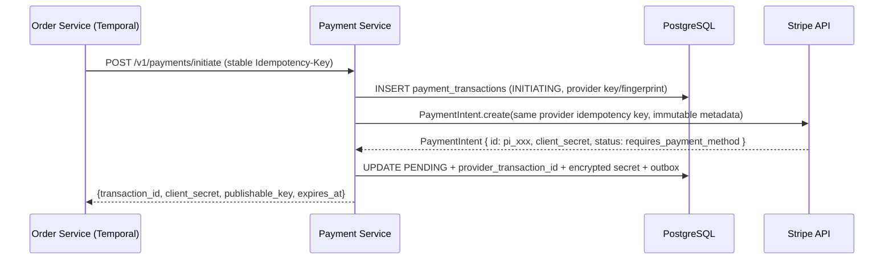
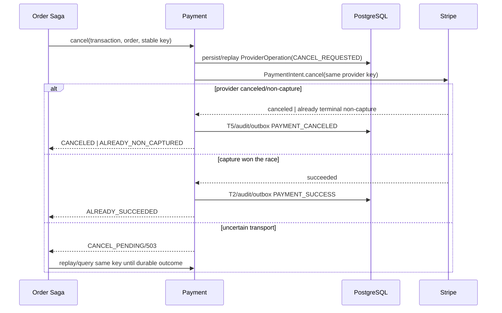

# Payment Service — Luồng nghiệp vụ

> Các luồng dưới đây bảo toàn happy path, idempotency, race, retry và recovery của
> thiết kế cũ (workflow + workers). Mỗi flow ghi rõ thành phần
> `[PostgreSQL]`, `[Redis]`, `[Kafka]`, `[FSM]`, `[Stripe API]` khi cần.

## Danh mục luồng nghiệp vụ

| ID | Workflow | Trigger | Tác nhân | Trạng thái |
|---|---|---|---|---|
| `WF-PAYMENT-001` | Khởi tạo thanh toán | HTTP/gRPC | Order (`InitiatePaymentActivity`) | proposed |
| `WF-PAYMENT-002` | Nhận và xử lý webhook Stripe | HTTPS + Kafka | Stripe, Webhook Processor | proposed |
| `WF-PAYMENT-003` | Tra cứu trạng thái thanh toán | HTTP | Client/Order | proposed |
| `WF-PAYMENT-004` | Khởi tạo hoàn tiền và chốt kết quả | HTTP/gRPC + webhook | Order (`OrderRefundWorkflow`) | proposed |
| `WF-PAYMENT-005` | Hết hạn phiên thanh toán | Schedule 1–2 phút | Expiration Scanner | proposed |
| `WF-PAYMENT-006` | Đối soát với Stripe | Schedule hourly | Reconciliation Worker | proposed |
| `WF-PAYMENT-007` | Poll trạng thái refund | Schedule 5–15 phút | Refund Status Poller | proposed |
| `WF-PAYMENT-008` | Đối soát notification `ORDER_CANCELLED` | Kafka | `payment-order-consumer` | proposed |
| `WF-PAYMENT-011` | Hủy payment trước capture | HTTP/gRPC + provider recovery | Order (`CancelPaymentActivity`), Stripe | proposed |
| `WF-PAYMENT-009` | Webhook auto-retry và DLQ replay | Schedule/manual | Auto-Retry Worker, Ops | proposed |
| `WF-PAYMENT-010` | Archive dữ liệu cũ và tiered read | Schedule weekly + HTTP | Archival CronJob, CSKH | proposed |

## WF-PAYMENT-001 — Khởi tạo thanh toán

**Mục tiêu:** tạo payment transaction và Stripe PaymentIntent để frontend thanh
toán qua Stripe Elements/Checkout SDK. **Trigger:** `POST /v1/payments/initiate`
từ Order Service Temporal Activity `InitiatePaymentActivity`. **Input:**
`order_id`, `amount`, `currency`, `return_url?`, `metadata{user_id, description}`.



**Happy path:**

1. Order supplies one stable `Idempotency-Key`. `[PostgreSQL]` atomically creates
   `payment_transactions` in `INITIATING` plus `ProviderOperation(CREATE)` with the
   canonical request fingerprint, provider idempotency key, immutable internal
   transaction ID and Order metadata. Redis/lock is an optimisation only.
2. `[Stripe API]` calls `PaymentIntent.create` using that exact provider key and
   immutable metadata (`payment_transaction_id`, `order_id`, `user_id`, amount,
   currency). It never generates a second provider key on retry.
3. A response, idempotent replay, or reconciliation lookup must prove one provider
   PaymentIntent. `[PostgreSQL]` then atomically records `pi_xxx`, encrypted
   `client_secret`, `PENDING`, audit and `PAYMENT_INITIATED` outbox event.
4. Only this recovered durable result returns `transaction_id`, `client_secret`,
   `publishable_key`, `expires_at`. `INITIATING` returns a retryable/pending command
   result, never an invented client secret.

**State/data changes:** first an `INITIATING` create-operation record; only after
one provider intent is proven, one `PENDING` transaction plus outbox row.
**Events:** `PAYMENT_INITIATED` (Analytics). **Output:** dữ liệu để frontend khởi
tạo Stripe Elements; không redirect ra URL ngoài.

**Idempotency:** DB `payment_idempotency`/`ProviderOperation` is authoritative;
the same Order key and fingerprint returns the same local/provider result. Redis
`SETNX` and distributed lock only reduce concurrent calls. A changed fingerprint is
rejected. An expiry may never overwrite a still-unresolved create operation or
silently mint a different payment identity.

**Failure/timeout/retry:** a Stripe timeout after request dispatch leaves
`INITIATING`, not an empty `PENDING`. Retry replays the same provider idempotency
key. If the provider response still cannot be recovered, Reconciliation searches
the immutable metadata and binds exactly one intent; zero/multiple candidates stay
in a manual/reconciliation queue. The Expiration Scanner does not expire
`INITIATING`; it may expire only a proven non-successful provider intent after a
fresh provider read. Lock loss cannot create another provider operation.

**Test scenarios:** happy path; replay trong phiên còn hiệu lực; replay sau
`EXPIRED`; Redis unavailable fallback DB; Stripe timeout; hai request đồng thời
cùng `order_id`.

## WF-PAYMENT-002 — Nhận và xử lý webhook Stripe

**Mục tiêu:** ghi nhận kết quả thanh toán/hoàn tiền từ Stripe mà không mất, không
trùng, không sai thứ tự. **Trigger:** Stripe gọi `POST /v1/payments/webhook/stripe`
sau khi user thanh toán/hủy.

**Happy path:**

1. `[API]` Nhận raw body + headers; trả `200 OK` ngay (< 500ms), không xử lý logic.
2. `[Kafka]` Produce lên `t.payment.webhooks.raw`, key `STRIPE:` + `stripe_event_id`,
   value `{provider, stripe_event_id, raw_body, stripe_signature, received_at}`.
3. `[Worker]` Webhook Processor consume; verify `Stripe-Signature`
   (HMAC-SHA256 với `whsec_...`, `|now - t| <= 300s`); thất bại → ghi
   `webhook_logs.status = FAILED_SIGNATURE`, không parse business payload.
4. Parse payload; map Stripe event → transition (`payment_intent.succeeded` → T2,
   `payment_intent.payment_failed` → T3, `payment_intent.canceled` → T5,
   `charge.refunded` → R2); guard amount/reference.
5. `[PostgreSQL]` `INSERT INTO webhook_logs ... ON CONFLICT (provider,
   provider_transaction_id, event_type) DO NOTHING`; 0 rows → đã xử lý → ack. Bổ
   sung check `stripe_event_id` để dedup cross-attempt.
6. Cùng một ACID transaction: `UPDATE payment_transactions` (optimistic lock
   `version`) + `INSERT payment_status_history` + `INSERT outbox_events`.

**Events:** `PAYMENT_SUCCESS`, `PAYMENT_FAILED`, `REFUND_SUCCESS`,
`REFUND_REVERSED` tùy transition. **Output:** state cuối trong DB; Order nhận qua
Kafka.

**Vì sao không xử lý đồng bộ:** Stripe retry nếu response > 5s (3–5 lần,
exponential backoff) → duplicate; DB down lúc webhook đến → mất event vĩnh viễn;
Kafka at-least-once + worker idempotent → không mất, không trùng
([ADR-004](./decisions/ADR-004-async-webhook-processing-via-kafka.md)).

**Failure/retry:** lỗi tạm thời (lock DB, Stripe API timeout) → retry theo
consumer/requeue có exponential backoff; không lấy được Redis lock → reject và đẩy
retry cycle/DLQ. `FAILED_SIGNATURE`/`UNPROCESSED` được Auto-Retry Worker xử lý lại
(`WF-PAYMENT-009`).

**Race/out-of-order:** webhook cho cùng transaction có thể đến trước/sau nhau;
optimistic lock ngăn ghi đè, state precedence không cho override ngược terminal
hợp lệ. Race giữa frontend và webhook được chặn bằng distributed lock theo
`payment_transaction_id`.

**Test scenarios:** signature sai; timestamp ngoài 300s; duplicate `evt_xxx`;
`succeeded` sau `canceled`; `pi_xxx` không map được; amount lệch; DB lock
conflict rồi requeue; endpoint trả 200 khi Kafka chậm.

## WF-PAYMENT-003 — Tra cứu trạng thái thanh toán

**Mục tiêu:** client polling hoặc Order verify trạng thái. **Trigger:**
`GET /v1/payments/{transactionId}`.

**Happy path:** `[PostgreSQL]` `SELECT pt.*, array_agg(rt.*) FROM
payment_transactions pt LEFT JOIN refund_transactions rt ON
rt.payment_transaction_id = pt.id WHERE pt.id = :transactionId`; trả `200` với
transaction detail + refunds. Read-only, không phát event.

**Tiered read:** với giao dịch > 6 tháng đã archive, xem `WF-PAYMENT-010`.

**Test scenarios:** transaction có/không refund; không tồn tại; dữ liệu đã archive.

## WF-PAYMENT-004 — Khởi tạo hoàn tiền và chốt kết quả

**Mục tiêu:** thực thi một refund transaction trọn đời cho order đã thanh toán,
không vượt paid amount. **Trigger:** `POST /v1/payments/{transactionId}/refund` từ
`OrderRefundWorkflow` sau Inventory evidence: Buyer selected scope fully final-inspected
(PASS/FAIL đều complete), hoặc Admin full-order committed allocation đã release atomically
before dispatch.

**Preconditions:** header `Idempotency-Key`; payment `SUCCESS`;
no `refund_transactions.order_id` exists with a different idempotency identity;
`amount <= paid_amount`; request là explicit command từ Order (không suy luận từ
shipping event). Inspection quality `FAIL` does not reject payout.

```mermaid
sequenceDiagram
    participant OS as Order Service
    participant PS as Payment Service
    participant DB as PostgreSQL
    participant ST as Stripe API

    OS->>PS: POST /v1/payments/{txn_id}/refund {amount, reason, Idempotency-Key}
    PS->>PS: Idempotency Check (Redis SETNX hoặc DB Unique Check)
    PS->>DB: Idempotency Key exist? -> trả data cũ nếu có
    PS->>DB: Validate txn.status = SUCCESS
    PS->>DB: Validate no refund exists for order; amount <= paid_amount
    PS->>DB: INSERT refund_transactions (PENDING) kèm idempotency_key
    PS->>PS: Acquire Distributed Lock Redis
    PS->>ST: Refund.create(payment_intent, amount, reason, Idempotency-Key)
    ST-->>PS: refund { id: re_xxx, status: succeeded | pending }
    PS->>DB: UPDATE refund_transactions (PROCESSING | SUCCESS)
    PS->>DB: UPDATE payment_transactions (REFUNDING | REFUNDED)
    PS->>DB: INSERT outbox_events (REFUND_INITIATED)
    PS-->>OS: {refund_txn_id, status: PROCESSING}
```

**Happy path:**

1. Check `Idempotency-Key` trên Redis và DB `refund_transactions`: trùng key → trả
   cùng kết quả cũ, không gọi Stripe; đang `PROCESSING` → trả processing.
2. Validate trạng thái, one-lifetime order uniqueness và amount (`400/409` nếu vi phạm).
3. `[PostgreSQL]` Transaction: `INSERT refund_transactions (PENDING,
   idempotency_key)`; `UPDATE payment_transactions SET status='REFUNDING',
   version=version+1 WHERE id=:txn_id AND version=:expected_version`;
   `INSERT outbox_events (REFUND_INITIATED)`; `INSERT payment_status_history`.
4. `[Redis]` Acquire `lock:payment:refund_call:{txn_id}` (chặn retry loop).
5. `[Stripe API]` `Refund.create` qua `RefundClient` với `payment_intent=pi_xxx`,
   `amount`, `reason=REQUESTED_BY_CUSTOMER`, metadata `order_id`/`refund_request_id`,
   `RequestOptions.setIdempotencyKey(idempotencyKey)`; lưu `re_xxx`.
6. Cập nhật refund `PROCESSING` (hoặc `SUCCESS` nếu Stripe trả `succeeded`), phát
   `REFUND_PROCESSING`; trả `{refund_txn_id, status: PROCESSING}`.
7. Finalization bất đồng bộ: webhook `charge.refunded` → `R2`/`T7` và
   `REFUND_SUCCESS`; `status=failed` → reversal (`T9`, `REFUND_REVERSED`,
   `requires_manual_review`); Refund Status Poller là safety net khi webhook miss.

**Chuẩn hóa lifecycle:** Accepted != Final; finalization từ webhook hoặc
poller/reconcile; duplicate-safe; chấp nhận failure-after-accept (`R3`, `T8`,
manual review); Stripe reversal qua `charge.refunded` `status=failed`.

**Failure/timeout/retry:** Stripe timeout sau khi đã commit `PENDING`/`REFUNDING`
→ refund row còn `PENDING`, lock hết hạn sau 15–30s; Order retry với cùng
`Idempotency-Key` → trả kết quả cũ/processing; Stripe idempotency key đảm bảo
không tạo refund kép. Provider reject sớm → `R4` `FAILED`. Không lấy được lock →
reject, không gọi Stripe.

**Race:** hai request refund khác key cho cùng order → insert under unique
`refund_transactions.order_id` + optimistic lock; chỉ một request thắng transition
`T6`, request kia gets `ORDER_REFUND_ALREADY_EXISTS`. Retry with the same key returns
the original transaction.

**Test scenarios:** selected-line gross amount/cap supplied by Order; Admin
pre-dispatch release evidence; mixed inspection PASS/FAIL accepted; second key/order
rejected; payment không `SUCCESS`; thiếu `Idempotency-Key`; replay cùng key; Stripe
`succeeded` ngay vs `pending`; webhook miss + poller chốt; reversal sau `REFUNDED`;
Redis sập fallback unique `idempotency_key` + `order_id`.

## WF-PAYMENT-005 — Hết hạn phiên thanh toán

**Mục tiêu:** đưa transaction quá hạn về `EXPIRED`, tránh treo phiên. **Trigger:**
Payment Expiration Scanner chạy mỗi 1–2 phút, batch theo partition hiện tại.

**Happy path:** quét `payment_transactions` `status IN (PENDING, PROCESSING)` và
`expires_at <= NOW()`; validate lại với Stripe (`PaymentIntent.retrieve`) nếu cần
để tránh false expire khi webhook đến trễ; áp `T4` → `EXPIRED`; ghi
`payment_status_history` + outbox `PAYMENT_EXPIRED`.

**Events:** `PAYMENT_EXPIRED` → Order cancel. **Race:** webhook `succeeded` đến
đúng lúc scanner chạy → optimistic lock `version` quyết định; nếu Stripe đã
`succeeded`, scanner không expire. Scanner nhiều instance dùng distributed lock
(`lock:payment:{action}:{txn_id}`).

**Test scenarios:** hết hạn đúng giờ; webhook trễ đến trước/sau scanner; hai
instance scanner đồng thời; Stripe retrieve timeout.

## WF-PAYMENT-006 — Đối soát với Stripe

**Mục tiêu:** phát hiện và sửa sai lệch DB nội bộ ↔ Stripe. **Trigger:**
Reconciliation Worker hourly (Spring `@Scheduled` + Spring Retry).

**Happy path:** lấy tập giao dịch theo cửa sổ thời gian; gọi
`BalanceTransaction.list` / `PaymentIntent.list`; so khớp amount/currency/status;
ghi mismatch report; với mismatch hợp lệ tạo correction transition + outbox event.

**Output:** báo cáo mismatch theo ngày; danh sách case xử lý thủ công; chỉ số
drift rate. Reconciliation có quyền phát transition bù để đưa hệ thống về trạng
thái đúng; nếu provider không hỗ trợ reversal callback, reversal được phát hiện ở
đây.

**Recovery:** mismatch tăng đột biến → freeze auto-correction cho event type liên
quan, mở review thủ công đến khi xác định root cause.

**Test scenarios:** không lệch; lệch status; lệch amount; Stripe API lỗi/retry;
correction transition idempotent khi chạy lại cùng cửa sổ.

## WF-PAYMENT-007 — Poll trạng thái refund

**Mục tiêu:** chốt trạng thái cuối cho refund `PROCESSING` khi webhook miss
(network blip khi Stripe retry, Stripe API outage). **Trigger:** Refund Status
Poller mỗi 5–15 phút tùy Stripe SLA (refund settle từ vài giây đến vài ngày tùy
issuing bank), retry với jitter chống thundering herd.

**Happy path:** quét `refund_transactions` `status = PROCESSING` và `updated_at`
> 1 phút; acquire `lock:payment:refund_poll:{refund_transaction_id}`;
`Refund.retrieve(re_xxx)`:

- `succeeded` → `PROCESSING -> SUCCESS`, payment `REFUNDING -> REFUNDED`, emit
  `REFUND_SUCCESS`.
- `failed` → `PROCESSING -> FAILED`, payment `REFUNDING -> SUCCESS` (theo mô tả
  poller; bảng FSM `T8` ghi `-> FAILED` — mâu thuẫn chưa chốt, xem `README.md` §9),
  emit `REFUND_FAILED`.
- reversed (account invalid) → audit + emit `REFUND_REVERSED` + manual queue.

**Race:** poller và webhook `charge.refunded` cùng lúc → optimistic lock + dedup;
kết quả idempotent. **Test scenarios:** webhook đến trước poller; poller chốt khi
webhook miss; lock không lấy được; Stripe retrieve timeout.

## WF-PAYMENT-008 — Đối soát notification `ORDER_CANCELLED`

**Mục tiêu:** `ORDER_CANCELLED` là notification sau khi Payment đã trả một
non-capture outcome; nó không còn là lệnh hủy tiền. **Trigger:** `ORDER_CANCELLED`
trên `t.order.events`, consumer group `payment-order-consumer`.

**Happy path:** durable-inbox dedup theo `event_id`; validate event nói Order đang
`CANCELLING`, đúng `payment_transaction_id` và đúng cancel command. Payment
`CANCELED`/`FAILED`/`EXPIRED` ghi confirmation marker; `SUCCESS` ghi financial
reconciliation marker, tuyệt đối không auto-refund. Nếu Payment vẫn
`PENDING`/`PROCESSING`, consumer chỉ kiểm tra/recover `ProviderOperation(CANCEL)`
cùng key; nó không tự tạo một lệnh hủy mới. Event sai lane/identity không chuyển
FSM và được đưa vào reconciliation.

**Test scenarios:** duplicate event, event trước provider outcome, event sai
transaction/lane, cancel-versus-success race, và `SUCCESS` sau Order notification.

## WF-PAYMENT-011 — Hủy payment trước capture

**Mục tiêu:** cung cấp fact bắt buộc cho Order trước khi nó final-cancel và nhả
Inventory/Promotion. **Trigger:** `POST /v1/payments/{transactionId}/cancel` từ
`CancelPaymentActivity`, với Order cancellation command ID ổn định.



The command is idempotent in Payment's database and at Stripe. It never changes a
captured `SUCCESS` to `CANCELED`; `ALREADY_SUCCEEDED` is a successful resolution of
the race, not a technical failure. A provider timeout is recovered by replaying the
same operation, then provider reconciliation if necessary. The cancel workflow
persists no refund and makes no judgement about Order fulfilment.

## WF-PAYMENT-009 — Webhook auto-retry và DLQ replay

**Auto-retry (CronJob):** quét `webhook_logs` `status IN ('FAILED_SIGNATURE',
'UNPROCESSED')`; kiểm tra `retry_count < max_retries` và backoff; đẩy lại vào
`t.payment.webhooks.raw` với ID giữ nguyên để xử lý lại. Mục đích: cover
`FAILED_SIGNATURE` do sai key/outage và `UNPROCESSED` do lỗi tạm.

**DLQ replay (manual/on-demand):** chọn message theo filter (time range, event
type, `order_id`); re-validate idempotency trước replay; replay theo batch nhỏ có
rate limit; ghi audit replay phục vụ forensic.

**Test scenarios:** retry đến `max_retries`; replay message đã xử lý (phải no-op);
rate limit; audit đầy đủ.

## WF-PAYMENT-010 — Archive dữ liệu cũ và tiered read

**Archival CronJob (Chủ nhật 3:00 AM):** quét partition `payment_transactions`
> 6 tháng tuổi; `pg_dump` partition → S3
`s3://payment-archive/YYYY/MM/payment_transactions_YYYY_MM.sql.gz`; verify
checksum SHA-256; `ALTER TABLE payment_transactions DETACH PARTITION ...`; DROP
chỉ sau khi verify S3 integrity pass; log archive event cho audit
([ADR-009](./decisions/ADR-009-monthly-partitioning-and-tiered-archive.md)).

**Tiered Read API:** CSKH tra cứu giao dịch > 6 tháng: check DB (partition hiện
tại) trước → tìm thấy trả ngay; DB miss → query S3/Athena (hoặc tương đương scan
Parquet/SQL trên S3), chậm ~2–5s nhưng chấp nhận được cho CSKH; response format
giống nhau cho hot và cold data.

**Test scenarios:** checksum mismatch không được drop; job chạy lại an toàn;
truy vấn hot/cold trả cùng format.
