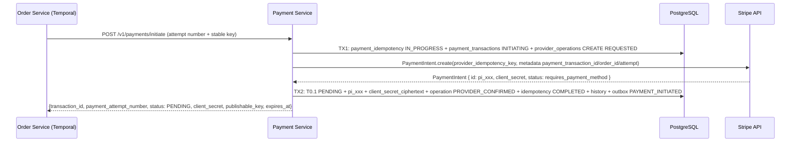

# Payment Service — Luồng nghiệp vụ

> Các luồng dưới đây bảo toàn happy path, idempotency, race, retry và recovery. Mỗi
> flow ghi rõ thành phần `[PostgreSQL]`, `[Redis]`, `[Kafka]`, `[FSM]`, `[Stripe API]`
> khi cần. Transition ID (`T*`, `R*`, `CORR`) theo `domain.md §6`; bảng và cột theo
> `data.md §3`.

## Danh mục luồng nghiệp vụ

| ID | Workflow | Trigger | Tác nhân | Trạng thái |
|---|---|---|---|---|
| `WF-PAYMENT-001` | Khởi tạo thanh toán | HTTP | Order (`InitiatePaymentActivity`) | proposed |
| `WF-PAYMENT-002` | Nhận và xử lý webhook Stripe | HTTPS + Kafka | Stripe, Webhook Processor | proposed |
| `WF-PAYMENT-003` | Tra cứu trạng thái và client data | HTTP | Order | proposed |
| `WF-PAYMENT-004` | Khởi tạo hoàn tiền và chốt kết quả | HTTP + webhook | Order (`OrderRefundWorkflow`) | proposed |
| `WF-PAYMENT-005` | Hết hạn phiên thanh toán | Schedule 1–2 phút | Expiration Scanner | proposed |
| `WF-PAYMENT-006` | Đối soát với Stripe | Schedule hourly | Reconciliation Worker | proposed |
| `WF-PAYMENT-007` | Poll trạng thái refund | Schedule 5–15 phút | Refund Status Poller | proposed |
| `WF-PAYMENT-008` | Recover provider operation | Schedule 30–60s | Provider-operation Recovery Worker | proposed |
| `WF-PAYMENT-009` | Webhook auto-retry và webhook-log replay | Schedule/manual | Auto-Retry Worker, Ops | proposed |
| `WF-PAYMENT-010` | Review case và correction thủ công | Hệ thống mở, CSKH/Kế toán xử lý | Ops | proposed |
| `WF-PAYMENT-011` | Hủy payment trước capture | HTTP + provider recovery | Order (`CancelPaymentActivity`), Stripe | proposed |
| `WF-PAYMENT-012` | Tự chấm dứt attempt sau decline | Webhook | Webhook Processor | proposed |

## WF-PAYMENT-001 — Khởi tạo thanh toán

**Mục tiêu:** tạo payment transaction và Stripe PaymentIntent để frontend thanh toán
qua Stripe Elements. **Trigger:** `POST /v1/payments/initiate` từ
`InitiatePaymentActivity`. **Input:** `order_id`, `payment_attempt_number`,
`amount { amount_minor, currency: VND }`, `user_id`, `return_url?`, header
`Idempotency-Key`.



**Happy path:**

1. `[PostgreSQL]` TX1 (atomic): insert `payment_idempotency (key, INITIATE,
   fingerprint, IN_PROGRESS)`; insert `payment_transactions` `INITIATING` với
   `expires_at = now() + payment_session_ttl`; insert `provider_operations CREATE`
   với `provider_idempotency_key` sinh một lần và `request_fingerprint`. Unique
   `(order_id, payment_attempt_number)` là guard chống double-initiate; Redis SETNX
   chỉ là fast-path.
2. `[Stripe API]` `PaymentIntent.create` với đúng key đó, `amount_minor` nguyên
   (VND zero-decimal), `currency=vnd`, metadata bất biến. Không bao giờ sinh key thứ
   hai khi retry.
3. `[PostgreSQL]` TX2 (atomic): `T0.1` → `PENDING`, ghi `provider_transaction_id`,
   `client_secret_ciphertext`/`client_secret_key_id`/`client_expires_at`, operation
   `PROVIDER_CONFIRMED`, idempotency `COMPLETED` (response **không** chứa secret,
   `resource_id = TXN_…`), history `T0.1`, outbox `PAYMENT_INITIATED`
   (`financial_state_version = 1`).
4. Trả `PENDING` + client data. Nếu request gọi provider nhận outcome chưa rõ, chính
   request đó trả `503 PROVIDER_OUTCOME_UNKNOWN`. Replay sau đó chỉ được trả
   `200 status=INITIATING` khi không còn request giữ execution lock và durable recovery
   đã nhận operation; không bao giờ bịa `client_secret`.

**Idempotency:** cùng key + fingerprint → replay: đọc `payment_idempotency`
`COMPLETED`, giải mã lại secret từ `resource_id` nếu còn `PENDING`/chưa quá
`client_expires_at`; cùng `(action, key)` khác fingerprint →
`422 IDEMPOTENCY_KEY_REUSED`; request đồng thời gặp active execution owner →
`409 REQUEST_IN_PROGRESS`. Attempt mới cần số kế tiếp + key mới và chỉ sau fact
terminal non-capture của attempt trước.

**Failure/timeout/retry:** Stripe timeout sau khi dispatch → operation `UNKNOWN`,
payment ở `INITIATING`, idempotency `IN_PROGRESS`; trả `503 PROVIDER_OUTCOME_UNKNOWN`.
`WF-PAYMENT-008` replay cùng key; nếu vẫn không bind được, tìm intent theo metadata
`payment_transaction_id`; zero/nhiều ứng viên → review case
`PROVIDER_IDENTITY_UNBOUND`. Scanner không expire `INITIATING`.

**Test scenarios:** same-attempt replay; replay `INITIATING` khi recovery đã nhận
operation và không còn active request; concurrent request còn active → `409`; replay sau khi payment đã `SUCCESS` (không
trả secret); new attempt sau `EXPIRED`/`FAILED`/`CANCELED`; reject attempt number
nhảy cóc/tái dùng; fingerprint khác; Redis mất → unique DB; Stripe timeout trước/sau
khi Stripe đã tạo intent; hai request đồng thời cùng attempt.

## WF-PAYMENT-002 — Nhận và xử lý webhook Stripe

**Mục tiêu:** ghi nhận kết quả thanh toán/hoàn tiền từ Stripe mà không mất, không
trùng, không sai thứ tự. **Trigger:** Stripe gọi `POST /v1/payments/webhook/stripe`.

**Happy path:**

1. `[API]` Envelope thiếu body hoặc thiếu `Stripe-Signature` → `400`, không enqueue.
   Nếu đủ envelope, nhận exact raw body bytes + headers; không deserialize/validate
   business payload. Candidate event ID chỉ được đọc best-effort để chọn partition.
2. `[Kafka]` Produce lên `t.payment.webhooks.raw`: key
   `STRIPE:<candidate_event_id>` nếu extraction thành công, nếu không
   `RAW:<sha256(raw_body)>`; value là full structured CloudEvent
   `com.ecommerce.payment.stripe-webhook.received.v1`, trong đó exact body bytes
   nằm ở `data.raw_body_base64` theo internal AsyncAPI. Candidate và body đều chưa
   được tin cậy; producer ack → trả `200 OK` (< 500ms), produce lỗi → `503` để Stripe retry.
3. `[Worker]` Decode base64 về exact bytes rồi verify `Stripe-Signature`
   (`Webhook.constructEvent`, `|now - t| <= 300s`).
   Thất bại → insert `webhook_logs` `FAILED_SIGNATURE` với `stripe_event_id = NULL`,
   `raw_body` nguyên byte, `next_retry_at`; dừng.
4. `[PostgreSQL]` `INSERT webhook_logs (stripe_event_id, event_type, event_created_at,
   provider_object_id, …) ON CONFLICT (stripe_event_id) DO NOTHING`; 0 row → event đã
   được ghi nhận trước đó → ack, không tạo row, không transition.
5. Resolve transaction: `pi_xxx` → `provider_transaction_id`; `ch_xxx` →
   `provider_charge_id`; `re_xxx` → `provider_refund_id`; fallback metadata
   `payment_transaction_id`. Không map được → `IGNORED`. Guard amount/currency; lệch
   → `AMOUNT_MISMATCH` + review case.
6. Map event → transition theo `interfaces.md §4` (`processing` → `T1`;
   `succeeded` → `T2`; `payment_failed` → `T3a` hoặc `WF-PAYMENT-012`; `canceled` →
   `T3`/`T4`/`T5` theo `CANCEL` operation; `charge.refunded` → `R2`+`T7`;
   `charge.refund.updated status=failed` → `R3`+`T8` hoặc `R5`+`T9`; dispute → review
   case). State precedence dùng `event_created_at`.
7. Cùng một ACID transaction: `UPDATE` aggregate (optimistic `version`,
   `financial_state_version++` nếu là financial fact, `provider_status_snapshot`) +
   `INSERT payment_status_history` + `INSERT outbox_events` + review case nếu có +
   `webhook_logs.status = PROCESSED`.

**Events:** `PAYMENT_SUCCESS`, `PAYMENT_FAILED`, `PAYMENT_EXPIRED`, `PAYMENT_CANCELED`,
`REFUND_SUCCESS`, `REFUND_FAILED`, `REFUND_REVERSED` tùy transition. `T1`/`T3a` không
phát event.

**Vì sao không xử lý đồng bộ:** Stripe retry nếu response > 5s (3–5 lần, exponential
backoff) → duplicate; DB down lúc webhook đến → mất event vĩnh viễn; Kafka
at-least-once + worker idempotent → không mất, không trùng
([ADR-004](./decisions/ADR-004-async-webhook-processing-via-kafka.md)).

**Failure/retry:** lỗi tạm (optimistic conflict, lock, DB) → `webhook_logs.status =
FAILED_PROCESSING`, `next_retry_at` backoff, `WF-PAYMENT-009` đẩy lại; không lấy được
Redis lock → cùng đường. Hết retry với event tài chính → review case
`WEBHOOK_RETRY_EXHAUSTED`.

**Race/out-of-order:** `succeeded` đến sau khi payment đã `FAILED`/`EXPIRED`/`CANCELED`
(về lý thuyết không xảy ra vì intent đã canceled — `INV-PAY-010`) → không ghi đè, mở
review case `CAPTURE_AFTER_CANCEL`. `payment_failed` đến sau `succeeded` → `IGNORED`
theo precedence.

**Test scenarios:** thiếu body/`Stripe-Signature` → `400`; body không deserialize được
nhưng envelope đủ → endpoint vẫn enqueue với key hash và trả `200`; signature sai
nhưng envelope hợp lệ → endpoint `200`, worker ghi `FAILED_SIGNATURE`; timestamp ngoài 300s;
duplicate `evt_xxx`; hai
`payment_failed` liên tiếp cùng intent rồi `succeeded`; `succeeded` sau `canceled`;
`pi_xxx` không map được; amount lệch; optimistic conflict rồi retry; `charge.refund.updated`
cho refund `PROCESSING` và cho refund `SUCCESS`; endpoint trả 200 khi Kafka chậm.

## WF-PAYMENT-003 — Tra cứu trạng thái và client data

**Mục tiêu:** Order verify trạng thái trước recovery/retry, và lấy client data để
relay cho buyer. Buyer/CSKH không gọi Payment trực tiếp.

**`GET /v1/payments/{transactionId}`:** `[PostgreSQL]` `SELECT pt.*, rt.* FROM
payment_transactions pt LEFT JOIN refund_transactions rt ON rt.payment_transaction_id
= pt.id WHERE pt.id = :id`; trả `200` với transaction + refund (nếu có), **không**
chứa client data. Read-only, không phát event.

**`GET /v1/payments/{transactionId}/client-data`:** đọc row; nếu `status = PENDING`
và `now() < client_expires_at` → giải mã `client_secret_ciphertext` bằng
`client_secret_key_id`, trả `usable=true` + secret + `publishable_key` (config);
ngược lại `usable=false`, `client_secret=null` (`200`). Không có cold read — mọi
transaction đều trong một schema ([ADR-013](./decisions/ADR-013-single-oltp-retention-no-partition.md)).

**Test scenarios:** transaction có/không refund; không tồn tại; client-data khi
`PENDING` còn hạn / quá hạn / đã `SUCCESS`; key rotation (`key_id` cũ vẫn giải mã được).

## WF-PAYMENT-004 — Khởi tạo hoàn tiền và chốt kết quả

**Mục tiêu:** thực thi một refund transaction trọn đời cho order đã thanh toán, không
vượt paid amount. **Trigger:** `POST /v1/payments/{transactionId}/refund` từ
`OrderRefundWorkflow` sau Inventory evidence
([ADR-011](./decisions/ADR-011-one-lifetime-order-refund.md)).

**Preconditions:** header `Idempotency-Key`; payment `SUCCESS`; chưa có
`refund_transactions.order_id`; `0 < amount <= amount_minor`; reason và
`inventory_evidence` khớp một trong hai schema ở `interfaces.md §2.7`.
Inspection quality `FAIL` không phải lý do reject.

```mermaid
sequenceDiagram
    participant OS as Order Service
    participant PS as Payment Service
    participant DB as PostgreSQL
    participant ST as Stripe API

    OS->>PS: POST /v1/payments/{txn}/refund {amount, reason, refund_request_id, inventory_evidence} + Idempotency-Key
    PS->>DB: payment_idempotency (REFUND) hit? -> trả response cũ
    PS->>DB: TX1: validate SUCCESS / unique order / amount; INSERT refund_transactions PENDING; T6 REFUNDING; provider_operations REFUND REQUESTED; history; outbox REFUND_INITIATED
    PS->>ST: Refund.create(payment_intent=pi_xxx, amount, reason=requested_by_customer, idempotencyKey)
    ST-->>PS: refund { id: re_xxx, status: succeeded | pending }
    PS->>DB: TX2: R1 PROCESSING (+ R2/T7 nếu succeeded); operation PROVIDER_CONFIRMED; idempotency COMPLETED; history; outbox REFUND_PROCESSING (+ REFUND_SUCCESS)
    PS-->>OS: {refund_transaction_id, payment_transaction_id, status: PROCESSING}
```

**Happy path:**

1. `payment_idempotency (key, REFUND)`: `COMPLETED` → trả response cũ; `IN_PROGRESS`
   → `409 REQUEST_IN_PROGRESS`; fingerprint khác → `422`.
2. `[PostgreSQL]` TX1: validate `RULE-PAY-003/004/006`; insert `refund_transactions`
   `PENDING` (unique `order_id`/`refund_request_id`/`command_idempotency_key` là
   guard đồng thời cuối); `T6` payment `REFUNDING`; insert `provider_operations REFUND`
   với `provider_idempotency_key = Idempotency-Key` của Order; history; outbox
   `REFUND_INITIATED`.
3. `[Redis]` `payment:lock:{payment_transaction_id}` (giảm đồng thời; không phải quyền).
4. `[Stripe API]` `Refund.create` với `payment_intent=pi_xxx`, `amount`,
   `reason=requested_by_customer`, metadata `order_id`/`refund_request_id`,
   `RequestOptions.setIdempotencyKey`.
5. `[PostgreSQL]` TX2: `R1` `PROCESSING` + `accepted_at` + `provider_refund_id`;
   nếu Stripe trả `succeeded` ngay → thêm `R2` + `T7` trong cùng TX (hai history, hai
   financial fact `REFUND_PROCESSING` rồi `REFUND_SUCCESS`); operation
   `PROVIDER_CONFIRMED`; idempotency `COMPLETED`.
6. Trả `{refund_transaction_id, payment_transaction_id, status: PROCESSING}`
   (Accepted != Final — kể cả khi đã success nội bộ, Order chốt qua event).
7. Finalization bất đồng bộ: `charge.refunded` → `R2`/`T7`; `charge.refund.updated
   status=failed` → `R3`/`T8` (`REFUND_FAILED`, review case) hoặc — nếu đã `SUCCESS` —
   `R5`/`T9` (`REFUND_REVERSED`, review case); Refund Status Poller là safety net khi
   webhook miss.

**Failure/timeout/retry:** Stripe timeout sau TX1 → operation `UNKNOWN`, refund
`PENDING`, trả `503 retryable`; `WF-PAYMENT-008` replay cùng key (Stripe idempotency
đảm bảo không tạo refund kép). Stripe reject sớm → operation `PROVIDER_REJECTED`,
`R4` `FAILED` + `T8`, `REFUND_FAILED`; command đã durably accepted nên HTTP vẫn trả
response lưu `PROCESSING`, còn event/GET là authority cho trạng thái final. Không lấy
được lock → reject, không gọi Stripe.

**Race:** hai request khác key cho cùng order → chỉ một insert thắng unique
`order_id`, request kia `409 ORDER_REFUND_ALREADY_EXISTS`.

**Test scenarios:** selected-line và admin pre-dispatch evidence; mixed PASS/FAIL;
second key/order rejected; payment không `SUCCESS`; thiếu key; replay cùng key;
`succeeded` ngay vs `pending`; webhook miss + poller chốt; reversal sau `REFUNDED`;
Redis mất → unique DB; timeout rồi recovery bind `re_xxx`.

## WF-PAYMENT-005 — Hết hạn phiên thanh toán

**Mục tiêu:** đưa transaction quá hạn về `EXPIRED` **chỉ sau khi** PaymentIntent
đã bị hủy, để không có capture muộn ([ADR-014](./decisions/ADR-014-decline-non-terminal-and-canceled-intent-before-non-capture-terminal.md)).
**Trigger:** Expiration Scanner mỗi 1–2 phút.

**Happy path:**

1. `[PostgreSQL]` Quét `payment_transactions WHERE status = 'PENDING' AND expires_at <=
   now()` (partial index), batch nhỏ, `SKIP LOCKED`.
2. Với mỗi row: TX1 insert `provider_operations CANCEL` (`reason = SESSION_EXPIRED`,
   key ổn định `cancel:{payment_transaction_id}`) — partial unique một `CANCEL`/payment
   nên nếu Order đã cancel song song thì reuse operation đó.
3. `[Stripe API]` `PaymentIntent.cancel(pi_xxx, cancellation_reason=abandoned)`.
4. TX2 theo kết quả: `canceled` → `T4` `EXPIRED`, xóa client secret, history, outbox
   `PAYMENT_EXPIRED`; `succeeded` (buyer xác nhận đúng lúc) → `T2` `SUCCESS` +
   `PAYMENT_SUCCESS`; intent `processing` → không cancel được, giữ nguyên, thử lại
   lần quét sau; timeout → operation `UNKNOWN` → `WF-PAYMENT-008`.

**Không quét:** `INITIATING` (recovery lo), `PROCESSING` (Stripe đang xử lý, không
cancel được; kết quả đến qua webhook).

**Race:** webhook `succeeded` đến giữa TX1 và cancel → Stripe trả lỗi
"already succeeded" hoặc `succeeded` → `T2`; optimistic `version` bảo vệ ghi đè.
Nhiều instance scanner dùng `payment:lock:{payment_transaction_id}` + `SKIP LOCKED`.

**Test scenarios:** hết hạn đúng giờ; cancel trả `succeeded`; intent `processing`;
hai instance đồng thời; Stripe timeout rồi recovery; `payment_intent.canceled` webhook
đến sau khi đã `EXPIRED` (no-op).

## WF-PAYMENT-006 — Đối soát với Stripe

**Mục tiêu:** phát hiện và sửa sai lệch DB ↔ Stripe. **Trigger:** Reconciliation
Worker hourly, singleton (`payment:lock:reconciliation`).

**Happy path:**

1. Insert `reconciliation_runs` (`RUNNING`, cửa sổ `[last_window_to, now - 5 phút)`,
   `auto_correction_frozen` copy từ cấu hình vận hành).
2. Tập đối soát: payment `updated_at` trong cửa sổ hoặc còn `PENDING`/`PROCESSING`/
   `REFUNDING`; refund `PROCESSING`/`SUCCESS` trong cửa sổ; operation `UNKNOWN` quá
   hạn recovery.
3. `[Stripe API]` `PaymentIntent.retrieve`/`Refund.retrieve` (hoặc `list` theo
   metadata) → cập nhật `provider_status_snapshot`/`provider_synced_at`.
4. So khớp status/amount. Khớp → không làm gì. Lệch:
   - Không freeze và transition đích hợp lệ → `CORR` (history `triggered_by =
     RECONCILIATION`, `cause_ref = run id`) + outbox event tương ứng; `corrected_count++`.
   - Freeze, hoặc lệch amount, hoặc đích không hợp lệ → review case
     `RECONCILIATION_DRIFT` với `evidence`; `review_opened_count++`.
   - Refund `SUCCESS` nhưng Stripe `failed` → `CORR` tương đương `R5`/`T9`.
5. Update run `COMPLETED` với counters. Lỗi → `FAILED` + `error_message`.

**Recovery:** drift tăng đột biến → vận hành bật `auto_correction_frozen`; run sau chỉ
mở review case. `CORR` idempotent: chạy lại cùng cửa sổ không phát event thứ hai
(state đã khớp).

**Test scenarios:** không lệch; lệch status; lệch amount; freeze; Stripe API lỗi;
chạy lại cùng cửa sổ; reversal phát hiện bởi reconciliation khi webhook miss.

## WF-PAYMENT-007 — Poll trạng thái refund

**Mục tiêu:** chốt refund `PROCESSING` khi webhook miss. **Trigger:** Refund Status
Poller mỗi 5–15 phút, jitter.

**Happy path:** quét `refund_transactions WHERE status = 'PROCESSING' AND updated_at <
now() - 1 phút` (partial index); `payment:lock:{payment_transaction_id}`;
`Refund.retrieve(re_xxx)`:

- `succeeded` → `R2` + `T7`, `REFUND_SUCCESS`.
- `failed` → `R3` + `T8`, `provider_failure_reason`, review case
  `REFUND_FAILED_AFTER_ACCEPT`, `REFUND_FAILED`.
- `pending` → chỉ cập nhật `provider_synced_at`.

Poller **không** phát hiện reversal (chỉ quét `PROCESSING`); reversal do webhook hoặc
`WF-PAYMENT-006`.

**Race:** poller và webhook cùng lúc → optimistic lock + state precedence; kết quả
idempotent. **Test scenarios:** webhook đến trước poller; poller chốt khi webhook
miss; lock không lấy được; Stripe timeout.

## WF-PAYMENT-008 — Recover provider operation

**Mục tiêu:** không side effect Stripe nào bị bỏ rơi sau timeout/crash
([ADR-012](./decisions/ADR-012-recoverable-initiation-and-cancel.md)).
**Trigger:** Recovery Worker mỗi 30–60s.

**Happy path:** quét `provider_operations WHERE status IN ('REQUESTED','UNKNOWN') AND
next_retry_at <= now()`; với mỗi operation:

1. Replay đúng call (`PaymentIntent.create`/`cancel`/`Refund.create`) với cùng
   `provider_idempotency_key`; Stripe trả lại object cũ nếu đã tạo.
2. Bind kết quả: `provider_object_id`, `PROVIDER_CONFIRMED`/`PROVIDER_REJECTED`, và áp
   transition tương ứng (`T0.1`, `T2`/`T3`/`T4`/`T5`, `R1`/`R4`) trong cùng TX như
   đường đồng bộ.
3. Không bind được (Stripe không nhận key, hoặc trả lỗi không rõ) → tìm theo
   metadata `payment_transaction_id`/`refund_request_id`; đúng một → bind; khác →
   `MANUAL_REVIEW_REQUIRED` + review case `PROVIDER_IDENTITY_UNBOUND`.
4. `attempt_count++`, `next_retry_at` backoff (30s → 5 phút, tối đa `max_attempts`).

**Test scenarios:** create timeout trước/sau Stripe tạo intent; cancel timeout;
refund timeout; key bị Stripe từ chối vì payload khác (fingerprint drift → review);
nhiều ứng viên metadata.

## WF-PAYMENT-009 — Webhook auto-retry và webhook-log replay

**Auto-retry (CronJob):** quét `webhook_logs WHERE status IN ('FAILED_SIGNATURE',
'UNPROCESSED', 'FAILED_PROCESSING') AND next_retry_at <= now()`; `retry_count <
max_retries`; `FAILED_SIGNATURE` re-verify `raw_body` bằng `whsec_` hiện hành (cover
đổi secret); đẩy lại vào `t.payment.webhooks.raw` để `WF-PAYMENT-002` xử lý; hết
retry với event tài chính → review case `WEBHOOK_RETRY_EXHAUSTED`.

**Webhook-log replay (manual/on-demand, không phải Kafka DLQ):** chọn durable row
trong `webhook_logs` theo filter (time range, event type,
`order_id`); re-validate idempotency (dedup `stripe_event_id` vẫn áp dụng); batch nhỏ
có rate limit; history `triggered_by = MANUAL` với `actor`.

**Test scenarios:** retry đến `max_retries`; replay message đã xử lý (no-op); đổi
secret rồi re-verify pass; rate limit; audit đầy đủ.

## WF-PAYMENT-010 — Review case và correction thủ công

**Mục tiêu:** mọi tình huống hệ thống không được tự quyết có một case durable, có
chủ, có kết luận. **Trigger:** hệ thống mở (`WEBHOOK`/`SCHEDULER`/`RECONCILIATION`/
`API`); CSKH/Kế toán xử lý.

**Mở case:** insert `payment_review_cases` (`OPEN`, `reason_code`, `evidence` snapshot)
+ set `payment_transactions.requires_manual_review = TRUE` trong cùng TX với transition
gây ra (`T8`, `T9`, `CAPTURE_AFTER_CANCEL`, `AMOUNT_MISMATCH`,
`PROVIDER_IDENTITY_UNBOUND`, `WEBHOOK_RETRY_EXHAUSTED`, `RECONCILIATION_DRIFT`,
`DISPUTE_OPENED`). Partial unique: một case mở/payment; sự kiện mới append vào
`evidence`.

**Xử lý:** `IN_PROGRESS` + `assigned_to`. Người xử lý đối chiếu Stripe Dashboard,
`payment_status_history`, `webhook_logs.raw_body`.

**Đóng:** `RESOLVED`/`ESCALATED` với `resolution_type` bắt buộc:

- `CORRECTION_APPLIED`: phát transition thủ công hợp lệ theo bảng FSM (history
  `triggered_by = MANUAL`, `actor`, `cause_ref = case id`) + outbox event.
- `MANUAL_REFUND_OUTSIDE_SYSTEM`: hoàn tiền tay (chuyển khoản/voucher) cho
  `REFUND_FAILED_AFTER_ACCEPT`/`REFUND_REVERSED`; hệ thống **không** tạo refund thứ hai.
- `NO_ACTION_NEEDED`; `ESCALATED_TO_ORDER`; `ESCALATED_TO_ACCOUNTING`.

Cùng TX clear `requires_manual_review` nếu không còn case mở.

**Test scenarios:** mở case trùng cho cùng payment (append evidence); đóng thiếu
resolution (reject); correction sai transition (reject `INVALID_TRANSITION`); audit
`actor`.

## WF-PAYMENT-011 — Hủy payment trước capture

**Mục tiêu:** cung cấp fact bắt buộc cho Order trước khi nó final-cancel và nhả
Inventory/Promotion. **Trigger:** `POST /v1/payments/{transactionId}/cancel` từ
`CancelPaymentActivity`, header `Idempotency-Key` ổn định.

```mermaid
sequenceDiagram
    participant O as Order Saga
    participant P as Payment
    participant DB as PostgreSQL
    participant S as Stripe

    O->>P: cancel(transaction, order, reason, stable key)
    P->>DB: TX1: payment_idempotency CANCEL IN_PROGRESS; provider_operations CANCEL(ORDER_COMMAND:reason) REQUESTED (reuse nếu đã có)
    P->>S: PaymentIntent.cancel(same provider key)
    alt provider canceled
      S-->>P: canceled
      P->>DB: TX2: T5 CANCELED / history / outbox PAYMENT_CANCELED
      P-->>O: CANCELED
    else đã terminal non-capture trước đó
      P-->>O: ALREADY_NON_CAPTURED
    else capture thắng race
      S-->>P: succeeded
      P->>DB: TX2: T2 SUCCESS / review case CAPTURE_AFTER_CANCEL / outbox PAYMENT_SUCCESS
      P-->>O: ALREADY_SUCCEEDED
    else PROCESSING hoặc transport không rõ
      P-->>O: CANCEL_PENDING / 503
      O->>P: replay cùng key tới khi có fact durable
    end
```

Idempotent trong DB Payment và tại Stripe. Không bao giờ biến `SUCCESS` thành
`CANCELED`; `ALREADY_SUCCEEDED` là kết quả hợp lệ của race. Payment `PROCESSING`
(Stripe đang xử lý payment method bất đồng bộ) không cancel được → `CANCEL_PENDING`
tới khi `succeeded` hoặc `payment_failed` (về `PENDING`, cancel được). Timeout →
operation `UNKNOWN` → `WF-PAYMENT-008`. Cùng cơ chế `CANCEL` operation được dùng bởi
`WF-PAYMENT-005` và `WF-PAYMENT-012`; partial unique một `CANCEL`/payment nên Order
command và scanner không tạo hai operation.

## WF-PAYMENT-012 — Tự chấm dứt attempt sau decline

**Mục tiêu:** decline không làm hỏng UX, nhưng attempt không thể sống mãi với thẻ
bị chặn; và không có terminal non-capture nào khi intent còn sống
([ADR-014](./decisions/ADR-014-decline-non-terminal-and-canceled-intent-before-non-capture-terminal.md)).
**Trigger:** Webhook Processor nhận `payment_intent.payment_failed`.

**Happy path:**

1. Đọc `last_payment_error.decline_code` và `outcome.type`. Ghi `last_error_code`,
   `last_error_message`, `decline_count++`, history `T3a` (`triggered_by = WEBHOOK`,
   không tăng `financial_state_version`, không outbox).
2. Nếu decline retryable và `decline_count <= max_declines_per_attempt` → dừng; payment
   vẫn `PENDING`, buyer tiếp tục trên cùng intent.
3. Nếu non-retryable hoặc quá ngưỡng → cùng TX insert `provider_operations CANCEL`
   (`reason = DECLINED_NON_RETRYABLE`/`DECLINE_LIMIT`, key `cancel:{payment_transaction_id}`;
   reuse nếu đã tồn tại).
4. `[Stripe API]` `PaymentIntent.cancel`. `canceled` → `T3` `FAILED`, `terminal_at`,
   xóa client secret, `PAYMENT_FAILED` với `error_code` chuẩn hóa (`STOLEN_CARD`,
   `DECLINE_LIMIT_EXCEEDED`, …). `succeeded` (buyer vừa thanh toán thành công bằng
   thẻ khác) → `T2` `SUCCESS`. Timeout → `UNKNOWN` → `WF-PAYMENT-008`.

**Test scenarios:** decline retryable rồi succeeded; decline non-retryable → `FAILED`;
decline thứ `max+1` → `FAILED`; cancel trả `succeeded`; `payment_intent.canceled`
webhook đến sau (no-op); `PAYMENT_FAILED` chỉ phát một lần dù webhook retry.
