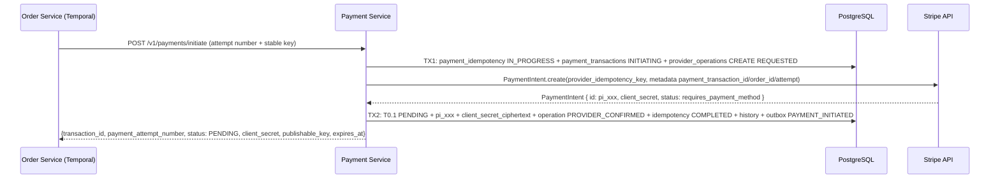

# Payment Service — Luồng nghiệp vụ

> **Đối chiếu runtime 2026-10-11:** xem [phạm vi hiện tại và năng lực chưa triển khai](./runtime-status.md)
> và [ADR-023](./decisions/ADR-023-reconciliation-ownership-and-audit-corrections.md). Các mục tiêu KMS, metric nghiệp vụ,
> heartbeat, health/DR/export và RBAC bên ngoài không phải bằng chứng đã được runtime hiện thực.

> Các luồng dưới đây bảo toàn happy path, idempotency, race, retry và recovery. Mỗi
> flow ghi rõ thành phần `[PostgreSQL]`, `[Redis]`, `[Kafka]`, `[FSM]`, `[Stripe API]`
> khi cần. Transition ID (`T*`, `R*`, `CORR`) theo `domain.md §6`; bảng và cột theo
> `data.md §3`.

## Danh mục luồng nghiệp vụ

| ID | Workflow | Trigger | Tác nhân | Trạng thái |
|---|---|---|---|---|
| `WF-PAYMENT-001` | Khởi tạo thanh toán | HTTP | Order (`InitiatePaymentActivity`) | implemented |
| `WF-PAYMENT-002` | Nhận và xử lý webhook Stripe | HTTPS + Kafka | Stripe, Webhook Processor | implemented |
| `WF-PAYMENT-003` | Tra cứu trạng thái và client data | HTTP | Order | implemented |
| `WF-PAYMENT-004` | Khởi tạo hoàn tiền và chốt kết quả | HTTP + webhook | Order (`OrderRefundWorkflow`) | implemented |
| `WF-PAYMENT-005` | Hết hạn phiên thanh toán | Schedule 1–2 phút | Expiration Scanner | implemented |
| `WF-PAYMENT-006` | Đối soát với Stripe | Schedule hourly | Reconciliation Worker | implemented |
| `WF-PAYMENT-007` | Poll trạng thái refund | Schedule 5–15 phút | Refund Status Poller | implemented |
| `WF-PAYMENT-008` | Recover provider operation | Schedule 30–60s | Provider-operation Recovery Worker | implemented |
| `WF-PAYMENT-009` | Webhook auto-retry và webhook-log replay | Schedule/manual | Auto-Retry Worker, Ops | implemented |
| `WF-PAYMENT-010` | Review case và correction thủ công | Hệ thống mở, CSKH/Kế toán xử lý | Ops | implemented |
| `WF-PAYMENT-011` | Hủy payment trước capture | HTTP + provider recovery | Order (`CancelPaymentActivity`), Stripe | implemented |
| `WF-PAYMENT-012` | Tự chấm dứt attempt sau decline | Webhook | Webhook Processor | implemented |
| `WF-PAYMENT-013` | Quản lý dispute/chargeback | Verified webhook + reconciliation | Dispute Worker, Finance Ops | implemented |
| `WF-PAYMENT-014` | Post subledger và đối soát balance/fee/payout | Transition + schedule | Payment core, Balance Reconciliation Worker | implemented |

## WF-PAYMENT-001 — Khởi tạo thanh toán

**Mục tiêu:** tạo payment transaction và Stripe PaymentIntent để frontend thanh toán
qua Stripe Elements. **Trigger:** `POST /v1/payments/initiate` từ
`InitiatePaymentActivity`. **Input:** `order_id`, `payment_attempt_number`,
`amount { amount_minor, currency: VND }`, `user_id`, `return_url?`, header
`Idempotency-Key`.



**Happy path:**

1. `[PostgreSQL]` TX1 (atomic): insert/claim `payment_idempotency (key, INITIATE,
   fingerprint, IN_PROGRESS, lease_owner/token/expiry)`; insert `payment_transactions` `INITIATING` với
   `expires_at = now() + payment_session_ttl`; insert `provider_operations CREATE`
   với `provider_idempotency_key = pay:create:{transaction_id}` sinh một lần,
   safety horizon 23 giờ và `request_fingerprint`. Unique
   `(order_id, payment_attempt_number)` là guard chống double-initiate. Gate 3 chưa
   dùng Redis fast-path.
2. `[Stripe API]` worker đang giữ đúng DB fencing token gọi
   `PaymentIntent.create` với đúng key đó, `amount_minor` nguyên
   (VND zero-decimal), `currency=vnd`, metadata bất biến. Không bao giờ sinh key thứ
   hai khi retry.
3. `[PostgreSQL]` TX2 (atomic, CAS đúng fencing token): `T0.1` → `PENDING`, ghi `provider_transaction_id`,
   `client_secret_ciphertext`/`client_secret_key_id`/`client_expires_at`, operation
   `PROVIDER_CONFIRMED`, idempotency `COMPLETED` (response **không** chứa secret,
   `resource_id = TXN_…`), history `T0.1`, outbox `PAYMENT_INITIATED`
   (`financial_state_version = 1`).
4. Trả `PENDING` + client data. Nếu request gọi provider nhận outcome chưa rõ, chính
   request đó trả `503 PROVIDER_OUTCOME_UNKNOWN`. Replay sau đó chỉ được trả
   `200 status=INITIATING` khi không còn request giữ execution lock và durable recovery
   đã nhận operation; không bao giờ bịa `client_secret`.

**Idempotency:** cùng key + fingerprint → replay: đọc `payment_idempotency`
`COMPLETED`, giải mã lại secret từ `resource_id` nếu còn `PENDING`/chưa quá
`client_expires_at`; cùng `(action, key)` khác fingerprint →
`422 IDEMPOTENCY_KEY_REUSED`; request đồng thời gặp active execution owner →
`409 REQUEST_IN_PROGRESS`. Attempt mới cần số kế tiếp + key mới và chỉ sau fact
terminal non-capture của attempt trước.

**Failure/timeout/retry:** Stripe timeout sau khi dispatch → operation `UNKNOWN`,
payment ở `INITIATING`, idempotency `IN_PROGRESS`; trả `503 PROVIDER_OUTCOME_UNKNOWN`.
`WF-PAYMENT-008` replay cùng key chỉ trước safety horizon; sau đó tìm intent theo metadata
`payment_transaction_id`; zero/nhiều ứng viên → review case
`PROVIDER_IDENTITY_UNBOUND`. Stripe xác định từ chối CREATE → operation
`PROVIDER_REJECTED`; không tạo transition giả `INITIATING → FAILED`; cùng TX set
`requires_manual_review`, mở case `PROVIDER_CREATE_REJECTED`, complete command bằng
`503 PROVIDER_REQUEST_REJECTED` không retry. Replay trả stored failure và không gọi
Stripe. Scanner không expire `INITIATING`.

**Ngoại lệ CREATE chưa được chấp nhận ([ADR-024](./decisions/ADR-024-certified-create-non-acceptance.md)):**
chỉ Stripe `400 amount_too_small` tại lần dispatch đầu, operation chưa từng UNKNOWN/retry
và chưa bind provider object, được persist atomically thành `422 PROVIDER_CREATE_NOT_ACCEPTED`.
Response chứa `no_payment_created=true`, `transaction_id`, `provider_operation_id`,
`order_id`, `payment_attempt_number`, `retryable=false`. Operation terminal
`PROVIDER_REJECTED`; payment audit giữ `INITIATING`, financial version 0, không review
case/history/financial event. Replay trả cùng proof, không gọi Stripe lại. Order
validate proof đúng order/attempt rồi fail preparation và bù Inventory/Promotion holds.
Không nâng cấp receipt `503` cũ hoặc suy luận từ `retryable=false`.

**Test scenarios:** same-attempt replay; replay `INITIATING` khi recovery đã nhận
operation và không còn active request; concurrent request còn active → `409`; replay sau khi payment đã `SUCCESS` (không
trả secret); new attempt sau `EXPIRED`/`FAILED`/`CANCELED`; reject attempt number
nhảy cóc/tái dùng; fingerprint khác; Stripe timeout trước/sau
khi Stripe đã tạo intent; hai request đồng thời cùng attempt.

## WF-PAYMENT-002 — Nhận và xử lý webhook Stripe

**Mục tiêu:** ghi nhận kết quả thanh toán/hoàn tiền từ Stripe mà không mất, không
trùng, không sai thứ tự. **Trigger:** Stripe gọi `POST /v1/payments/webhook/stripe`.

**Happy path:**

1. `[Ingress]` Giới hạn body 256 KiB, đọc exact bytes; thiếu body/signature,
   signature sai, `|now-t| > 300s` hoặc không parse được envelope tối thiểu → `400`.
   Không persist/publish payload chưa xác thực.
2. `[PostgreSQL]` Sau verify, encrypt exact raw/signature và upsert durable inbox
   theo `stripe_event_id`. Row mới ở `RECEIVED`; duplicate terminal
   `PROCESSED/IGNORED` → trả `200`; duplicate non-terminal tiếp tục bước publish để
   phục hồi trường hợp lần trước DB commit nhưng Kafka fail.
3. `[Kafka]` Produce verified internal CloudEvent lên `t.payment.webhooks.raw`, key
   `STRIPE:<stripe_event_id>`, value theo internal AsyncAPI gồm verified metadata,
   signing-secret id, SHA-256 và exact bytes base64. Kafka ack → `200` (<500ms);
   Kafka/inbox unavailable → `503` để Stripe gửi delivery mới với timestamp/signature mới.
4. `[Worker]` Đối chiếu SHA-256, atomic claim inbox (`PROCESSING`, lease token).
   Message trùng khi row đang được owner khác giữ lease → ack Kafka; DB retry path
   chịu trách nhiệm. Worker không kiểm tra lại signature recency.
5. Resolve transaction: `pi_xxx` → `provider_transaction_id`; `ch_xxx` →
   `provider_charge_id`; `re_xxx` → `provider_refund_id`; fallback metadata
   `payment_transaction_id`. Không map được → `IGNORED`. Guard amount/currency; lệch
   → `AMOUNT_MISMATCH` + review case.
6. So provider checkpoint rồi map event → transition theo `interfaces.md §4` (`processing` → `T1`;
   `succeeded` → `T2`; `payment_failed` → `T3a` hoặc `WF-PAYMENT-012`; `canceled` →
   `T3`/`T4`/`T5` theo `CANCEL` operation; `charge.refunded` → `Refund.retrieve` rồi
   áp `Refund.status` (`succeeded` → `R2`+`T7`); `refund.updated status=succeeded` →
   `R2`+`T7`; `refund.updated`/`refund.failed` với `failed`/`canceled` → `R3`+`T8` hoặc
   `R5`+`T9` ([ADR-022](./decisions/ADR-022-refund-lifecycle-hardening.md));
   dispute/funds events → `WF-PAYMENT-013`). Event cũ hơn checkpoint → `IGNORED`;
   cùng timestamp và xung đột → retrieve provider object.
7. Cùng một ACID transaction: `UPDATE` aggregate (optimistic `version`,
   `financial_state_version++` nếu là financial fact, `provider_status_snapshot`) +
   `INSERT payment_status_history` + journal cân bằng khi có movement + `INSERT outbox_events` + review case nếu có +
   `webhook_logs.status = PROCESSED`.

**Events:** một trong 15 financial facts theo transition. `T1`/`T3a`/`D2`/`D5c`
không phát event.

**Vì sao tách worker:** ingress chỉ làm authentication + durable accept trong cửa sổ
signature ngắn; xử lý FSM/Stripe retrieve không kéo dài response. Inbox + Kafka
at-least-once + worker idempotent xử lý duplicate/crash
([ADR-004](./decisions/ADR-004-async-webhook-processing-via-kafka.md)).

**Failure/retry:** lỗi tạm → inbox `RETRY_WAIT`, `next_retry_at` backoff;
`WF-PAYMENT-009` claim trực tiếp row. Hết retry → `DEAD` + review case
`WEBHOOK_RETRY_EXHAUSTED`.

**Race/out-of-order:** `succeeded` đến sau khi payment đã `FAILED`/`EXPIRED`/`CANCELED`
(về lý thuyết không xảy ra vì intent đã canceled — `INV-PAY-010`) → không ghi đè, mở
review case `CAPTURE_AFTER_CANCEL`. `payment_failed` đến sau `succeeded` → `IGNORED`
theo precedence.

**Test scenarios:** thiếu body/signature, body >256 KiB, malformed envelope,
signature sai hoặc timestamp ngoài 300s → `400` và không có inbox/Kafka; DB commit
rồi Kafka fail → `503`, delivery kế tiếp republish cùng inbox row; duplicate terminal;
duplicate đang retry; hai
`payment_failed` liên tiếp cùng intent rồi `succeeded`; `succeeded` sau `canceled`;
`pi_xxx` không map được; amount lệch; optimistic conflict rồi DB retry; `refund.updated`
cho refund `PROCESSING` và cho refund `SUCCESS`; endpoint trả 200 khi Kafka chậm.

## WF-PAYMENT-003 — Tra cứu trạng thái và client data

**Mục tiêu:** Order verify trạng thái trước recovery/retry, và lấy client data để
relay cho buyer. Buyer/CSKH không gọi Payment trực tiếp.

**`GET /v1/payments/{transactionId}`:** `[PostgreSQL]` `SELECT pt.*, rt.* FROM
payment_transactions pt LEFT JOIN refund_transactions rt ON rt.payment_transaction_id
= pt.id WHERE pt.id = :id`; trả `200` với transaction + refund (nếu có), **không**
chứa client data. Read-only, không phát event.

**`GET /v1/payments/{transactionId}/client-data`:** đọc row; nếu `status = PENDING`
và `now() < client_expires_at` → giải mã `client_secret_ciphertext` bằng
`client_secret_key_id`, trả `usable=true` + secret + `publishable_key` (config);
ngược lại `usable=false`, `client_secret=null` (`200`). Không có cold read — mọi
transaction đều trong một schema ([ADR-013](./decisions/ADR-013-single-oltp-retention-no-partition.md)).

**Test scenarios:** transaction có/không refund; không tồn tại; client-data khi
`PENDING` còn hạn / quá hạn / đã `SUCCESS`; key rotation (`key_id` cũ vẫn giải mã được).

## WF-PAYMENT-004 — Khởi tạo hoàn tiền và chốt kết quả

**Mục tiêu:** thực thi đúng một refund single-shot trọn đời cho order đã thanh toán;
scope có thể gồm nhiều line nhưng mỗi line phải hoàn toàn bộ ordered quantity, không
incremental/partial quantity. **Trigger:** `POST /v1/payments/{transactionId}/refund` từ
`OrderRefundWorkflow` sau Inventory evidence
([ADR-011](./decisions/ADR-011-one-lifetime-order-refund.md)).

**Preconditions:** header `Idempotency-Key`; payment `SUCCESS`; chưa có
`refund_transactions.order_id`; `0 < amount <= amount_minor`; reason và
`inventory_evidence` khớp một trong hai schema ở `interfaces.md §2.7`.
Inspection quality `FAIL` không phải lý do reject.

```mermaid
sequenceDiagram
    participant OS as Order Service
    participant PS as Payment Service
    participant DB as PostgreSQL
    participant ST as Stripe API

    OS->>PS: POST /v1/payments/{txn}/refund {amount, reason, refund_request_id, inventory_evidence} + Idempotency-Key
    PS->>DB: payment_idempotency (REFUND) hit? -> trả response cũ
    PS->>DB: TX1: validate SUCCESS / unique order / amount; INSERT refund_transactions PENDING; T6 REFUNDING; provider_operations REFUND REQUESTED; history; outbox REFUND_INITIATED
    PS->>ST: Refund.create(payment_intent=pi_xxx, amount, reason=requested_by_customer, idempotencyKey)
    ST-->>PS: refund { id: re_xxx, status: succeeded | pending }
    PS->>DB: TX2: R1 PROCESSING (+ R2/T7 nếu succeeded); operation PROVIDER_CONFIRMED; idempotency COMPLETED; history; outbox REFUND_PROCESSING (+ REFUND_SUCCESS)
    PS-->>OS: {refund_transaction_id, payment_transaction_id, status: PROCESSING}
```

**Happy path:**

1. `payment_idempotency (key, REFUND)`: `COMPLETED` → trả response cũ; `IN_PROGRESS`
   → `409 REQUEST_IN_PROGRESS`; fingerprint khác → `422`.
2. `[PostgreSQL]` TX1: validate `RULE-PAY-003/004/006`; insert `refund_transactions`
   `PENDING` (unique `order_id`/`refund_request_id`/`command_idempotency_key` là
   guard đồng thời cuối); `T6` payment `REFUNDING`; insert `provider_operations REFUND`
   với `provider_idempotency_key = pay:refund:{refund_transaction_id}` (không dùng
   raw Order key), safety horizon; history; outbox
   `REFUND_INITIATED`.
3. DB operation lease/fencing cấp quyền; Gate 3 không dùng Redis lock.
4. `[Stripe API]` `Refund.create` với `payment_intent=pi_xxx`, `amount`,
   `reason=requested_by_customer`, metadata `order_id`/`refund_request_id`,
   `RequestOptions.setIdempotencyKey`.
5. `[PostgreSQL]` TX2: `R1` `PROCESSING` + `accepted_at` + `provider_refund_id`;
   nếu Stripe trả `succeeded` ngay → thêm `R2` + `T7` trong cùng TX (hai history, hai
   financial fact `REFUND_PROCESSING` rồi `REFUND_SUCCESS`); operation
   `PROVIDER_CONFIRMED`; idempotency `COMPLETED`.
6. Trả `{refund_transaction_id, payment_transaction_id, status: PROCESSING}`
   (Accepted != Final — kể cả khi đã success nội bộ, Order chốt qua event).
7. Finalization bất đồng bộ, luôn theo `Refund.status` (bảng `domain.md §6.3`):
   `refund.updated status=succeeded` (hoặc `charge.refunded` rồi `Refund.retrieve`
   `succeeded`) → `R2`/`T7`; `failed`/`canceled` → `R3`/`T8` (`REFUND_FAILED`, review
   case) hoặc — nếu đã `SUCCESS` — `R5`/`T9` (`REFUND_REVERSED`, review case). Refund
   `pending` (Stripe giữ khi số dư khả dụng không đủ) vẫn `PROCESSING`. Refund Status
   Poller là safety net khi webhook miss.

**Failure/timeout/retry:** Stripe timeout sau TX1 → operation `UNKNOWN`, refund
`PENDING`, trả `503 retryable`; `WF-PAYMENT-008` chỉ replay đúng key trong safety
horizon, sau đó lookup/review. Stripe reject sớm → operation `PROVIDER_REJECTED`,
`R4` `FAILED` + `T8`, `REFUND_FAILED`; command đã durably accepted nên HTTP vẫn trả
response lưu `PROCESSING`, còn event/GET là authority cho trạng thái final. Không lấy
được DB lease/fencing → không gọi Stripe.

**Race:** hai request khác key cho cùng order → chỉ một insert thắng unique
`order_id`, request kia `409 ORDER_REFUND_ALREADY_EXISTS`.

**Test scenarios:** selected-line và admin pre-dispatch evidence; mixed PASS/FAIL;
second key/order rejected; payment không `SUCCESS`; thiếu key; replay cùng key;
`succeeded` ngay vs `pending`; `charge.refunded` khi refund còn `pending` (không chốt
`SUCCESS`); `refund.updated succeeded` chốt `R2`; refund `canceled` → `R3`; webhook miss +
poller chốt; reversal sau `REFUNDED`; timeout rồi recovery bind `re_xxx`.

## WF-PAYMENT-005 — Hết hạn phiên thanh toán

**Mục tiêu:** đưa transaction quá hạn về `EXPIRED` **chỉ sau khi** PaymentIntent
đã bị hủy, để không có capture muộn ([ADR-014](./decisions/ADR-014-decline-non-terminal-and-canceled-intent-before-non-capture-terminal.md)).
**Trigger:** Expiration Scanner mỗi 1–2 phút.

**Happy path:**

1. `[PostgreSQL]` Quét `payment_transactions WHERE status IN ('PENDING','PROCESSING') AND expires_at <=
   now()` (partial index), batch nhỏ, `SKIP LOCKED`.
2. Với mỗi row: TX1 insert `provider_operations CANCEL` (`reason = SESSION_EXPIRED`,
   key ổn định `pay:cancel:{payment_transaction_id}`) — partial unique một `CANCEL`/payment
   nên nếu Order đã cancel song song thì reuse operation đó.
3. `[Stripe API]` `PaymentIntent.cancel(pi_xxx, cancellation_reason=abandoned)`.
4. TX2 theo kết quả: `canceled` → `T4` `EXPIRED`, xóa client secret, history, outbox
   `PAYMENT_EXPIRED`; `succeeded` → `T2` `SUCCESS` + `PAYMENT_SUCCESS`; provider
   tạm thời chưa cancel được hoặc outcome chưa rõ → giữ operation pending/unknown và
   `WF-PAYMENT-008`. Không suy luận chỉ từ local status `PROCESSING`.

**Không quét:** `INITIATING` (recovery lo) và terminal/refund states.

**Race:** webhook `succeeded` đến giữa TX1 và cancel → Stripe trả lỗi
"already succeeded" hoặc `succeeded` → `T2`; optimistic `version` bảo vệ ghi đè.
Nhiều instance scanner dùng `SKIP LOCKED` + operation lease/fencing.

**Test scenarios:** hết hạn đúng giờ; cancel trả `succeeded`; intent `processing`;
hai instance đồng thời; Stripe timeout rồi recovery; `payment_intent.canceled` webhook
đến sau khi đã `EXPIRED` (no-op).

## WF-PAYMENT-006 — Đối soát với Stripe

**Mục tiêu:** phát hiện và sửa sai lệch object state và mọi money movement DB ↔ Stripe.
**Trigger:** Reconciliation
Worker hourly, singleton bằng session advisory lock và run-row fence, kèm partial
unique RUNNING/lane trong PostgreSQL (ADR-023).

**Happy path:**

1. Chạy hai lane độc lập `OBJECT_STATE` và `BALANCE_LEDGER`; insert
   `reconciliation_runs` (`RUNNING`, cửa sổ có overlap nhưng cursor null mỗi cửa sổ,
   `auto_correction_frozen` copy từ cấu hình vận hành).
2. Tập đối soát: payment `updated_at` trong cửa sổ hoặc còn `PENDING`/`PROCESSING`/
   `REFUNDING`; refund `PROCESSING`, hoặc `SUCCESS` có `finalized_at` trong
   `refund-success-lookback` (`P35D`, `RULE-PAY-024`) — không phụ thuộc `updated_at`, vì
   reversal có thể đến tới ~30 ngày sau; dispute trong cửa sổ hoặc active. Refund được
   quét theo `provider_synced_at` cũ nhất trước (NULLS FIRST) để refund mới không bị bỏ
   đói khi vượt `batch-size`.
   Operation `UNKNOWN` thuộc Provider-operation Recovery, không bị xử lý lặp ở lane này.
3. `[Stripe API]` `PaymentIntent.retrieve`/`Refund.retrieve`/`Dispute.retrieve` → cập nhật `provider_status_snapshot`/`provider_synced_at`.
4. So khớp status/amount. Khớp → ghi observation/rotate scan, không phát financial fact. Lệch:
   - Không freeze và transition đích hợp lệ → `CORR` (history `triggered_by =
     RECONCILIATION`, `cause_ref = run id`) + outbox event tương ứng; `corrected_count++`.
   - Freeze, hoặc lệch amount, hoặc đích không hợp lệ → review case
     `RECONCILIATION_DRIFT` với `evidence`; `review_opened_count++`.
   - Refund `SUCCESS` nhưng Stripe `failed`/`canceled`/`requires_action` → `CORR` tương
     đương `R5`/`T9`.
5. Lane `BALANCE_LEDGER` đọc hết balance pages, limit ≤100, dedup theo canonical
   source và balance ID (nội dung tài chính phải khớp), post
   journal capture/refund/dispute withdrawal hoặc reinstatement theo dấu amount,
   fee/payout và tính totals/currency. Source không map được hoặc currency sai làm
   run `FAILED`/error_message; metric/alert nghiệp vụ còn chưa triển khai; lifecycle drift có aggregate owner mở ReviewCase ở lane
   `OBJECT_STATE`. Không tự sửa journal cũ.
6. Session lock + run-row fencing bảo vệ lane (ADR-023); owner mất session → run cũ FAILED/OWNER_SESSION_LOST khi successor nhận lane. Chỉ COMPLETED mới advance watermark. Object batch áp dụng riêng từng nhóm payment/refund/dispute; observation xoay vòng cả ba nhóm.

**Recovery:** drift tăng đột biến → vận hành gọi internal freeze API maker-checker;
row `CONTROL` bền vững được scheduler đọc trước mỗi run, run sau chỉ
mở review case ở object lane; balance lane FAILED/AUTO_CORRECTION_FROZEN, không ghi ledger hoặc advance watermark. `CORR` idempotent: chạy lại cùng cửa sổ không phát event thứ hai
(state đã khớp).

**Test scenarios:** không lệch; lệch status; lệch amount; freeze; Stripe API lỗi;
chạy lại cùng cửa sổ; reversal phát hiện bởi reconciliation khi webhook miss, kể cả với
refund `SUCCESS` cũ 20 ngày; refund mới không bị bỏ đói khi có nhiều hơn `batch-size`
refund `SUCCESS`.

## WF-PAYMENT-007 — Poll trạng thái refund

**Mục tiêu:** chốt refund `PROCESSING` khi webhook miss. **Trigger:** Refund Status
Poller mỗi 5–15 phút, jitter.

**Happy path:** quét `refund_transactions WHERE status = 'PROCESSING' AND updated_at <
now() - 1 phút AND provider_refund_id IS NOT NULL` (partial index). Gate 3 không
dùng Redis lock; optimistic `version` trên payment/refund quyết định writer thắng;
`Refund.retrieve(re_xxx)`:

- `succeeded` → `R2` + `T7`, `REFUND_SUCCESS`.
- `failed` hoặc `canceled` → `R3` + `T8`, `provider_failure_reason` (`canceled` →
  `MERCHANT_REQUEST`), review case `REFUND_FAILED_AFTER_ACCEPT`, `REFUND_FAILED`.
- `requires_action` → giữ `PROCESSING`; mở review case `RECONCILIATION_DRIFT`
  (`provider_status=requires_action`); không transition.
- `pending` → chỉ cập nhật `provider_status_snapshot`, `provider_synced_at` và
  technical `version`; không tăng `financial_state_version`, không history/outbox.
  Refund `pending` lâu là dấu hiệu số dư Stripe khả dụng không đủ (`operations.md §9.9`).

Poller **không** phát hiện reversal (chỉ quét `PROCESSING`); reversal do webhook hoặc
`WF-PAYMENT-006`.

**Race:** poller và webhook cùng lúc → optimistic lock + state precedence; loser bỏ
kết quả retrieve, lần quét sau đọc state mới; kết quả idempotent. **Test scenarios:**
webhook đến trước poller; poller chốt khi webhook miss; concurrent poller; Stripe timeout.

## WF-PAYMENT-008 — Recover provider operation

**Mục tiêu:** không side effect Stripe nào bị bỏ rơi sau timeout/crash
([ADR-012](./decisions/ADR-012-recoverable-initiation-and-cancel.md)).
**Trigger:** Recovery Worker mỗi 30–60s.

**Happy path:** quét `provider_operations WHERE status IN ('REQUESTED','UNKNOWN') AND
next_retry_at <= now()`; với mỗi operation:

1. Atomic claim DB lease/fencing. Nếu `now < safe_replay_until`, replay đúng call
   với cùng `provider_idempotency_key`.
2. Bind kết quả: `provider_object_id`, `PROVIDER_CONFIRMED`/`PROVIDER_REJECTED`, và áp
   transition tương ứng (`T0.1`, `T2`/`T3`/`T4`/`T5`, `R1`/`R4`) trong cùng TX như
   đường đồng bộ.
3. Khi qua safety horizon hoặc retry vẫn không rõ, chỉ search/list/retrieve theo
   metadata `payment_transaction_id`/`refund_request_id` + amount/currency; đúng một → bind; khác →
   `MANUAL_REVIEW_REQUIRED` + review case `PROVIDER_IDENTITY_UNBOUND`.
4. TX hoàn tất phải CAS đúng fencing token. `attempt_count++`, `next_retry_at`
   backoff; quá recovery deadline → review. Không blind-create/refund sau horizon.

**Test scenarios:** create timeout trước/sau Stripe tạo intent; cancel timeout;
refund timeout; key bị Stripe từ chối vì payload khác (fingerprint drift → review);
nhiều ứng viên metadata.

## WF-PAYMENT-009 — Webhook auto-retry và webhook-log replay

**Auto-retry:** quét inbox `RECEIVED/RETRY_WAIT` đến hạn và `PROCESSING` có lease
hết hạn; atomic claim DB row, tăng fencing token rồi chạy bước worker của WF-002.
Không re-publish Kafka và không re-verify timestamp/signature. Hết retry → `DEAD` +
review case `WEBHOOK_RETRY_EXHAUSTED`.

**Webhook-log replay (manual/on-demand, không phải Kafka DLQ):** chọn durable row
trong `webhook_logs` theo filter (time range, event type,
`order_id`); chỉ row đã từng verified và còn ciphertext trong retention mới replay
được; reset sang `RETRY_WAIT` bằng maker-checker, ghi actor/cause, rồi DB worker claim.
Terminal replay vẫn đi qua checkpoint/idempotency nên là no-op nếu state đã khớp.

**Test scenarios:** lease owner crash/takeover; stale fencing token không commit;
retry đến `max_retries`; replay terminal (no-op); raw đã crypto-shred (reject);
rate limit; audit đầy đủ.

## WF-PAYMENT-010 — Review case và correction thủ công

**Mục tiêu:** mọi tình huống hệ thống không được tự quyết có một case durable, có
chủ, có kết luận. **Trigger:** hệ thống mở (`WEBHOOK`/`SCHEDULER`/`RECONCILIATION`/
`API`); CSKH/Kế toán xử lý.

**Mở case:** insert `payment_review_cases` (`OPEN`, `reason_code`, `evidence` snapshot)
+ set `payment_transactions.requires_manual_review = TRUE` trong cùng TX với transition
gây ra (`T8`, `T9`, `CAPTURE_AFTER_CANCEL`, `AMOUNT_MISMATCH`,
`PROVIDER_IDENTITY_UNBOUND`, `PROVIDER_RETRIEVE_REJECTED`,
`DISPUTE_FUNDS_TIE_UNRESOLVED`, `WEBHOOK_RETRY_EXHAUSTED`, `RECONCILIATION_DRIFT`,
`PROVIDER_CREATE_REJECTED`, `DISPUTE_OPENED`). Partial unique: một case mở/payment; sự kiện mới append vào
`evidence`.

**Xử lý:** `IN_PROGRESS` + `assigned_to`. Người xử lý đối chiếu Stripe Dashboard,
`payment_status_history`, webhook ciphertext qua break-glass và ledger journals.

**Đóng:** `RESOLVED`/`ESCALATED` với `resolution_type` bắt buộc:

- `CORRECTION_APPLIED`: phát transition thủ công hợp lệ theo bảng FSM (history
  `triggered_by = MANUAL`, `actor`, `cause_ref = case id`) + outbox event.
- `MANUAL_REFUND_OUTSIDE_SYSTEM`: hoàn tiền tay (chuyển khoản/voucher) cho
  `REFUND_FAILED_AFTER_ACCEPT`/`REFUND_REVERSED`; hệ thống **không** tạo refund thứ hai.
- `NO_ACTION_NEEDED`; `ESCALATED_TO_ORDER`; `ESCALATED_TO_ACCOUNTING`.

Correction commit FSM/history/outbox/journal trước. Sau đó resolve
`CORRECTION_APPLIED` chỉ thành công nếu tìm thấy history `MANUAL`/`RECONCILIATION`
với `cause_ref = case id`; transaction resolve mới clear `requires_manual_review`
nếu không còn case mở. Crash giữa hai bước để case `IN_PROGRESS`, an toàn để replay
resolve bằng idempotency key.

**Test scenarios:** mở case trùng cho cùng payment (append evidence); đóng thiếu
resolution (reject); correction sai transition (reject `INVALID_TRANSITION`); audit
`actor`.

## WF-PAYMENT-011 — Hủy payment trước capture

**Mục tiêu:** cung cấp fact bắt buộc cho Order trước khi nó final-cancel và nhả
Inventory/Promotion. **Trigger:** `POST /v1/payments/{transactionId}/cancel` từ
`CancelPaymentActivity`, header `Idempotency-Key` ổn định.

```mermaid
sequenceDiagram
    participant O as Order Saga
    participant P as Payment
    participant DB as PostgreSQL
    participant S as Stripe

    O->>P: cancel(transaction, order, reason, stable key)
    P->>DB: TX1: payment_idempotency CANCEL IN_PROGRESS; provider_operations CANCEL(ORDER_COMMAND:reason) REQUESTED (reuse nếu đã có)
    P->>S: PaymentIntent.cancel(same provider key)
    alt provider canceled
      S-->>P: canceled
      P->>DB: TX2: T5 CANCELED / history / outbox PAYMENT_CANCELED
      P-->>O: CANCELED
    else đã terminal non-capture trước đó
      P-->>O: ALREADY_NON_CAPTURED
    else capture thắng race
      S-->>P: succeeded
      P->>DB: TX2: T2 SUCCESS / review case CAPTURE_AFTER_CANCEL / outbox PAYMENT_SUCCESS
      P-->>O: ALREADY_SUCCEEDED
    else PROCESSING hoặc transport không rõ
      P-->>O: CANCEL_PENDING / 503
      O->>P: replay cùng key tới khi có fact durable
    end
```

Idempotent trong DB Payment và tại Stripe. Không bao giờ biến `SUCCESS` thành
`CANCELED`; `ALREADY_SUCCEEDED` là kết quả hợp lệ của race. Với `PROCESSING`, Payment
vẫn gọi cancel và tin actual provider response: canceled → `T5`, succeeded → `T2`,
temporarily not cancelable/unknown → `CANCEL_PENDING` + recovery. Cùng cơ chế `CANCEL` operation được dùng bởi
`WF-PAYMENT-005` và `WF-PAYMENT-012`; partial unique một `CANCEL`/payment nên Order
command và scanner không tạo hai operation.

## WF-PAYMENT-012 — Tự chấm dứt attempt sau decline

**Mục tiêu:** decline không làm hỏng UX, nhưng attempt không thể sống mãi với thẻ
bị chặn; và không có terminal non-capture nào khi intent còn sống
([ADR-014](./decisions/ADR-014-decline-non-terminal-and-canceled-intent-before-non-capture-terminal.md)).
**Trigger:** Webhook Processor nhận `payment_intent.payment_failed`.

**Happy path:**

1. Đọc `last_payment_error.decline_code` và `outcome.type`. Ghi `last_error_code`,
   `last_error_message`, `decline_count++`, history `T3a` (`triggered_by = WEBHOOK`,
   không tăng `financial_state_version`, không outbox).
2. Nếu decline retryable và `decline_count <= max_declines_per_attempt` → dừng; payment
   vẫn `PENDING`, buyer tiếp tục trên cùng intent.
3. Nếu non-retryable hoặc quá ngưỡng → cùng TX insert `provider_operations CANCEL`
   (`reason = DECLINED_NON_RETRYABLE`/`DECLINE_LIMIT`, key `pay:cancel:{payment_transaction_id}`;
   reuse nếu đã tồn tại).
4. `[Stripe API]` `PaymentIntent.cancel`. `canceled` → `T3` `FAILED`, `terminal_at`,
   xóa client secret, `PAYMENT_FAILED` với `error_code` chuẩn hóa (`STOLEN_CARD`,
   `DECLINE_LIMIT_EXCEEDED`, …). `succeeded` (buyer vừa thanh toán thành công bằng
   thẻ khác) → `T2` `SUCCESS`. Timeout → `UNKNOWN` → `WF-PAYMENT-008`.

**Test scenarios:** decline retryable rồi succeeded; decline non-retryable → `FAILED`;
decline thứ `max+1` → `FAILED`; cancel trả `succeeded`; `payment_intent.canceled`
webhook đến sau (no-op); `PAYMENT_FAILED` chỉ phát một lần dù webhook retry.

## WF-PAYMENT-013 — Quản lý dispute/chargeback

Verified events `charge.dispute.created/updated/closed/funds_withdrawn/
funds_reinstated` resolve charge → payment, đi qua dispute checkpoint. `created`
insert `payment_disputes`, mở ReviewCase (kèm `evidence.refund_overlap = true` nếu payment
đã có refund `PROCESSING`/`SUCCESS`, `RULE-PAY-023`) và phát `DISPUTE_OPENED`; `updated` cập nhật
deadline/status audit-only; funds events post journal cân bằng rồi phát đúng fact;
`closed` phát `DISPUTE_WON` hoặc `DISPUTE_LOST` (warning-closed audit-only). Không
transition Payment FSM. Duplicate/stale no-op; cùng timestamp xung đột phải retrieve
Dispute. Finance Ops claim case, nộp evidence trên Stripe theo quy trình kiểm soát
ngoài API buyer, và theo dõi `evidence_due_at`.

**Test:** created rồi funds-withdrawn/closed/reinstated theo mọi thứ tự; duplicate;
stale; amount/reference lệch; warning dispute; deadline alert; ledger cân bằng.

## WF-PAYMENT-014 — Post subledger và đối soát balance/fee/payout

Mọi transition có money movement gọi `post_financial_journal` trong cùng DB
transaction; stored procedure insert immutable header + ít nhất hai line và deferred
trigger kiểm balance. Capture/refund/reversal/dispute dùng source identity của object
và balance transaction khi có. Balance Reconciliation Worker ingest fee/payout bằng
pagination đầy đủ trong một cửa sổ cố định (page ≤100). Cửa sổ mới bắt đầu cursor
null; scheduler đọc bù từ successful watermark/failed window. Canonical source
chung với webhook/correction và nội dung journal phải khớp để dedup, kể cả khi
journal cũ chưa có balance ID. Kiểm amount-fee=net, dấu movement, fee credit đảo
accounts; refund_failure là REFUND_REVERSAL. Freeze chặn lane, ghi FAILED và không
advance watermark. Totals là dữ liệu đã đọc, gồm duplicate hợp lệ; chưa có closing
balance/statement comparison hay tự mở review case cho lỗi balance (run FAILED
có error_message). Correction amount cần reversal + journal mới nhưng API này
chưa triển khai; không UPDATE/DELETE ledger hoặc dùng SQL trực tiếp làm runbook.

**Test:** debit=credit; rollback khi lệch; duplicate balance transaction; cursor
không advance khi run fail; fee/payout; reversal; concurrent webhook/reconciliation.

### Bằng chứng correction SUCCESS sau audit 2026-10-11

Theo quyết định chủ dự án, PAYMENT_SUCCESS_CONFIRMED yêu cầu provider_status=succeeded,
provider_object_id là Charge ch_, provider_response_json là object có id bằng
PaymentIntent đã lưu, status=succeeded và latest_charge bằng Charge đó. Charge đã
lưu nếu có cũng phải khớp. Journal CAPTURE dùng source CHARGE/ch_ chung với webhook
và balance, tránh journal CHARGE/pi_ gây ghi kép. Bằng chứng do Finance Ops cung cấp;
API không tự retrieve hoặc xác thực chữ ký của bằng chứng.
