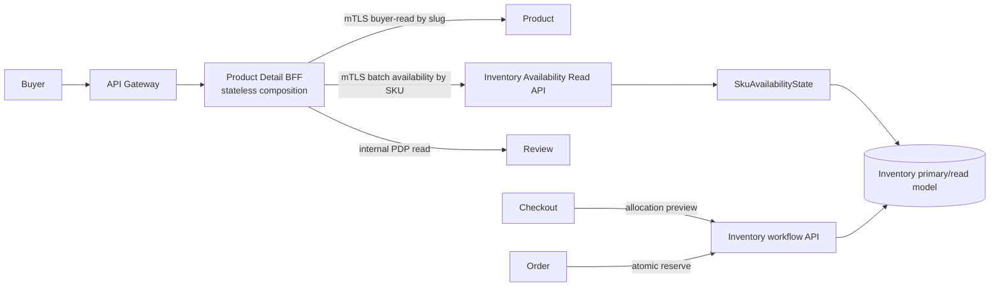

# Product Detail BFF — Architecture

## Read path

Mỗi `GET` PDP gọi Product để lấy catalog snapshot theo slug và `product_id`. Snapshot
này đã được Product resolve sẵn category path, thuộc tính, trục biến thể và media giới
hạn ([ADR-005](./decisions/ADR-005-pdp-catalog-scope-and-media-url.md)), nên pha 1 chỉ có
một lời gọi. Nếu Product trả catalog-active Product, BFF lấy toàn bộ `sku_id` active rồi
gọi **song song** một Inventory batch-read và Review internal PDP read. Inventory không
được gọi theo từng SKU. Khi compose, BFF dựng URL CDN cho media và thumbnail từ storage key;
đây là phép biến đổi cục bộ, không có I/O.

Inventory trả một UI advisory state cho mỗi SKU. BFF map trực tiếp
`IN_STOCK`/`OUT_OF_STOCK`; item bị thiếu, `UNKNOWN`, timeout hoặc `503` được map thành
`UNKNOWN`. BFF không đọc quantity, warehouse, reservation hoặc local stock cache để
thay đổi kết quả đó.

Nếu Product trả `404` (slug không tồn tại, Product `DRAFT`/`HIDDEN` hoặc không còn SKU
`ACTIVE`), BFF trả `404` và không gọi Inventory/Review. Buyer-read không mang status
Product hay SKU; lọc catalog-active là trách nhiệm của Product. Nếu Product không sẵn sàng, BFF trả `503`. Review là enrichment
optional: timeout/lỗi Review không làm mất catalog, mà trả
`review_section.status = UNAVAILABLE`.

## Inventory boundary

Inventory tính và sở hữu `SkuAvailabilityState` từ trạng thái warehouse/stock của nó.
Availability Read API là contract riêng cho PDP BFF, khác hoàn toàn với event/export
chỉ dành cho Search. Inventory có thể cache hoặc scale read model trong boundary của
mình, nhưng BFF không được biết hay phụ thuộc vào cách lưu trữ đó.

Nếu Inventory read model không có trạng thái đáng tin cậy, đang pending recompute hoặc
không đáp ứng freshness budget, Inventory trả `UNKNOWN`. Vì thế BFF không cần Kafka
consumer, database, revision guard, bootstrap hay replay procedure.

## Consistency và degradation

Catalog, availability và Review không có distributed transaction, vì vậy response mang
các snapshot độc lập. `IN_STOCK` không phải reservation; khi Order Reserve thất bại,
checkout báo hết hàng và refresh PDP/cart theo policy UI.

Inventory là dependency degradable: failure chỉ làm availability thành `UNKNOWN`, không
biến một catalog hợp lệ thành `503`. Product là dependency bắt buộc. Review là enrichment
degradable. Mỗi dependency có timeout, bulkhead và circuit breaker riêng để lỗi của một
dependency không làm cạn request pool của PDP.

## Resilience: phân chia với mesh và gateway

Theo [ADR-004](./decisions/ADR-004-resilience-budget-and-mesh-split.md):

- **Gateway** chờ response header của route PDP tối đa 3 giây và chỉ retry lỗi kết nối
  tới BFF.
- **Mesh** lo mTLS, authorization theo principal, retry lỗi kết nối cho Product và Review,
  outlier detection và timeout ngoài (Product 3 giây, Inventory/Review 2 giây). Mesh không
  biết dependency nào được degrade.
- **BFF** giữ deadline PDP 1 000 ms, cắt Product ở `min(400 ms, deadline còn lại − 50 ms)`
  và Inventory/Review ở `min(300 ms, deadline còn lại − 50 ms)`, không gọi dependency của
  một pha khi deadline còn dưới 100 ms
  ([ADR-007](./decisions/ADR-007-hot-path-clarifications.md)), không retry ở ứng dụng, mở
  circuit breaker và map lỗi sang `503`/`UNKNOWN`/`UNAVAILABLE`.

Timeout BFF luôn ngắn hơn timeout mesh, nên BFF là tầng quyết định degrade; timeout mesh
chỉ là giới hạn ngoài khi BFF có lỗi.

Không dùng Search index làm shared PDP store: Search là browse projection, không có
catalog point-read authority và không là fallback availability cho PDP.
