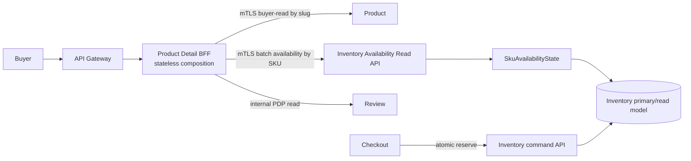

# Product Detail BFF — Architecture

## Read path

Mỗi `GET` PDP gọi Product để lấy catalog snapshot theo slug và `product_id`. Nếu
Product trả catalog-active Product, BFF lấy toàn bộ `sku_id` active rồi gọi **song
song** một Inventory batch-read và Review internal PDP read. Inventory không được gọi
theo từng SKU.

Inventory trả một UI advisory state cho mỗi SKU. BFF map trực tiếp
`IN_STOCK`/`OUT_OF_STOCK`; item bị thiếu, `UNKNOWN`, timeout hoặc `503` được map thành
`UNKNOWN`. BFF không đọc quantity, warehouse, reservation hoặc local stock cache để
thay đổi kết quả đó.

Nếu Product trả không tồn tại, `DRAFT` hoặc `HIDDEN`, BFF trả `404` và không gọi
Inventory/Review. Nếu Product không sẵn sàng, BFF trả `503`. Review là enrichment
optional: timeout/lỗi Review không làm mất catalog, mà trả
`review_section.status = UNAVAILABLE`.

## Inventory boundary

Inventory tính và sở hữu `SkuAvailabilityState` từ trạng thái warehouse/stock của nó.
Availability Read API là contract riêng cho PDP BFF, khác hoàn toàn với event/export
chỉ dành cho Search. Inventory có thể cache hoặc scale read model trong boundary của
mình, nhưng BFF không được biết hay phụ thuộc vào cách lưu trữ đó.

Nếu Inventory read model không có trạng thái đáng tin cậy, đang pending recompute hoặc
không đáp ứng freshness budget, Inventory trả `UNKNOWN`. Vì thế BFF không cần Kafka
consumer, database, revision guard, bootstrap hay replay procedure.

## Consistency và degradation

Catalog, availability và Review không có distributed transaction, vì vậy response mang
các snapshot độc lập. `IN_STOCK` không phải reservation; khi Checkout reserve thất bại,
checkout báo hết hàng và refresh PDP/cart theo policy UI.

Inventory là dependency degradable: failure chỉ làm availability thành `UNKNOWN`, không
biến một catalog hợp lệ thành `503`. Product là dependency bắt buộc. Review có timeout,
bulkhead và circuit breaker riêng để lỗi enrichment không làm cạn request pool của PDP.

Không dùng Search index làm shared PDP store: Search là browse projection, không có
catalog point-read authority và không là fallback availability cho PDP.
