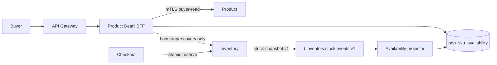

# Product Detail BFF — Architecture

## Read path

Mỗi `GET` PDP gọi Product để lấy một snapshot catalog theo slug, sau đó đọc tất cả
row availability theo `sku_id` trong local store và ghép vào từng variant. Product là
dependency synchronous duy nhất của request; Inventory không nằm trên hot path.

Nếu Product trả không tồn tại, `DRAFT` hoặc `HIDDEN`, BFF trả `404` và không để một
row availability cũ làm Product lộ ra. Nếu local projection không đủ tươi, BFF vẫn có
thể trả catalog nhưng đặt trạng thái SKU là `UNKNOWN` theo policy freshness.

## Write path của projection

Projector consume `com.ecommerce.inventory.stock-snapshot.v1`, key `sku_id`. Nó
upsert độc lập với Product: event tới trước catalog vẫn tạo row availability; request
PDP sau này mới join row này với catalog hợp lệ. Guard chỉ dựa trên `stock_revision`.

Bootstrap tạo export session tại Inventory, import hết trang snapshot vào store, rồi
seek/replay inclusive từ `replay_from_offsets`. BFF không tự chụp Kafka watermark.

## Consistency và degradation

Catalog và availability không có distributed transaction, vì vậy response mang hai
snapshot độc lập. UI không được diễn giải `IN_STOCK` là reservation. Khi Checkout
reserve thất bại, flow checkout báo hết hàng và refresh PDP/cart theo policy UI.

Không dùng Search index làm shared PDP store: Search là browse projection, không có
point-read catalog authority hay contract freshness cho PDP.
