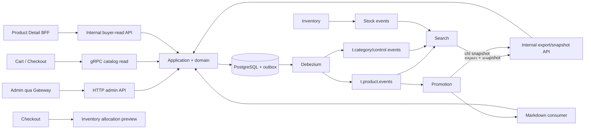

# Product Service — Architecture

## Thành phần

| Thành phần | Trách nhiệm |
|---|---|
| HTTP admin API | Validate transport, ủy quyền admin và gọi application layer |
| gRPC catalog read | Trả catalog saleability và giá; không trả stock |
| Internal buyer-read API | Trả projection buyer đã resolve (category path, thuộc tính, trục biến thể, media giới hạn, giá) cho Product Detail BFF; không trả stock |
| Internal export/snapshot API | Export Category/Product kèm replay offsets cho Search full reindex; snapshot một Product cho Search và Promotion. Allowlist tách theo nhóm route (`TrustedIdentityFilter`), so khớp trên path đã decode và bỏ `;param` — đúng path Spring MVC route — nên `/%61pi/v1/...` hay `/internal/v1;x=1/...` không né được kiểm quyền (`TrustedIdentityFilterPathTest`) |
| Application/domain | Command, validation, transaction, pricing, revision và outbox |
| PostgreSQL repository | Write store, lock order Product → SKU |
| Markdown consumer | Consume ACTIVE full payload/INACTIVE tombstone, guard `source_revision`, reprice SKU |
| Outbox + Debezium | Phát CloudEvents catalog/tombstone/control event at-least-once sau commit |

Product không có Redis, cache, Lua script, Inventory consumer, Inventory worker hay
self-consumer hoặc scheduled job. Search kết hợp catalog/price với Inventory event
projection; Product Detail BFF kết hợp catalog/price với Inventory Availability Read API.
Product không là stock intermediary cho bên nào.

## Processing và consistency

Admin command và markdown command đều chạy trong transaction PostgreSQL: validate, lock
Product rồi SKU, mutate, tăng `catalog_revision` một lần, insert outbox và commit.
Debezium phát event bất đồng bộ; consumer phải idempotent.

Strong consistency nằm ở catalog, giá, trạng thái và tồn tại SKU trong Product DB.
Stock chỉ được quyết định bằng reservation atomic tại Inventory. Search là eventual
read model; khoảng trễ của Search không được ảnh hưởng Checkout.

Khi Search full reindex, Product tạo export session cho Category và Product/SKU. Mỗi
session chụp replay offsets của topic tương ứng trước scan và trả lại cùng snapshot
qua mọi trang; Search import xong mới catch-up. Đây là contract phục hồi, không phải
đường đọc nóng và không tạo transaction phân tán PostgreSQL–Kafka.

## Concurrency

- Lock bắt buộc: `products` trước bằng `FOR NO KEY UPDATE`, rồi SKU liên quan bằng
  `FOR UPDATE`.
- Worker đặt `lock_timeout` ngắn và retry/requeue khi timeout.
- `catalog_revision` là ordering guard cho catalog event cùng Product aggregate.
- `category_revision` là ordering guard cho Category event; đổi cây category phát control
  event để Search rebuild read model thay vì Product fan-out subtree.
- `source_revision` là ordering guard cho markdown event theo Product.
- Không dùng `updated_at` hay Redis timestamp để quyết định thứ tự giữa các nguồn khác nhau.
- `replay_from_offsets` của export là boundary do Product cấp; Search không tự chụp
  catalog watermark. Chi tiết ở [ADR-014](./decisions/ADR-014-catalog-snapshot-replay-offsets.md).

## Deployment

Runtime cần PostgreSQL, Kafka và Kafka Connect/Debezium. API/gRPC và Markdown Consumer
có thể chạy thành process riêng để scale độc lập; không có scheduler process của Product.
Debezium chạy trong Kafka Connect do Platform vận hành. Search và Inventory là dependency
liên service, không dùng database/cache của Product. Rationale và recovery trade-off của
topology này nằm tại [ADR-016](./decisions/ADR-016-state-discriminated-markdown-snapshot.md).
