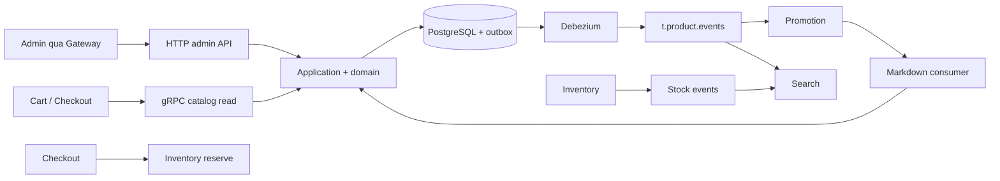

# Product Service — Architecture

## Thành phần

| Thành phần | Trách nhiệm |
|---|---|
| HTTP admin API | Validate transport, ủy quyền admin và gọi application layer |
| gRPC catalog read | Trả catalog saleability và giá; không trả stock |
| Application/domain | Command, validation, transaction, pricing, revision và outbox |
| PostgreSQL repository | Write store, lock order Product → SKU |
| Markdown consumer | Consume snapshot Promotion, guard `source_revision`, reprice SKU |
| Outbox + Debezium | Phát catalog/tombstone event at-least-once sau commit |
| Scheduled safety check | Deactivate markdown projection đã quá hạn nếu consumer/schedule chậm |

Product không có Redis, cache, Lua script, Inventory consumer, Inventory worker hay
self-consumer. Search tự kết hợp catalog event của Product với stock event của Inventory.

## Processing và consistency

Admin command và markdown command đều chạy trong transaction PostgreSQL: validate, lock
Product rồi SKU, mutate, tăng `catalog_revision` một lần, insert outbox và commit.
Debezium phát event bất đồng bộ; consumer phải idempotent.

Strong consistency nằm ở catalog, giá, trạng thái và tồn tại SKU trong Product DB.
Stock chỉ được quyết định bằng reservation atomic tại Inventory. Search là eventual
read model; khoảng trễ của Search không được ảnh hưởng Checkout.

## Concurrency

- Lock bắt buộc: `products` trước bằng `FOR NO KEY UPDATE`, rồi SKU liên quan bằng
  `FOR UPDATE`.
- Worker đặt `lock_timeout` ngắn và retry/requeue khi timeout.
- `catalog_revision` là ordering guard cho catalog event cùng Product aggregate.
- `source_revision` là ordering guard cho markdown event theo Product.
- Không dùng `updated_at` hay Redis timestamp để quyết định thứ tự giữa các nguồn khác nhau.

## Deployment

Runtime cần PostgreSQL, Kafka và Kafka Connect/Debezium. API, markdown consumer và
scheduled safety check có thể chạy thành process riêng. Search và Inventory là dependency
liên service, không dùng database/cache của Product.
