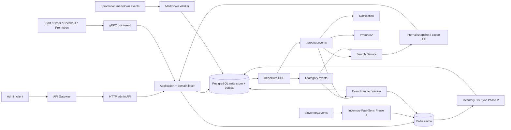

# Product Service — Architecture

> File này trả lời: “Product Service gồm những thành phần nào và chúng phối hợp ra sao?”

## 1. Architecture context

Product Service là write model của bounded context Catalog. Admin ghi dữ liệu qua
HTTP API sau Gateway; các service nghiệp vụ đọc dữ liệu qua gRPC point-read; Search
Service dựng read model từ event Kafka. Product tiêu thụ hai luồng event từ ngoài:
markdown rule từ Promotion và thay đổi tồn kho từ Inventory.

Ranh giới quan trọng: Redis và PostgreSQL của Product là nội bộ tuyệt đối. Mọi truy
cập từ service khác đều đi qua gRPC hoặc qua event, không có ngoại lệ.

## 2. Components và trách nhiệm

| Component | Trách nhiệm | Không được làm | Dependencies |
|---|---|---|---|
| HTTP admin adapter | Nhận request admin, validate transport, map domain error ra HTTP | Chứa business rule, gọi Redis/Kafka trực tiếp | Application layer |
| gRPC point-read adapter | Trả snapshot SKU cho service nội bộ theo contract | Cho phép ghi dữ liệu, để lộ chi tiết cache | Application layer |
| Internal HTTP adapter | Snapshot, export, category tree phục vụ reindex | Gây side effect nghiệp vụ | Application layer |
| Application + domain layer | Thực thi command, guard FSM, transaction boundary, sinh outbox | Biết chi tiết adapter hoặc format Kafka | Repository, cache, FSM |
| Pricing module | Tính `promotional_price` và `best_price` theo markdown rule | Nhận giá markdown do client gửi | Repository |
| State machine (FSM) | Quản lý transition `DRAFT`/`ACTIVE`/`HIDDEN` và guard | Quản lý soft delete hoặc trạng thái SKU | Application layer |
| Repository | Đọc/ghi PostgreSQL, giữ lock order Product → SKU | Ghi dữ liệu của service khác | PostgreSQL |
| Outbox writer | Ghi `product_outbox_events` trong cùng transaction nghiệp vụ | Ghi outbox ngoài transaction, để trống `partition_key` | PostgreSQL |
| Debezium CDC connector | Đọc WAL, forward outbox sang Kafka theo `partition_key` | Biến đổi payload, parse JSON để lấy key | PostgreSQL, Kafka Connect |
| Event Handler Worker | Self-consume `SKU_CREATED`/`SKU_UPDATED` để refresh cache và `CATEGORY_DELETED` để cascade write model | Gọi business logic sinh ra event mới trong nhánh SKU | Kafka, Redis, PostgreSQL |
| Markdown Worker | Áp/gỡ markdown, tính giá, ghi tracking và outbox | Ghi đè `product:sku:{sku_id}` | Kafka, PostgreSQL, Redis |
| Inventory Phase 1 consumer | Cập nhật cache tồn kho bằng Lua CAS, đăng ký pending sync | Chạm PostgreSQL, ghi đè field giá | Kafka, Redis |
| Inventory Phase 2 worker | Drain pending, batch update DB, chạy FSM auto-hide/reactivate | Ghi đè `product:sku:{sku_id}` | Redis, PostgreSQL |
| Scheduled jobs | Markdown pending gate, markdown expiry, outbox retention | Chạy nhiều instance song song trên cùng tập dữ liệu | Redis lock, PostgreSQL |
| Redis adapter | Point-read cache, marker markdown, ZSET pending, distributed lock | Là source of truth cho dữ liệu nghiệp vụ | Redis |

## 3. Processing model

Ghi từ admin là synchronous: một transaction PostgreSQL bao trọn validate, lock,
cập nhật bảng nghiệp vụ và insert outbox. Sau commit, API refresh cache in-band
trước khi trả response để bảo đảm read-your-own-writes cho chính admin.

Phát event là bất đồng bộ và tách rời hoàn toàn khỏi request: Debezium đọc WAL của
bảng outbox và forward sang Kafka. Service không publish trực tiếp tới Kafka trong
transaction, vì vậy không có dual-write giữa database và broker.

Ba luồng bất đồng bộ chính:

- Markdown: một transaction cho mỗi `product_id`, không bao giờ một transaction cho
  cả category.
- Inventory: hai pha, Phase 1 chỉ chạm Redis, Phase 2 gộp batch xuống PostgreSQL.
- Cache refresh: đi qua đúng một đường — Event Handler tiêu thụ `SKU_UPDATED`.

## 4. Consistency model

| Tầng dữ liệu | Độ trễ mục tiêu | Ghi chú |
|---|---|---|
| Redis point-read cache | Tức thì với inventory (Phase 1) và với admin write (in-band) | Nguồn đọc của Cart/Checkout |
| PostgreSQL | 500 ms – 2 s sau event inventory; đồng bộ với admin write | Source of truth |
| Kafka event | Vài ms sau commit (CDC) | At-least-once |
| Elasticsearch (Search) | 2 – 5 s | Read model, có guard theo `updated_at` |

Dữ liệu cần strong consistency: trạng thái sản phẩm, giá, tồn tại của SKU và ràng
buộc danh mục — tất cả nằm trong transaction PostgreSQL. Chấp nhận eventual
consistency: `display_quantity` trong DB so với Redis, document Elasticsearch, và
thời điểm auto-hide/auto-reactivate.

Phát hiện và phục hồi lệch dữ liệu: staleness guard nhiều tầng (Lua CAS ở Phase 1,
so mốc thời gian ở Phase 2, so `updated_at` ở consumer), ZSET pending chỉ được ack
sau khi DB commit, markdown expiry cronjob dọn giá kẹt, và internal export/snapshot
API cho phép Search rebuild từ đầu.

## 5. Concurrency model

- **Lock order bắt buộc**: `products` trước (`SELECT ... FOR NO KEY UPDATE`), rồi
  `product_skus` (`SELECT ... FOR UPDATE`). Áp dụng cho admin API, Markdown Worker,
  Event Handler nhánh `CATEGORY_DELETED`, Phase 2 và cronjob.
- **`lock_timeout` + retry**: worker chạm cùng product phải đặt `lock_timeout` ngắn
  và nack/requeue khi timeout, không được skip im lặng.
- **Distributed lock (Redis)**: cronjob và job quét diện rộng chạy singleton bằng
  `SET NX PX`; lock phải được gia hạn nếu job chạy dài.
- **Lua CAS**: Phase 1 dùng script atomic để so mốc `last_inventory_sync_at` và ghi
  cache trong một lần thực thi, không có race read-modify-write.
- **Conditional update**: Phase 2 chỉ apply khi mốc thời gian trong batch mới hơn giá
  trị đang có trong DB; xung đột thì requeue với backoff.
- **Dedupe theo `product_id`/`sku_id` trong từng poll-batch** của consumer để giảm
  write amplification lên Redis.
- **Ordering**: mọi event cùng một `partition_key` rơi vào cùng partition, nên thứ tự
  chỉ được bảo đảm trong phạm vi một product (hoặc một SKU với event cấp SKU). Không
  có cam kết thứ tự giữa hai topic khác nhau.

Các race condition quan trọng phải giữ đúng: admin sửa giá đồng thời với Markdown
Worker áp rule; Phase 2 chạy đồng thời với admin đổi trạng thái; hai instance worker
cùng xử lý một product; và event inventory đến trễ sau một event mới hơn.

## 6. Deployment topology

Các process được triển khai:

- API process: HTTP admin, HTTP internal và gRPC point-read.
- Consumer process: `product-event-handler-group`, `product-markdown-group`,
  `product-inventory-fast-sync-group`.
- Scheduler process: Phase 2 drain, markdown pending gate, markdown expiry, outbox
  retention trimmer.
- Kafka Connect chạy Debezium connector, là hạ tầng riêng chứ không phải một
  thành phần trong service.

Runtime dependency: PostgreSQL bật logical replication (có replication slot cho
Debezium), Redis có module RedisJSON, Kafka và Kafka Connect.

Scale: API scale theo request và connection pool; consumer scale tối đa tới số
partition của topic; Phase 2 và các cronjob là job singleton hoặc phải dùng lock nên
không scale tự do.

## 7. Architecture constraints

- Không service nào truy cập trực tiếp PostgreSQL hoặc Redis của Product.
- Không phát event ngoài transaction; mọi event đi qua outbox và CDC.
- `partition_key` phải được validate ở tầng application trước khi insert outbox.
- Adapter không chứa business rule; domain không phụ thuộc HTTP, Kafka hay Redis API.
- Event Handler ở nhánh SKU chỉ được đọc DB và ghi Redis; nếu ghi DB sẽ sinh outbox
  mới và tạo vòng lặp self-consume vô tận.
- Phase 1 không ghi các field giá và `price_updated_at`; Phase 2 và Markdown Worker
  không ghi đè `product:sku:{sku_id}`.
- Không dùng Elasticsearch hay Search Service làm nguồn rebuild cache hoặc DB.

## 8. Trade-offs và ADR liên quan

Các đánh đổi lớn được ghi riêng trong [Decision index](./decisions/README.md): chọn
Java/Spring Boot ([ADR-001](./decisions/ADR-001-java-spring-boot-runtime.md)), outbox
+ Debezium thay polling ([ADR-002](./decisions/ADR-002-outbox-debezium-cdc.md)),
kiến trúc inventory hai pha
([ADR-003](./decisions/ADR-003-two-phase-lock-free-inventory-sync.md)), pessimistic
locking và lock order ([ADR-004](./decisions/ADR-004-pessimistic-locking-order.md)),
single-writer cho cache point-read
([ADR-005](./decisions/ADR-005-single-writer-cache-ownership.md)), hợp nhất event
SKU ([ADR-006](./decisions/ADR-006-consolidated-sku-updated-event.md)), vòng đời
admin-only ([ADR-007](./decisions/ADR-007-admin-only-product-lifecycle.md)) và
ownership của giá/tồn kho hiển thị
([ADR-008](./decisions/ADR-008-price-and-inventory-snapshot-ownership.md)).

Không quyết định nào trong số này được coi là verified chỉ dựa trên tài liệu.
