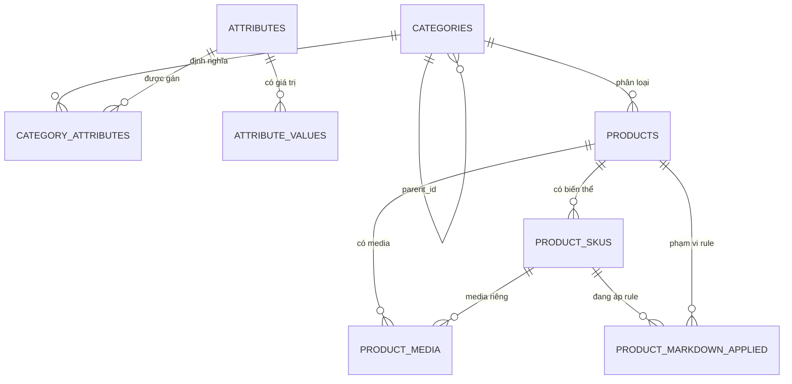

# Product Service — Data Design

> File này trả lời: “Dữ liệu được sở hữu, lưu trữ và duy trì tính đúng đắn thế nào?”

## 1. Data ownership

Product Service sở hữu toàn bộ schema của mình trên PostgreSQL. Không service nào
được đọc hoặc ghi trực tiếp; mọi truy cập đi qua gRPC, HTTP internal API hoặc event.

| Nhóm | Bảng | Ghi chú |
|---|---|---|
| Catalog | `categories`, `attributes`, `attribute_values`, `category_attributes` | Cấu hình danh mục và thuộc tính |
| Product | `products`, `product_skus`, `product_media` | Aggregate chính |
| Markdown | `product_markdown_applied` | Bản chiếu rule của Promotion |
| Infrastructure | `product_outbox_events` | Log append-only cho CDC |

Dữ liệu external nằm trong schema Product nhưng do service khác sở hữu:

| Dữ liệu | Source of truth | Cơ chế đồng bộ | Được phép dùng cho |
|---|---|---|---|
| `product_skus.display_quantity`, `last_inventory_sync_at` | Inventory Service | Kafka `INVENTORY_STOCK_CHANGED` | Hiển thị và guard FSM auto-hide/reactivate |
| `product_markdown_applied.*` | Promotion Service | Kafka `MARKDOWN_*` | Tính `promotional_price`, dọn khi rule kết thúc |

`display_quantity` tuyệt đối không được dùng để giữ hàng, trừ kho hay xác nhận khả
dụng lúc đặt hàng ([PRODUCT-INV-001](./README.md#7-critical-invariants)).

## 2. Logical data model

Vòng đời: `Product` sinh ra ở `DRAFT`, mang một hoặc nhiều `ProductSku`; xóa mềm giữ
lại row và chỉ bật cờ. `ProductMarkdownApplied` chỉ tồn tại trong thời gian rule
active và bị xóa khi rule kết thúc hoặc SKU bị xóa mềm. `product_outbox_events` là
append-only và bị trim theo tuổi.

## 3. Schema sources

Nguồn schema chuẩn là migration của service, hiện tại là
`java/services/product-service/src/main/resources/db/migration/` với `V1__initial_schema.sql`,
`V2__add_outbox_partition_index.sql` và `V3__add_debezium_metadata.sql`. Bộ tài liệu
này chưa được đối chiếu với các file đó, nên chúng là ứng viên evidence chứ chưa phải
evidence đã xác minh.

Không coi bất kỳ đoạn SQL nào trong Markdown là schema chuẩn. Mô tả dưới đây giải
thích ý nghĩa và ràng buộc nghiệp vụ của schema, không thay thế migration.

## 4. Tables và constraints chính

### `categories`, `attributes`, `attribute_values`, `category_attributes`

`categories` là cây phân cấp qua `parent_id`, có `level`, `slug` unique và cờ
`is_leaf`. Sản phẩm chỉ được gán vào danh mục lá. `category_attributes` map danh mục
với thuộc tính và mang hai cờ nghiệp vụ: `is_required` (bắt buộc khi tạo sản phẩm) và
`is_variant` (thuộc tính dùng để sinh SKU).

`path` — chuỗi breadcrumb từ gốc tới danh mục — được dùng trong event `CATEGORY_*` và
internal API nhưng chưa được mô tả như một cột của `categories`. Cần chốt là cột vật
lý được duy trì trong transaction hay giá trị tính lúc đọc; hiện là gap đã biết.

### `products`

Aggregate root. Các nhóm field:

| Nhóm | Field | Ý nghĩa |
|---|---|---|
| Identity | `product_id`, `category_id` | Khóa chính và danh mục lá |
| Nội dung | `name`, `description`, `attributes_json` | `attributes_json` là raw key-value, không phải token search |
| State | `status` | `DRAFT`, `ACTIVE`, `HIDDEN` — quản lý bởi FSM |
| Cờ hiển thị | `admin_hidden` | Chỉ được set `true` khi admin gọi `HIDE`; auto-hide giữ nguyên giá trị |
| Xóa mềm | `is_deleted`, `deleted_at` | Nằm ngoài FSM; giữ nguyên `status` nghiệp vụ |
| Lifecycle | `created_at`, `updated_at` | `updated_at` là guard ordering cho downstream |

`admin_hidden` là ranh giới giữa ý chí của admin và hành vi tự động của hệ thống:
`AUTO_REACTIVATE_IN_STOCK` bị cấm khi cờ này bằng `true`.

### `product_skus`

Mỗi row là một biến thể bán được.

| Nhóm | Field | Ý nghĩa |
|---|---|---|
| Identity | `sku_id`, `product_id`, `sku_code` | `sku_code` unique toàn hệ thống |
| Giá | `original_price`, `promotional_price` | `promotional_price = NULL` nghĩa là không có rule active |
| State | `status` | `ACTIVE`, `INACTIVE`, `OUT_OF_STOCK` |
| Tồn kho replica | `display_quantity`, `last_inventory_sync_at` | `last_inventory_sync_at` là epoch millis dùng chặn event out-of-order |
| Biến thể | `variant_attributes_json` | Giữ nguyên dạng object ở write model |
| Xóa mềm | `is_deleted`, `deleted_at` | Độc lập với product cha |
| Lifecycle | `created_at`, `updated_at` | |

Tên field trong DB là `status`, nhưng tên canonical trong API response, cache và event
payload là `sku_status`. Đây là khác biệt cố ý và phải được giữ nhất quán ở mọi
adapter.

`best_price` và `has_promotion` không phải cột trong DB: chúng được tính từ
`original_price` và `promotional_price` khi ghi cache và khi build payload event.

Không có cột `version` cho optimistic locking. Đồng thời hóa được xử lý bằng
pessimistic lock (admin, markdown, cronjob) và conditional update theo mốc thời gian
(Phase 2 inventory) — xem [ADR-003](./decisions/ADR-003-two-phase-lock-free-inventory-sync.md)
và [ADR-004](./decisions/ADR-004-pessimistic-locking-order.md).

`sku_id` không được nhúng `product_id` trong chuỗi mã: point-read theo `sku_id` phải
đi qua index và resolve `product_id` từ DB trước khi lock hoặc cập nhật bảng cha.

### `product_media`

Media thuộc về product; `sku_id` khác `NULL` nghĩa là ảnh riêng của một biến thể.
`sort_order` quyết định thứ tự hiển thị. Ảnh đầu tiên của product được dùng làm
`main_image_url` trong cache và event.

### `product_markdown_applied`

Bản ghi "sổ nợ" cho vòng đời markdown: giữ `rule_id` (luôn string), `product_id`,
`sku_id`, `discount_type`, `discount_value`, `max_discount_amount`, `calculated_price`,
`applied_at` và `expires_at`. Không có bảng này thì khi `MARKDOWN_ENDED` đến, service
không biết phải reset SKU nào.

`calculated_price` được lưu để đối chiếu khi audit hoặc khi công thức thay đổi; nó
không phải nguồn đọc cho luồng bán hàng.

Unique `(rule_id, sku_id)` bảo đảm một rule chỉ áp một lần trên một SKU.

### `product_outbox_events`

`event_id` (UUID) là khóa chính. `event_type`, `aggregate_type` và `aggregate_id` mô
tả event; `payload` là JSONB; `created_at` phục vụ retention.

`partition_key` là cột quan trọng nhất về mặt vận hành: Debezium lấy trực tiếp giá trị
này làm Kafka message key, không parse JSON trong Connect. Quy tắc: event cấp Product
dùng `product_id`, event cấp SKU dùng `sku_id`, event cấp Category dùng `category_id`.
Ràng buộc `NOT NULL` cộng với `CHECK (LENGTH(partition_key) > 0)` và validate ở tầng
application; nếu để rỗng, event của cùng một sản phẩm rơi vào nhiều partition và thứ
tự đồng bộ của downstream bị phá vỡ.

## 5. Indexes và query patterns

| Index | Query pattern phục vụ | Trade-off |
|---|---|---|
| `products(category_id)` | Markdown theo scope CATEGORY, kiểm tra trước khi xóa danh mục | Chi phí ghi nhỏ, cần thiết cho batch |
| `products(status)` | Lọc theo trạng thái ở admin list và cascade `CATEGORY_DELETED` | Cardinality thấp; cân nhắc index kết hợp nếu bảng lớn |
| `product_skus(product_id)` | Join product → SKU, lock batch theo product | Bắt buộc |
| `product_skus(status)` | Lọc SKU theo trạng thái | Cardinality thấp |
| `product_skus(sku_code)` unique | Chống trùng mã và tra cứu theo mã | Bắt buộc theo BR-004 |
| `product_skus(sku_id)` (PK) | Point-read và Phase 2 batch update | Bắt buộc |
| `product_markdown_applied(rule_id)` | Tìm SKU bị ảnh hưởng khi rule đổi hoặc kết thúc | Bắt buộc |
| `product_markdown_applied(expires_at)` | Chỉ phục vụ markdown expiry cronjob, không phục vụ luồng mua hàng | Ghi thêm chi phí nhỏ |
| `product_markdown_applied(rule_id, sku_id)` unique | Enforce BR-012 | Bắt buộc |
| `product_outbox_events(created_at)` | Retention trimmer xóa theo lô | Bắt buộc cho cleanup |

## 6. Transaction boundaries

Nguyên tắc: mỗi transaction bao đúng một product và luôn kết thúc bằng việc ghi
outbox. Không bao giờ mở một transaction bọc nhiều product hay cả một danh mục.

| Luồng | Phạm vi transaction | Locking |
|---|---|---|
| Tạo product | `products` + `product_skus` + `product_media` + outbox | Không cần lock; insert mới |
| Cập nhật product/SKU | Product + SKU liên quan + outbox | `FOR NO KEY UPDATE` trên product, `FOR UPDATE` trên SKU |
| Chuyển FSM | Product + outbox (guard đọc SKU trong cùng transaction) | `FOR NO KEY UPDATE` trên product trước khi đọc `SUM(display_quantity)` |
| Xóa mềm | Product hoặc SKU + markdown mapping + outbox | Như trên |
| Markdown | Một transaction cho mỗi `product_id` | Lock product với `lock_timeout` ngắn, rồi lock các SKU |
| Inventory Phase 2 | Một transaction cho mỗi `product_id`, gộp mọi SKU trong batch | Lock product một lần cho cả batch |
| `CATEGORY_DELETED` cascade | Batch 100 product, mỗi batch một transaction | Lock từng product trước khi update |
| Cronjob markdown expiry | Batch 100 record, duyệt `product_id` tăng dần | Lock product trước, distributed lock cho cả job |

Guard TOCTOU (ví dụ điều kiện của `SHOW` và `AUTO_REACTIVATE_IN_STOCK`) phải được
kiểm tra bên trong transaction, sau khi đã lock row product. Kiểm tra ngoài transaction
là sai.

Isolation level mặc định của PostgreSQL (`READ COMMITTED`) là đủ vì mọi thao tác đọc
để quyết định đều chạy trên row đã lock; đây là giả định cần xác minh với implementation.

Side effect nằm ngoài transaction: refresh cache in-band (sau commit, trước response),
Debezium forward event, và mọi lệnh Redis khác.

## 7. Caching

Redis là cache và hàng đợi trung gian, không phải source of truth. Không service nào
khác được đọc Redis của Product.

**Quy ước timestamp (chốt trong refactor này):** trong `product:sku:{sku_id}`,
`last_inventory_sync_at` là **epoch millis** (number) và `price_updated_at` là
**ISO 8601** (string). Bên nào so sánh cũng phải convert về đúng kiểu của field mình
guard, không so sánh chéo hai định dạng. Tài liệu cũ mô tả mâu thuẫn ở điểm này.

| Key | Loại | TTL | Writer duy nhất | Mục đích |
|---|---|---|---|---|
| `product:sku:{sku_id}` | RedisJSON | 3600 s | API in-band (product-level change) + Event Handler (`SKU_CREATED`, `SKU_UPDATED`) + Phase 1 Lua (chỉ field tồn kho) | Point-read cho Cart/Order/Checkout |
| `product:markdown:active:{sku_id}` | String JSON | `expires_at − now` | Markdown Worker | Marker rule đang active cho trang chi tiết |
| `product:inventory:pending` | ZSET | 24 h | Phase 1 ghi, Phase 2 xóa sau commit | Hàng đợi pending sync xuống DB |
| `product:markdown:pending` | ZSET | Tới khi drain | Markdown Worker ghi, scheduler xóa | Job markdown chờ tới `start_time` |
| `product:lock:fetch:{sku_id}` | String | Vài giây | Bất kỳ reader nào gặp cache miss | Chống cache stampede khi rebuild point-read |
| `product:lock:markdown:{product_id}` | String | TTL + gia hạn | Markdown Worker | Chống hai instance cùng xử lý một product |
| `product:jobs:markdown-expiry:lock` | String | ~60 s, gia hạn khi job dài | Markdown expiry cronjob | Bảo đảm cronjob chạy singleton |

### `product:sku:{sku_id}`

Giá trị là snapshot denormalized: định danh SKU và product, `sku_code`,
`product_name`, `main_image_url`, `original_price`, `promotional_price`, `best_price`,
`has_promotion`, `sku_status`, `product_status`, `is_available`, `is_deleted`,
`variant_attributes`, `display_quantity`, `last_inventory_sync_at`, `price_updated_at`.

Ownership của từng nhóm field ([ADR-005](./decisions/ADR-005-single-writer-cache-ownership.md)):

| Nhóm field | Ai được ghi |
|---|---|
| Field giá và `price_updated_at` | API in-band và Event Handler qua `SKU_UPDATED` |
| Field tồn kho (`display_quantity`, `sku_status`, `is_available`, `last_inventory_sync_at`) | Phase 1 Lua CAS và Event Handler |
| `product_status`, `is_deleted`, thông tin cấp product | API in-band và Event Handler |

Phase 1 không bao giờ ghi đè field giá, `price_updated_at` hay `product_status`.
Markdown Worker và Phase 2 không bao giờ ghi trực tiếp key này.

Invalidation là soft: luôn `JSON.SET` đè giá trị mới, không `DEL` hàng loạt, để tránh
cache stampede. Staleness guard trước mỗi lần ghi: so `event.updated_at` với
`price_updated_at` cho thay đổi giá, so mốc epoch với `last_inventory_sync_at` cho
thay đổi tồn kho, so `created_at` cho `SKU_CREATED`. Event bằng hoặc cũ hơn phải bị
bỏ qua; cache miss thì query DB rồi nạp đầy đủ.

Chống stampede: distributed lock `product:lock:fetch:{sku_id}` (`SET NX EX`) kết hợp
probabilistic early expiration khi TTL còn dưới ngưỡng, và có thể thêm singleflight
trong từng pod.

Khi Redis không sẵn sàng: point-read rơi về PostgreSQL và chấp nhận latency cao hơn;
Phase 1 dừng và event tồn kho không được ack, Kafka sẽ redeliver. Không có fallback
đọc từ Elasticsearch trong bất kỳ trường hợp nào.

### Lua script Phase 1

Script atomic được lưu tại
[`scripts/inventory_fast_sync.lua`](./scripts/inventory_fast_sync.lua). Hợp đồng:
trả `1` khi đã apply, `0` khi event cũ hoặc `product_id` không khớp, `-1` khi cache
miss. Ở nhánh cache miss, script chỉ đăng ký pending sync và **không** ghi field tồn
kho vào cache, để Phase 2 nạp lại snapshot đầy đủ từ DB.

Bản trong tài liệu là thiết kế chuẩn; implementation phải khớp về hợp đồng trả về và
về danh sách field được phép ghi.

## 8. Outbox và idempotency storage

`product_outbox_events` là cơ chế duy nhất để phát event. Vòng đời: application ghi
record trong transaction nghiệp vụ → PostgreSQL ghi WAL → Debezium đọc slot logical
replication → forward sang Kafka theo `partition_key` → record ở lại bảng cho tới khi
retention trimmer xóa theo `created_at`.

Không có bảng inbox và không có bảng idempotency. Deduplication dựa vào:

- `event_id` ổn định để consumer downstream tự dedupe.
- Staleness guard theo mốc thời gian ở mọi tầng.
- Ràng buộc unique ở DB (`sku_code`, `(rule_id, sku_id)`).
- ZSET `product:inventory:pending` chỉ được ack sau khi DB commit.

Hệ quả đã biết: nếu một event được xử lý lại, hệ thống ghi lại cùng giá trị chứ không
chặn ở tầng lưu trữ; điều này an toàn với các thao tác hiện tại vì tất cả đều là
idempotent field update, nhưng sẽ không còn an toàn nếu sau này có thao tác tích lũy
(cộng dồn, đếm).

DLQ và error handling của luồng CDC được cấu hình tại Kafka Connect, không phải trong
application.

## 9. Data lifecycle

| Dữ liệu | Chính sách |
|---|---|
| Product/SKU bị xóa | Xóa mềm, giữ row vĩnh viễn; không có hard delete tự động |
| `product_markdown_applied` | Xóa khi rule kết thúc, khi SKU/product bị xóa mềm, hoặc bởi cronjob expiry |
| `product_outbox_events` | Trim theo lô 10.000 record, giữ khoảng 30 ngày theo `created_at` |
| `product:inventory:pending` | TTL 24 h; item được xóa ngay sau khi DB commit |
| Cache point-read | TTL 3600 s, tự rebuild khi miss |
| Reindex Search | Qua internal export API với sắp xếp ổn định và watermark `updated_since` |

Reconciliation: markdown expiry cronjob là cơ chế self-healing cho giá kẹt; Phase 2
là self-healing cho tồn kho chưa xuống DB; export/snapshot API là self-healing cho
read model của Search.

Backup và restore theo chính sách hạ tầng của PostgreSQL. Lưu ý khi restore: replication
slot của Debezium và offset của Kafka Connect phải được xử lý cùng, nếu không sẽ phát
lại hoặc bỏ sót event.

## 10. Security và privacy

Dữ liệu sản phẩm không chứa PII của khách hàng. Các điểm cần chú ý:

- `changed_by` và `changed_by_type` trong event trạng thái là định danh admin; đây là
  dữ liệu nhân sự nội bộ, chỉ log ở mức cần thiết.
- URL media trỏ tới object storage bên ngoài; không nhúng credential vào URL và không
  log URL có chữ ký tạm thời.
- Giá vốn, biên lợi nhuận và dữ liệu thương mại nhạy cảm khác không thuộc service này;
  nếu sau này thêm vào thì phải đánh giá lại phần này.
- Kết nối tới PostgreSQL, Redis và Kafka phải dùng TLS; mã hóa at rest theo hạ tầng.
- Bảng outbox chứa toàn bộ snapshot sản phẩm, vì vậy quyền đọc bảng này tương đương
  quyền đọc dữ liệu sản phẩm và phải được kiểm soát như nhau.
- Không có yêu cầu GDPR/data deletion riêng cho dữ liệu sản phẩm.
