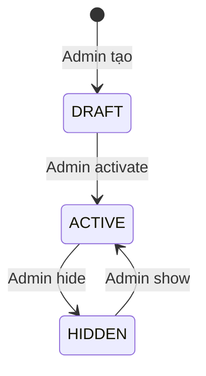

# Product Service — Domain Model

## Ngôn ngữ chung

| Term | Ý nghĩa |
|---|---|
| Product | Aggregate root, mang nội dung chung, category và SKU |
| SKU | Biến thể bán được, mang giá và saleability do admin quản lý |
| Catalog availability | Product `ACTIVE` và SKU `ACTIVE`; không phải stock availability |
| Base price | Giá VND do admin đặt: `base_price_vnd` |
| Selling price | Giá VND Product công bố sau markdown: `selling_price_vnd` |
| Catalog revision | Version đơn điệu của toàn Product aggregate cho catalog event |
| Source revision | Version do Promotion cấp để guard markdown snapshot |

Inventory chỉ được tham chiếu qua `sku_id` ở contract liên service. Product không có
`OUT_OF_STOCK`, quantity, reservation hay deduct.

## Commands và queries

| Type | Capability | Actor |
|---|---|---|
| Command | Tạo/cập nhật/xóa Product, SKU, media | Admin |
| Command | Tạo/cập nhật/xóa category, attribute, option, mapping | Admin |
| Command | `DRAFT -> ACTIVE`, `ACTIVE <-> HIDDEN` | Admin |
| Command | Apply markdown snapshot và reprice | Promotion qua Kafka |
| Query | Catalog point-read một/batch SKU | Cart, Checkout |
| Query | Snapshot/export catalog | Search |

## Quy tắc nghiệp vụ

- Product chỉ gán vào category lá tồn tại; application cấm category cycle.
- Product có ít nhất một SKU; `sku_code` unique toàn hệ thống.
- `base_price_vnd > 0`; `0 <= selling_price_vnd <= base_price_vnd`.
- Chỉ admin sửa `base_price_vnd`. Khi markdown active, Product tính lại selling price
  cho mọi SKU trong cùng transaction.
- Chỉ một markdown active cho một Product; Promotion bảo đảm rule không overlap.
- `DRAFT -> ACTIVE` cần ít nhất một SKU `ACTIVE`.
- `ACTIVE <-> HIDDEN` là quyết định admin thuần túy, không kiểm tra Inventory.
- Hard delete SKU chỉ được phép khi Product còn SKU khác. Hard delete Product/SKU phải
  ghi tombstone event trong cùng transaction.

## Giá markdown

```text
PERCENTAGE: discount = floor(base_price_vnd * discount_bps / 10_000)
            discount = min(discount, max_discount_vnd) nếu có cap
FIXED_VND:  discount = fixed_discount_vnd
selling_price_vnd = max(0, base_price_vnd - discount)
```

Promotion event activate/update/deactivate là snapshot đầy đủ. Product chỉ apply khi
`source_revision` lớn hơn row projection hiện có; event cũ/trùng là no-op.

## State machine



Không có transition tự động do hết hàng. Hard delete là command ngoài state machine.

## Concurrency

Command chạm aggregate lock Product trước rồi lock SKU. Sau mutation, tăng
`catalog_revision` đúng một lần và ghi outbox snapshot. Lock timeout là lỗi tạm thời;
worker retry/requeue, không bỏ qua im lặng.

## Domain errors

`CATEGORY_NOT_FOUND`, `CATEGORY_NOT_LEAF`, `CATEGORY_NOT_EMPTY`,
`SKU_CODE_ALREADY_EXISTS`, `INVALID_PRICE`, `PRODUCT_NOT_SUBMITTABLE`,
`SKU_LAST_DELETE_FORBIDDEN`, `PRODUCT_NOT_FOUND`, `SKU_NOT_FOUND` và
`INVALID_STATE_TRANSITION` là domain error. Hết hàng là kết quả reservation của
Inventory, không phải domain error của Product.
