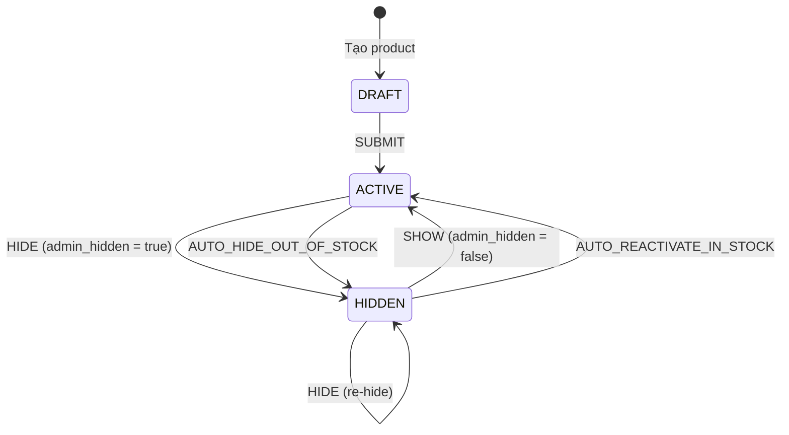

# Product Service — Domain Model

> File này trả lời: “Product Service đang bảo vệ những quy tắc nghiệp vụ nào?”

## 1. Ubiquitous language

| Term | Định nghĩa | Không được nhầm với |
|---|---|---|
| Product | Đơn vị sản phẩm cấp cha, mang tên, mô tả, danh mục và thuộc tính dùng chung | SKU |
| SKU | Biến thể bán được của một product, mang giá và trạng thái riêng | Product |
| Category | Nút trong cây danh mục; sản phẩm chỉ được gán vào danh mục lá | Tag hoặc bộ lọc của Search |
| Attribute | Thuộc tính được định nghĩa sẵn theo danh mục | Giá trị thuộc tính của một sản phẩm cụ thể |
| Variant attribute | Thuộc tính tạo ra biến thể, ví dụ màu và dung lượng | Thuộc tính dùng chung của product |
| Markdown rule | Quy tắc giảm giá trực tiếp do Promotion Service sở hữu | Voucher, flash sale, khuyến mãi giỏ hàng |
| `original_price` | Giá niêm yết do admin đặt | `best_price` |
| `promotional_price` | Giá sau markdown; `NULL` khi không có rule active | Giá cuối cùng của đơn hàng |
| `best_price` | Giá hiển thị đã được Product tính sẵn | Giá do downstream tự tính |
| `display_quantity` | Bản sao tồn kho chỉ để hiển thị | Tồn kho khả dụng của Inventory |
| `admin_hidden` | Cờ ghi nhận admin chủ động ẩn sản phẩm | Trạng thái `HIDDEN` của FSM |
| `is_deleted` | Cờ xóa mềm, nằm ngoài state machine | Trạng thái nghiệp vụ |
| `changed_fields` | Danh sách field thực sự thay đổi trong một event SKU | Toàn bộ payload |
| `change_source` | Nguồn gây ra thay đổi trạng thái SKU | `source` của CloudEvents |
| Point-read | Truy vấn nhanh một hoặc nhiều SKU cho service nội bộ | Search hoặc listing |

## 2. Domain objects

`Product` là aggregate root. `ProductSku` và `ProductMedia` là entity con, chỉ được
thay đổi thông qua product cha để giữ lock order và tính nhất quán của snapshot phát
ra trong event.

`Category`, `Attribute`, `AttributeValue` và `CategoryAttribute` tạo thành aggregate
cấu hình độc lập; chúng ràng buộc việc validate product nhưng có vòng đời riêng.

`ProductMarkdownApplied` là bản ghi mapping giữa một markdown rule (thuộc Promotion)
và một SKU. Nó tồn tại để Product biết phải reset SKU nào khi rule kết thúc; nó
không phải định nghĩa của rule.

Đối tượng thuộc service khác chỉ được tham chiếu bằng identifier hoặc snapshot:
`rule_id` của Promotion (luôn ở dạng string) và tồn kho của Inventory
(`display_quantity` cùng mốc `last_inventory_sync_at`).

## 3. Commands và queries

| Type | Capability | Actor | Aggregate |
|---|---|---|---|
| Command | Tạo product bản nháp | Admin | Product |
| Command | Cập nhật thông tin cấp product | Admin | Product |
| Command | Thêm, cập nhật, xóa mềm SKU | Admin | Product/SKU |
| Command | Xóa mềm product | Admin | Product |
| Command | Chuyển trạng thái `SUBMIT`/`HIDE`/`SHOW` | Admin | Product |
| Command | Tạo, cập nhật, xóa danh mục | Admin | Category |
| Command | Áp, cập nhật, gỡ markdown | Promotion (qua event) | Product/SKU |
| Command | Đồng bộ tồn kho và auto-hide/auto-reactivate | Inventory (qua event), system worker | Product/SKU |
| Query | Đọc chi tiết và danh sách product | Admin | Product |
| Query | Point-read SKU đơn và batch | Cart, Order, Checkout, Promotion | SKU |
| Query | Category tree, export, snapshot | Search Service | Product/Category |

## 4. Business rules

| ID | Rule | Domain error khi vi phạm |
|---|---|---|
| PRODUCT-BR-001 | Product chỉ được gán vào danh mục lá đang tồn tại | `CATEGORY_NOT_FOUND` / `CATEGORY_NOT_LEAF` |
| PRODUCT-BR-002 | Thuộc tính `is_required = true` của danh mục phải có mặt khi tạo/cập nhật product | `REQUIRED_ATTRIBUTE_MISSING` |
| PRODUCT-BR-003 | Mọi SKU phải có `original_price > 0` | `INVALID_PRICE` |
| PRODUCT-BR-004 | `sku_code` là duy nhất toàn hệ thống | `SKU_CODE_ALREADY_EXISTS` |
| PRODUCT-BR-005 | `SUBMIT` chỉ thành công khi product có ít nhất một SKU với `original_price > 0` | `PRODUCT_NOT_SUBMITTABLE` |
| PRODUCT-BR-006 | `SHOW` chỉ thành công khi `SUM(display_quantity) > 0` và `is_deleted = false` | `PRODUCT_OUT_OF_STOCK` |
| PRODUCT-BR-007 | Chỉ được xóa mềm product ở trạng thái `DRAFT` hoặc `HIDDEN` | `PRODUCT_NOT_DELETABLE` |
| PRODUCT-BR-008 | Admin chỉ được sửa `original_price`; `promotional_price` do Pricing module tính | `PROMOTIONAL_PRICE_NOT_WRITABLE` |
| PRODUCT-BR-009 | Khi `original_price` đổi và SKU đang có markdown active, phải tính lại `promotional_price` trong cùng transaction | Không có lỗi; là hậu điều kiện bắt buộc |
| PRODUCT-BR-010 | Công thức markdown: `PERCENTAGE` → `discount = MIN(original_price × value / 100, max_discount_amount)`; `FIXED_AMOUNT` → `discount = value`; `promotional_price = MAX(0, ROUND(original_price − discount, 2))` | Không có lỗi; là quy tắc tính |
| PRODUCT-BR-011 | `best_price = LEAST(original_price, COALESCE(promotional_price, original_price))`, làm tròn 2 chữ số và không âm | Không có lỗi; là quy tắc tính |
| PRODUCT-BR-012 | Một markdown rule chỉ được áp một lần trên một SKU | `MARKDOWN_ALREADY_APPLIED` |
| PRODUCT-BR-013 | `MARKDOWN_ENDED` không tìm thấy mapping nào phải no-op và ack, không phát event rỗng | Không có lỗi; là hành vi bắt buộc |
| PRODUCT-BR-014 | Markdown có `start_time` trong tương lai phải được hoãn tới đúng thời điểm, không áp ngay | Không có lỗi; là hành vi bắt buộc |
| PRODUCT-BR-015 | Xóa danh mục chỉ được phép khi không còn product `ACTIVE` thuộc danh mục đó | `CATEGORY_HAS_ACTIVE_PRODUCTS` |
| PRODUCT-BR-016 | Xóa mềm product hoặc SKU phải xóa mapping markdown và reset `promotional_price = NULL` | Không có lỗi; là hậu điều kiện bắt buộc |
| PRODUCT-BR-017 | Event tồn kho cũ hơn mốc đã ghi nhận phải bị bỏ qua ở mọi tầng | Không có lỗi; là guard bắt buộc |

## 5. Invariants

`PRODUCT-INV-001` đến `PRODUCT-INV-008` được liệt kê ở [README](./README.md#7-critical-invariants).
Nơi enforcement dự kiến:

| Invariant | Nơi enforcement |
|---|---|
| INV-001, INV-007 | Pricing module và ràng buộc ghi trong [Data](./data.md#6-transaction-boundaries) |
| INV-002, INV-003 | Outbox writer và validation trước khi insert outbox |
| INV-004 | Ownership của cache tại [Data](./data.md#7-caching) và Event Handler |
| INV-005 | Guard của FSM trong cùng transaction Phase 2 |
| INV-006 | Repository và mọi worker chạm nhiều bảng |
| INV-008 | Lua CAS Phase 1, conditional update Phase 2, staleness guard của consumer |

Việc enforcement đã có test tương ứng hay chưa vẫn cần được xác minh; xem
[Development](./development.md#3-build-quality-và-tests).

## 6. State machines

### Product

Ba trạng thái: `DRAFT` (khởi tạo, không hiển thị), `ACTIVE` (đang bán), `HIDDEN`
(ẩn khỏi trang bán, link trực tiếp vẫn sống). Không có `PENDING_REVIEW`, `REJECTED`
hay `BANNED` vì nền tảng vận hành theo mô hình admin-only, không có seller
([ADR-007](./decisions/ADR-007-admin-only-product-lifecycle.md)).

| From | To | Trigger | Guard | Side effect |
|---|---|---|---|---|
| — | `DRAFT` | Tạo product | Category hợp lệ, mọi SKU có `original_price > 0` | Phát `PRODUCT_CREATED` |
| `DRAFT` | `ACTIVE` | `SUBMIT` (Admin) | Có ít nhất một SKU `original_price > 0` | Phát `PRODUCT_STATUS_CHANGED`, refresh cache in-band |
| `ACTIVE` | `HIDDEN` | `HIDE` (Admin) | Không có | Set `admin_hidden = true`, phát `PRODUCT_STATUS_CHANGED` |
| `HIDDEN` | `HIDDEN` | `HIDE` (Admin, re-hide) | Không có | Giữ `admin_hidden = true` |
| `HIDDEN` | `ACTIVE` | `SHOW` (Admin) | `SUM(display_quantity) > 0` và `is_deleted = false`, kiểm tra trong cùng transaction sau khi lock product | Reset `admin_hidden = false`, phát `PRODUCT_STATUS_CHANGED` |
| `ACTIVE` | `HIDDEN` | `AUTO_HIDE_OUT_OF_STOCK` (Phase 2) | Toàn bộ SKU của product có `display_quantity = 0` và `sku_status = OUT_OF_STOCK`, `is_deleted = false` | Giữ nguyên `admin_hidden`, phát `SKU_UPDATED` mang `product_status_changed = true` |
| `HIDDEN` | `ACTIVE` | `AUTO_REACTIVATE_IN_STOCK` (Phase 2) | `admin_hidden = false` và `is_deleted = false`, kiểm tra trong cùng transaction | Phát `SKU_UPDATED` mang `product_status_changed = true` |

Transition không hợp lệ (ví dụ `SUBMIT` trên product `ACTIVE`, hoặc `SHOW` trên
product `DRAFT`) bị FSM từ chối và trả `INVALID_STATE_TRANSITION`.

Xóa mềm **không** phải một state: nó là cờ `is_deleted` ở tầng dữ liệu. Khi xóa mềm,
trạng thái nghiệp vụ được giữ nguyên để bảo lưu ngữ cảnh và để Search tombstone đúng
document.

### SKU

`ACTIVE` ⇄ `OUT_OF_STOCK` do đồng bộ tồn kho: `available_quantity = 0` chuyển sang
`OUT_OF_STOCK`, `available_quantity > 0` đưa `OUT_OF_STOCK` về `ACTIVE`. `INACTIVE`
là trạng thái do admin đặt và không bị luồng tồn kho tự động thay đổi. SKU bị xóa mềm
giữ nguyên `sku_status` và mang `is_deleted = true`.

## 7. Authorization rules

- Toàn bộ HTTP API quản trị yêu cầu role `ADMIN`, xác thực bằng JWT do Gateway
  chuyển tiếp. Không có khái niệm seller nên không có kiểm tra ownership theo shop.
- gRPC point-read và internal HTTP API chỉ dành cho service nội bộ, xác thực bằng
  mTLS hoặc service account; không được expose ra public.
- Các transition `AUTO_HIDE_OUT_OF_STOCK` và `AUTO_REACTIVATE_IN_STOCK` chỉ do system
  worker thực hiện; không có API nào cho phép admin gọi trực tiếp hai transition này.
- Markdown chỉ được áp qua event từ Promotion Service; không có API admin để set giá
  khuyến mãi thủ công.

## 8. Domain errors

| Error code | Điều kiện phát sinh | Retryable | Mapping ra interface |
|---|---|---|---|
| `PRODUCT_NOT_FOUND` | Không tồn tại hoặc đã xóa mềm | No | HTTP 404; gRPC `NOT_FOUND` / `SkuNotFound` |
| `SKU_NOT_FOUND` | SKU không tồn tại hoặc không thuộc product | No | HTTP 404; gRPC `SkuNotFound` |
| `CATEGORY_NOT_FOUND` | `category_id` không tồn tại | No | HTTP 400 |
| `CATEGORY_NOT_LEAF` | Gán product vào danh mục không phải lá | No | HTTP 400 |
| `REQUIRED_ATTRIBUTE_MISSING` | Thiếu thuộc tính bắt buộc theo danh mục | No | HTTP 400 |
| `INVALID_PRICE` | `original_price <= 0` | No | HTTP 400 |
| `SKU_CODE_ALREADY_EXISTS` | Trùng `sku_code` | No | HTTP 409 |
| `PRODUCT_NOT_SUBMITTABLE` | `SUBMIT` không thỏa guard | No | HTTP 400 |
| `PRODUCT_OUT_OF_STOCK` | `SHOW` khi tổng tồn kho bằng 0 | Yes, sau khi có hàng | HTTP 409 |
| `PRODUCT_NOT_DELETABLE` | Xóa mềm product đang `ACTIVE` | No | HTTP 400 |
| `INVALID_STATE_TRANSITION` | Command không hợp lệ với state hiện tại | No | HTTP 409 |
| `CATEGORY_HAS_ACTIVE_PRODUCTS` | Xóa danh mục còn product `ACTIVE` | No | HTTP 409 |
| `EMPTY_UPDATE_PAYLOAD` | Partial update không có field nào | No | HTTP 400 |
| `SKU_UNAVAILABLE` | Point-read gặp SKU `INACTIVE`, đã xóa hoặc hết hàng | No | gRPC `SkuUnavailable` kèm reason |

Lỗi hạ tầng — lock timeout, Redis không sẵn sàng, database quá tải, Kafka lag — không
phải domain error. Chúng được xử lý bằng retry, requeue và alert; xem
[Operations](./operations.md).

## 9. Business examples

- Admin tạo product với hai SKU giá dương: product ở `DRAFT`, cả hai SKU `ACTIVE`,
  một event `PRODUCT_CREATED` mang snapshot đầy đủ được phát.
- Admin gọi `SUBMIT` khi product chưa có SKU nào: FSM từ chối, API trả 400, không có
  event nào được phát và trạng thái vẫn là `DRAFT`.
- Promotion tạo rule `PERCENTAGE 15%` với cap 5.000.000 trên SKU giá 34.990.000:
  `discount = MIN(5.248.500, 5.000.000) = 5.000.000`, `promotional_price = 29.990.000`,
  `best_price = 29.990.000`, `has_promotion = true`.
- Toàn bộ SKU của một product `ACTIVE` về 0 tồn kho: Phase 1 đặt `sku_status` thành
  `OUT_OF_STOCK` trong cache ngay, Phase 2 hạ product xuống `HIDDEN` trong vòng vài
  giây và giữ nguyên `admin_hidden = false`.
- Product trên đã được admin ẩn thủ công (`admin_hidden = true`) rồi có hàng trở lại:
  hệ thống tuyệt đối không auto-reactivate; admin phải tự gọi `SHOW`.
- Event tồn kho của một SKU đến sau một event mới hơn đã ghi nhận: Lua CAS trả về
  "stale" và cache không đổi; Phase 2 cũng không apply.
