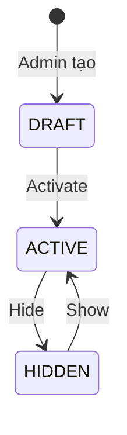

# Product Service — Domain Model

## Ngôn ngữ chung

| Term | Ý nghĩa |
|---|---|
| Product | Aggregate root, mang nội dung chung, category và SKU |
| SKU | Biến thể bán được, mang giá và saleability do admin quản lý |
| Catalog availability | Product `ACTIVE` và SKU `ACTIVE`; không phải stock availability |
| Base price | Giá VND do admin đặt: `base_price_vnd` |
| Selling price | Giá VND Product công bố sau markdown: `selling_price_vnd` |
| Catalog revision | Version đơn điệu của toàn Product aggregate cho catalog event |
| Effective thumbnail | `storage_key` ảnh đại diện đã resolve cho một SKU; `null` khi không có ảnh hợp lệ |
| Source revision | Version do Promotion cấp để guard markdown snapshot |

Inventory chỉ được tham chiếu qua `sku_id` ở contract liên service. Product không có
`OUT_OF_STOCK`, quantity, reservation hay deduct.

## Commands và queries

| Type | Capability | Actor |
|---|---|---|
| Command | Tạo/cập nhật/xóa Product, SKU, media | Admin |
| Command | Tạo/cập nhật/xóa category, attribute, option, mapping | Admin |
| Command | Activate, hide hoặc show Product | Admin |
| Command | Apply markdown snapshot và reprice | Promotion qua Kafka |
| Query | Catalog point-read một/batch SKU | Cart, Checkout |
| Query | Buyer Product Detail theo slug: catalog, category path, nhãn thuộc tính/biến thể, media giới hạn và giá; không stock | Product Detail BFF |
| Query | Snapshot/export catalog | Search |

## Quy tắc nghiệp vụ

| ID | Quy tắc | Enforcement/kết quả |
|---|---|---|
| PRODUCT-BR-001 | Product chỉ được gán vào category lá tồn tại; category tree không được cycle. | Validate application trong transaction. |
| PRODUCT-BR-002 | Product luôn có ít nhất một SKU; không được xóa SKU cuối cùng. | Tạo Product/SKU cùng transaction; từ chối delete SKU cuối. |
| PRODUCT-BR-003 | `sku_code` unique toàn hệ thống. | Unique constraint; lỗi trùng map thành domain error. |
| PRODUCT-BR-004 | `base_price_vnd > 0` và `0 <= selling_price_vnd <= base_price_vnd`. | Validate application và CHECK constraint. |
| PRODUCT-BR-005 | Chỉ admin sửa `base_price_vnd`; Product là nơi duy nhất tính `selling_price_vnd`. | Không nhận selling price từ admin API. |
| PRODUCT-BR-006 | Chỉ có một markdown active cho một Product; Promotion không phát rule overlap. | Một projection mỗi Product, guard `source_revision`. |
| PRODUCT-BR-007 | Event markdown cũ/trùng không được reprice ngược. | Chỉ apply `source_revision` mới hơn. |
| PRODUCT-BR-008 | Activate yêu cầu tối thiểu một SKU `ACTIVE`. | Guard trong transaction sau khi lock Product. |
| PRODUCT-BR-009 | Hide/show là quyết định admin thuần túy, không đọc Inventory. | Không có stock guard hay auto transition. |
| PRODUCT-BR-010 | Hard delete Product/SKU phải ghi tombstone event trong cùng transaction. | Insert outbox trước delete; không FK outbox tới aggregate. |
| PRODUCT-BR-011 | Xóa category chỉ khi không còn category con và Product. | Trả lỗi khi category chưa rỗng; không cascade hide. |
| PRODUCT-BR-012 | Thumbnail SKU ưu tiên IMAGE của SKU, rồi IMAGE Product; VIDEO không được chọn. | Product resolve `thumbnail_storage_key` trong snapshot; `null` là hợp lệ. |
| PRODUCT-BR-013 | Slug Product là kebab-case ASCII chữ thường `^[a-z0-9]+(?:-[a-z0-9]+)*$`, dài 1–180. Product không tự chuẩn hóa slug admin gửi. | Validate ở HTTP admin API, trả `400`; DB CHECK là lớp phòng thủ cuối. Product Detail BFF dùng cùng pattern để trả `404` mà không gọi Product. |

## Giá markdown

```text
PERCENTAGE: discount = floor(base_price_vnd * discount_bps / 10_000)
            discount = min(discount, max_discount_vnd) nếu có cap
FIXED_VND:  discount = fixed_discount_vnd
selling_price_vnd = max(0, base_price_vnd - discount)
```

Promotion event ACTIVE mang full rule/discount/interval; INACTIVE là reason-only
tombstone. Product chỉ apply khi `source_revision` lớn hơn row projection hiện có;
event cũ/trùng là no-op và tombstone được giữ để không hồi sinh giá cũ.

## State machine



| Transition | Actor | Guard | Kết quả |
|---|---|---|---|
| `— -> DRAFT` | Admin | Category/attribute hợp lệ, có ít nhất một SKU hợp lệ | Tạo Product, revision `1`, outbox `sku-upserted` cho từng SKU. |
| `DRAFT -> ACTIVE` | Admin | Có ít nhất một SKU `ACTIVE`. | Tăng `catalog_revision`, phát status snapshot. |
| `ACTIVE -> HIDDEN` | Admin | Product tồn tại. | Tăng `catalog_revision`, phát status snapshot. |
| `HIDDEN -> ACTIVE` | Admin | Product tồn tại. | Tăng `catalog_revision`, phát status snapshot. |
| `DRAFT`/`ACTIVE`/`HIDDEN` -> deleted | Admin | Delete SKU không phải SKU cuối; delete Product chụp tombstone trước. | Hard delete, phát `SKU_DELETED` hoặc `PRODUCT_DELETED`. |

Không có transition tự động do hết hàng. Hard delete là command ngoài FSM.

## Concurrency

Command chạm aggregate lock Product trước rồi lock SKU. Sau mutation, tăng
`catalog_revision` đúng một lần và ghi outbox snapshot. Lock timeout là lỗi tạm thời;
worker retry/requeue, không bỏ qua im lặng.

## Domain errors

Mọi lỗi HTTP là `application/problem+json` với `code` và `retryable`
(`common/ErrorCode.java` là nguồn duy nhất). Catalog đầy đủ:

| Code | Khi nào trả | HTTP |
|---|---|---|
| `PRODUCT_NOT_FOUND` | Product không tồn tại; buyer-read còn dùng cho Product `DRAFT`/`HIDDEN` hoặc không còn SKU `ACTIVE` để không lộ catalog chưa công bố. | 404 |
| `SKU_NOT_FOUND` | SKU không tồn tại hoặc không thuộc Product. | 404 |
| `MEDIA_NOT_FOUND` | Media không tồn tại hoặc không thuộc Product. | 404 |
| `CATEGORY_NOT_FOUND` | Category không tồn tại. | 404 |
| `ATTRIBUTE_NOT_FOUND` | Attribute không tồn tại, hoặc chưa được map vào category khi bỏ mapping. | 404 |
| `ATTRIBUTE_OPTION_NOT_FOUND` | Option không tồn tại hoặc không thuộc attribute. | 404 |
| `CATEGORY_NOT_LEAF` | Gán Product vào category không phải lá, hoặc thêm category con vào category đang chứa Product. | 409 |
| `CATEGORY_NOT_EMPTY` | Xóa category còn con hoặc Product. | 409 |
| `CATEGORY_CYCLE_DETECTED` | Parent mới là chính category hoặc hậu duệ của nó. | 409 |
| `SKU_CODE_ALREADY_EXISTS` | `sku_code` trùng, kể cả trùng trong cùng request. | 409 |
| `SLUG_ALREADY_EXISTS` | Slug Product hoặc Category đã dùng. | 409 |
| `ATTRIBUTE_CODE_ALREADY_EXISTS` | `code` attribute trùng. | 409 |
| `ATTRIBUTE_OPTION_CODE_ALREADY_EXISTS` | `code` option trùng trong cùng attribute. | 409 |
| `PRODUCT_NOT_SUBMITTABLE` | Activate không có SKU `ACTIVE`. | 409 |
| `SKU_LAST_DELETE_FORBIDDEN` | Xóa SKU cuối cùng của Product. | 409 |
| `INVALID_STATE_TRANSITION` | Command không hợp lệ cho status hiện tại, kể cả target trùng status hiện tại hoặc target `DRAFT`. | 409 |
| `ATTRIBUTE_IN_USE` | Đổi `code`/`value_type`, xóa attribute/option/mapping, hoặc đặt mapping mà dữ liệu Product/SKU hiện hữu sẽ không còn hợp lệ. | 409 |
| `CATALOG_CONSTRAINT_VIOLATION` | CHECK/unique của database chặn một race mà validate application không thấy (gồm selling price vượt base price). | 409 |
| `PRODUCT_REVISION_MISMATCH` | `If-Match` khác `catalog_revision` hiện tại. | 412 |
| `INVALID_REQUEST` | Body/tham số sai (kèm `errors[]` theo field), thiếu hoặc sai định dạng `If-Match`, slug Product vi phạm PRODUCT-BR-013, `base_price_vnd <= 0`. | 400 |
| `INVALID_ATTRIBUTES` | Key không được map vào category của Product, đặt nhầm bên Product-level/biến thể, giá trị sai kiểu hoặc option `SELECT` không tồn tại, hoặc thiếu attribute bắt buộc; kèm `errors[]` theo field. | 400 |
| `INVALID_CURSOR` | Cursor phân trang hoặc export hỏng, hết hạn hoặc thuộc export khác. | 400 |
| `UNAUTHENTICATED` | Thiếu trusted identity (`X-User-Id`) hoặc `X-Service-Identity`. | 401 |
| `FORBIDDEN` | Không có role `ADMIN`, hoặc service identity ngoài allowlist của nhóm route. | 403 |
| `CATALOG_UNAVAILABLE` | Lock timeout, lỗi tạm thời PostgreSQL, hoặc không chụp được replay offsets của export; `retryable=true`, có `Retry-After`. | 503 |
| `INTERNAL_ERROR` | Lỗi không lường trước; không lộ message tầng dưới. | 500 |

`INVALID_PRICE` có trong enum nhưng hiện không được phát: giá `base_price_vnd` không dương bị
bean validation báo `INVALID_REQUEST`, và selling price không bao giờ do client gửi nên chỉ vi phạm
được qua CHECK của database (`CATALOG_CONSTRAINT_VIOLATION`).

Hết hàng là kết quả reservation của Inventory, không phải domain error của Product. gRPC không
dùng bảng này: SKU không tồn tại hoặc không catalog-active là `not_found`/`unavailable` trong
response, còn request sai là `INVALID_ARGUMENT`.
