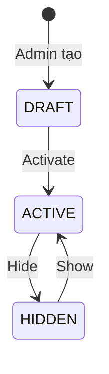

# Product Service — Domain Model

## Ngôn ngữ chung

| Term | Ý nghĩa |
|---|---|
| Product | Aggregate root, mang nội dung chung, category và SKU |
| SKU | Biến thể bán được, mang giá và saleability do admin quản lý |
| Catalog availability | Product `ACTIVE` và SKU `ACTIVE`; không phải stock availability |
| Base price | Giá VND do admin đặt: `base_price_vnd` |
| Selling price | Giá VND Product công bố sau markdown: `selling_price_vnd` |
| Catalog revision | Version đơn điệu của toàn Product aggregate cho catalog event |
| Source revision | Version do Promotion cấp để guard markdown snapshot |

Inventory chỉ được tham chiếu qua `sku_id` ở contract liên service. Product không có
`OUT_OF_STOCK`, quantity, reservation hay deduct.

## Commands và queries

| Type | Capability | Actor |
|---|---|---|
| Command | Tạo/cập nhật/xóa Product, SKU, media | Admin |
| Command | Tạo/cập nhật/xóa category, attribute, option, mapping | Admin |
| Command | Activate, hide hoặc show Product | Admin |
| Command | Apply markdown snapshot và reprice | Promotion qua Kafka |
| Query | Catalog point-read một/batch SKU | Cart, Checkout |
| Query | Snapshot/export catalog | Search |

## Quy tắc nghiệp vụ

| ID | Quy tắc | Enforcement/kết quả |
|---|---|---|
| PRODUCT-BR-001 | Product chỉ được gán vào category lá tồn tại; category tree không được cycle. | Validate application trong transaction. |
| PRODUCT-BR-002 | Product luôn có ít nhất một SKU; không được xóa SKU cuối cùng. | Tạo Product/SKU cùng transaction; từ chối delete SKU cuối. |
| PRODUCT-BR-003 | `sku_code` unique toàn hệ thống. | Unique constraint; lỗi trùng map thành domain error. |
| PRODUCT-BR-004 | `base_price_vnd > 0` và `0 <= selling_price_vnd <= base_price_vnd`. | Validate application và CHECK constraint. |
| PRODUCT-BR-005 | Chỉ admin sửa `base_price_vnd`; Product là nơi duy nhất tính `selling_price_vnd`. | Không nhận selling price từ admin API. |
| PRODUCT-BR-006 | Chỉ có một markdown active cho một Product; Promotion không phát rule overlap. | Một projection mỗi Product, guard `source_revision`. |
| PRODUCT-BR-007 | Event markdown cũ/trùng không được reprice ngược. | Chỉ apply `source_revision` mới hơn. |
| PRODUCT-BR-008 | Activate yêu cầu tối thiểu một SKU `ACTIVE`. | Guard trong transaction sau khi lock Product. |
| PRODUCT-BR-009 | Hide/show là quyết định admin thuần túy, không đọc Inventory. | Không có stock guard hay auto transition. |
| PRODUCT-BR-010 | Hard delete Product/SKU phải ghi tombstone event trong cùng transaction. | Insert outbox trước delete; không FK outbox tới aggregate. |
| PRODUCT-BR-011 | Xóa category chỉ khi không còn category con và Product. | Trả lỗi khi category chưa rỗng; không cascade hide. |

## Giá markdown

```text
PERCENTAGE: discount = floor(base_price_vnd * discount_bps / 10_000)
            discount = min(discount, max_discount_vnd) nếu có cap
FIXED_VND:  discount = fixed_discount_vnd
selling_price_vnd = max(0, base_price_vnd - discount)
```

Promotion event activate/update/deactivate là snapshot đầy đủ. Product chỉ apply khi
`source_revision` lớn hơn row projection hiện có; event cũ/trùng là no-op.

## State machine



| Transition | Actor | Guard | Kết quả |
|---|---|---|---|
| `— -> DRAFT` | Admin | Category/attribute hợp lệ, có ít nhất một SKU hợp lệ | Tạo Product, revision `1`, outbox `sku-upserted` cho từng SKU. |
| `DRAFT -> ACTIVE` | Admin | Có ít nhất một SKU `ACTIVE`. | Tăng `catalog_revision`, phát status snapshot. |
| `ACTIVE -> HIDDEN` | Admin | Product tồn tại. | Tăng `catalog_revision`, phát status snapshot. |
| `HIDDEN -> ACTIVE` | Admin | Product tồn tại. | Tăng `catalog_revision`, phát status snapshot. |
| `DRAFT`/`ACTIVE`/`HIDDEN` -> deleted | Admin | Delete SKU không phải SKU cuối; delete Product chụp tombstone trước. | Hard delete, phát `SKU_DELETED` hoặc `PRODUCT_DELETED`. |

Không có transition tự động do hết hàng. Hard delete là command ngoài FSM.

## Concurrency

Command chạm aggregate lock Product trước rồi lock SKU. Sau mutation, tăng
`catalog_revision` đúng một lần và ghi outbox snapshot. Lock timeout là lỗi tạm thời;
worker retry/requeue, không bỏ qua im lặng.

## Domain errors

| Code | Khi nào trả | Mapping gợi ý |
|---|---|---|
| `CATEGORY_NOT_FOUND` | Category không tồn tại. | HTTP 404 |
| `CATEGORY_NOT_LEAF` | Gán Product vào category không phải lá. | HTTP 409 |
| `CATEGORY_NOT_EMPTY` | Xóa category còn con hoặc Product. | HTTP 409 |
| `SKU_CODE_ALREADY_EXISTS` | `sku_code` trùng. | HTTP 409 |
| `INVALID_PRICE` | Base/selling price vi phạm ràng buộc. | HTTP 400 |
| `PRODUCT_NOT_SUBMITTABLE` | Activate không có SKU `ACTIVE`. | HTTP 409 |
| `SKU_LAST_DELETE_FORBIDDEN` | Xóa SKU cuối cùng của Product. | HTTP 409 |
| `PRODUCT_NOT_FOUND` | Product không tồn tại. | HTTP 404 |
| `SKU_NOT_FOUND` | SKU không tồn tại hoặc không thuộc Product. | HTTP 404 |
| `INVALID_STATE_TRANSITION` | Command không hợp lệ cho status hiện tại. | HTTP 409 |

Hết hàng là kết quả reservation của Inventory, không phải domain error của Product.
