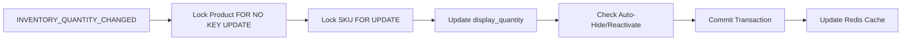

# Product Service - Tối Ưu Hóa Inventory Sync Worker

**Tài liệu thiết kế giải pháp Two-Phase Lock-Free thay thế Pessimistic Locking cho Inventory Sync Event**

**Liên kết nhanh (Related Documents):**
* [Background Workers Workflows](product_workflow.md)
* [Background Workers & Jobs](product_workers.md)
* [API Endpoints](product_endpoints.md)
* [Caching Schema (Redis)](product_caching_schema.md)
* [Database Schema (Write Store)](product_db_design.md)
* [State Machine & Lifecycle](product_state_machine.md)
* [Events Structure & Kafka Topics](product_events.md)
* [Architecture Recommendations](product_architecture_recommendations.md)

---

## 1. Phân Tích Root Cause

### 1.1. Vấn đề hiện tại

Thiết kế Inventory Sync Worker cũ sử dụng **Pessimistic Locking** cho mọi event.



**Các vấn đề nghiêm trọng:**

| Vấn đề | Mô tả | Mức độ |
|---|---|---|
| **Hot SKU Contention** | SKU bán chạy (iPhone) nhận hàng trăm event/giây. Mỗi event lock row → hàng trăm worker instance chờ nhau. | 🔴 Nghiêm trọng |
| **Deadlock AB-BA** | Inventory Worker (Product→SKU) vs Admin API (Product→SKU) khi cùng chạm vào cùng product từ nhiều instance | 🔴 Nghiêm trọng |
| **Lock Hold Time dài** | Auto-hide check + auto-reactivate logic + outbox insert trong cùng transaction giữ lock quá lâu | 🟠 Cao |
| **Không Scale được** | QPS cao = QPS lock contention = latency tăng phi tuyến tính | 🟠 Cao |
| **Tài nguyên DB lãng phí** | Lock contention = connection pool exhaustion = ảnh hưởng Admin API | 🟡 Trung bình |

### 1.2. Tại sao Pessimistic Locking không phù hợp cho Volume cao

- **Đặc thù Inventory event**: `INVENTORY_QUANTITY_CHANGED` về bản chất là **idempotent field update** (`display_quantity = available_quantity`). Không có business logic phức tạp trong transaction.
- **Tần suất**: Mỗi lần mua hàng → 1 event. Với 1000 đơn/giây → 1000 lock/giây trên cùng hot SKU.
- **So sánh với Markdown Worker**: Markdown Worker đã xử lý đúng bằng cách chia transaction-per-product, nhưng Inventory event còn cao hơn Markdown hàng chục lần.

---

## 2. Giải Pháp Đề Xuất: Two-Phase Architecture

**Core idea**: Tách luồng xử lý thành **2 phase** để loại bỏ lock contention:

### 2.1. Tổng Quan Kiến Trúc

```
┌─────────────────────────────────────────────────────────────────────────┐
│  PHASE 1: Fast Path - Lock-Free Update (Kafka Consumer)                │
│                                                                         │
│  INVENTORY_QUANTITY_CHANGED                                             │
│        │                                                                │
│        ▼                                                                │
│  ┌──────────────┐    ┌──────────────┐    ┌──────────────────────────┐ │
│  │ 1. Validate  │    │ 2. Lua CAS   │    │ 3. Upsert Redis Cache    │ │
│  │ payload +    │───▶│ (Atomic      │───▶│ (Immediate warm cache) │ │
│  │ timestamp    │    │ Compare-     │    │ + Redis ZSET (pending)  │ │
│  │ guard        │    │ Swap) on      │    │                          │ │
│  │              │    │ display_qty  │    │                          │ │
│  └──────────────┘    └──────────────┘    └──────────────────────────┘ │
│                                                                         │
│  ⚡ Target: < 5ms latency, ZERO database lock                          │
└─────────────────────────────────────────────────────────────────────────┘

┌─────────────────────────────────────────────────────────────────────────┐
│  PHASE 2: Slow Path - Async DB Sync (Scheduled Worker)                 │
│                                                                         │
│  Redis ZSET (pending_sync)                                              │
│        │                                                                │
│        ▼                                                                │
│  ┌──────────────┐    ┌──────────────┐    ┌──────────────────────────┐│
│  │ 1. Drain     │    │ 2. Batch     │    │ 3. Batch INSERT          ││
│  │ ZSET with    │───▶│ aggregate by │───▶│ product_outbox_events     ││
│  │ pagination   │    │ product_id   │    │ (1 statement per product)││
│  │ (100-500     │    │              │    │                          ││
│  │  items/run)  │    │              │    │                          ││
│  └──────────────┘    └──────────────┘    └──────────────────────────┘│
│                                    │                                     │
│                                    ▼                                     │
│                          ┌──────────────────┐                          │
│                          │ 4. FSM triggers   │                          │
│                          │ (AUTO_HIDE/      │                          │
│                          │  AUTO_REACTIVATE) │                          │
│                          │ + Optimistic     │                          │
│                          │   Locking        │                          │
│                          └──────────────────┘                          │
│                                                                         │
│  ⏱ Target: < 1s end-to-end, batch processing                          │
└─────────────────────────────────────────────────────────────────────────┘
```

### 2.2. Phase 1: Fast Path (Lock-Free)

**Nguyên lý hoạt động:**

1. **Kafka Consumer nhận event** → **KHÔNG mở transaction với DB**
2. **Lua Script atomic compare-and-swap** trên Redis để đảm bảo:
   - Event mới hơn (`event_timestamp > cached.last_inventory_sync_at`)
   - Atomic update `display_quantity` + `last_inventory_sync_at`
3. **Immediate cache warm**: Ghi đè `product:sku:{sku_id}` ngay lập tức (không cần chờ DB)
4. **Đăng ký pending sync**: Thêm vào Redis ZSET `product:inventory:pending` (Global ZSET — không phải per-SKU ZSET) với score = `event_timestamp` và member = `{sku_id}:{event_timestamp}`
5. **Consumer ACK Kafka offset** ngay lập tức

**Tại sao không cần DB lock ở Phase 1:**
- Event payload đã chứa `available_quantity` — không cần đọc giá trị cũ từ DB để tính toán
- `event_timestamp` là monotonic increasing — dùng làm out-of-order guard
- Cache-first: downstream consumers (Cart, Checkout) đọc từ Redis, không cần DB

### 2.3. Phase 2: Slow Path (Async DB Sync)

**Nguyên lý hoạt động:**

1. **Scheduled Worker** chạy mỗi **500ms - 1s**
2. **Drain Redis ZSET** với pagination (100-500 items mỗi run)
3. **Group by product_id** trong RAM
4. **Batch write với Optimistic Locking** — mỗi product 1 transaction nhỏ:
   - Lock Product cha (1 row lock nhẹ)
   - Batch update tất cả SKU thuộc product đó
   - FSM auto-hide/reactivate nếu cần
   - Outbox insert
5. **Ack pending sync** từ Redis ZSET sau khi DB commit thành công

**Tại sao dùng Optimistic Locking ở Phase 2:**
- Mỗi product xử lý batch SKU, không còn hot contention
- Lock Product 1 lần cho cả batch → giảm lock operations 10-100 lần
- Retry với exponential backoff nếu optimistic lock fail

### 2.4. So Sánh Hiệu Suất

| Metric | Thiết kế hiện tại | Thiết kế mới |
|---|---|---|
| **DB Locks/event** | 2 (Product + SKU) | 0 (Phase 1) / 1/batch (Phase 2) |
| **Latency/event** | 20-100ms+ | < 5ms (Phase 1) |
| **Throughput** | Giới hạn bởi lock contention | 100x+ (lock-free) |
| **Deadlock risk** | Cao | Không (Phase 1) / Thấp (Phase 2) |
| **Cache freshness** | Sau DB commit | Ngay lập tức (Phase 1) |
| **Auto-hide latency** | Ngay lập tức | < 1-2s (trì hoãn được) |

---

## 3. Chi Tiết Thiết Kế Từng Phase

### 3.1. Phase 1: Inventory Fast-Sync Consumer (Kafka → Redis)

**Kiến trúc code:**

```java
// === Phase 1: Fast Path - Không đụng đến Database ===

@Service
@Slf4j
public class InventoryFastSyncConsumer {

    private final RedisTemplate<String, String> redis;
    private final InventoryFastSyncLuaScript luaScript;
    private final ObjectMapper objectMapper;

    // Lua script: atomic compare-and-swap trên Redis
    // Trả về:
    //   1 = update thành công (event mới hơn)
    //   0 = skip (event cũ hơn hoặc không tìm thấy key)
    //  -1 = key chưa tồn tại (cache miss - upsert)
    private static final String LUA_COMPARE_AND_SWAP =
        """
        local key = KEYS[1]
        local eventTimestamp = tonumber(ARGV[1])
        local availableQty = tonumber(ARGV[2])
        local productId = ARGV[3]
        local skuStatus = ARGV[4]

        local existing = redis.call('JSON.GET', key)
        if existing then
            local data = cjson.decode(existing)
            local cachedTs = tonumber(data.last_inventory_sync_at) or 0
            if eventTimestamp <= cachedTs then
                return 0  -- stale event, skip
            end
        end

        -- Build new cache value
        local newData = {
            sku_id = data and data.sku_id or key,
            product_id = productId,
            display_quantity = availableQty,
            last_inventory_sync_at = eventTimestamp,
            sku_status = skuStatus,
            -- preserve existing fields if present
            original_price = data and data.original_price or nil,
            promotional_price = data and data.promotional_price or nil,
            sku_code = data and data.sku_code or nil,
            product_name = data and data.product_name or nil,
            main_image_url = data and data.main_image_url or nil,
            product_status = data and data.product_status or nil,
            is_available = availableQty > 0,
            is_deleted = data and data.is_deleted or false,
            variant_attributes = data and data.variant_attributes or {}
        }

        redis.call('JSON.SET', key, '$', cjson.encode(newData))
        redis.call('EXPIRE', key, 3600)  -- 1h TTL

        -- Add to pending sync ZSET
        redis.call('ZADD', KEYS[2], eventTimestamp, KEYS[3])
        redis.call('EXPIRE', KEYS[2], 86400)  -- 24h TTL for ZSET

        return 1
        """;

    @KafkaListener(
        topics = "t.inventory.events",
        groupId = "product-inventory-fast-sync-group",
        concurrency = "8-16"  // Nhiều consumer threads
    )
    public void onInventoryEvent(ConsumerRecord<String, String> record) {
        try {
            InventoryEvent event = objectMapper.readValue(record.value(), InventoryEvent.class);
            if (!"INVENTORY_QUANTITY_CHANGED".equals(event.getEventType())) {
                return;
            }

            String skuId = event.getPayload().getSkuId();
            String cacheKey = "product:sku:" + skuId;
            String pendingKey = "product:inventory:pending";
            String pendingMember = skuId + ":" + event.getPayload().getEventTimestamp();

            // === BƯỚC 1: Lua CAS atomic update ===
            String skuStatus = determineSkuStatus(event.getPayload().getAvailableQuantity());

            Long result = redis.execute(
                new DefaultRedisScript<>(LUA_COMPARE_AND_SWAP, Long.class),
                Arrays.asList(cacheKey, pendingKey, pendingMember),
                String.valueOf(event.getPayload().getEventTimestamp()),
                String.valueOf(event.getPayload().getAvailableQuantity()),
                event.getPayload().getProductId(),
                skuStatus
            );

            if (result == null || result == 0) {
                log.debug("Skipping stale inventory event for sku={}, ts={}",
                    skuId, event.getPayload().getEventTimestamp());
                // Vẫn ACK để không block Kafka
            }


        } catch (Exception e) {
            log.error("Failed to process inventory event", e);
            // Không rethrow - sẽ retry tự động bởi Kafka retry policy
            throw e; // Kafka sẽ retry, sau max retries sẽ vào DLQ
        }
    }
}
```

**Đặc điểm quan trọng của Phase 1:**
- **8-16 consumer threads** để parallelize
- **Lua script** đảm bảo atomicity mà không cần DB lock
- **Staleness guard** ngay trong Lua để chặn out-of-order
- **ACK ngay lập tức** sau khi Redis write thành công
- **Không bao giờ đụng PostgreSQL** trong Phase 1

### 3.2. Phase 2: Async DB Sync Worker

**Kiến trúc code:**

```java
// === Phase 2: Slow Path - Async DB Sync từ Redis ZSET ===

@Service
@Slf4j
public class InventoryAsyncDbSyncWorker {

    private final RedisTemplate<String, String> redis;
    private final JdbcTemplate jdbc;
    private final ProductRepository productRepo;
    private final StateMachineService stateMachine;
    private final OutboxService outboxService;

    private static final int BATCH_SIZE = 100;   // SKU items mỗi run
    private static final int ZSET_RUN_LIMIT = 500; // Max items drain từ ZSET

    // Global Redis ZSET cho Phase 2: pending sync queue
    // Sử dụng ZSET đơn giản, scale bằng pagination + multi-instance scheduled workers
    // (Trong tương lai có thể chuyển sang Redis Stream nếu cần consumer group)
    private static final String ZSET_KEY = "product:inventory:pending";

    @Scheduled(fixedDelay = 500)  // Chạy mỗi 500ms
    public void syncToDatabase() {
        List<PendingSyncItem> items = drainPendingSync();
        if (items.isEmpty()) return;

        // Group by product_id trong RAM
        Map<String, List<PendingSyncItem>> byProduct = items.stream()
            .collect(Collectors.groupingBy(PendingSyncItem::getProductId));

        for (Map.Entry<String, List<PendingSyncItem>> entry : byProduct.entrySet()) {
            String productId = entry.getKey();
            List<PendingSyncItem> skuItems = entry.getValue();

            try {
                syncProductBatch(productId, skuItems);
            } catch (OptimisticLockingFailureException e) {
                // Retry sau với exponential backoff
                requeueForRetry(productId, skuItems);
            } catch (DataAccessException e) {
                log.error("Failed to sync product={}", productId, e);
                requeueForRetry(productId, skuItems);
            }
        }
    }

    @Transactional(isolation = Isolation.READ_COMMITTED)
    public void syncProductBatch(String productId, List<PendingSyncItem> skuItems) {

        // === BƯỚC 1: Lock Product cha ===
        Product product = productRepo.findByIdForUpdate(productId)
            .orElseThrow(() -> new IllegalStateException("Product not found: " + productId));

        if (product.getIsDeleted()) {
            // Product đã soft-delete, skip tất cả SKU nhưng vẫn ack pending
            ackPendingItems(skuItems);
            return;
        }

        // === BƯỚC 2: Query TẤT CẢ SKU của Product từ DB ===
        // QUAN TRỌNG: Phải query toàn bộ SKU pool (không chỉ SKU trong drain batch)
        // để FSM đánh giá auto-hide/reactivate toàn diện.
        List<ProductSku> allProductSkus = skuRepository.findAllByProductId(productId);

        // Map drain batch: SKU ID -> PendingSyncItem
        Map<String, PendingSyncItem> pendingMap = skuItems.stream()
            .collect(Collectors.toMap(PendingSyncItem::getSkuId, item -> item));

        List<ProductSku> updatedSkus = new ArrayList<>();
        boolean anyInventoryChanged = false;

        for (ProductSku sku : allProductSkus) {
            PendingSyncItem pending = pendingMap.get(sku.getSkuId());
            if (pending == null) {
                // SKU không có event trong drain batch hiện tại
                // Kiểm tra SKU này có đang OUT_OF_STOCK không -> có thể cần auto-reactivate
                // Không làm gì thêm, chỉ giữ nguyên state
                continue;
            }

            // Staleness guard: chỉ update nếu event mới hơn DB
            if (pending.getEventTimestamp() <= sku.getLastInventorySyncAt()) {
                continue; // event cũ, skip
            }

            String oldStatus = sku.getStatus();
            sku.setDisplayQuantity(pending.getAvailableQuantity());
            sku.setLastInventorySyncAt(pending.getEventTimestamp());

            // SKU status logic
            if (pending.getAvailableQuantity() == 0 && "ACTIVE".equals(sku.getStatus())) {
                sku.setStatus("OUT_OF_STOCK");
                anyInventoryChanged = true;
            } else if (pending.getAvailableQuantity() > 0 && "OUT_OF_STOCK".equals(sku.getStatus())) {
                // Chỉ auto-reactivate nếu SKU đang OUT_OF_STOCK. INACTIVE do admin set không tự động nhảy.
                sku.setStatus("ACTIVE");
                anyInventoryChanged = true;
            }
            // INACTIVE: giữ nguyên không tự động kích hoạt

            updatedSkus.add(sku);
        }

        if (!updatedSkus.isEmpty()) {
            skuRepository.saveAll(updatedSkus);
        }

        // === BƯỚC 3: FSM Auto-Hide / Auto-Reactivate ===
        // Đánh giá trên toàn bộ SKU pool (allProductSkus), không phải chỉ drain batch
        if (anyInventoryChanged) {
            evaluateAndTriggerStateTransition(product, allProductSkus);
        }

        // === BƯỚC 4: Batch Insert Outbox ===
        // Phát SKU_STATUS_CHANGED khi có ít nhất 1 SKU thực sự được update
        // (anyInventoryChanged đã bao gồm việc có SKU nào được thay đổi trong batch).
        // Payload chứa sku_ids[], product_status_changed, new_product_status nếu FSM trigger
        // đồng thời đổi product status (ví dụ: AUTO_HIDE → product HIDDEN).
        List<OutboxEvent> outboxEvents = new ArrayList<>();
        if (anyInventoryChanged) {
            outboxEvents.add(OutboxEvent.skuStatusChanged(
                productId,
                updatedSkus.stream().map(ProductSku::getSkuId).toList(),
                skuStatusChanged,       // new_sku_status
                productStatusChanged,   // boolean
                newProductStatus       // nullable, chỉ set khi product_status cũng thay đổi
            ));
        }
        outboxService.batchInsert(outboxEvents);

        // === BƯỚC 5: Ack pending items ===
        ackPendingItems(skuItems);
    }

    private void evaluateAndTriggerStateTransition(Product product, List<ProductSku> allProductSkus) {
        // Kiểm tra tất cả SKU thuộc product:
        // - Nếu TẤT CẢ SKU đều OUT_OF_STOCK (quantity=0, status=OUT_OF_STOCK) -> auto-hide
        // - Nếu ÍT NHẤT 1 SKU có hàng (quantity>0, status!=OUT_OF_STOCK) -> auto-reactivate
        //
        // Chỉ kiểm tra các SKU thực sự có trong DB (allProductSkus).
        // SKU nào không có event trong drain batch giữ nguyên trạng thái (không bị đánh giá sai).

        boolean allOutOfStock = allProductSkus.stream()
            .allMatch(s -> s.getDisplayQuantity() == 0 && "OUT_OF_STOCK".equals(s.getStatus()));

        boolean anyInStock = allProductSkus.stream()
            .anyMatch(s -> s.getDisplayQuantity() > 0 && !"OUT_OF_STOCK".equals(s.getStatus()));

        if (allOutOfStock && "ACTIVE".equals(product.getStatus())) {
            // AUTO_HIDE_OUT_OF_STOCK
            stateMachine.sendEvent(product, "AUTO_HIDE_OUT_OF_STOCK");
        } else if (anyInStock && "HIDDEN".equals(product.getStatus())
                   && !product.getAdminHidden() && !product.getIsDeleted()) {
            // AUTO_REACTIVATE_IN_STOCK
            stateMachine.sendEvent(product, "AUTO_REACTIVATE_IN_STOCK");
        }
    }
}
```

**Điểm khác biệt quan trọng so với thiết kế cũ:**
- Bước 2 query **toàn bộ** SKU pool, không chỉ drain batch — đảm bảo FSM nhìn thấy full picture.
- Logic `evaluateAndTriggerStateTransition` dùng `allProductSkus` thay vì `allSkus` (code cũ không rõ ràng).
- Đã loại bỏ `buildOutboxEvents` phức tạp, thay bằng `anyInventoryChanged` flag.
- Comment rõ ràng cho trường hợp SKU không có event trong batch.

### 3.3. Redis Lua Script cho Phase 1 (Chi tiết)

```lua
-- inventory_fast_sync.lua
-- Atomic compare-and-swap cho inventory sync
-- KEYS[1] = product:sku:{sku_id}  (cache key)
-- KEYS[2] = product:inventory:pending  (Global ZSET)
-- KEYS[3] = member string "{sku_id}:{event_timestamp}"
-- ARGV[1] = event_timestamp (epoch millis)
-- ARGV[2] = available_quantity
-- ARGV[3] = product_id
-- ARGV[4] = sku_status
-- Returns: 1 = applied, 0 = stale skipped, -1 = new key upsert

local cacheKey = KEYS[1]
local pendingZSet = KEYS[2]
local pendingMember = KEYS[3]
local eventTimestamp = tonumber(ARGV[1])
local availableQty = tonumber(ARGV[2])
local productId = ARGV[3]
local skuStatus = ARGV[4]

-- Get existing cache data
local existingJson = redis.call('JSON.GET', cacheKey)
local cachedTs = 0
local existingData = nil

if existingJson then
    existingData = cjson.decode(existingJson)
    cachedTs = tonumber(existingData.last_inventory_sync_at) or 0
end

-- Out-of-order guard
if cachedTs > 0 and eventTimestamp <= cachedTs then
    return 0  -- stale event
end

-- Determine SKU status
local newSkuStatus = skuStatus
if availableQty == 0 then
    newSkuStatus = 'OUT_OF_STOCK'
elseif availableQty > 0 then
    -- Chỉ auto-reactivate nếu SKU đang OUT_OF_STOCK. INACTIVE do admin set không tự động nhảy.
    if newSkuStatus == 'OUT_OF_STOCK' then
        newSkuStatus = 'ACTIVE'
    end
    -- Nếu là INACTIVE (admin chủ động deactivate), giữ nguyên INACTIVE.
end

-- Build cache value (preserve existing fields)
-- CRITICAL: product_status is PRESERVED from existing cache, NOT overwritten.
-- product_status can only change via PRODUCT_STATE_CHANGED (API/FSM) or SKU_STATUS_CHANGED (Phase 2 FSM trigger).
-- Phase 1 does NOT update product_status to avoid overwriting a newer state change with a stale cached value.
-- price_updated_at is also preserved — it is only set by Event Handler when refreshing
-- from PRODUCT_PRICE_UPDATED.
local newData = {
    sku_id = existingData and existingData.sku_id or string.match(cacheKey, "product:sku:(.+)"),
    product_id = productId,
    sku_code = existingData and existingData.sku_code or "",
    product_name = existingData and existingData.product_name or "",
    main_image_url = existingData and existingData.main_image_url or "",
    original_price = existingData and existingData.original_price or 0,
    promotional_price = existingData and existingData.promotional_price,
    best_price = existingData and existingData.best_price or 0,
    has_promotion = existingData and existingData.has_promotion or false,
    display_quantity = availableQty,
    last_inventory_sync_at = eventTimestamp,
    sku_status = newSkuStatus,
    -- product_status: PRESERVED, never overwritten by Phase 1
    product_status = existingData and existingData.product_status or "",
    is_available = availableQty > 0,
    is_deleted = existingData and existingData.is_deleted or false,
    variant_attributes = existingData and existingData.variant_attributes or {},
    -- price_updated_at: PRESERVED, only set by Event Handler on PRODUCT_PRICE_UPDATED
    price_updated_at = existingData and existingData.price_updated_at or nil
}

-- Atomic write
redis.call('JSON.SET', cacheKey, '$', cjson.encode(newData))
redis.call('EXPIRE', cacheKey, 3600)

-- Add to pending ZSET for async DB sync
redis.call('ZADD', pendingZSet, eventTimestamp, pendingMember)
redis.call('EXPIRE', pendingZSet, 86400)

return existingJson and 1 or -1
```

---

## 4. Đảm Bảo Consistency

### 4.1. Eventual Consistency Model

```
┌──────────────────────────────────────────────────────────────────┐
│                    DATA FLOW CONSISTENCY                         │
│                                                                  │
│  Inventory Service                                                │
│       │                                                          │
│       ▼ (1) Kafka INVENTORY_QUANTITY_CHANGED                    │
│  ┌─────────────────────────────────────────────────────────────┐ │
│  │ Phase 1: Redis Fast Sync                                     │ │
│  │   Lua CAS → product:sku:{sku_id} (IMMEDIATE)                │ │
│  │   + ZADD to pending ZSET                                    │ │
│  │                                                               │ │
│  │   Latency: < 5ms                                             │ │
│  │   Cache: WARMED immediately                                  │ │
│  └─────────────────────────────────────────────────────────────┘ │
│       │                                                          │
│       │ (2) Kafka offset ACK                                     │
│       ▼                                                          │
│  ┌─────────────────────────────────────────────────────────────┐ │
│  │ Phase 2: Async DB Sync (500ms - 1s delay)                   │ │
│  │   Drain ZSET → Batch UPDATE product_skus                    │ │
│  │   + FSM triggers (if status changed)                        │ │
│  │   + Outbox INSERT                                           │ │
│  │                                                               │ │
│  │   Latency: 500ms - 2s                                       │ │
│  │   Source of Truth: UPDATED                                   │ │
│  └─────────────────────────────────────────────────────────────┘ │
│       │                                                          │
│       ▼ (3) Debezium CDC                                        │
│  Search Service (Elasticsearch) ← OUTBOX EVENT                  │
│                                                                  │
│  CONSISTENCY:                                                    │
│  - Cache: IMMEDIATE (Phase 1)                                    │
│  - DB: eventual (500ms-2s)                                      │
│  - Search: eventual (2-5s)                                      │
└──────────────────────────────────────────────────────────────────┘
```

### 4.2. Đảm Bảo Không Mất Event

| Cơ chế | Mô tả |
|---|---|
| **Redis ZSET pending** | Event được ghi vào ZSET trước khi ACK Kafka. Nếu Phase 1 crash sau ZADD nhưng trước ACK, event sẽ được xử lý lại (Kafka sẽ redeliver). |
| **Kafka at-least-once** | Kafka consumer với manual ACK chỉ commit offset SAU khi Redis write thành công. |
| **Idempotent processing** | Lua CAS với staleness guard đảm bảo event cũ không bị apply lại. |
| **Pending ack** | Chỉ xóa khỏi ZSET SAU khi DB commit thành công. Nếu crash giữa chừng, worker restart sẽ đọc lại ZSET. |

### 4.3. Self-Healing Khi Crash

| Crash point | Recovery mechanism |
|---|---|
| Phase 1: Sau ZADD, trước Kafka ACK | Kafka redelivers → Lua CAS idempotent → không double-write |
| Phase 1: Sau Kafka ACK, trước ZADD | **Rủi ro**: event không vào pending ZSET → DB không sync. **Giải pháp**: Kafka ACK chỉ sau khi cả Redis write + ZADD thành công |
| Phase 2: DB commit fail | Optimistic lock fail → item requeue vào ZSET với retry metadata |
| Phase 2: Sau DB commit, trước ZSET ACK | Worker restart → item vẫn nằm trong ZSET với timestamp cũ. Redis TTL guard 24h. |

### 4.4. Staleness Guard Đa Tầng

```
Layer 1: Lua Script (Phase 1)
  event_timestamp > cached.last_inventory_sync_at

Layer 2: Phase 2 DB Sync
  event_timestamp > product_skus.last_inventory_sync_at

Layer 3: Outbox event guard (Search Service)
  event.updated_at > current_doc.updated_at
```

---

## 5. Trade-offs Cần Lưu Ý

| Trade-off | Chi tiết | Mitigation |
|---|---|---|
| **Auto-hide delay** | Auto-hide/reactivate có thể chậm 500ms-2s | Chấp nhận được vì đây là business "nice-to-have", không phải hard constraint. Product vẫn hiển thị "hết hàng" ngay qua Redis. |
| **Cache/DB drift ngắn** | Cache có thể hiển thị quantity chưa sync xuống DB (vài trăm ms) | Chấp nhận được. Cart/Checkout dùng `display_quantity` chỉ để hiển thị, không dùng để reserve. |
| **Complexity tăng** | 2 workers thay vì 1 | Đánh đổi xứng đáng với hiệu suất. Mỗi worker logic đơn giản, dễ test. |
| **Redis as intermediate** | Thêm Redis như tầng trung gian | Redis vốn đã là tầng cache của hệ thống. Không thêm dependency mới. |

---

## 6. Kết Luận

Thiết kế **Two-Phase Lock-Free Architecture** giải quyết triệt để vấn đề Pessimistic Locking bottleneck của Inventory Sync:

1. **Phase 1 (Fast Path)**: Lock-free, < 5ms latency, immediate cache warm
2. **Phase 2 (Slow Path)**: Batch processing với Optimistic Locking, giảm lock operations 10-100x
3. **Deadlock elimination**: Phase 1 hoàn toàn không dùng DB lock
4. **Scale linearly**: Throughput giới hạn bởi Redis, không còn là DB lock
5. **Auto-hide/reactivate**: Vẫn được đảm bảo qua Phase 2 (với độ trễ 500ms-2s chấp nhận được)

Trade-off chấp nhận được: Cache và DB có consistency gap vài trăm ms, auto-hide/reactivate có độ trễ 1-2s. Đây là event-driven system, eventual consistency là mô hình phù hợp.
