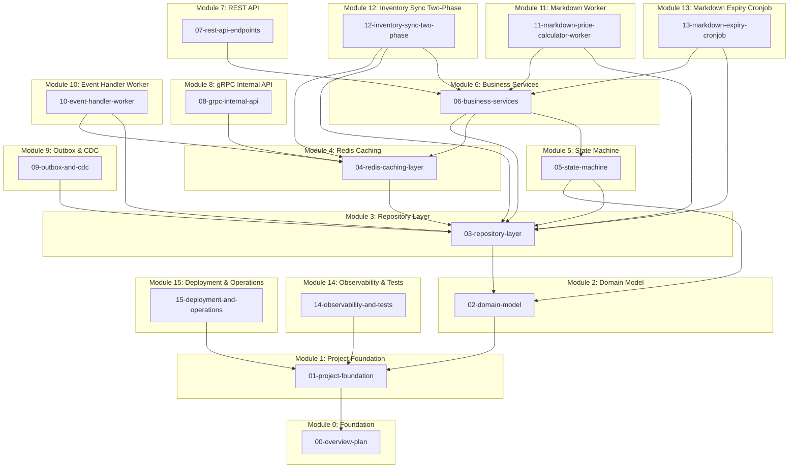

# Product Service - Implementation Plan Overview

> **Document Version:** 1.0
> **Date:** June 10, 2026
> **Service:** product-service (Java / Spring Boot 3.x)
> **Status:** Implementation Master Plan

---

## 1. Scope & Overview

Product Service is the **source of truth** for product catalog data in the e-commerce platform. It manages the full lifecycle of products, SKUs, categories, and integrates with promotion and inventory services. The service uses a CQRS-style architecture with PostgreSQL as the write store, Redis for caching, and Kafka for event-driven communication.

### 1.1 Service Responsibilities

- **Product Management:** CRUD for products and SKUs, state machine lifecycle (DRAFT → ACTIVE → HIDDEN)
- **Category Management:** Hierarchical category tree management
- **Point-Read API:** gRPC and REST endpoints serving Cart, Order, Checkout, and other internal services
- **Markdown Pricing Integration:** Consume promotion events and calculate promotional prices
- **Inventory Sync:** Two-Phase Lock-Free Architecture for high-throughput inventory updates
- **Event Broadcasting:** Outbox pattern via Debezium CDC to Kafka topics

### 1.2 Technology Stack

| Component | Technology | Version |
|---|---|---|
| Runtime | JDK | 21 |
| Framework | Spring Boot | 3.x |
| Build Tool | Maven | 3.9+ |
| Database | PostgreSQL | 16+ |
| Cache | Redis (Lettuce + RedisJSON) | 7.x |
| Message Broker | Apache Kafka | 3.x |
| State Machine | Spring State Machine | 4.x |
| CDC | Debezium | 2.x |
| gRPC | grpc-spring-boot-starter | 3.x |
| Resilience | Resilience4j | 2.x |
| Migration | Flyway | 10.x |
| Testing | JUnit 5 + Mockito + TestContainers | - |

---

## 2. Module Dependency Graph



### 2.1 Build Order Summary

| Order | Module | Description |
|---|---|---|
| 1 | 01-project-foundation | Maven scaffold, dependencies, base config |
| 2 | 02-domain-model | Entities, value objects, enums, domain events, exceptions |
| 3 | 03-repository-layer | JPA repositories, custom queries, locking |
| 4 | 04-redis-caching-layer | Redis config, cache keys, Lua scripts |
| 5 | 05-state-machine | Spring State Machine configuration |
| 6 | 06-business-services | Core service classes (product, SKU, category, markdown) |
| 7 | 07-rest-api-endpoints | Admin REST controllers, DTOs |
| 8 | 08-grpc-internal-api | gRPC service definitions and implementations |
| 9 | 09-outbox-and-cdc | Outbox pattern, Debezium connector configuration |
| 10 | 10-event-handler-worker | Kafka consumers for category/SKU events |
| 11 | 11-markdown-price-calculator-worker | Markdown price calculation from Kafka |
| 12 | 12-inventory-sync-two-phase | Phase 1 consumer + Phase 2 scheduled worker |
| 13 | 13-markdown-expiry-cronjob | Scheduled markdown expiry cleanup |
| 14 | 14-observability-and-tests | Logging, metrics, health checks, tests |
| 15 | 15-deployment-and-operations | Docker, CI/CD, environment configuration |

---

## 3. Key Architecture Decisions

### 3.1 Concurrency Control Strategy

| Context | Strategy | Reason |
|---|---|---|
| Admin API (all writes) | Pessimistic Locking (`FOR NO KEY UPDATE` on Product, `FOR UPDATE` on SKU) | Strong consistency, lock order: Product → SKU |
| Inventory Sync Phase 1 | Redis Lua CAS (compare-and-swap) | Lock-free, < 5ms latency |
| Inventory Sync Phase 2 | Batch Optimistic Locking per product | Avoid hot-row contention |
| Markdown Worker | Redis Distributed Lock (SETNX) | Prevent concurrent recalculation |
| Event Handler | No locks (read-only + Redis write) | Worker only reads DB, never writes |

### 3.2 Caching Strategy

- **Soft Invalidation:** Overwrite cache on every SKU event instead of DEL
- **Cache Keys:** `product:sku:{sku_id}`, `product:markdown:active:{sku_id}`, `product:inventory:pending` (ZSET)
- **Event Handler is the sole writer** of `product:sku:{sku_id}` cache
- **Markdown Worker only manages** `product:markdown:active:{sku_id}` cache

### 3.3 Outbox Pattern

- Every domain write inserts into `product_outbox_events` within the same transaction
- Debezium CDC reads WAL and publishes to Kafka topics
- Topics: `t.product.events` (partitioned by `product_id`), `t.category.events` (partitioned by `category_id`)

### 3.4 Inventory Sync Two-Phase

```
Phase 1 (Fast Path): Kafka → Redis Lua CAS → Immediate cache warm → ZADD pending
  - Latency: < 5ms
  - DB locks: ZERO
  - Staleness guard: event_timestamp > cached.last_inventory_sync_at

Phase 2 (Slow Path): Scheduled Worker (500ms) → Drain ZSET → Batch DB sync → FSM triggers → Ack ZSET
  - Latency: 500ms-2s
  - Optimistic locking per product
  - FSM auto-hide/reactivate based on inventory
```

---

## 4. Package Structure (Java Common Layout)

All code follows the `com.platform.product-service` base package.

```
com.platform.product-service/
├── ProductServiceApplication.java
├── config/                    # Spring configs (Kafka, Redis, gRPC, Scheduling)
├── controller/                # REST controllers (Admin APIs)
├── dto/                       # Request/Response DTOs, Mappers, gRPC protos
├── service/                   # Application services (use cases)
│   └── impl/
├── domain/                    # Pure domain (NO infrastructure deps)
│   ├── entity/
│   ├── vo/
│   ├── enums/
│   ├── event/
│   ├── exception/
│   └── statemachine/
├── port/                      # Interfaces (ports in Hexagonal)
│   ├── inbound/
│   └── outbound/
├── infrastructure/            # Adapters (implementations)
│   ├── persistence/
│   │   ├── entity/
│   │   ├── repository/
│   │   └── mapper/
│   ├── redis/
│   ├── kafka/
│   │   ├── producer/
│   │   └── consumer/
│   └── grpc/
├── worker/                    # Background workers
│   ├── consumer/
│   ├── scheduler/
│   └── processor/
└── common/                     # Shared utilities
```

---

## 5. Module Files

| # | File | Description |
|---|---|---|
| 1 | `00-overview-plan.md` | This file |
| 2 | `01-project-foundation.md` | Project scaffold, Maven pom.xml, base configs |
| 3 | `02-domain-model.md` | Entities, VOs, enums, domain events, exceptions |
| 4 | `03-repository-layer.md` | JPA repositories, custom queries, locking |
| 5 | `04-redis-caching-layer.md` | Redis config, cache keys, Lua scripts |
| 6 | `05-state-machine.md` | Spring State Machine FSM |
| 7 | `06-business-services.md` | ProductService, SkuService, CategoryService, MarkdownService |
| 8 | `07-rest-api-endpoints.md` | Admin REST controllers |
| 9 | `08-grpc-internal-api.md` | gRPC internal service definitions |
| 10 | `09-outbox-and-cdc.md` | Outbox pattern, Debezium CDC |
| 11 | `10-event-handler-worker.md` | Kafka consumers for category/SKU events |
| 12 | `11-markdown-price-calculator-worker.md` | Markdown price calculation worker |
| 13 | `12-inventory-sync-two-phase.md` | Two-Phase Lock-Free inventory sync |
| 14 | `13-markdown-expiry-cronjob.md` | Markdown expiry scheduled job |
| 15 | `14-observability-and-tests.md` | Logging, metrics, health checks, tests |
| 16 | `15-deployment-and-operations.md` | Docker, CI/CD, environment configuration |

---

## 6. Key Design Principles

1. **Structure Before Framework:** Business logic lives in `domain/`, independent of HTTP/Redis/Kafka
2. **Interface as Contract:** Use ports (interfaces) to define contracts; infrastructure implements them
3. **Dependency Inversion:** Domain layer knows nothing about infrastructure
4. **Lock Order:** Always Product → SKU when both need to be locked
5. **Eventual Consistency:** Cache is immediate (Phase 1), DB is 500ms-2s (Phase 2), Search is 2-5s
6. **Outbox First:** Every domain write inserts outbox record in the same transaction
7. **Schema Versioning:** All Kafka events carry `schema_version = 1`, additive changes only
8. **Staleness Guards:** Multi-layer guards at Lua CAS, Phase 2 DB, and Outbox event level
