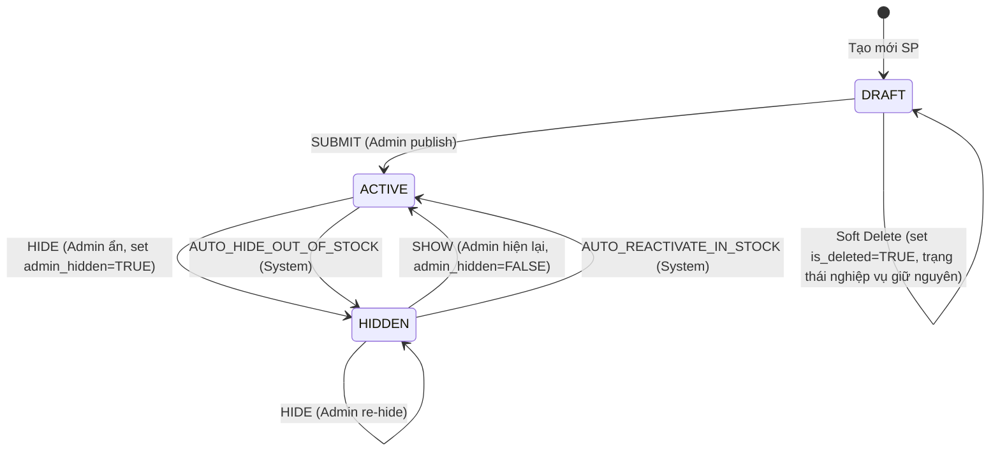

# Product Service - Sơ Đồ Quản Lý Trạng Thái Máy (State Machine)

**Liên kết nhanh (Related Documents):**
*   [Workflows (API & Data Flow)](product_workflow.md)
*   [Background Workers & Jobs](product_workers.md)
*   [Caching Schema (Redis)](product_caching_schema.md)
*   [Database Schema (Write Store)](product_db_design.md)
*   [State Machine & Lifecycle](product_state_machine.md)
*   [Events Structure & Kafka Topics](product_events.md)
*   [Architecture Recommendations](product_architecture_recommendations.md)

---

Tài liệu này quy chiếu quá trình biến thiên vòng đời (Lifecycle) của một Sản Phẩm (Product) bên trong E-commerce Platform. Hệ thống sử dụng thiết kế cấu trúc máy trạng thái hữu hạn (Finite State Machine - FSM) từ Spring State Machine kết hợp với Lưu log Lịch sử thay đổi.

> **Mô hình người dùng:** Hệ thống vận hành theo mô hình **Platform do Admin quản lý trực tiếp** — không có khái niệm Seller/Shop. Admin đồng thời đảm nhận vai trò quản lý sản phẩm, khuyến mãi, và toàn bộ vận hành nền tảng. Do đó, trạng thái sản phẩm được thiết kế đơn giản hóa: không có bước duyệt chéo (PENDING_REVIEW), không có từ chối (REJECTED), không có cấm vĩnh viễn (BANNED). Admin tạo sản phẩm và có thể ẩn/hiện sản phẩm.

## 1. Bản Đồ Các Trạng Thái (States)

1.  **`DRAFT` (Bản Nháp)**: Trạng thái khởi tạo. Sản phẩm được lưu trữ, admin đang soạn thảo hình ảnh, content, giá. Hoàn toàn không hiển thị trên Storefront và Search.
2.  **`ACTIVE` (Đang Bán)**: Sản phẩm công khai trên nền tảng. Có thể được Search, Add vào Giỏ và Thanh Toán bình thường.
3.  **`HIDDEN` (Ẩn)**: Sản phẩm bị ẩn khỏi trang bán. Link trực tiếp vẫn sống (hiển thị hết hàng). Có thể do admin chủ động ẩn, hoặc do System tự động ẩn khi tất cả SKU hết Tồn Kho (xem [Inventory Sync Worker - Two-Phase](product_workers.md#5-inventory-sync-worker-two-phase-lock-free-architecture)).

*(Lưu ý: Không có trạng thái `DELETED` trong State Machine. Thao tác xóa mềm (soft delete) được quản lý độc lập thông qua cờ `is_deleted` ở tầng cơ sở dữ liệu. Khi soft delete, trạng thái nghiệp vụ (DRAFT/ACTIVE/HIDDEN) được giữ nguyên — không chuyển sang HIDDEN — để bảo lưu trạng thái nghiệp vụ cuối cùng và đảm bảo Search Service tombstone đúng document.)*

## 2. Các Lệnh Chuyển Tiếp (Events / Transitions)

Khi hệ thống nội bộ gởi một Event, State Machine sẽ xét Điều kiện (Guards) để đi từ *T_Hiện_Tại* sang *T_Mục_Tiêu*.

### 2.1 Transitions do Admin Trigger

*   **`SUBMIT`**: Admin bấm publish. (`DRAFT` → `ACTIVE`).
    **Guard (BẮT BUỘC):** Sản phẩm phải có ít nhất 1 SKU với `original_price > 0`. Nếu không thỏa mãn → FSM reject event, API trả 400 Bad Request.
*   **`HIDE`**: Admin chủ động ẩn sản phẩm. (`ACTIVE` → `HIDDEN` hoặc `HIDDEN` → `HIDDEN` — cho phép re-hide để cập nhật trạng thái). Khi thực hiện HIDE thành công, hệ thống bắt BUỘC set `admin_hidden = TRUE` để ghi nhận admin chủ động ẩn.
*   **`SHOW`**: Admin hiện lại sản phẩm. (`HIDDEN` → `ACTIVE`). Khi chạy lệnh này, BẮT BUỘC hệ thống API phải đếm tổng Tồn Kho của tất cả SKU (`SUM(display_quantity)`). Trước lệnh Query `SUM`, API/Controller bắt buộc phải gọi `SELECT 1 FROM products WHERE product_id = :id FOR NO KEY UPDATE` để chốt cọc Lock ở Product Cha. Hiện lại chỉ được phép chuyển state sang `ACTIVE` NẾU VÀ CHỈ NẾU tổng tồn kho > 0 **và** `is_deleted = false`. Đồng thời reset `admin_hidden = FALSE`. Nếu tổng tồn kho = 0 nhưng admin vẫn cố hiện, bản ghi Database chỉ lưu lại trạng thái `HIDDEN` do kẹt điều kiện tồn kho. Sau khi inventory nhả hàng trở lại, luồng `AUTO_REACTIVATE_IN_STOCK` sẽ tự động hiện sản phẩm khi `is_deleted = false` và `admin_hidden = false`.

### 2.2 Transitions do System/Worker Tự Động Trigger

> **Ràng buộc Kiến trúc (Concurrency Guard):** Các Transition `AUTO_HIDE_OUT_OF_STOCK` và `AUTO_REACTIVATE_IN_STOCK` do Worker tự động trigger chạy trong Phase 2 của Inventory Sync Worker, sử dụng Optimistic Locking (batch per product). Không còn Pessimistic Locking trên từng event. Transition `SUBMIT`/`HIDE`/`SHOW` do Admin trigger vẫn dùng Pessimistic Locking theo thứ tự Product -> SKU. State Machine chỉ quản lý trạng thái nghiệp vụ; không có `@Version` hay optimistic locking nữa.

*   **`AUTO_HIDE_OUT_OF_STOCK`**: Hệ thống tự động ẩn sản phẩm khi [Inventory Sync Worker - Two-Phase](product_workers.md#5-inventory-sync-worker-two-phase-lock-free-architecture) phát hiện **tất cả** SKU của Product đều có `display_quantity = 0`, `is_deleted = false`, và `status = ACTIVE` (chỉ trigger khi Product đang ACTIVE). Nếu Product đã ở HIDDEN do admin (SHOW) nhưng inventory lại hết hàng, FSM không chạy AUTO_HIDE (product đã HIDDEN rồi). (`ACTIVE` → `HIDDEN`).
*   **`AUTO_REACTIVATE_IN_STOCK`**: Hệ thống tự động hiện lại sản phẩm khi Inventory báo có hàng trở lại. (`HIDDEN` → `ACTIVE`). **Điều kiện sống còn:** Chỉ auto-reactivate nếu đánh giá Product thỏa mãn đồng thời cả ba điều kiện: `status = HIDDEN`, `is_deleted = false`, và `admin_hidden = false` trong cùng transaction. Nếu Admin đã chủ động ẩn sản phẩm (`admin_hidden = true`), hệ thống tuyệt đối không được tự động hiện lại — admin phải tự nhấn SHOW.

> **Lưu ý:** Hai transition `AUTO_HIDE_OUT_OF_STOCK` và `AUTO_REACTIVATE_IN_STOCK` hoạt động ở mức Product (cấp cha), không phải SKU (cấp con). Logic tổng hợp: nếu **ít nhất 1 SKU** khả dụng → Product vẫn ACTIVE. Chỉ khi **100% SKU** hết hàng → auto-hide. Trạng thái riêng lẻ của từng SKU (`ACTIVE`/`OUT_OF_STOCK`/`INACTIVE`) được quản lý trên field `product_skus.status` (tên DB). Trong event payload và API, field này dùng tên chuẩn là `sku_status`. — xem [DB Design](product_db_design.md#12-nhóm-sản-phẩm--biến-thể-product--sku).
>
> **`admin_hidden` flag:** Khi Admin chủ động thực hiện lệnh `HIDE`, cờ `admin_hidden` được set = TRUE. Cờ này dùng để phân biệt giữa Admin ẩn thủ công và System auto-hide do hết hàng. Luồng `AUTO_REACTIVATE_IN_STOCK` **tuyệt đối không được** trigger khi `admin_hidden = true`, đảm bảo admin giữ quyền kiểm soát trạng thái hiển thị.

## 3. Sơ đồ UML (Sequence) Của Các Transitions

## 4. Ràng Buộc Hệ Thống & Các Hành Động Hậu Kỳ (Post-Actions)

*   **Phát Broadcast Sự Kiện Outbox:** Sự kiện đồng hành là [`PRODUCT_STATE_CHANGED`](product_events.md#33-product_state_changed). Điều này là Yết hầu để Search Service biết mà Xóa Data / Thêm Data vào Elasticsearch Index nếu Sản phẩm rơi vào / Thoát khỏi nhóm Hợp lệ (ACTIVE). Sự kiện này mặc định luôn tồn tại đính kèm quy trình FSM (Không cần ai viết code thêm để bắn Outbox ngoài lòng FSM).
*   **Cache Invalidation:** Khi trạng thái thay đổi, [Invalidation Consumer Worker](product_workers.md) sẽ bắt lấy sự kiện outbox ngay tại Kafka, lập tức cập nhật soft invalidation cho các cache key `product:sku:{sku_id}` tự động mà không can thiệp API blocking.
*   **Guards (Rào cản logic):**
    *   `SUBMIT` yêu cầu sản phẩm phải có ít nhất 1 SKU với `original_price > 0`.
    *   `AUTO_REACTIVATE_IN_STOCK` chỉ áp dụng khi điều kiện tức thời đang đúng: `status = HIDDEN`, `is_deleted = false`, và `admin_hidden = false` trong cùng transaction.
