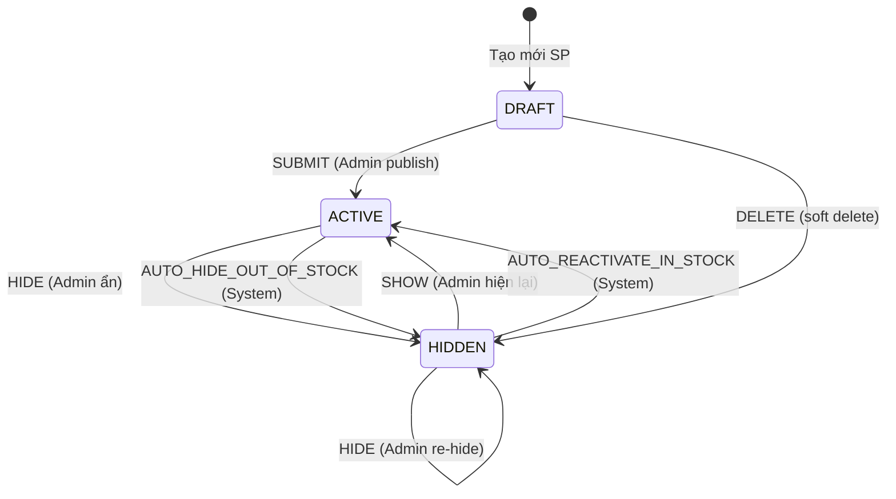

# Product Service - Sơ Đồ Quản Lý Trạng Thái Máy (State Machine)

**Liên kết nhanh (Related Documents):**
*   [Workflows (API & Data Flow)](product_workflow.md)
*   [Background Workers & Jobs](product_workers.md)
*   [Caching Schema (Redis)](product_caching_schema.md)
*   [Database Schema (Write Store)](product_db_design.md)
*   [State Machine & Lifecycle](product_state_machine.md)
*   [Events Structure & Kafka Topics](product_events.md)
*   [Architecture Recommendations](product_architecture_recommendations.md)

---

Tài liệu này quy chiếu quá trình biến thiên vòng đời (Lifecycle) của một Sản Phẩm (Product) bên trong E-commerce Platform. Hệ thống sử dụng thiết kế cấu trúc máy trạng thái hữu hạn (Finite State Machine - FSM) từ Spring State Machine kết hợp với Lưu log Lịch sử thay đổi.

> **Mô hình người dùng:** Hệ thống vận hành theo mô hình **Platform do Admin quản lý trực tiếp** — không có khái niệm Seller/Shop. Admin đồng thời đảm nhận vai trò quản lý sản phẩm, khuyến mãi, và toàn bộ vận hành nền tảng. Do đó, trạng thái sản phẩm được thiết kế đơn giản hóa: không có bước duyệt chéo (PENDING_REVIEW), không có từ chối (REJECTED), không có cấm vĩnh viễn (BANNED). Admin tạo sản phẩm và có thể ẩn/hiện sản phẩm.

## 1. Bản Đồ Các Trạng Thái (States)

1.  **`DRAFT` (Bản Nháp)**: Trạng thái khởi tạo. Sản phẩm được lưu trữ, admin đang soạn thảo hình ảnh, content, giá. Hoàn toàn không hiển thị trên Storefront và Search.
2.  **`ACTIVE` (Đang Bán)**: Sản phẩm công khai trên nền tảng. Có thể được Search, Add vào Giỏ và Thanh Toán bình thường.
3.  **`HIDDEN` (Ẩn)**: Sản phẩm bị ẩn khỏi trang bán. Link trực tiếp vẫn sống (hiển thị hết hàng). Có thể do admin chủ động ẩn, hoặc do System tự động ẩn khi tất cả SKU hết Tồn Kho (xem [Inventory Sync Worker](product_workers.md#6-inventory-sync-worker)).

*(Lưu ý: Không có trạng thái `DELETED` trong State Machine. Thao tác xóa mềm được quản lý độc lập thông qua cờ `is_deleted` ở tầng cơ sở dữ liệu nhằm bảo lưu trạng thái nghiệp vụ cuối cùng).*

## 2. Các Lệnh Chuyển Tiếp (Events / Transitions)

Khi hệ thống nội bộ gởi một Event, State Machine sẽ xét Điều kiện (Guards) để đi từ *T_Hiện_Tại* sang *T_Mục_Tiêu*.

### 2.1 Transitions do Admin Trigger

*   **`SUBMIT`**: Admin bấm publish. (`DRAFT` → `ACTIVE`).
*   **`HIDE`**: Admin chủ động ẩn sản phẩm. (`ACTIVE` → `HIDDEN` hoặc `HIDDEN` → `HIDDEN` — cho phép re-hide để cập nhật trạng thái).
*   **`SHOW`**: Admin hiện lại sản phẩm. (`HIDDEN` → `ACTIVE`). **Sửa lỗi Hố Đen Deadlock:** Khi chạy lệnh này, BẮT BUỘC hệ thống API phải đếm tổng Tồn Kho của tất cả SKU (`SUM(display_quantity)`). TUY NHIÊN, trước lệnh Query `SUM`, API/Controller bắt buộc phải gọi `SELECT 1 FROM products WHERE product_id = :id FOR NO KEY UPDATE` để chốt cọc Lock ở Product Cha (tránh Deadlock ngược AB-BA với Inventory Worker). Hiện lại chỉ được phép chuyển state sang `ACTIVE` NẾU VÀ CHỈ NẾU tổng tồn kho > 0 **và** `is_deleted = false`. Nếu tổng tồn kho = 0 nhưng admin vẫn cố hiện, bản ghi Database chỉ lưu lại trạng thái `HIDDEN` do kẹt điều kiện tồn kho. Sau khi inventory nhả hàng trở lại, luồng `AUTO_REACTIVATE_IN_STOCK` sẽ tự động hiện sản phẩm khi `is_deleted = false`.

### 2.2 Transitions do System/Worker Tự Động Trigger

> 🔴 **Ràng buộc Kiến trúc (Concurrency Guard):** Tất cả các Transition thực hiện bởi Worker bắt buộc phải nằm trong một Database Transaction, sử dụng lock `SELECT 1 FROM products WHERE product_id = ? FOR NO KEY UPDATE` ở BƯỚC ĐẦU TIÊN (Trước khi lock bảng SKUs) để chống Deadlock AB-BA. Và Hibernate/JPA/SpringStateMachine sẽ tự động lưu cập nhật Entity, tự động kích `version = version + 1` qua `@Version`. Tuyệt đối KHÔNG ĐỤNG TỚI lệnh Native Cập nhật version thủ công `UPDATE products SET version = version + 1` nếu có gọi logic rẽ nhánh FSM trong Transaction đó.

*   **`AUTO_HIDE_OUT_OF_STOCK`**: Hệ thống tự động ẩn sản phẩm khi [Inventory Sync Worker](product_workers.md#6-inventory-sync-worker) phát hiện **tất cả** SKU của Product đều có `display_quantity = 0` và `is_deleted = false`. (`ACTIVE` → `HIDDEN`).
*   **`AUTO_REACTIVATE_IN_STOCK`**: Hệ thống tự động hiện lại sản phẩm khi Inventory báo có hàng trở lại. (`HIDDEN` → `ACTIVE`). **Điều kiện sống còn:** Chỉ auto-reactivate nếu đánh giá Product thỏa mãn điều kiện `is_deleted = false` trong cùng transaction.

> **Lưu ý:** Hai transition `AUTO_HIDE_OUT_OF_STOCK` và `AUTO_REACTIVATE_IN_STOCK` hoạt động ở mức Product (cấp cha), không phải SKU (cấp con). Logic tổng hợp: nếu **ít nhất 1 SKU** khả dụng → Product vẫn ACTIVE. Chỉ khi **100% SKU** hết hàng → auto-hide. Trạng thái riêng lẻ của từng SKU (`ACTIVE`/`OUT_OF_STOCK`/`INACTIVE`) được quản lý trực tiếp trên field `product_skus.status` — xem [DB Design](product_db_design.md#12-nhóm-sản-phẩm--biến-thể-product--sku).

## 3. Sơ đồ UML (Sequence) Của Các Transitions

## 4. Ràng Buộc Hệ Thống & Các Hành Động Hậu Kỳ (Post-Actions)

*   **Phát Broadcast Sự Kiện Outbox:** Sự kiện đồng hành là [`PRODUCT_STATE_CHANGED`](product_events.md#33-product_state_changed). Điều này là Yết hầu để Search Service biết mà Xóa Data / Thêm Data vào Elasticsearch Index nếu Sản phẩm rơi vào / Thoát khỏi nhóm Hợp lệ (ACTIVE). Sự kiện này mặc định luôn tồn tại đính kèm quy trình FSM (Không cần ai viết code thêm để bắn Outbox ngoài lòng FSM).
*   **Cache Invalidation:** Khi trạng thái thay đổi, [Invalidation Consumer Worker](product_workers.md) sẽ bắt lấy sự kiện outbox ngay tại Kafka, lập tức cập nhật soft invalidation cho các cache key `product:sku:{sku_id}` tự động mà không can thiệp API blocking.
*   **Guards (Rào cản logic):**
    *   `SUBMIT` yêu cầu sản phẩm phải có ít nhất 1 SKU với `original_price > 0`.
    *   `AUTO_REACTIVATE_IN_STOCK` chỉ áp dụng khi điều kiện tức thời đang đúng: `status = HIDDEN` và `is_deleted = false` trong cùng transaction.
