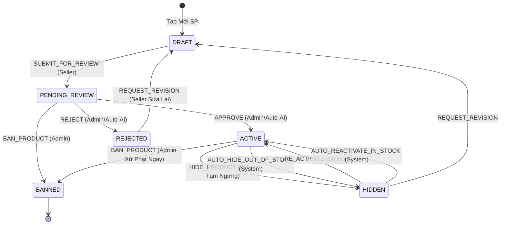

# Product Service - Sơ Đồ Quản Lý Trạng Thái Máy (State Machine)

**Liên kết nhanh (Related Documents):**
*   [Workflows (API & Data Flow)](product_workflow.md)
*   [Background Workers & Jobs](product_workers.md)
*   [Caching Schema (Redis & Caffeine)](product_caching_schema.md)
*   [Database Schema (Write Store)](product_db_design.md)
*   [State Machine & Lifecycle](product_state_machine.md)
*   [Events Structure & Kafka Topics](product_events.md)
*   [Architecture Recommendations](product_architecture_recommendations.md)

---
Tài liệu này quy chiếu quá trình biến thiên vòng đời (Lifecycle) của một Sản Phẩm (Product) bên trong E-commerce Platform. Hệ thống sử dụng thiết kế cấu trúc máy trạng thái hữu hạn (Finite State Machine - FSM) từ Spring State Machine kết hợp với Lưu log Lịch sử thay đổi.

Bảng lưu vết sử dụng tại `product_status_history`. Giao diện FSM kết dính chặt chẽ với API: *Chuyển Trạng Thái Sản Phẩm*. Xem tại [Product Workflow (API Chuyển Trạng Thái)](product_workflow.md#4-api-chuyển-trạng-thái-sản-phẩm-gửi-duyệt--duyệt--khoá-bài).

## 1. Bản Đồ Các Trạng Thái (States)

1.  **`DRAFT` (Bản Nháp)**: Trạng thái khởi tạo. Sản phẩm được lưu trữ, Seller đang trong quá trình soạn thảo hình ảnh, content. Hoàn toàn không hiển thị trên Storefront và Search.
2.  **`PENDING_REVIEW` (Chờ Xét Duyệt)**: Seller đã bấm gửi. Sản phẩm đang nằm ở trạng chờ để System, AI (Kiểm duyệt Ảnh/Nội Dung), hoặc Human Admin xét duyệt tính hợp quy định (Không phải hàng cấm, không chứa từ khóa xấu).
3.  **`ACTIVE` (Đang Bán)**: Sản phẩm công khai trên nền tảng. Có thể được Search, Add vào Giỏ và Thanh Toán bình thường.
4.  **`HIDDEN` (Ẩn)**: Sản phẩm hợp quy lưu hành nhưng bị chính Seller chủ động tạm Ẩn, hoặc bị System tự động ẩn khi tất cả SKU hết Tồn Kho (trường hợp Inventory đồng bộ lại tín hiệu Out-Of-Stock kéo dài — xem [Inventory Sync Worker](product_workers.md#6-inventory-sync-worker)). Không hiển thị trên trang bán nhưng link trực tiếp vẫn sống (hiển thị hết hàng).
5.  **`REJECTED` (Từ Chối Duyệt)**: Sản phẩm vi phạm chính sách ở khâu kiểm duyệt ban đầu (`PENDING_REVIEW` -> `REJECTED`). Seller phải sửa lại (trở lại DRAFT) để gửi duyệt tiếp.
6.  **`BANNED` (Bị Khoá/Cấm)**: Sản phẩm đang `ACTIVE` hoặc `PENDING_REVIEW` nhưng bất ngờ bị phát hiện vi phạm luật nặng, gian lận, report từ người dùng, Admin khóa gỡ bỏ ngay lập tức. Khóa vĩnh viễn quyền edit.

*(Lưu ý: Không có trạng thái `DELETED` trong State Machine. Thao tác xóa mềm được quản lý độc lập thông qua cờ `is_deleted` ở tầng cơ sở dữ liệu nhằm bảo lưu trạng thái nghiệp vụ cuối cùng).*

## 2. Các Lệnh Chuyển Tiếp (Events / Transitions)

Khi hệ thống nội bộ gởi một Event, State Machine sẽ xét Điều kiện (Guards) để đi từ *T_Hiện_Tại* sang *T_Mục_Tiêu*.

### 2.1 Transitions do Seller / Admin Trigger

*   **`SUBMIT_FOR_REVIEW`**: Seller bấm Nút Hoàn Tất / Gửi. (`DRAFT` → `PENDING_REVIEW`).
*   **`APPROVE`**: Chấp nhận duyệt qua Admin/AI. (`PENDING_REVIEW` → `ACTIVE`).
*   **`REJECT`**: Từ chối với lý do đính kèm. (`PENDING_REVIEW` → `REJECTED`).
*   **`REQUEST_REVISION`**: Chỉnh sửa (Làm lại form). (`REJECTED` / `HIDDEN` → `DRAFT`).
*   **`HIDE_PRODUCT`**: Chủ động tạm dừng kinh doanh. Khi Seller thao tác trigger này, hệ thống sẽ gán/cập nhật thêm cờ `seller_intention_hidden = true`. (`ACTIVE` → `HIDDEN`).
*   **`RE_ACTIVATE`**: Bán lại. Lệnh này sẽ mở cờ `seller_intention_hidden = false`. **Sửa lỗi Hố Đen:** Khi chạy lệnh này, BẮT BUỘC hệ thống API phải đếm tổng Tồn Kho của tất cả SKU (`SUM(display_quantity)`). Bấm "Bán lại" chỉ được phép chuyển state sang `ACTIVE` NẾU VÀ CHỈ NẾU tổng tồn kho > 0. Nếu tổng tồn kho = 0 nhưng Seller vẫn cố chỉnh cờ `seller_intention_hidden = false`, bản ghi Database chỉ lưu lại ý định (cập nhật cờ = false) nhưng **GIỮ NGUYÊN PRODUCT Ở TRẠNG THÁI `HIDDEN`** do kẹt điều kiện tồn kho. Sau khi ý định được cập nhật lại, bất kỳ event nhập kho nào đến sau cũng sẽ thành công đưa hàng lên web qua luồng `AUTO_REACTIVATE_IN_STOCK`.
*   **`BAN_PRODUCT`**: Hành động tối cao của Admin. Bất kể là `PENDING_REVIEW` hay `ACTIVE` đều bị ép sang `BANNED`.

### 2.2 Transitions do System/Worker Tự Động Trigger

> 🔴 **Ràng buộc Kiến trúc (Concurrency Guard):** Tất cả các Transition thực hiện bởi Worker bắt buộc phải nằm trong một Database Transaction, sử dụng lock `SELECT 1 FROM products WHERE id = ? FOR NO KEY UPDATE`, và luôn luôn đánh update `version = version + 1` để các hệ thống bắt event downstream (như Search Service) biết là trạng thái đã thực sự thay đổi một cách nhất quán.

*   **`AUTO_HIDE_OUT_OF_STOCK`**: Hệ thống tự động ẩn sản phẩm khi [Inventory Sync Worker](product_workers.md#6-inventory-sync-worker) phát hiện **tất cả** SKU của Product đều có `display_quantity = 0`. (`ACTIVE` → `HIDDEN`).
*   **`AUTO_REACTIVATE_IN_STOCK`**: Hệ thống tự động bật lại sản phẩm khi Inventory báo có hàng trở lại. (`HIDDEN` → `ACTIVE`). **Điều kiện sống còn:** Chỉ auto-reactivate nếu đánh giá Product thỏa mãn điều kiện `seller_intention_hidden = false`. Trước đây việc dựa vào `product_status_history.changed_by = 'SYSTEM'` là sai lầm vì ngăn chặn khả năng Seller được chủ động ẩn hàng vĩnh viễn lúc nó đang tạm hết.
*   **`VISIBILITY_REEVALUATE` (Internal Trigger)**: Trigger nội bộ được phát khi Seller đổi cờ `seller_intention_hidden: true -> false` trong lúc Product vẫn `HIDDEN`. Worker phải chạy lại guard tồn kho (ít nhất 1 SKU khả dụng) trong cùng transaction; nếu đạt điều kiện thì hợp thức chuyển `HIDDEN` → `ACTIVE` bằng `AUTO_REACTIVATE_IN_STOCK` mà không cần chờ inventory event mới.

> **Lưu ý:** Hai transition `AUTO_HIDE_OUT_OF_STOCK` và `AUTO_REACTIVATE_IN_STOCK` hoạt động ở mức Product (cấp cha), không phải SKU (cấp con). Logic tổng hợp: nếu **ít nhất 1 SKU** khả dụng → Product vẫn ACTIVE. Chỉ khi **100% SKU** hết hàng → auto-hide. Trạng thái riêng lẻ của từng SKU (`ACTIVE`/`OUT_OF_STOCK`/`INACTIVE`) được quản lý trực tiếp trên field `product_skus.status` — xem [DB Design](product_db_design.md#12-nhóm-sản-phẩm--biến-thể-product--sku).

## 3. Sơ đồ UML (Sequence) Của Các Transitions

## 4. Ràng Buộc Hệ Thống & Các Hành Động Hậu Kỳ (Post-Actions)

*   **Audit Trail:** Mọi ngóc ngách của quá trình chuyển trạng thái đều viết vào Log Table `product_status_history` kèm thời điểm, người gửi, và `reason` (đặc biệt khi REJECT, BAN). Quá trình này **chung một Transaction** với hành động cập nhật `status`.
*   **Phát Broadcast Sự Kiện Outbox:** Sự kiện đồng hành là [`ProductStateChangedEvent`](product_events.md#33-product_state_changed). Điều này là Yết hầu để Search Service biết mà Xoá Data / Thêm Data vào Elasticsearch Index nếu Sản phẩm rơi vào / Thoát khỏi nhóm Hợp lệ (ACTIVE).
*   **Cache Invalidation:** Khi trạng thái thay đổi, [Invalidation Consumer Worker](product_workers.md#2-invalidation-consumer-worker-xoá-cache-ngầm---optional) sẽ xoá các cache key `product:sku:{sku_id}` và `product:master:{product_id}` để đảm bảo Point-Read API luôn trả về trạng thái mới nhất.
*   **Guards (Rào cản logic):** 
    *   `APPROVE` không thể trigger nếu sản phẩm chưa có đủ Category Attributes Required (sẽ báo cản trong Code).
    *   `SUBMIT_FOR_REVIEW` yêu cầu sản phẩm phải có ít nhất 1 SKU với `original_price > 0`.
    *   `AUTO_REACTIVATE_IN_STOCK` chỉ áp dụng khi lý do ẩn trước đó là `OUT_OF_STOCK` (check `product_status_history`).
    *   `VISIBILITY_REEVALUATE` không được phép bypass `seller_intention_hidden`; chỉ chạy khi cờ hiện tại đã là `false` và ít nhất 1 SKU còn hàng.
    *   Hàng đã `BANNED` sẽ không bao giờ có thể quay lui lại được trạng thái nào khác. Nếu Seller muốn khiếu nại, họ phải tạo SP khác, hoặc Admin phải tác động cứng dưới DB (Data Patching).
