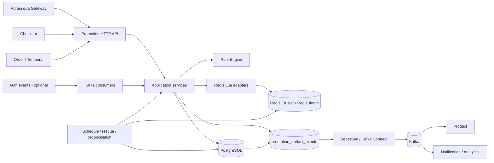

# Promotion Service — Kiến trúc

## 1. Architecture context

Promotion nằm giữa Admin, Checkout, Order và Product. PostgreSQL giữ campaign,
voucher, wallet, markdown cùng transactional outbox. Redis phục vụ cache và các hot
path có tranh chấp cao: claim, budget reservation và campaign schedule. Product nhận
full product markdown snapshot rồi sở hữu việc tính/persist giá bán; Search chỉ đọc
giá do Product công bố.

## 2. Component diagram



## 3. Trách nhiệm component

| Component | Trách nhiệm | Không được làm |
|---|---|---|
| HTTP adapter | AuthN/AuthZ, validation, mapping lỗi | Chứa discount/refund logic |
| Application service | Orchestrate command/query và transaction | Query database service khác |
| Rule Engine | Evaluate AST thuần, xác định | Ghi DB/Redis hoặc gọi network |
| PostgreSQL repository | Persist campaign, rule, wallet, budget, outbox | Quản lý reservation runtime |
| Redis/Lua adapter | Atomic claim, reserve, counter, lock, schedule | Trở thành durable truth |
| Outbox writer | Ghi CloudEvent cùng business transaction | Direct-produce sau commit |
| Debezium/Kafka Connect | Relay outbox at-least-once | Suy diễn business state |
| Kafka consumer | Welcome grant/claim persistence nếu được bật | Xử lý duplicate thiếu business guard |
| Worker | Rescue, expiry, rebuild và reconciliation | Ghi PostgreSQL dựa trên Redis counter |

## 4. Processing model

- Discovery/calculate là synchronous read path. Snapshot JSON từ Redis; cache miss đọc
  PostgreSQL. Rule AST được parse request-scoped.
- Claim hữu hạn chạy một Lua: kiểm tra user, `SPOP`, ghi claimed-user và pending record.
  Claim consumer ghi `coupon_claims` + wallet; pending sweeper cứu crash window.
- Reserve/confirm/cancel/`cancel-confirmed` là synchronous Temporal activities. Redis
  giữ reservation; PostgreSQL wallet/budget là durable state sau final transition.
- Admin mutation ghi PostgreSQL và outbox trong cùng transaction. Cache invalidation và
  ZSET update chỉ chạy sau commit, có DB fallback/rebuild.
- Campaign START/END worker không lưu phase thời gian vào DB. Worker kiểm tra lại
  `publication_status`, `[start_time,end_time)` và `campaigns.revision` trước khi phát
  markdown snapshot.
- Customer refund không đi qua Promotion. Không có refund consumer/API/allocation.

## 5. Consistency model

| Phạm vi | Mô hình |
|---|---|
| PostgreSQL constraint/transaction | Strong consistency nội bộ |
| Redis Lua | Atomic khi tất cả key cùng cluster hash slot |
| Claim Redis → PostgreSQL | Eventual; pending record không xóa trước DB commit |
| Campaign DB → Redis schedule | Eventual; DB scanner và startup rebuild tự phục hồi |
| PostgreSQL → Kafka | Transactional outbox + CDC, at-least-once |
| Product markdown projection | Apply full snapshot khi `source_revision` mới hơn |
| Discovery budget guard | Best-effort/fail-open; Reserve chốt authoritative |
| Redis budget counter | Runtime projection; DB-first reconciliation |

Không có distributed transaction PostgreSQL–Redis. Mỗi crash window phải có replay,
guarded transition hoặc reconciliation cụ thể.

## 6. Campaign scheduling correctness

`campaigns.publication_status` chỉ lưu ý định quản trị: `DRAFT`, `PUBLISHED`, `PAUSED`,
`CANCELLED`. `UPCOMING/ACTIVE/ENDED` được suy ra từ DB time; child promotion/markdown
không có lịch hay phase riêng.

Redis ZSET:

```text
promo:campaign:schedule
score  = boundary epoch milliseconds
member = {campaign_id}:{campaign_revision}:{START|END}
```

Worker dùng `ZRANGEBYSCORE`, acquire `promo:campaign:schedule:lock:{campaign_id}`, đọc
lại PostgreSQL và chỉ xử lý member có revision hiện hành. Business/outbox commit trước
`ZREM`. Nếu crash sau commit, retry bị outbox dedup key chặn. Nếu START được xử lý sau
`end_time`, worker chỉ phát trạng thái hội tụ `INACTIVE`, không phát `ACTIVE` muộn.

DB fallback 10–30 giây và startup/failover rebuild ngăn ZSET bị thiếu vĩnh viễn. Đây là
bounded eventual propagation, không phải hard real-time 0 ms; API eligibility luôn tự
kiểm tra DB time nên không kích hoạt voucher sớm vì worker lag.

## 7. Concurrency và idempotency

- Claim dùng các key có cùng hash tag `{promotion_id}`; DB guard
  `AVAILABLE AND owner_id IS NULL` và unique wallet chốt cuối.
- Reserve replay phải cùng payload; khác payload trả `IDEMPOTENCY_PAYLOAD_MISMATCH`.
- Confirm dùng conditional `SAVED → USED` và unique non-null `used_order_id`.
- Cancel pre-payment là idempotent trên reservation key; không đổi wallet.
- `cancel-confirmed` dùng guarded `USED → SAVED` nếu còn hạn, hoặc `USED → EXPIRED`.
- Outbox có deterministic `dedup_key`; Product dùng `source_revision` để bỏ stale event.
- Không cần bảng idempotency tổng quát hay usage ledger riêng.

## 8. Deployment constraints

- API stateless, consumer/worker có thể scale ngang.
- Multi-key Lua bắt buộc cùng Redis Cluster hash slot.
- Tiền/counter amount dùng integer VND với `HINCRBY`, không dùng `HINCRBYFLOAT`.
- Không reserve ở Preview/Discovery và không auto-save khi Submit.
- Không persist `RESERVED`; reservation chỉ là runtime hold.
- Không phát business event trực tiếp từ application sau commit.
- Không để Product/Search chạy voucher Rule Engine.
- Không coi campaign end, pause hoặc cancel là emergency revocation của voucher đã lưu;
  wallet vẫn theo `expired_at` đã snapshot, kể cả khi mode chọn `CAMPAIGN_END`.

## 9. ADR liên quan

- [ADR-002](./decisions/ADR-002-single-tier-redis-snapshots.md): snapshot Redis đơn tầng.
- [ADR-003](./decisions/ADR-003-redis-lua-budget-reservation.md): budget/reservation Lua.
- [ADR-004](./decisions/ADR-004-spop-claim-and-rescue.md): SPOP + pending rescue.
- [ADR-009](./decisions/ADR-009-deterministic-json-rule-engine.md): Rule Engine xác định.
- [ADR-010](./decisions/ADR-010-campaign-lifecycle-and-scheduling.md): campaign lifecycle/schedule.
- [ADR-011](./decisions/ADR-011-transactional-outbox-cdc.md): outbox + CDC.
- [ADR-012](./decisions/ADR-012-wallet-redemption-and-no-refund.md): schema/wallet/no-refund.

ADR-001, ADR-005, ADR-006, ADR-007 và ADR-008 được các ADR mới supersede.
