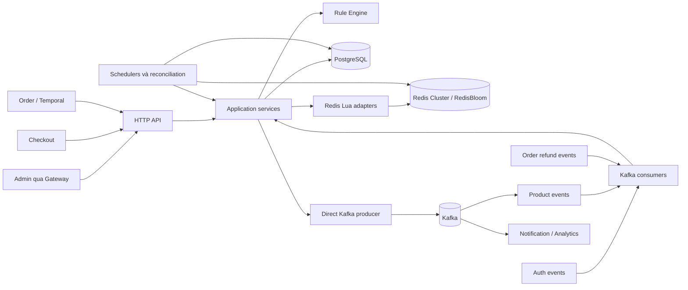

# Promotion Service — Kiến trúc

## 1. Architecture context

Promotion nằm giữa Admin/Checkout/Order và các read model downstream. Admin ghi
campaign, voucher và markdown. Checkout đọc gợi ý/tính giảm giá. Order điều phối
TRY/CONFIRM/CANCEL qua Temporal. Product nhận markdown để tính giá; Search chỉ nhận
giá đã được Product công bố. PostgreSQL và Redis là trust boundary nội bộ; API nội bộ
và Kafka phải dùng service identity, còn API người dùng nhận identity từ Gateway.

## 2. Component diagram

## 3. Trách nhiệm từng component

| Component | Trách nhiệm | Không được làm |
|---|---|---|
| HTTP adapter | AuthN/AuthZ, transport validation, mapping lỗi | Chứa rule/discount logic |
| Application service | Orchestrate command/query và transaction boundary | Query database service khác |
| Rule Engine | Parse AST request-scoped, evaluate thuần O(n), tính reason | Ghi Redis/DB hoặc gọi network |
| PostgreSQL repository | Persist aggregate, wallet, ledger, idempotency | Quản lý reservation runtime |
| Redis/Lua adapter | Atomic claim/counter/reservation/lock/schedule | Tự quyết định final idempotency |
| Direct Kafka producer | Route event sau commit | Hứa delivery bền vững như outbox |
| Kafka consumers | Refund, welcome voucher, product activation, claim persistence | Xử lý duplicate không có guard |
| Scheduler/worker | Rescue, expiry, cleanup, reconciliation | Ghi DB theo Redis như nguồn chuẩn |

Dependency đi từ adapter vào application/domain, rồi ra repository/producer. Rule
Engine không phụ thuộc adapter hạ tầng.

## 4. Processing model

- Discovery và calculate-discount là synchronous read path. Metadata + AST đến từ
  snapshot Redis hoặc PostgreSQL khi miss; AST được parse cho từng request.
- Reserve/confirm/cancel/cancel-confirmed là synchronous Temporal activity. Lua mutate
  counter trước; confirm/cancel sau đó chốt idempotency/ledger trong PostgreSQL.
- Claim flash-sale atomic trên Redis rồi phát `COUPON_CLAIMED`; consumer ghi
  `coupon_claims` và wallet sau.
- Refund có lane Kafka `ORDER_REFUNDED`; lane HTTP `/refund` được ghi nhận là tùy chọn.
- Admin/markdown ghi PostgreSQL, commit rồi direct-produce Kafka. Không có outbox.
- Side effect Redis và Kafka nằm ngoài PostgreSQL transaction. Reconciliation/sweeper
  đóng crash window nhưng không tạo atomicity xuyên hệ thống.

## 5. Consistency model

| Phạm vi | Mô hình |
|---|---|
| Constraint trong PostgreSQL | Strong consistency trong một transaction |
| Một lần Lua trên Redis | Atomic theo Redis; correctness phụ thuộc key cùng execution scope |
| Budget lúc Submit | Quyết định tại Script 2B, không tại Discovery |
| Claim Redis → wallet DB | Eventual; pending-claim sweeper republish sau 5 phút |
| Markdown DB → Product/Search | Eventual và best-effort; có thể stale nếu event mất |
| Snapshot rule | Có thể stale đến TTL 1 giờ nếu invalidation/version increment lỗi |
| Discovery budget guard | Best-effort, fail-open; Reserve chốt cuối |
| Redis counter | Projection runtime; job 15 phút và full-scan hằng ngày sửa drift |

## 6. Concurrency model

- `coupon_claims` dùng `SPOP` để phân phát `claim_id` duy nhất; DB update có guard
  `AVAILABLE AND owner_id IS NULL`, unique partial index chặn user claim hai lần.
- Script 2B validate-only rồi apply atomically; reserve replay phải khớp toàn bộ payload.
- Script confirm/cancel/refund dùng lock ngắn hạn theo
  `{action}:{promotion_id}:{order_id}`; PostgreSQL idempotency mới là chốt dài hạn.
- Reservation sweeper, confirm và rollback không dùng global lock. DB final gate cộng
  với mutation Redis idempotent phân xử race.
- Markdown scheduler dùng `SETNX` ngắn hạn; DB update guard `ACTIVE AND end_time <= NOW()`
  là quyết định cuối.
- Event ordering theo `rule_id`, `claim_id`, `order_id`, `promotion_id` tùy event group.
- Tiền nên chuyển sang integer minor-unit; `HINCRBYFLOAT` hiện đòi hỏi reconciliation.

## 7. Deployment topology

Thiết kế logic gồm API instances stateless, consumer workers, scheduler loop near-real-
time, cron/micro-batch jobs, PostgreSQL, Redis Cluster/RedisBloom và Kafka. Chưa có
deployment manifest nên chưa chốt API/consumer/job chạy chung hay riêng.

API và consumer có thể scale ngang. Scheduler/reconciliation có thể chạy nhiều instance
nhưng phải dùng lock cấp rule/promotion. Redis Lua nhiều key chỉ chạy được khi các key
thuộc cùng hash slot; shared index hiện cần quyết định topology hoặc key-tag trước khi
triển khai.

## 8. Architecture constraints

- Không reserve ở Preview/Discovery và không auto-save ở Submit.
- Không có seller/shop/shipping voucher; chỉ một slot PLATFORM toàn đơn.
- Không phát event trước PostgreSQL commit.
- Không coi direct-produce là outbox hay exactly-once.
- Không lưu `RESERVED` trong DB ledger.
- Không ghi ngược PostgreSQL từ Redis reconciliation.
- Không cache AST object trong JVM heap; snapshot JSON parse request-scoped.
- Không fanout xóa mọi wallet cache khi budget exhausted; thực tế không có wallet cache.
- Không để Product/Search tự chạy voucher Rule Engine.

## 9. Trade-offs và ADR liên quan

- [ADR-001](./decisions/ADR-001-postgresql-jsonb-and-ledger.md): PostgreSQL JSONB và ledger.
- [ADR-002](./decisions/ADR-002-single-tier-redis-snapshots.md): snapshot Redis đơn tầng.
- [ADR-003](./decisions/ADR-003-redis-lua-budget-reservation.md): Lua cho budget/reservation.
- [ADR-004](./decisions/ADR-004-spop-claim-and-rescue.md): SPOP và pending-claim rescue.
- [ADR-005](./decisions/ADR-005-direct-kafka-best-effort.md): direct produce best-effort.
- [ADR-006](./decisions/ADR-006-platform-only-voucher-policy.md): policy voucher toàn sàn.
- [ADR-007](./decisions/ADR-007-markdown-cqrs-and-expiry.md): markdown CQRS/scheduler.
- [ADR-008](./decisions/ADR-008-db-first-reconciliation.md): reconciliation DB-first.
- [ADR-009](./decisions/ADR-009-deterministic-json-rule-engine.md): Rule Engine xác định.
