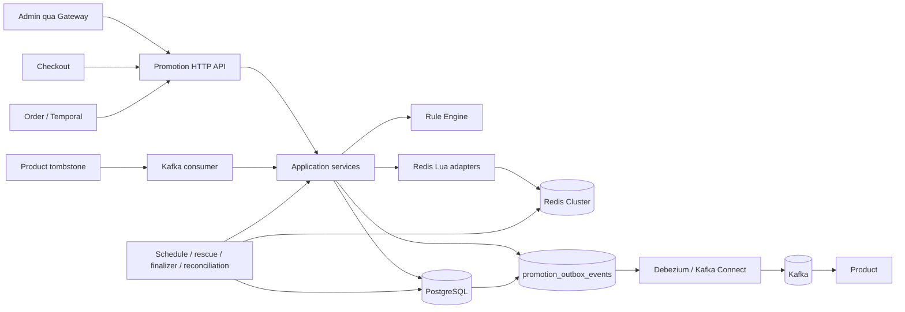

# Promotion Service — Kiến trúc

## 1. Architecture context

Promotion nằm giữa Admin, Checkout, Order và Product. PostgreSQL giữ campaign,
voucher, wallet, durable command receipt, markdown cùng transactional outbox. Redis phục
vụ cache và các hot path có tranh chấp cao: time-fenced claim, budget reservation và
campaign schedule. Product nhận state-discriminated markdown snapshot rồi sở hữu việc
tính/persist giá bán; Promotion consume Product tombstone để invalidate dangling rule.

## 2. Component diagram



## 3. Trách nhiệm component

| Component | Trách nhiệm | Không được làm |
|---|---|---|
| HTTP adapter | AuthN/AuthZ, validation, mapping lỗi | Chứa discount/refund logic |
| Application service | Orchestrate command/query và transaction | Query database service khác |
| Rule Engine | Evaluate AST thuần, xác định | Ghi DB/Redis hoặc gọi network |
| PostgreSQL repository | Persist campaign, rule, Product tombstone watermark, wallet, budget, command receipt, outbox | Quản lý reservation runtime |
| Redis/Lua adapter | Atomic claim, reserve, counter và schedule | Trở thành durable truth |
| Outbox writer | Ghi markdown snapshot CloudEvent cùng business transaction | Direct-produce sau commit; ghi event không có consumer |
| Debezium/Kafka Connect | Relay outbox at-least-once | Suy diễn business state |
| Kafka consumer | Product tombstone invalidation | Xử lý duplicate thiếu business guard |
| Worker | Rescue, expiry, receipt-driven finalizer/repair, rebuild và reconciliation | Ghi PostgreSQL dựa trên Redis counter |

## 4. Processing model

- Discovery/calculate là synchronous read path. Snapshot JSON từ Redis; cache miss đọc
  PostgreSQL. Rule AST được parse request-scoped.
- Discovery/suggestion/voucher options duyệt keyset projection cho wallet/public, snapshot và budget
  đọc theo batch; public loại ownership ngay trong query. Heap giữ top `limit` toàn cục, không trần 200
  candidate và không giữ managed entity theo tổng số candidate. Bộ nhớ `O(batchSize + limit)`, chọn kết
  quả `O(N log limit)`; vẫn phải đánh giá N candidate ([ADR-020](./decisions/ADR-020-complete-discovery-with-batched-top-k.md)).
- Claim hữu hạn chạy một Lua: dùng Redis TIME kiểm claim-gate fields trong runtime hash
  (`enabled`/revision/[open,close)), rồi kiểm tra user, `SPOP`, ghi claimed-user và pending
  acquisition evidence. API chạy guarded PostgreSQL claim + wallet transaction và chỉ trả
  success sau commit; pending persistence worker dùng cùng logic để cứu crash window.
- Reserve/cancel pre-payment là Redis runtime activities. Confirm preflight durable receipt,
  rồi dùng Redis fence không đổi counter cho command mới, PostgreSQL-first commit
  receipt/wallet/budget và finalize Redis sau commit. Capability/proof-gated legacy
  `cancel-confirmed` commit PostgreSQL trước rồi repair Redis projection. Cả hai flow không ghi outbox: receipt với
  `redis_finalized_at IS NULL` là durable trigger để finalizer/repair chạy lại sau crash,
  và được set sau khi Redis hội tụ.
- Admin mutation ghi PostgreSQL và outbox trong cùng transaction. Cache invalidation và
  ZSET update chỉ chạy sau commit, có DB fallback/rebuild.
- Campaign START/END worker không lưu phase thời gian vào DB. Worker kiểm tra lại
  `publication_status`, `[start_time,end_time)` và `campaigns.revision` trước khi phát
  markdown snapshot.
- Product tombstone consumer và mọi admin markdown mutation serialize bằng cùng PostgreSQL
  advisory transaction lock theo product. Consumer persist catalog-revision watermark dù
  chưa có rule, rồi ghi operational invalidation; mutation reject nếu watermark đã
  tồn tại. Không có cache nào theo product để xóa (markdown rule không nằm trong Redis) nên consumer chỉ commit
  rồi ack. Không bump campaign revision/claim gate hay version fence của snapshot voucher vì voucher
  definition không đổi, và không phát INACTIVE ngược về Product đã bị xóa.
- Customer refund không đi qua Promotion. Không có refund consumer/API/allocation.

## 5. Consistency model

| Phạm vi | Mô hình |
|---|---|
| PostgreSQL constraint/transaction | Strong consistency nội bộ |
| Redis Lua | Atomic khi tất cả key cùng cluster hash slot |
| Claim Redis → PostgreSQL | Synchronous trước API success; eventual chỉ cho `CLAIM_PENDING`/crash recovery; pending không xóa trước DB commit |
| Claim boundary | Redis TIME + revision gate fields trong runtime hash, trong cùng Lua với SPOP |
| Campaign DB → Redis schedule | Eventual; DB scanner và startup rebuild tự phục hồi |
| PostgreSQL → Kafka | Transactional outbox + CDC, at-least-once |
| Product markdown projection | Apply ACTIVE full rule hoặc INACTIVE tombstone khi `source_revision` mới hơn |
| Discovery budget guard | Best-effort/fail-open; Reserve chốt authoritative |
| Redis budget counter | Runtime projection; DB-first reconciliation |
| Confirm/legacy `cancel-confirmed` durable outcome | Receipt + wallet + budget trong một PostgreSQL transaction; legacy path requires migration capability/proof; `redis_finalized_at` đánh dấu Redis đã hội tụ |

Không có distributed transaction PostgreSQL–Redis. Mỗi crash window phải có replay,
guarded transition hoặc reconciliation cụ thể.

## 6. Campaign scheduling correctness

`campaigns.publication_status` chỉ lưu ý định quản trị: `DRAFT`, `PUBLISHED`, `PAUSED`,
`CANCELLED`. `UPCOMING/ACTIVE/ENDED` được suy ra từ DB time; child promotion/markdown
không có lịch hay phase riêng.

Redis ZSET:

```text
promo:campaign:schedule
score  = boundary epoch milliseconds
member = {campaign_id}:{campaign_revision}:{START|END}
```

Worker dùng `ZRANGEBYSCORE`, đọc lại PostgreSQL và chỉ xử lý member có revision hiện hành.
Không có Redis schedule lock: nhiều worker có thể cùng đọc một member, nhưng transaction
outbox dùng deterministic dedup key/`INSERT ... ON CONFLICT DO NOTHING`, còn `ZREM` là
idempotent. Business/outbox commit trước `ZREM`; nếu crash sau commit, retry bị outbox dedup
key chặn. Nếu START được xử lý sau `end_time`, worker chỉ phát trạng thái hội tụ `INACTIVE`,
không phát `ACTIVE` muộn.

Với một member, worker không phát cả campaign trong một transaction
([ADR-021](./decisions/ADR-021-batched-boundary-emission-and-dedup-precheck.md)): rule được duyệt bằng
keyset theo `promotion.schedule.emit-batch-size` (mặc định 200), **mỗi lô một transaction** nên advisory
lock product chỉ giữ trong lô. Mỗi lô kiểm lại `revision`/`publication_status` của campaign rồi lọc
trước các product đã có dedup key bằng một query (không lock, không tính winner, không tiêu
`source_revision`); `ON CONFLICT DO NOTHING` vẫn là hàng rào chính xác. Lô lỗi chỉ rollback chính nó, các lô
sau vẫn chạy và member **chỉ bị `ZREM` khi không còn lô lỗi**; vòng sau chạy lại, phần đã commit bị bỏ qua.
Vì vậy START/END của một campaign không còn nguyên tử: một số product có thể đổi trạng thái trước số khác
trong khoảng ngắn, và downstream chỉ dựa vào `source_revision` theo từng product. Đường admin
(publish/pause/cancel) vẫn chạy trong transaction của lệnh admin, không chia lô.

DB fallback 10–30 giây và startup/failover rebuild ngăn ZSET bị thiếu vĩnh viễn. Đây là
bounded eventual propagation, không phải hard real-time 0 ms; API eligibility luôn tự
kiểm tra DB time nên không kích hoạt voucher sớm vì worker lag. Limited claim không dựa
vào scheduler: Lua tự kiểm hard boundary từ claim gate bằng Redis TIME.

## 7. Concurrency và idempotency

- Runtime hash/pool/claimed/pending dùng cùng hash tag `{promotion_id}`. Lua kiểm claim-gate
  fields (revision và Redis time) trước SPOP; DB guard `AVAILABLE AND owner_id IS NULL` cùng
  unique wallet chốt persistence. Worker dùng acquisition time/revision, không dùng
  processing time và không bắt revision-at-acquisition bằng current revision sau
  pause/cancel.
- Reserve replay phải cùng payload; khác payload trả `IDEMPOTENCY_PAYLOAD_MISMATCH`.
- Confirm tra receipt trước Redis; durable replay không phụ thuộc reservation còn tồn tại.
  Command mới fence `RESERVED→CONFIRMING` nhưng không move counter trước DB; receipt +
  conditional `SAVED→USED` + budget chốt durable outcome. Redis miss phải recheck receipt
  để đóng race với concurrent commit/finalize trước khi kết luận reservation mất.
- Cancel pre-payment là idempotent trên reservation key; không đổi wallet.
- Legacy `cancel-confirmed` (migration capability/proof only) dùng receipt + guarded `USED → SAVED` nếu còn hạn, hoặc
  `USED → EXPIRED`; Redis không bị decrement trước DB.
- Markdown outbox `dedup_key` chứa product, campaign, campaign revision và trigger; state
  không thuộc key để cùng một cause không thể phát hai snapshot khác nhau. Product dùng
  monotonic `source_revision` để bỏ stale event.
- `promotion_command_receipts` dedup inbound final command, replay stored response và
  giữ `redis_finalized_at` để finalizer/repair idempotent; outbox chặn tạo trùng logical
  markdown event và giữ stable event ID, còn Kafka delivery vẫn at-least-once. Không có
  usage ledger riêng.

## 8. Deployment constraints

- API stateless, consumer/worker có thể scale ngang.
- Multi-key Lua bắt buộc cùng Redis Cluster hash slot.
- Tiền/counter amount dùng integer VND với `HINCRBY`, không dùng `HINCRBYFLOAT`.
- Không reserve ở Preview/Discovery và không auto-save khi Submit.
- Không mutate definition đã publish. Thay đổi business config phải clone campaign DRAFT
  với campaign/promotion/markdown identity mới; revision chỉ là concurrency/schedule fence.
- Không persist `RESERVED`; reservation chỉ là runtime hold.
- Không coi Redis confirm fence/finalizer hay projection repair là durable command receipt.
- Không tạo Redis applied marker hoặc per-order mutation lock: Lua state transition atomic,
  command receipt và PostgreSQL transaction đã bảo vệ replay/final outcome.
- Không phát business event trực tiếp từ application sau commit.
- Không phát budget-exhausted event từ Redis observation; chỉ trả synchronous result và metric.
- Không phát coupon/wallet, reservation hay campaign lifecycle event và không consume Auth/
  Order/Payment event khi chưa có consumer/producer đã đăng ký; không dùng outbox làm cơ
  chế điều phối nội bộ.
- Không để Product/Search chạy voucher Rule Engine.
- Không coi campaign end, pause hoặc cancel là emergency revocation của voucher đã lưu;
  wallet vẫn theo `expired_at` đã snapshot, kể cả khi mode chọn `CAMPAIGN_END`.

## 9. ADR liên quan

- [ADR-002](./decisions/ADR-002-single-tier-redis-snapshots.md): snapshot Redis đơn tầng.
- [ADR-003](./decisions/ADR-003-redis-lua-budget-reservation.md): lịch sử budget/reservation Lua; đã superseded.
- [ADR-004](./decisions/ADR-004-spop-claim-and-rescue.md): lịch sử SPOP + pending rescue; đã superseded.
- [ADR-009](./decisions/ADR-009-deterministic-json-rule-engine.md): Rule Engine xác định.
- [ADR-010](./decisions/ADR-010-campaign-lifecycle-and-scheduling.md): lịch sử campaign lifecycle/schedule; đã superseded.
- [ADR-011](./decisions/ADR-011-transactional-outbox-cdc.md): lịch sử outbox + CDC; đã superseded.
- [ADR-012](./decisions/ADR-012-wallet-redemption-and-no-refund.md): lịch sử schema/wallet/no-refund; đã superseded.
- [ADR-013](./decisions/ADR-013-command-receipts-and-durable-finalization.md): command receipt và PostgreSQL-first finalization.
- [ADR-014](./decisions/ADR-014-claim-and-markdown-consistency.md): claim gate, immutable definition và causal markdown lifecycle.
- [ADR-015](./decisions/ADR-015-lean-redis-runtime-keyspace.md): keyspace runtime gọn, claim
  fields gộp vào runtime hash và edge-owned discovery rate limit.
- [ADR-016](./decisions/ADR-016-event-scope-and-receipt-driven-finalization.md): phạm vi
  integration event v1 và finalizer/repair trigger bằng command receipt.
- [ADR-017](./decisions/ADR-017-post-capture-forward-repair.md): lỗi sau payment dùng forward repair;
  `cancel-confirmed` chỉ còn legacy.
- [ADR-018](./decisions/ADR-018-checkout-voucher-options-and-context-free-save.md): voucher options cho
  Checkout, lưu voucher không cần context.
- [ADR-019](./decisions/ADR-019-post-implementation-audit-corrections.md): sửa sau audit (guard legacy,
  channel `CHECKOUT`, final command trùng đồng thời, `EXPIRED→USED` ở Confirm, route lạ là lỗi client).
- [ADR-021](./decisions/ADR-021-batched-boundary-emission-and-dedup-precheck.md): phát snapshot START/END
  theo lô nhỏ (mỗi lô một transaction), kiểm dedup key trước khi lock, cô lập lô lỗi.

ADR-001, ADR-003..008 và ADR-010..012 đã được supersede.
