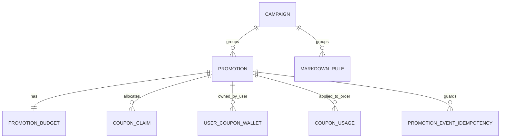

# Promotion Service — Thiết kế dữ liệu

> Chưa có migration/schema thực thi. Các bảng và key dưới đây là logical/physical
> design được bảo toàn từ tài liệu cũ, chưa phải nguồn DDL chuẩn.

## 1. Data ownership

PostgreSQL Promotion là source of truth cho campaign, rule, budget cấu hình, claim,
wallet, usage và idempotency. Redis là source runtime cho snapshot, claim pool,
reservation, counter nóng và schedule index; mọi dữ liệu Redis phải có đường rebuild
hoặc recovery. Cart/user/product/order data chỉ được giữ dưới dạng ID hoặc input snapshot.

## 2. Logical data model

`Promotion` và `MarkdownRule` độc lập, không có FK trực tiếp. User, Order, Product và
Category thuộc bounded context khác nên chỉ là logical reference.

## 3. Schema sources

- Chưa có migration/entity/schema generation cho Promotion.
- `RuleEngineDemo.java` minh họa deserialize/evaluate `conditions_rule`, không phải
  schema chuẩn.
- Khi implement phải tạo migration additive tại service source và cập nhật `evidence`.

## 4. PostgreSQL schema và constraints

### 4.1 `campaigns`

| Cột | Kiểu/ý nghĩa |
|---|---|
| `id` | `BIGSERIAL PRIMARY KEY` |
| `name` | `VARCHAR(255)` |
| `start_time`, `end_time` | `TIMESTAMPTZ`, lưu UTC |
| `status` | `UPCOMING`, `ACTIVE`, `ENDED` |
| `created_at`, `updated_at` | timestamp audit |

### 4.2 `promotions`

| Cột | Kiểu/ý nghĩa |
|---|---|
| `id` | `BIGSERIAL PRIMARY KEY` |
| `campaign_id` | nullable FK → `campaigns.id` |
| `code` | `VARCHAR(50)`; cần unique policy khi tạo DDL |
| `type` | `UNLIMITED_ALL` hoặc `PLATFORM_VOUCHER` |
| `discount_type` | `PERCENTAGE` hoặc `FIXED_AMOUNT` |
| `discount_value` | `DECIMAL(10,2)` |
| `max_discount_amount` | `DECIMAL(10,2)`, cap cho percentage |
| `min_purchase_amount` | `DECIMAL(10,2)`, tách khỏi JSONB để query nhanh |
| `conditions_rule` | `JSONB` AST |
| `start_time`, `end_time` | claim/save window, không phải use window |
| `status` | `ACTIVE`, `INACTIVE` |

Mọi promotion do admin tạo; không có `owner_id` của seller/merchant.

### 4.3 `promotion_budgets`

| Cột | Kiểu/ý nghĩa |
|---|---|
| `promotion_id` | PK/FK → `promotions.id` |
| `total_quantity`, `used_quantity` | `INT`; quota tổng và đã redeem |
| `total_budget`, `used_budget` | `DECIMAL(15,2)`; amount tổng và đã dùng |

Bảng tách khỏi `promotions` để giảm row-lock contention. Runtime còn có reserved
counter ở Redis; DB không lưu reservation.

### 4.4 `coupon_claims`

| Cột | Kiểu/ý nghĩa |
|---|---|
| `id` | `BIGSERIAL PRIMARY KEY`; pre-generate theo quota |
| `promotion_id` | FK → `promotions.id` |
| `owner_id` | nullable user identifier; canonical hiện được ghi là UUID ở wallet/usage |
| `status` | `AVAILABLE`, `CLAIMED` |
| `claimed_at` | nullable `TIMESTAMPTZ` |

Invariant CHECK dự kiến: `AVAILABLE` thì owner/claimed_at đều null; `CLAIMED` thì cả
hai non-null. Partial unique index `(promotion_id, owner_id) WHERE owner_id IS NOT NULL`
đảm bảo một user chỉ claim một suất. Worker update bằng guard
`id=:claim_id AND status='AVAILABLE' AND owner_id IS NULL`.

### 4.5 `user_coupon_wallets`

| Cột | Kiểu/ý nghĩa |
|---|---|
| `id` | `BIGSERIAL PRIMARY KEY` |
| `user_id` | UUID, indexed |
| `promotion_id` | FK → `promotions.id` |
| `status` | `SAVED`, `USED`, `EXPIRED` |
| `saved_at`, `used_at` | acquisition/use timestamps |
| `expired_at` | use-window; mặc định `saved_at + 30 days` |

Unique `(user_id,promotion_id)`; index `(user_id,status)` phục vụ wallet discovery.
Không có quy tắc “toàn ví chỉ một mã”.

### 4.6 `coupon_usages`

| Cột | Kiểu/ý nghĩa |
|---|---|
| `id` | `BIGSERIAL PRIMARY KEY` |
| `user_id` | UUID, index cho lịch sử voucher |
| `promotion_id` | logical/FK reference |
| `order_id` | `BIGINT`, indexed |
| `discount_amount` | `DECIMAL(10,2)`, allocation thực tế |
| `status` | `REDEEMED`, `PARTIALLY_REFUNDED`, `REFUNDED` |
| `reserved_at` | timestamp lấy từ Redis khi confirm; có thể null |
| `redeemed_at`, `refunded_at` | timestamps nghiệp vụ |
| `refunded_amount` | `DECIMAL(10,2) DEFAULT 0` |
| `refund_count` | `INT DEFAULT 0` |

Unique `(order_id,promotion_id)`. Không có `RESERVED`/`CANCELLED`. CHECK/application
guard: `0 <= refunded_amount <= discount_amount`, `refund_count >= 0`; status phải
khớp refunded amount. Refund update row hiện có, không insert ledger mới.

### 4.7 `promotion_event_idempotency`

| Cột | Kiểu/ý nghĩa |
|---|---|
| `event_id` | `VARCHAR(255) PRIMARY KEY`; lấy từ caller/envelope theo lane |
| `order_id` | `BIGINT`, indexed |
| `promotion_id` | `BIGINT`, indexed |
| `action_type` | `REDEEM_COUPON`, `CANCEL_COUPON`, `REFUND_COUPON` |
| `action_scope_key` | `FINAL`, refund transaction/batch ID |
| `payload_hash` | nullable checksum để phát hiện replay khác nội dung |
| `processed_at` | `TIMESTAMPTZ` |

Unique `(order_id,promotion_id,action_type,action_scope_key)`. Sync API ghi nguyên
`idempotency_key/request_id` từ Order; Kafka refund ghi `event_id` envelope. Thiết kế cũ
còn cách diễn đạt khác về khóa refund dẫn xuất; contract cuối cùng được hoãn, nhưng
business scope vẫn là từng refund transaction và promotion.

### 4.8 `markdown_rules`

| Cột | Kiểu/ý nghĩa |
|---|---|
| `id` | `BIGSERIAL PRIMARY KEY` |
| `campaign_id` | nullable FK → `campaigns.id` |
| `name` | `VARCHAR(255)` |
| `scope_type` | Scope legacy được event/worker dùng (`PRODUCT`/`CATEGORY`) |
| `ref_id` | `VARCHAR(255)`, polymorphic logical reference; mặc định category trong mô tả cũ |
| `discount_type`, `discount_value` | PERCENTAGE/FIXED và `DECIMAL(10,2)` |
| `max_discount_amount` | nullable cap |
| `start_time`, `end_time` | effective schedule |
| `status` | `ACTIVE`, `INACTIVE`, `ENDED` |

Không cross-database FK; application validate reference qua Product contract trước save.

## 5. Indexes và query patterns

| Index | Query phục vụ | Trade-off |
|---|---|---|
| wallet `(user_id,status)` | Lấy `SAVED` voucher của user | Tăng write cost nhỏ |
| wallet unique `(user_id,promotion_id)` | Upsert/idempotent save | Cấm duplicate ownership |
| claim partial unique | Chống claim lặp/user/promotion | Nhiều AVAILABLE null vẫn hợp lệ |
| usage unique `(order_id,promotion_id)` | Confirm/refund ledger | Một allocation/promotion/order |
| idempotency PK + action unique | Replay theo delivery và scope | Tăng storage/audit write |
| idempotency `order_id`, `promotion_id` | Đối soát action/order/promotion | Tăng write amplification |
| promotion `(type,status,end_time)` | Public voucher discovery | Cần tạo khi có migration |
| usage `user_id`, `order_id` | Lịch sử user và đối soát order | Tăng write cost |

## 6. Transaction boundaries

- Admin command mutate rule/budget trong PostgreSQL transaction; Redis invalidation và
  Kafka publish chỉ sau commit (tài liệu cũ có câu “DEL trong cùng TX”, nhưng Redis không
  nằm trong PostgreSQL transaction; implementation phải xem đó là side effect phối hợp).
- Claim worker update claim + upsert wallet trong một DB transaction, rồi mới xóa pending.
- Confirm/refund insert idempotency, mutate budget/wallet/usage trong một DB transaction
  sau Redis script. Duplicate conflict đọc state hiện có và trả idempotent success.
- Isolation level chưa chốt. Unique/CHECK/guarded update là lớp correctness chính.
- Không có transaction phân tán; reconciliation xử lý crash window Redis-before-DB.

## 7. Caching và Redis data structures

| Key | Type/value | TTL | Pattern và policy |
|---|---|---|---|
| `promo:{promotion_id}:snapshot` | STRING `{metadata,rule_ast_json,snapshot_version}` | 3600s | Cache-aside; parse request-scoped |
| `promo:rules:version` | STRING counter | none | INCR sau admin write; version fence cross-instance |
| `promo:{promotion_id}:budget` | HASH total/reserved/used qty+amount | none | Hot counter; `total_amount=-1` biểu diễn không giới hạn; DB-first reconciliation |
| `promo:{id}:claim_pool` | SET claim IDs | campaign lifecycle | `SPOP` O(1) |
| `promo:{id}:claimed:user:{user_id}` | STRING flag | 30 days | Chống spam/claim lặp |
| `promo:{id}:pending_claims:data` | HASH claim_id → user/timestamp payload | đến DB ack | Rescue source |
| `promo:{id}:pending_claims:index` | ZSET timestamp → claim_id | đến DB ack | Quét stale O(logN) |
| `promo:{id}:reservation:{order_id}` | STRING req qty/amount/promotion/slot/member | 15m + cleanup grace | Payload release/replay |
| `promo:reservation:index` | ZSET expiry → `promotion_id:order_id` | explicit cleanup | Sweep không key scan |
| `promo:lock:{action}:{promotion_id}:{order_id}` | STRING lock | khoảng 10s | Chống concurrent action |
| `promo:markdown:expiry:index` | ZSET end ms → rule_id | explicit cleanup | Scheduler near-real-time |
| `promo:markdown:expiry:lock:{rule_id}` | STRING lock | ngắn | Chống nhiều worker cùng expiry |
| `promo:budget:reconcile:lock:{promotion_id}` | STRING lock | ngắn | Serialize repair |
| `promotion:ratelimit:voucher_discovery:{user_id}` | token bucket hash/TTL | window 1 phút | 20 req/phút |
| `promo:codes` | RedisBloom | lifecycle | `BF.RESERVE 0.001 1000000`, pre-check code |

Snapshot read pipeline lấy rules version và N snapshot trong một round-trip. Version lệch
hoặc miss thì đọc DB, `SETEX`, rồi evaluate. Không có JVM L1 cache, Pub/Sub eviction,
`refreshAfterWrite` hay wallet cache. Budget guard fail-open; snapshot DB fallback.

## 8. Lua semantics, outbox/inbox và idempotency storage

| Script | Atomic behavior | Kết quả quan trọng |
|---|---|---|
| 1 — Claim | check user flag → SPOP → SETEX flag → HSET pending → ZADD index | `claim_id`, `ALREADY_CLAIMED`, `OUT_OF_STOCK` |
| 2B — Reserve | validate layout/payload/existing key; check qty+amount; increment reserved; SETEX payload; ZADD index; rollback từng bước nếu lỗi | JSON `OK`, `BUDGET_EXHAUSTED`, `INVALID_INPUT`, `PARTIAL_RESERVATION_STATE`, `IDEMPOTENCY_PAYLOAD_MISMATCH`, `APPLY_FAILED_ROLLED_BACK` |
| 3 — Confirm | SETNX lock; read reservation; move reserved→used; DEL payload; ZREM index | `SUCCESS`, `IN_PROGRESS`, `RESERVATION_NOT_FOUND`; giữ lock tới sau DB commit |
| 4 — Cancel | SETNX lock; read payload; giảm reserved; DEL+ZREM | Missing payload chỉ clean index và trả repair-required |
| 5 — Refund | SETNX lock; clamp request không vượt used; giảm used | Trả applied qty/amount thực tế để DB dùng |

Script 2B là reserve duy nhất dù slot chỉ có một voucher, vì cần rollback bốn thao tác,
payload equality và structured error. Amount hiện dùng `HINCRBYFLOAT`; integer minor-unit
là hướng khuyến nghị.

Không có outbox/inbox trong thiết kế. Kafka publish trực tiếp best-effort. Idempotency
Redis chỉ là fast guard; bảng PostgreSQL quyết định cuối. Retention idempotency phải
`>= refund_window + 15 ngày`, khuyến nghị 45 ngày.

## 9. Data lifecycle

- Pre-generate `coupon_claims` theo `total_quantity`, preload claim pool.
- Hard delete claim chỉ khi campaign ended và hết hiệu lực hơn 30 ngày; không cold-store.
- Wallet `EXPIRED` được giữ cho audit; lazy transition khi Discovery chạm row.
- Idempotency cleanup hằng ngày, mặc định giữ 45 ngày.
- Markdown schedule index rebuild lúc startup/sau Redis failover từ DB ACTIVE tương lai.
- Redis budget rebuild/repair từ DB ledger và reservation payload hợp lệ.
- Backup/restore PostgreSQL, migration/backfill và archive usage chưa được đặc tả.

## 10. Security và privacy

`user_id`, lịch sử voucher và order linkage là dữ liệu liên quan người dùng. API phải
enforce ownership/service identity; log không ghi access token hoặc toàn bộ payload
nhạy cảm. Encryption in transit/at rest, masking, GDPR delete/anonymization và audit
access chưa được chốt trước implementation.
