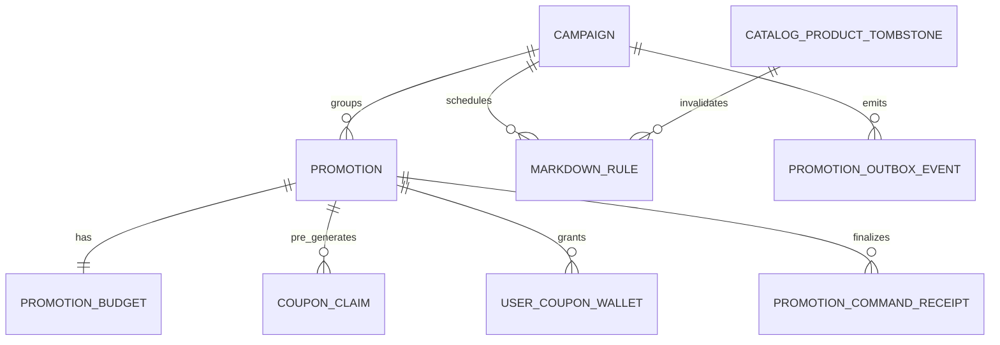

# Promotion Service — Thiết kế dữ liệu

> DDL thực thi: `java/services/promotion-service/src/main/resources/db/migration/V1__promotion_baseline.sql`
> (Flyway). Entity JPA chạy `ddl-auto: validate` nên migration và code không được lệch nhau.

## 1. Data ownership

PostgreSQL Promotion là source of truth cho campaign, voucher, budget đã chốt, claim,
wallet, markdown, observed Product tombstone watermark và markdown integration event. Redis là
runtime store cho snapshot, claim pool, pending claim, budget/reservation và schedule
index. Mọi dữ liệu Redis phải rebuild, replay hoặc reconcile được.

Promotion không lưu refund allocation theo SKU và không tiêu thụ customer-refund event.
Order/Payment sở hữu refund amount/scope: Order has one lifetime refund case, selects
full-quantity order lines, and locks gross line price capped at the paid final amount.
Promotion behavior remains no-op.

Các kiểu bên dưới là storage model, không phải wire contract. Adapter HTTP serialize mọi
ID BIGINT thành opaque string; các cột tiền `*_vnd`/Redis integer map sang
`{amount_minor,currency:"VND"}` theo
[`contracts/http/promotion/v1/openapi.yaml`](../../contracts/http/promotion/v1/openapi.yaml).

## 2. Logical model

Schema có chín bảng: `campaigns`, `promotions`, `promotion_budgets`, `coupon_claims`,
`user_coupon_wallets`, `markdown_rules`, `catalog_product_tombstones`,
`promotion_command_receipts` và `promotion_outbox_events`. Không có `coupon_usages` hoặc
bảng event-idempotency tổng quát. Command receipt và outbox là hai trách nhiệm riêng.

## 3. PostgreSQL schema

### 3.1 `campaigns`

| Cột                        | Kiểu/constraint                                               |
| -------------------------- | ------------------------------------------------------------- |
| `id`                       | `BIGSERIAL PRIMARY KEY`                                       |
| `code`                     | `VARCHAR(80) NOT NULL UNIQUE`                                 |
| `name`                     | `VARCHAR(255) NOT NULL`                                       |
| `description`              | `TEXT NULL`                                                   |
| `publication_status`       | `DRAFT`, `PUBLISHED`, `PAUSED`, `CANCELLED`                   |
| `start_time`, `end_time`   | `TIMESTAMPTZ NOT NULL`; CHECK `start_time < end_time`         |
| `revision`                 | `BIGINT NOT NULL DEFAULT 1`; tăng khi campaign/child thay đổi |
| `created_by`, `updated_by` | admin identifier/audit                                        |
| `created_at`, `updated_at` | `TIMESTAMPTZ NOT NULL`                                        |

Không persist `UPCOMING`, `ACTIVE`, `ENDED`. Phase được suy ra theo
`publication_status` và khoảng `[start_time,end_time)`. `campaigns.revision` là optimistic
concurrency/cache/schedule fence để chống stale work, không phải definition-version history.

### 3.2 `promotions`

| Cột                        | Kiểu/constraint                                              |
| -------------------------- | ------------------------------------------------------------ |
| `id`                       | `BIGSERIAL PRIMARY KEY`                                      |
| `campaign_id`              | `BIGINT NOT NULL REFERENCES campaigns(id)`                   |
| `code`                     | `VARCHAR(80) NOT NULL UNIQUE`                                |
| `name`, `description`      | metadata quản trị                                            |
| `distribution_mode`        | `PUBLIC_SAVE`, `LIMITED_CLAIM` hoặc `DIRECT_GRANT`           |
| `discount_type`            | `PERCENTAGE` hoặc `FIXED_VND`                                |
| `discount_value`           | `BIGINT NOT NULL`; basis points hoặc VND theo type           |
| `max_discount_vnd`         | `BIGINT NULL`, cap cho percentage                            |
| `min_order_amount_vnd`     | `BIGINT NOT NULL DEFAULT 0`                                  |
| `conditions_rule`          | `JSONB NOT NULL` AST                                         |
| `rule_schema_version`      | `SMALLINT NOT NULL`; version format AST, không phải revision |
| `validity_mode`            | `CAMPAIGN_END`, `DURATION_AFTER_SAVE`, `FIXED_DATE`          |
| `valid_for_seconds`        | chỉ dùng với `DURATION_AFTER_SAVE`                           |
| `redeem_until`             | chỉ dùng với `FIXED_DATE`                                    |
| `is_enabled`               | admin guard; không thay cho campaign phase                   |
| `created_at`, `updated_at` | audit timestamps                                             |

CHECK bảo đảm validity mode chỉ đi với tham số tương ứng. Không có mặc định ngầm 30
ngày. Khi save/claim, application tính một lần và ghi `wallet.expired_at`:

- `CAMPAIGN_END` → `campaign.end_time`.
- `DURATION_AFTER_SAVE` → `saved_at + valid_for_seconds`.
- `FIXED_DATE` → `redeem_until`.

Promotion không có `start_time`, `end_time`, status thời gian hoặc `rule_revision`.
Definition đã publish là bất biến. Thay đổi field ảnh hưởng discount, eligibility,
validity hoặc budget phải clone campaign DRAFT và child identity mới; không update row cũ
chỉ bằng cách tăng revision. Wallet cũ tiếp tục bind promotion cũ và giữ `expired_at` đã
snapshot.

### 3.3 `promotion_budgets`

| Cột                         | Kiểu/constraint                                |
| --------------------------- | ---------------------------------------------- |
| `promotion_id`              | `BIGINT PRIMARY KEY REFERENCES promotions(id)` |
| `total_claim_quantity`      | `BIGINT NULL`; null là không giới hạn          |
| `claimed_quantity`          | `BIGINT NOT NULL DEFAULT 0`                    |
| `total_redemption_quantity` | `BIGINT NULL`; null là không giới hạn          |
| `used_quantity`             | `BIGINT NOT NULL DEFAULT 0`                    |
| `total_budget_vnd`          | `BIGINT NULL`; null là không giới hạn          |
| `used_budget_vnd`           | `BIGINT NOT NULL DEFAULT 0`                    |
| `updated_at`                | `TIMESTAMPTZ NOT NULL`                         |

CHECK mọi counter không âm và không vượt total hữu hạn. Không lưu reserved counter trong
PostgreSQL; Redis giữ runtime reservation. Bảng không có revision.

### 3.4 `coupon_claims`

| Cột            | Kiểu/constraint                                         |
| -------------- | ------------------------------------------------------- |
| `id`           | `BIGSERIAL PRIMARY KEY`; pre-generate cho limited claim |
| `promotion_id` | `BIGINT NOT NULL REFERENCES promotions(id)`             |
| `status`       | `AVAILABLE` hoặc `CLAIMED`                              |
| `owner_id`     | `UUID NULL`                                             |
| `claimed_at`   | `TIMESTAMPTZ NULL`                                      |
| `claimed_campaign_revision` | `BIGINT NULL`; campaign revision đã được claim-gate Lua kiểm atomically với `SPOP` (acquisition evidence), replay cho `ClaimVoucherResponse.campaign_revision_at_acquisition` |
| `created_at`   | `TIMESTAMPTZ NOT NULL`                                  |

CHECK: `AVAILABLE` có `owner_id/claimed_at/claimed_campaign_revision` null; `CLAIMED` có cả
ba non-null. Partial unique `(promotion_id,owner_id) WHERE owner_id IS NOT NULL` chặn một
user claim hai suất. Với `LIMITED_CLAIM`, đúng `total_claim_quantity` row `AVAILABLE` được
pre-generate tại publish (batch `promotion.claim.pool-batch-size`, cap
`promotion.claim.max-pool-size`), không phải lúc tạo promotion DRAFT.

### 3.5 `user_coupon_wallets`

| Cột                      | Kiểu/constraint                             |
| ------------------------ | ------------------------------------------- |
| `id`                     | `BIGSERIAL PRIMARY KEY`                     |
| `user_id`                | `UUID NOT NULL`                             |
| `promotion_id`           | `BIGINT NOT NULL REFERENCES promotions(id)` |
| `coupon_claim_id`        | nullable unique FK → `coupon_claims.id`     |
| `status`                 | `SAVED`, `USED`, `EXPIRED`                  |
| `saved_at`, `expired_at` | `TIMESTAMPTZ NOT NULL`                      |
| `used_order_id`          | `BIGINT NULL` logical Order reference       |
| `discount_amount_vnd`    | `BIGINT NULL`                               |
| `used_at`                | `TIMESTAMPTZ NULL`                          |
| `updated_at`             | `TIMESTAMPTZ NOT NULL`                      |

Unique `(user_id,promotion_id)` bảo đảm một quyền sở hữu. Partial unique
`used_order_id WHERE used_order_id IS NOT NULL` bảo đảm một platform voucher cho một
order. CHECK buộc `USED` có order/amount/time và `SAVED/EXPIRED` không có usage fields.

Confirm chuyển `SAVED → USED`, và cả `EXPIRED → USED` khi wallet bị lazy-normalize sau Reserve trong lúc
Payment chạy (reservation tạo khi còn hạn là authority; PROMO-BR-026). `EXPIRED` chỉ do truy vấn của user ghi
(`UPDATE ... WHERE status='SAVED' AND expired_at <= now`), không có batch. Buyer selected-line hay Admin
pre-dispatch refund không mutate row. Legacy, capability/proof-gated `cancel-confirmed` chuyển `USED → SAVED` và
xóa usage fields nếu `NOW() < expired_at`; nếu đã hết hạn thì chuyển `USED → EXPIRED`.

### 3.6 `markdown_rules`

| Cột                        | Kiểu/constraint                                                            |
| -------------------------- | -------------------------------------------------------------------------- |
| `id`                       | `BIGSERIAL PRIMARY KEY`                                                    |
| `campaign_id`              | `BIGINT NOT NULL REFERENCES campaigns(id)`                                 |
| `product_id`               | `UUID NOT NULL`, logical Product reference                                 |
| `discount_type`            | `PERCENTAGE` hoặc `FIXED_VND`                                              |
| `discount_value`           | `BIGINT NOT NULL`; basis points hoặc VND                                   |
| `max_discount_vnd`         | `BIGINT NULL`                                                              |
| `priority`                 | `INT NOT NULL DEFAULT 0` cho winner selection                              |
| `is_enabled`               | admin guard                                                                |
| `invalidated_at`           | `TIMESTAMPTZ NULL`; operational invalidation, không sửa definition         |
| `invalidation_reason`      | `PRODUCT_DELETED` khi invalidated, ngược lại null                          |
| `source_product_revision`  | `BIGINT NULL CHECK (source_product_revision > 0)`; guard Product tombstone |
| `created_at`, `updated_at` | audit timestamps                                                           |

Unique `(campaign_id,product_id)`. Không có category/polymorphic scope, `start_time`,
`end_time`, time-derived status hoặc rule revision. Product ID được validate qua Product
contract trước save; không có cross-database FK. CHECK buộc ba invalidation field cùng
null hoặc cùng non-null. Winning rule luôn filter `is_enabled AND invalidated_at IS NULL`.
Product tombstone chỉ ghi terminal watermark và invalidation overlay; cả hai là operational
evidence nên published definition vẫn bất biến.

### 3.7 `catalog_product_tombstones`

| Cột                       | Kiểu/constraint                                                |
| ------------------------- | -------------------------------------------------------------- |
| `product_id`              | `UUID PRIMARY KEY`; logical Product identity, không được reuse |
| `source_product_revision` | `BIGINT NOT NULL CHECK (source_product_revision > 0)`          |
| `product_deleted_at`      | `TIMESTAMPTZ NOT NULL`; từ Product tombstone                   |
| `received_at`             | `TIMESTAMPTZ NOT NULL DEFAULT NOW()`                           |

Đây là terminal inbound projection, không phải command receipt. Consumer upsert chỉ khi
incoming catalog revision mới hơn, nhưng luôn dùng watermark lớn nhất hiện có để repair
mọi rule chưa invalidated. Mọi admin markdown mutation và consumer cùng acquire PostgreSQL
advisory transaction lock theo `product_id`; mutation reject nếu watermark tồn tại. Vì vậy
tombstone đến trước rule commit hoặc sau rule commit đều không để lại dangling rule.

### 3.8 `promotion_command_receipts`

| Cột                       | Kiểu/constraint                                                                                                   |
| ------------------------- | ----------------------------------------------------------------------------------------------------------------- |
| `id`                      | `UUID PRIMARY KEY`                                                                                                |
| `operation_type`          | `CONFIRM` hoặc `CANCEL_CONFIRMED`                                                                                 |
| `idempotency_key`         | `VARCHAR(255) NOT NULL UNIQUE`                                                                                    |
| `promotion_id`            | `BIGINT NOT NULL REFERENCES promotions(id)`                                                                       |
| `order_id`                | `BIGINT NOT NULL`, logical Order reference                                                                        |
| `wallet_id`               | `BIGINT NOT NULL REFERENCES user_coupon_wallets(id)`                                                              |
| `request_hash`            | `CHAR(64) NOT NULL`, SHA-256 canonical request                                                                    |
| `migration_record_id`     | `UUID NULL`; required only for `CANCEL_CONFIRMED`, must equal `X-Legacy-Migration-Proof` (migration `V2`)           |
| `pre_watermark_evidence_sha256` | `CHAR(64) NULL`; required only for `CANCEL_CONFIRMED`, immutable audited evidence digest, lưu chữ thường (migration `V2`) |
| `amount_vnd`              | `BIGINT NOT NULL CHECK (amount_vnd >= 0)`; confirm lấy từ fenced reservation, legacy cleanup lấy từ wallet USED after proof validation |
| `result_code`             | stable business result để replay                                                                                  |
| `resulting_wallet_status` | `USED`, `SAVED` hoặc `EXPIRED` theo operation                                                                     |
| `response_payload`        | `JSONB NOT NULL`, stored response đã sanitize                                                                     |
| `completed_at`            | `TIMESTAMPTZ NOT NULL`                                                                                            |
| `redis_finalized_at`      | `TIMESTAMPTZ NULL`; set sau khi Redis finalize (`CONFIRM`) hoặc projection repair (`CANCEL_CONFIRMED`) đã hội tụ |
| `retain_until`            | `TIMESTAMPTZ NOT NULL`, không ngắn hơn retry/recovery horizon                                                     |

Unique `(operation_type,promotion_id,order_id)` ngăn hai idempotency key khác nhau nhắm
cùng final business transition. Receipt không có durable `PENDING`: row, wallet và budget
chỉ hiện ra cùng lúc khi transaction commit. Cùng key + cùng request hash trả
`response_payload`; cùng key khác hash trả `IDEMPOTENCY_PAYLOAD_MISMATCH`.
`CHECK chk_receipts_migration_proof` (migration `V2__legacy_migration_proof.sql`) requires both
migration-proof fields for `CANCEL_CONFIRMED` and both NULL for `CONFIRM`; the request hash includes
them. A legacy command may not be replayed with a different proof record/digest. Ràng buộc được thêm
`NOT VALID`: receipt `CANCEL_CONFIRMED` tạo trước `V2` (khi route chưa có guard) không có proof và không thể
bịa lại, nên được miễn; mọi dòng mới đều bị kiểm. Promotion không có registry để tra cứu bản ghi migration:
bằng chứng của guard là header = `migration_record_id` + allowlist workload, còn tính "đã duyệt" của record và
digest là trách nhiệm của quy trình migration phía caller; Promotion chỉ lưu chúng bất biến trên receipt để
audit.

Receipt là command history tối thiểu, không phải usage/refund ledger. Nó giữ response,
migration proof reference và original order/amount sau khi legacy cleanup clear usage fields trên wallet.

`redis_finalized_at` là durable trigger cho Redis finalize/repair. Nó luôn `NULL` khi
transaction commit, được application set sau khi Lua finalize/repair trả kết quả hội tụ,
và được finalizer worker quét bằng partial index khi còn `NULL` quá ngưỡng. Set chỉ bằng
guarded `UPDATE ... WHERE redis_finalized_at IS NULL`; duplicate finalize là no-op ở cả
Redis lẫn PostgreSQL. Không dùng outbox event làm trigger vì final command không phát
integration event.

### 3.9 `promotion_outbox_events`

| Cột                              | Kiểu/constraint                                     |
| -------------------------------- | --------------------------------------------------- |
| `event_id`                       | `UUID PRIMARY KEY`                                  |
| `event_type`                     | CloudEvent type                                     |
| `aggregate_type`, `aggregate_id` | aggregate identity                                  |
| `partition_key`                  | `VARCHAR NOT NULL`; product event dùng `product_id` |
| `source_revision`                | `BIGINT NULL`; bắt buộc với markdown snapshot       |
| `dedup_key`                      | `VARCHAR NOT NULL UNIQUE`                           |
| `payload`                        | `JSONB NOT NULL`; complete structured CloudEvent    |
| `created_at`                     | `TIMESTAMPTZ NOT NULL`                              |

Outbox append-only, không có mutable publish/retry status. Debezium/Kafka Connect sở hữu
retry/backoff/DLQ. Ở v1 outbox chỉ chứa `event_type =
com.ecommerce.promotion.product-markdown-snapshot.v1`; claim, confirm và `cancel-confirmed`
không ghi outbox vì không có consumer. `dedup_key` có dạng
`markdown:{product_id}:campaign:{campaign_id}:rev:{campaign_revision}:trigger:{START|END|PUBLISH|PAUSE|CANCEL}`.

Markdown key là causal identity: hai campaign khác nhau không collision dù cùng revision,
product và resulting state. Resulting state cố ý không nằm trong key: retry cùng logical
trigger luôn đụng đúng một row, kể cả khi state hiện hành đã đổi bởi cause khác; không thể
phát cả ACTIVE lẫn INACTIVE cho cùng cause. `source_revision` là ordering guard riêng,
không thay causal dedup identity. Payload `ACTIVE` mang full winning rule/discount/interval;
`INACTIVE` chỉ mang product, source revision và inactive reason.

Outbox dedup chỉ bảo vệ một outbound business event; nó không thay
`promotion_command_receipts` cho inbound retry/response replay hay Redis finalize trigger
và có retention riêng.

Markdown `source_revision` lấy từ PostgreSQL sequence `markdown_source_revision_seq` (toàn cục, không theo product;
đơn điệu tăng theo product vì lấy sau advisory lock; cause trùng dedup cũng tiêu thụ một giá trị nên có khoảng
trống). Transaction acquire advisory lock
theo `product_id`, tính current-state snapshot hiện hành, cấp revision rồi insert outbox; Product
chỉ apply revision mới hơn.

## 4. Index và query pattern

| Index                                                                                     | Mục đích                                                        |
| ----------------------------------------------------------------------------------------- | --------------------------------------------------------------- |
| campaign `(publication_status,start_time,end_time)`                                       | fallback scan/rebuild schedule                                  |
| promotion `(campaign_id,is_enabled)`                                                      | discovery/admin load                                            |
| wallet `(user_id,status,expired_at)`                                                      | voucher tray/lazy expiry                                        |
| wallet `(promotion_id,status)`                                                            | reconciliation/đếm wallet theo promotion và trạng thái          |
| wallet unique `(user_id,promotion_id)`                                                    | save/claim idempotency                                          |
| wallet partial unique `used_order_id`                                                     | một voucher/order                                               |
| claim `(promotion_id,status,id)`                                                          | preload/rebuild claim pool                                      |
| markdown `(product_id,is_enabled)`                                                        | tính current-state snapshot theo product                        |
| markdown `(product_id,source_product_revision) WHERE source_product_revision IS NOT NULL` | Product tombstone invalidation/repair guard                     |
| tombstone PK `(product_id)`                                                               | serialize terminal Product watermark và markdown-mutation guard |
| command receipt unique `idempotency_key`                                                  | replay cùng command hoặc reject payload mismatch                |
| command receipt unique `(operation_type,promotion_id,order_id)`                           | một final business transition                                   |
| command receipt partial `(completed_at) WHERE redis_finalized_at IS NULL`                 | finalizer worker quét receipt chưa hội tụ Redis                |
| command receipt `(retain_until)`                                                          | safe retention cleanup                                          |
| outbox `(created_at)`                                                                     | retention/diagnostic                                            |
| outbox unique `dedup_key`                                                                 | chặn tạo trùng cùng logical outbound event                      |

## 5. Transaction boundaries

- Admin DRAFT command: validate Product synchronously; với mọi markdown mutation, transaction
acquire product advisory lock và reject nếu `catalog_product_tombstones` đã có row, rồi
mutate campaign/child và tăng `campaigns.revision`. Published definition không update
in-place. Publish/pause/cancel tăng revision, tạo outbox nếu cần, commit; sau commit
invalidate cache/ZADD schedule. Fallback scanner sửa side effect mất.
- Claim persistence path: API hoặc pending worker validate immutable pending identity,
`acquired_at_ms` và revision-at-acquisition, rồi guarded claim + wallet insert + claimed
counter trong một transaction; API chỉ trả success và pending chỉ bị xóa sau commit.
Không so revision-at-acquisition với current revision và không dùng processing time để
bác claim đã linearize đúng hạn. Retry preflight durable claim/wallet trước khi gọi Lua.
- Product tombstone consumer: transaction acquire cùng product advisory lock, upsert
terminal watermark theo max catalog revision, rồi lock affected rules theo deterministic
order. Dùng watermark lớn nhất để update rule khi `source_product_revision IS NULL OR source_product_revision < watermark`. Duplicate/stale event vẫn repair được rule bất
thường nhưng không lùi watermark. Operational overlay không bump campaign revision/claim
gate. Không có cache nào theo product để invalidate (markdown rule không nằm trong Redis; snapshot voucher theo
promotion không đổi vì voucher definition không đổi) nên consumer chỉ commit rồi ack; không insert markdown
INACTIVE về Product đã xóa.
- Confirm: preflight receipt theo key và business identity; durable hit replay response mà
không cần reservation. Với command mới, Redis preparation fence đổi reservation
`RESERVED→CONFIRMING` và gia hạn grace nhưng chưa move counter. Một DB transaction commit
command receipt (`redis_finalized_at NULL`), guarded wallet `SAVED→USED` (hoặc `EXPIRED→USED` nếu wallet bị
lazy-normalize sau Reserve) và durable used counter; không ghi outbox. Transaction kiểm receipt trước, rồi
khoá wallet, rồi kiểm receipt lần nữa: một bản trùng vừa commit trong lúc chờ khoá là replay, không phải
state không nhất quán. Sau commit Redis finalizer mới move reserved→used rồi set
`redis_finalized_at`. Redis miss recheck receipt trước khi trả not-found; missing runtime
evidence chỉ enqueue reconciliation, không increment mù.
- Pre-payment cancel: Redis release; wallet không đổi.
- Legacy `cancel-confirmed` (dedicated migrator + proof): một DB transaction commit command receipt (`redis_finalized_at NULL`,
kèm `migration_record_id` và digest bằng chứng), giảm durable used counter và chuyển wallet về `SAVED`/`EXPIRED`
(cùng kiểm receipt trước và sau khi khoá wallet như Confirm); không ghi outbox. Sau
commit trigger DB-first Redis projection repair rồi set `redis_finalized_at`; không
decrement Redis trước DB hoặc replay delta mù.
- Customer refund: không có Promotion transaction.

## 6. Redis runtime state

Redis chỉ có mười một key pattern, chia theo sáu runtime responsibility. Key không phải
source of truth, có thể rebuild/reconcile như mô tả ở phần 8.

| Nhóm                 | Key                                           | Type           | TTL/lifecycle                    | Vai trò                                                                                                   |
| -------------------- | --------------------------------------------- | -------------- | -------------------------------- | --------------------------------------------------------------------------------------------------------- |
| Snapshot             | `promo:{promotion_id}:snapshot`               | STRING JSON    | 3600s                            | metadata + AST + campaign revision                                                                        |
| Snapshot             | `promo:rules:version`                         | STRING counter | none                             | cache version fence                                                                                       |
| Claim/budget runtime | `promo:{promotion_id}:runtime`                | HASH scalar    | rebuild từ PostgreSQL; không TTL | total/reserved/used quantity + VND, cùng `claim_enabled`, `claim_revision`, `opens_at_ms`, `closes_at_ms` |
| Claim                | `promo:{promotion_id}:claim_pool`             | SET            | campaign lifecycle               | `SPOP` claim IDs                                                                                          |
| Claim                | `promo:{promotion_id}:claimed_users`          | HASH           | promotion lifecycle              | user → claim ID                                                                                           |
| Claim                | `promo:{promotion_id}:pending_claims:data`    | HASH           | đến DB ack                       | claim payload                                                                                             |
| Claim                | `promo:{promotion_id}:pending_claims:index`   | ZSET           | đến DB ack                       | stale deadline → claim ID                                                                                 |
| Reservation          | `promo:{promotion_id}:reservation:{order_id}` | STRING         | 15m + grace                      | reservation payload                                                                                       |
| Reservation          | `promo:{promotion_id}:reservation:index`      | ZSET           | explicit cleanup                 | expiry → order ID                                                                                         |
| Schedule             | `promo:campaign:schedule`                     | ZSET           | explicit cleanup                 | START/END campaign boundary                                                                               |
| Repair               | `promo:{promotion_id}:reconcile_lock`         | STRING         | ngắn                             | serialize repair                                                                                          |

`promo:{promotion_id}:runtime` gộp quota/counter hot path và claim-gate fields vì cả hai
đều cùng promotion, cùng cluster slot, không có TTL và được rebuild từ PostgreSQL. Đây chỉ
là gộp physical key; hard claim boundary bằng Redis `TIME` và campaign revision vẫn giữ
nguyên. Không dùng RedisBloom pre-check cho code: `promotions.code` unique trong PostgreSQL
là authority. Voucher-discovery rate limit thuộc Gateway profile `promotion-discovery`,
không thuộc Promotion Redis namespace.

Field của `runtime` hash trong implementation: `total_redemption_quantity`,
`total_budget_vnd` (`-1` = không giới hạn), `used_quantity`, `used_vnd`, `reserved_quantity`,
`reserved_vnd`, `claim_enabled` (`0/1`), `claim_revision`, `opens_at_ms`, `closes_at_ms`.
Reservation payload JSON: `order_id`, `promotion_id`, `user_id`, `wallet_id`, `amount`,
`state` (`RESERVED|CONFIRMING`), `reserved_at_ms`, `expires_at_ms`, `payload_hash`
(SHA-256 của `RESERVE|order|promotion|user|amount`). Pending claim payload: `claim_id`,
`user_id`, `acquired_at_ms` (Redis `TIME`), `campaign_revision`. Key cụ thể do
`PromotionRedisKeys` sinh, ví dụ `promo:{101}:runtime`.

Mọi key trong một multi-key Lua theo promotion dùng cùng hash tag `{promotion_id}`.
Redis amount chỉ dùng integer `HINCRBY`, không dùng `HINCRBYFLOAT`. Trong docker-compose Redis
chạy standalone; hash tag vẫn được dùng để chuyển sang Redis Cluster không đổi Lua.

Claim API truyền expected campaign revision nhưng Lua quyết định bằng claim-gate fields
hiện hành trong `runtime` và Redis server time, không dùng application timestamp. Gate
mismatch trả `CLAIM_GATE_STALE`; ngoài interval trả `CAMPAIGN_NOT_ACTIVE`. Public save
không dùng gate này mà kiểm phase bằng PostgreSQL clock trong transaction.
Redis–PostgreSQL clock drift có metric/alert; startup/recovery rebuild runtime claim fields
và claim pool từ current PostgreSQL definition/claim rows.

Campaign schedule member là
`{campaign_id}:{campaign_revision}:{START|END}`, score là epoch milliseconds. Schedule
chỉ là trigger/index; PostgreSQL luôn quyết định transition.

## 7. Lua semantics

| Script           | Atomic behavior                                                                                                                                                                  |
| ---------------- | -------------------------------------------------------------------------------------------------------------------------------------------------------------------------------- |
| Claim            | Redis TIME → check `runtime` claim enabled/revision/`open <= now < close` → check claimed user → `SPOP` → HSET claimed/pending có acquisition time/revision → ZADD pending index |
| Reserve          | validate replay/payload + available qty/amount trong `runtime` → tăng reserved → SET payload + ZADD index                                                                        |
| Confirm prepare  | matching `CONFIRMING` là replay; nếu không thì verify payload → `RESERVED→CONFIRMING` + extend grace; counter không đổi                                                          |
| Confirm finalize | receipt đã commit + matching `CONFIRMING` → atomic reserved giảm/used tăng → DEL payload + ZREM index                                                                            |
| Cancel           | chỉ `RESERVED` mới giảm reserved → DEL payload + ZREM index                                                                                                                      |

Không có Redis script customer-refund hoặc Redis-first `cancel-confirmed`. Finalizer retry
sau khi payload đã bị xóa là no-op; thiếu/mismatch payload không được tự
increment/decrement mà enqueue reconciliation. `promotion_command_receipts` là evidence
durable duy nhất cho replay final command; Redis không cần applied marker hoặc mutation
lock riêng. Script bounded, trả structured result và reserve phải rollback các mutation đã
áp dụng nếu command giữa chừng lỗi.

Script versioned trong `src/main/resources/lua/` với result code cụ thể:

| Script | File | Result codes |
|---|---|---|
| Claim | `claim_acquire.lua` | `ACQUIRED`, `ALREADY_CLAIMED` (kèm pending payload nếu còn), `OUT_OF_STOCK`, `GATE_MISSING`, `GATE_DISABLED`, `GATE_STALE`, `OUT_OF_WINDOW` |
| Reserve | `reserve.lua` | `RESERVED`, `REPLAY`, `PAYLOAD_MISMATCH`, `BUDGET_EXHAUSTED`, `RUNTIME_MISSING` |
| Confirm prepare | `confirm_prepare.lua` | `PREPARED`, `CONFIRMING` (replay), `MISSING` |
| Confirm finalize | `confirm_finalize.lua` | `FINALIZED`, `MISSING` (reconcile từ DB), `DRIFT` (counter không đủ → reconcile) |
| Cancel | `cancel_release.lua` | `RELEASED`, `NO_RESERVATION`, `CONFIRMING` (không release mù; sweeper truyền `force=1` sau grace khi không có receipt), `DRIFT` |

`GATE_MISSING`/`RUNTIME_MISSING` (Redis loss) làm application rebuild runtime của promotion từ
PostgreSQL rồi thử lại đúng một lần; vẫn thiếu thì trả `503 RUNTIME_NOT_READY`.

## 8. Reconciliation và lifecycle

- Expected used quantity/amount lấy từ wallet `USED`, không lấy từ Redis.
- Expected claimed quantity lấy từ durable limited claims.
- Expected reserved lấy từ reservation payload còn hiệu lực.
- Repair luôn PostgreSQL + valid runtime evidence → Redis; không ghi DB từ counter Redis.
- Receipt CONFIRM/CANCEL_CONFIRMED là durable evidence cho retry; `redis_finalized_at IS
NULL` là durable trigger để finalizer/repair chạy lại sau crash. Outbox chỉ phục vụ
markdown snapshot.
- Campaign ZSET rebuild lúc startup/failover và được DB fallback scan bổ sung.
- Pending claim không trả lại pool; API success chỉ sau DB commit và cleanup chỉ sau commit.
- Claim worker persist theo `acquired_at_ms`/revision-at-acquisition đã ghi atomically với
SPOP; xử lý sau campaign end hoặc pause/cancel không biến acquisition hợp lệ thành failure.
- Runtime claim fields/pool rebuild khi Redis loss; stale gate revision không được fail-open.
- Product tombstone giữ terminal source catalog watermark; duplicate/stale không lùi
revision, có thể repair dangling rule và không tạo event loop trở lại Product.
- Wallet `EXPIRED` giữ cho audit; lazy transition khi truy vấn.
- Command receipt chỉ trim sau `retain_until` và maximum Temporal retry/late-recovery
horizon. Outbox trim độc lập theo CDC watermark/replay horizon.

## 9. Security và privacy

`user_id`, wallet và order linkage là dữ liệu liên quan người dùng. API phải enforce
ownership/service identity; log không ghi token hay full sensitive payload. Backup,
encryption, masking, retention/anonymization và audit access phải được chốt trước khi
implementation được xem là production-ready.
