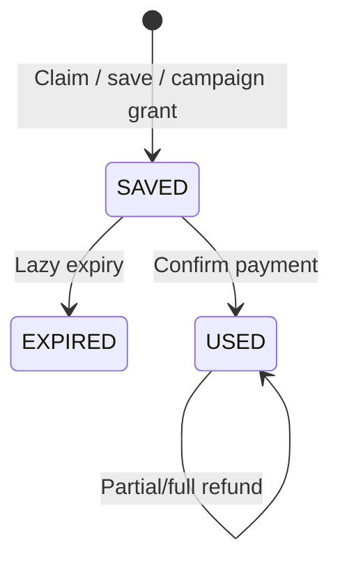

# Promotion Service — Mô hình domain

## 1. Ngôn ngữ chung

| Term | Định nghĩa | Không được nhầm với |
|---|---|---|
| Campaign | Nhóm voucher/markdown cùng chương trình và lịch tổng | Promotion đơn lẻ |
| Promotion | Voucher nhập/chọn ở cart/checkout | Markdown gạch giá |
| `PLATFORM_VOUCHER` | Voucher toàn đơn có quota/budget, có thể cần claim/save | Shipping/shop voucher |
| `UNLIMITED_ALL` | Voucher admin cấp rộng, không quản lý tồn kho ngặt | Public voucher vô điều kiện |
| Markdown rule | Luật giảm trực tiếp giá hiển thị theo category/product scope | Voucher checkout |
| Claim window | Khoảng `promotions.start_time/end_time` cho phép nhận mã mới | Hạn sử dụng mã đã sở hữu |
| Use window | Hạn `user_coupon_wallets.expired_at`, mặc định 30 ngày sau save | Claim window |
| Claim | Một suất hữu hạn được gán cho user | Redeem vào order |
| Wallet entry | Quyền sở hữu một voucher của user | Reservation runtime |
| Reservation | Giữ quota/amount 15 phút trong Redis sau Submit | `SAVED`/`USED` trong DB |
| Redeem | Chuyển budget reserved sang used sau payment success | Claim/save |
| Refund | Hoàn allocation budget đã redeem | Cancel pre-payment |
| Rule AST | Cây `LOGICAL`/`CONDITION` mô tả eligibility | HTTP payload |
| Budget guard | Read-time pre-check best-effort | Reserve authoritative |

## 2. Domain objects

- `Campaign` là aggregate nhóm nhiều `Promotion` và `MarkdownRule`; hai loại rule độc
  lập, chỉ cùng tham chiếu `campaign_id`.
- `Promotion` là aggregate root cho metadata, AST và `PromotionBudget` một-một.
- `CouponClaim` là entity suất claim; `claim_id` bất biến sau khi phát khỏi pool.
- `UserCouponWallet` là entity duy nhất theo `(user_id, promotion_id)`.
- `CouponUsage` là ledger entity duy nhất theo `(order_id, promotion_id)`.
- `MarkdownRule` là aggregate root độc lập. `ref_id` là polymorphic logical reference,
  không phải FK sang Product database.
- Cart, user, category, product và order chỉ là identifier/snapshot từ service khác.
- `RuleNode`, money, time window, discount result và ineligible reason là value object.

## 3. Commands và queries

| Type | Capability | Actor |
|---|---|---|
| Command | Tạo/cập nhật/kết thúc campaign, promotion, markdown | Admin |
| Command | Claim/save public voucher | Customer |
| Command | Reserve/confirm/cancel/cancel-confirmed/refund | Order/Temporal service identity |
| Command | Persist claim event, refund event, welcome voucher | Kafka consumer |
| Query | Calculate discount | Checkout |
| Query | Voucher trong ví | Customer qua Checkout |
| Query | Public platform voucher discovery | Customer qua Checkout |
| Query | Wallet/history | Customer sở hữu tài nguyên hoặc admin |

## 4. Business rules

| ID | Quy tắc | Kết quả/enforcement |
|---|---|---|
| `PROMO-BR-001` | Một order chỉ áp dụng tối đa một `PLATFORM_VOUCHER`. | Reject tập chọn lớn hơn một. |
| `PROMO-BR-002` | Discount waterfall: `final = subtotal - platform_discount`. | Promotion tính discount line; clamp không âm. |
| `PROMO-BR-003` | PERCENTAGE bị cap bởi `max_discount_amount`; FIXED bị cap bởi subtotal. | Tính in-memory bằng decimal-safe math. |
| `PROMO-BR-004` | Preview/Discovery chỉ đọc; reserve bắt đầu sau Submit và có `order_id`. | Không mutate counter trước Submit. |
| `PROMO-BR-005` | Reserve là all-or-nothing và replay phải cùng payload. | Script 2B trả structured error/mismatch. |
| `PROMO-BR-006` | Voucher trong ví dùng `expired_at`, không dùng promotion `end_time` để redeem. | Claim window và use window tách biệt. |
| `PROMO-BR-007` | `voucher-suggestions` chỉ trả mã `WALLET`; public discovery có thể trả `PLATFORM_PUBLIC`. | Không trộn public vào tray ví. |
| `PROMO-BR-008` | `save-and-apply` là write có chủ đích; Submit không auto-save. | Upsert wallet theo state guard. |
| `PROMO-BR-009` | Refund giữ wallet `USED`; voucher không tái sử dụng. | Chỉ cập nhật budget/usage ledger. |
| `PROMO-BR-010` | Partial refund chỉ restore allocation PLATFORM nếu internal rule `RESTORE_ONLY_IF_FULL_PLATFORM_COVERED` đạt. | Allocation không đạt có amount 0/no-op. |
| `PROMO-BR-011` | Missing AST field trả false, không ném lỗi. | Rule Engine deterministic. |
| `PROMO-BR-012` | `IN` trên collection là ANY; `NOT_IN` là ALL-not-match. | Empty: `IN=false`, `NOT_IN=true`; missing vẫn false. |
| `PROMO-BR-013` | Unknown operator/node hoặc logical children rỗng bị từ chối khi create/update. | Validation trước persist/publish. |
| `PROMO-BR-014` | Markdown `ref_id` phải tồn tại theo Product trước khi lưu. | Application validation; không cross-DB FK. |
| `PROMO-BR-015` | Event refund unavailable không rollback tiền khách đã nhận. | Audit `VOUCHER_UNAVAILABLE`, xử lý non-blocking. |

### 4.1. Schema và semantics của Rule AST

```json
{
  "node_type": "LOGICAL",
  "operator": "AND",
  "children": [
    {
      "node_type": "CONDITION",
      "operator": "GREATER_THAN_OR_EQUAL",
      "field": "cart.total_amount",
      "value": 200000
    },
    {
      "node_type": "CONDITION",
      "operator": "NOT_IN",
      "field": "cart.items.category_id",
      "value": [101, 104]
    }
  ]
}
```

Logical operator: `AND`, `OR`. Condition operator: `EQUAL`, `NOT_EQUAL`, `IN`,
`NOT_IN`, `GREATER_THAN`, `GREATER_THAN_OR_EQUAL`, `LESS_THAN`,
`LESS_THAN_OR_EQUAL`. Supported input hiện tại:

- `cart.total_amount`, `cart.payment_method`, `cart.checkout_channel`;
- `cart.items.category_id` (collection);
- `user.id`, `user.tier` (scalar).

`node_type` bắt buộc ở mọi node; `children` bắt buộc và không rỗng cho LOGICAL;
`field/value` bắt buộc cho CONDITION. `rule_version` phải đi cùng metadata được publish/
serve để trace và kiểm tra staleness lúc Submit.

## 5. Invariants

| ID | Điều kiện phải luôn đúng | Enforcement dự kiến |
|---|---|---|
| `PROMO-INV-001` | Tối đa một voucher PLATFORM/order. | API validation + slot model. |
| `PROMO-INV-002` | `0 <= used_*`, `0 <= reserved_*`, `used_* + reserved_* <= total_*` khi total hữu hạn. | Lua guard + reconciliation. |
| `PROMO-INV-003` | Không có reservation trước Submit. | Workflow boundary/test. |
| `PROMO-INV-004` | Một user chỉ có một claim và một wallet row/promotion. | Partial unique + unique wallet constraint. |
| `PROMO-INV-005` | Claim window và use window không bị đánh đồng. | Application eligibility tests. |
| `PROMO-INV-006` | Refund/cancel-confirmed không tái sử dụng voucher hết hạn; refund thường giữ `USED`. | Wallet transition guard. |
| `PROMO-INV-007` | Reconciliation chỉ DB → Redis. | Worker policy/test. |
| `PROMO-INV-008` | Rule evaluation thuần, chỉ phụ thuộc AST + context. | Unit/property tests. |
| `PROMO-INV-009` | Claim `AVAILABLE` có owner/claimed_at null; `CLAIMED` có cả hai non-null. | CHECK + guarded update. |
| `PROMO-INV-010` | `0 <= refunded_amount <= discount_amount`; usage status khớp amount. | CHECK/application transaction. |
| `PROMO-INV-011` | Một action scope chỉ mutate một lần. | DB unique `(order,promotion,action,scope)`. |

## 6. State machines

### Wallet voucher



Reservation không phải wallet state: `SAVED → RESERVED(runtime) → SAVED` khi cancel,
hoặc `SAVED → RESERVED(runtime) → USED` khi confirm. `USED` mặc định không reacquire;
`save-and-apply` trả `409 ALREADY_USED_VOUCHER` nếu không có policy riêng.

### Claim

| From | Trigger | Guard | To |
|---|---|---|---|
| `AVAILABLE` | SPOP + claim worker | owner null, user chưa claim | `CLAIMED` |
| `CLAIMED` | Duplicate/replay | cùng `claim_id` | `CLAIMED` no-op |

### Coupon usage

| From | Trigger | To |
|---|---|---|
| — | Confirm | `REDEEMED` |
| `REDEEMED` | Refund một phần | `PARTIALLY_REFUNDED` |
| `REDEEMED`/`PARTIALLY_REFUNDED` | Hoàn đủ discount | `REFUNDED` |

### Markdown

`ACTIVE` có thể chuyển `INACTIVE` do admin hoặc `ENDED` do admin/expiry. Expiry worker
chỉ transition khi `status='ACTIVE' AND end_time<=NOW()`; terminal `ENDED` không được
activate lại trong thiết kế hiện tại.

## 7. Authorization rules

- Chỉ admin quản trị campaign/promotion/markdown và budget.
- Customer chỉ đọc/claim/save voucher cho chính `user_id` lấy từ access token; không
  tin `user_id` do client tự khai.
- Chỉ Checkout service identity gọi calculate/discovery nội bộ nếu API không expose
  trực tiếp qua Gateway.
- Chỉ Order/Temporal service identity gọi reserve/confirm/cancel/cancel-confirmed/refund.
- Consumer tin producer sau xác thực broker ACL và vẫn validate schema/idempotency.

## 8. Domain errors

| Error code | Điều kiện | Retryable | Mapping |
|---|---|---|---|
| `ALREADY_CLAIMED` | User đã claim promotion | No | 409 |
| `OUT_OF_STOCK` | Claim pool rỗng | No | 409 |
| `ALREADY_USED_VOUCHER` | Save lại wallet `USED` không có reacquire policy | No | 409 |
| `BUDGET_EXHAUSTED` | Không đủ quantity/amount | Sau thay đổi state | 409/business result |
| `IDEMPOTENCY_PAYLOAD_MISMATCH` | Replay cùng order khác payload | No, cần điều tra | 409 |
| `PARTIAL_RESERVATION_STATE` | Reservation key/payload hỏng | Không tự retry mù | 500 + repair |
| `RESERVATION_NOT_FOUND` | Confirm không còn payload | No theo cùng flow | late-payment compensation |
| `RESERVATION_MISSING_PAYLOAD` | Sweep còn index nhưng mất payload | Repair async | no-op + reconciliation |
| `CONDITIONS_NOT_MET` | AST tổng quát false | No | eligibility result |
| `MIN_PURCHASE_NOT_MET` | Chưa đạt tối thiểu | Sau đổi cart | eligibility result |
| `PAYMENT_METHOD_NOT_MATCHED` | Sai payment method | Sau đổi payment | eligibility result |
| `CATEGORY_NOT_MATCHED` | Không có category phù hợp | Sau đổi cart | eligibility result |
| `EXPIRED` | Hết use/claim window tương ứng | No | eligibility result |

Timeout PostgreSQL/Redis/Kafka là lỗi hạ tầng, không phải domain error.

## 9. Business examples

- Cart 530.000đ dùng FIXED 100.000đ đủ điều kiện: discount 100.000đ, final 430.000đ.
- Cart 350.000đ dùng PERCENTAGE 20%, cap 50.000đ: discount 50.000đ.
- Rule `NOT_IN [999,1000]`, cart category `[5,12]`: true; collection rỗng cũng true;
  thiếu field category: false.
- Voucher claim window đã hết nhưng wallet `SAVED`, `expired_at` còn hạn: vẫn được
  evaluate/redeem.
- Discovery thấy budget còn nhưng reserve sau đó cạn: trả `BUDGET_EXHAUSTED`, Checkout
  re-evaluate phần còn lại và yêu cầu Preview/token mới.
- Refund đủ 50.000đ: usage thành `REFUNDED`, wallet vẫn `USED`, budget used giảm 50.000đ.
