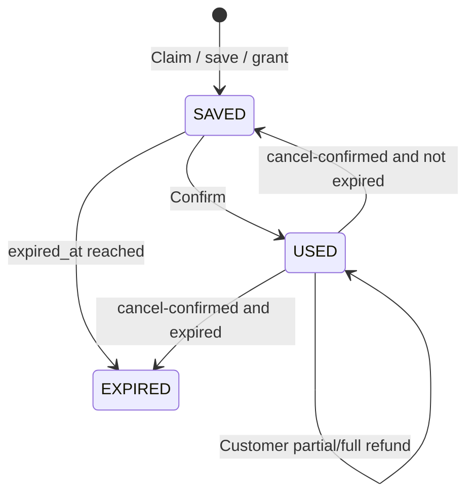

# Promotion Service — Mô hình domain

## 1. Ngôn ngữ chung

| Term | Định nghĩa | Không được nhầm với |
|---|---|---|
| Campaign | Lớp quản trị và lịch chung cho voucher/markdown | Quyền lợi đã lưu trong wallet |
| Publication status | Ý định admin: `DRAFT/PUBLISHED/PAUSED/CANCELLED` | Phase theo thời gian |
| Campaign phase | `DRAFT/UPCOMING/ACTIVE/ENDED/PAUSED/CANCELLED` được suy ra | DB status mutable |
| Promotion | Voucher do admin tạo, áp dụng cho toàn đơn | Markdown giá sản phẩm |
| Markdown rule | Giảm trực tiếp cho một `product_id` khi campaign active | Voucher checkout |
| Claim window | Campaign phải ACTIVE để nhận voucher mới | Hạn dùng voucher đã sở hữu |
| Use window | Đến `wallet.expired_at`, được snapshot lúc save | Campaign có còn active hay không |
| Claim | Một suất hữu hạn được gán cho user | Redeem vào order |
| Wallet entry | Quyền sở hữu và trạng thái redemption hiện hành | Reservation runtime |
| Reservation | Giữ quota/amount 15 phút trong Redis sau Submit | Wallet DB state |
| Redeem | Chuyển reserved→used và wallet `SAVED→USED` | Claim/save |
| Technical compensation | `cancel-confirmed` vì order không hoàn tất sau confirm | Customer refund |
| Customer refund | Order/Payment hoàn tiền partial/full | Promotion budget rollback |

## 2. Domain objects

- `Campaign` là aggregate schedule/lifecycle chung; `revision` là business revision duy nhất.
- `Promotion` là voucher definition và có một `PromotionBudget`.
- `CouponClaim` là một suất pre-generated cho distribution `LIMITED_CLAIM`.
- `UserCouponWallet` là current ownership/redemption state, duy nhất theo
  `(user_id,promotion_id)`; không cần `CouponUsage` aggregate.
- `MarkdownRule` là product-scope child của campaign; không có lịch/status riêng.
- `PromotionOutboxEvent` là append-only integration fact/durable dedup record.
- User, Order và Product chỉ là identifier/snapshot từ bounded context khác.

## 3. Commands và queries

| Type | Capability | Actor |
|---|---|---|
| Command | Tạo/cập nhật/publish/pause/cancel campaign | Admin |
| Command | Tạo/cập nhật voucher hoặc markdown trước publish | Admin |
| Command | Claim/save voucher | Customer |
| Command | Reserve/confirm/cancel/`cancel-confirmed` | Order/Temporal |
| Query | Calculate discount | Checkout |
| Query | Voucher trong ví/public discovery | Customer qua Checkout |
| Worker | Schedule START/END, rescue, reconciliation | Promotion |

Không có command customer-refund trong Promotion.

## 4. Business rules

| ID | Quy tắc |
|---|---|
| `PROMO-BR-001` | Một order áp dụng tối đa một `PLATFORM_VOUCHER`. |
| `PROMO-BR-002` | Voucher mang nghĩa toàn đơn; Promotion không phân bổ discount xuống SKU/order line. |
| `PROMO-BR-003` | `final = max(0, subtotal - platform_discount)`; percentage có cap, fixed có clamp. |
| `PROMO-BR-004` | Preview/Discovery chỉ đọc; reserve chỉ sau Submit và có `order_id`. |
| `PROMO-BR-005` | Reserve all-or-nothing; replay cùng key phải khớp payload. |
| `PROMO-BR-006` | Claim/save mới chỉ được phép khi campaign phase `ACTIVE` và promotion enabled. |
| `PROMO-BR-007` | Voucher đã lưu chỉ dùng `wallet.expired_at`; campaign end không tự thu hồi row/quyền lợi ngoài expiry đã snapshot. Với mode `CAMPAIGN_END`, hai mốc trùng nhau. |
| `PROMO-BR-008` | Validity phải chọn `CAMPAIGN_END`, `DURATION_AFTER_SAVE` hoặc `FIXED_DATE`; không có default ngầm. |
| `PROMO-BR-009` | Definition đã publish không được sửa hồi tố quyền lợi; thay đổi phải qua campaign revision mới. |
| `PROMO-BR-010` | Customer refund partial/full không restore voucher và không hoàn Promotion budget. |
| `PROMO-BR-011` | `cancel-confirmed` do lỗi kỹ thuật trả wallet về `SAVED` nếu còn hạn, `EXPIRED` nếu hết hạn. |
| `PROMO-BR-012` | Markdown chỉ product-scope và chỉ có hiệu lực khi campaign `ACTIVE`. |
| `PROMO-BR-013` | Worker không xử lý schedule dựa riêng vào Redis; phải re-read DB/revision/time. |
| `PROMO-BR-014` | Missing AST field trả false; Rule Engine thuần và xác định. |
| `PROMO-BR-015` | `IN` collection là ANY; `NOT_IN` là ALL-not-match; missing vẫn false. |
| `PROMO-BR-016` | Unknown operator/node hoặc logical children rỗng bị từ chối trước persist/publish. |

Natural campaign end khác emergency revocation. Pause/cancel dừng effective markdown và
claim mới nhưng không tự thu hồi voucher đã lưu. Revocation nếu cần phải là nghiệp vụ
riêng, có audit và contract riêng.

## 5. Campaign lifecycle

`publication_status` persist:

- `DRAFT`: chưa public.
- `PUBLISHED`: phase suy ra bằng clock.
- `PAUSED`: admin tạm dừng claim/markdown; schedule cũ bị revision fence vô hiệu.
- `CANCELLED`: không claim/markdown; terminal về quản trị.

Với `PUBLISHED`:

```text
now < start_time              => UPCOMING
start_time <= now < end_time  => ACTIVE
now >= end_time               => ENDED
```

Không có transition ghi DB tại START/END. Schedule worker phát full markdown snapshot
để downstream hội tụ; eligibility đồng bộ tự tính phase nên worker lag không mở campaign
sớm hoặc kéo dài claim window.

## 6. State machines

### Wallet voucher



Reservation không phải wallet state:

```text
SAVED --reserve(runtime)--> SAVED --cancel--> SAVED
SAVED --reserve(runtime)--> SAVED --confirm--> USED
```

Customer refund không tạo transition. Sau `cancel-confirmed`, usage fields được clear để
voucher có thể dùng lại nếu còn hạn.

### Claim

| From | Trigger | Guard | To |
|---|---|---|---|
| `AVAILABLE` | Redis SPOP + claim persistence | owner null, user chưa claim | `CLAIMED` |
| `CLAIMED` | duplicate/replay | cùng claim/user | `CLAIMED` no-op |

### Markdown effective state

Markdown snapshot là `ACTIVE` chỉ khi campaign phase ACTIVE và rule enabled; mọi trường
hợp khác là `INACTIVE`. Không persist state này trong `markdown_rules`.

## 7. Invariants

| ID | Điều kiện phải luôn đúng | Enforcement |
|---|---|---|
| `PROMO-INV-001` | Tối đa một platform voucher/order. | API + partial unique `used_order_id` |
| `PROMO-INV-002` | Budget integer không âm và không vượt total hữu hạn. | Lua + CHECK + reconciliation |
| `PROMO-INV-003` | Không reservation trước Submit. | Workflow boundary/test |
| `PROMO-INV-004` | Một user có tối đa một claim/wallet row mỗi promotion. | Unique constraints |
| `PROMO-INV-005` | Campaign phase và wallet use window không bị đánh đồng. | Eligibility tests |
| `PROMO-INV-006` | Customer refund không mutate Promotion. | Không API/consumer/refund script |
| `PROMO-INV-007` | Technical compensation không làm mất voucher còn hạn. | Guarded wallet transition |
| `PROMO-INV-008` | Redis schedule/counter không sửa ngược DB. | Worker policy/test |
| `PROMO-INV-009` | Stale campaign revision không phát state cũ. | Schedule member + DB revision check |
| `PROMO-INV-010` | Markdown event ordering tăng theo product source revision. | Advisory lock + sequence |
| `PROMO-INV-011` | Rule evaluation chỉ phụ thuộc AST + input context. | Unit/property tests |

## 8. Rule AST

```json
{
  "node_type": "LOGICAL",
  "operator": "AND",
  "children": [
    {
      "node_type": "CONDITION",
      "operator": "GREATER_THAN_OR_EQUAL",
      "field": "cart.total_amount",
      "value": 200000
    }
  ]
}
```

Logical operator: `AND`, `OR`. Condition operator: `EQUAL`, `NOT_EQUAL`, `IN`,
`NOT_IN`, `GREATER_THAN`, `GREATER_THAN_OR_EQUAL`, `LESS_THAN`,
`LESS_THAN_OR_EQUAL`. `rule_schema_version` version hóa format AST; campaign revision
version hóa business configuration.

## 9. Authorization

- Chỉ admin quản trị campaign/voucher/markdown/budget.
- Customer chỉ đọc/claim/save wallet của `user_id` trong access token.
- Chỉ Checkout service identity gọi API nội bộ calculate/discovery nếu không expose.
- Chỉ Order/Temporal gọi reserve/confirm/cancel/`cancel-confirmed`.
- Consumer validate broker ACL, schema, event identity và business guard.

## 10. Domain errors

| Error | Điều kiện | Retryable |
|---|---|---|
| `CAMPAIGN_NOT_ACTIVE` | Claim/save khi phase khác ACTIVE | No đến khi state đổi |
| `ALREADY_CLAIMED` | User đã claim promotion | No |
| `OUT_OF_STOCK` | Claim pool rỗng | No |
| `ALREADY_USED_VOUCHER` | Wallet đã USED | No |
| `VOUCHER_EXPIRED` | `wallet.expired_at <= now` | No |
| `BUDGET_EXHAUSTED` | Không đủ qty/amount | Sau khi state đổi |
| `IDEMPOTENCY_PAYLOAD_MISMATCH` | Reserve replay khác payload | No; điều tra |
| `PARTIAL_RESERVATION_STATE` | Redis apply/rollback không hoàn chỉnh | Repair async |
| `RESERVATION_NOT_FOUND` | Confirm không còn payload | Late-payment compensation |
| `CONDITIONS_NOT_MET` | AST false | No |
| `INVALID_RULE` | AST/operator/config không hợp lệ | No |

## 11. Ví dụ

- Campaign kết thúc lúc 20:00. Markdown chuyển `INACTIVE`; từ 20:00 không claim mới.
  Wallet đã lưu có `expired_at=23:59` vẫn dùng được đến thời điểm đó.
- Voucher giảm 100.000đ được confirm cho order: wallet `USED`, budget used tăng 100.000đ.
  Customer refund partial hay full: wallet và Promotion budget giữ nguyên.
- Confirm thành công nhưng order không thể hoàn tất vì lỗi saga: `cancel-confirmed` giảm
  allocation; wallet trở lại `SAVED` nếu chưa hết hạn.
- START job revision 4 chạy sau khi campaign đã được sửa lên revision 5: worker no-op.
