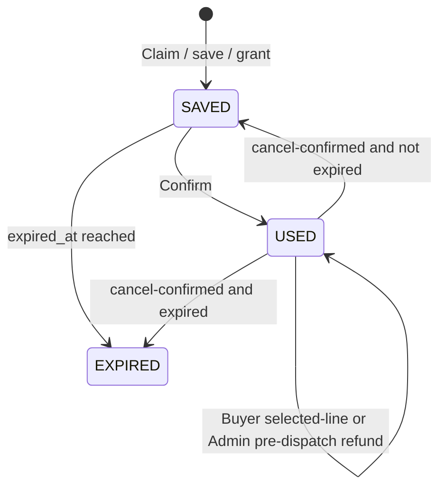

# Promotion Service — Mô hình domain

## 1. Ngôn ngữ chung

| Term | Định nghĩa | Không được nhầm với |
|---|---|---|
| Campaign | Lớp quản trị và lịch chung cho voucher/markdown | Quyền lợi đã lưu trong wallet |
| Publication status | Ý định admin: `DRAFT/PUBLISHED/PAUSED/CANCELLED` | Phase theo thời gian |
| Campaign phase | `DRAFT/UPCOMING/ACTIVE/ENDED/PAUSED/CANCELLED` được suy ra | DB status mutable |
| Promotion | Voucher do admin tạo, áp dụng cho toàn đơn | Markdown giá sản phẩm |
| Markdown rule | Giảm trực tiếp cho một `product_id` khi campaign active | Voucher checkout |
| Claim window | Atomic Redis-time interval từ claim-gate fields trong runtime hash để nhận limited voucher mới | Hạn dùng voucher đã sở hữu |
| Use window | Đến `wallet.expired_at`, được snapshot lúc save | Campaign có còn active hay không |
| Claim | Một suất hữu hạn được gán cho user | Redeem vào order |
| Wallet entry | Quyền sở hữu và trạng thái redemption hiện hành | Reservation runtime |
| Reservation | Giữ quota/amount 15 phút trong Redis sau Submit | Wallet DB state |
| Redeem | Chuyển reserved→used và wallet `SAVED→USED` | Claim/save |
| Legacy technical cleanup | Deprecated `cancel-confirmed` only for `promotion-legacy-migrator` with immutable proof the flow never crossed Payment financial watermark | Customer refund or active post-capture Order failure |
| Customer refund | Buyer selected-line hoặc Admin pre-dispatch refund | Promotion budget rollback |
| Command receipt | Biên nhận durable cho final command, response replay và Redis finalize marker | Outbox event/publication state |

## 2. Domain objects

- `Campaign` là aggregate schedule/lifecycle chung; `revision` là concurrency/cache/schedule
  fence, không phải immutable definition version.
- `Promotion` là voucher definition và có một `PromotionBudget`.
- `CouponClaim` là một suất pre-generated cho distribution `LIMITED_CLAIM`.
- `UserCouponWallet` là current ownership/redemption state, duy nhất theo
  `(user_id,promotion_id)`; không cần `CouponUsage` aggregate.
- `MarkdownRule` là product-scope immutable child; Product tombstone có thể gắn operational
  invalidation riêng mà không sửa definition.
- `CatalogProductTombstone` là durable terminal watermark theo Product/catalog revision;
  nó chặn markdown rule được tạo sau khi delete đã được quan sát.
- `PromotionOutboxEvent` là append-only integration fact/durable dedup record; ở v1 chỉ
  chứa markdown snapshot.
- `PromotionCommandReceipt` là inbound `CONFIRM`/legacy `CANCEL_CONFIRMED` receipt, chứa stable
  key, request hash, stored response và `redis_finalized_at`; không phải usage ledger.
- User, Order và Product chỉ là identifier/snapshot từ bounded context khác.

## 3. Commands và queries

| Type | Capability | Actor |
|---|---|---|
| Command | Tạo/cập nhật/publish/pause/cancel campaign | Admin |
| Command | Tạo/cập nhật voucher hoặc markdown trước publish | Admin |
| Command | Clone published campaign thành DRAFT identity mới | Admin |
| Command | Claim/save voucher | Customer |
| Command | Reserve/confirm/cancel | Order/Temporal |
| Command | Legacy `cancel-confirmed` | `promotion-legacy-migrator` capability only |
| Query | Calculate discount | Checkout |
| Query | Voucher trong ví/public discovery | Customer qua Checkout |
| Worker | Schedule START/END, rescue, reconciliation | Promotion |
| Event | Invalidate markdown khi Product hard delete | Product Kafka tombstone |

Không có command customer-refund trong Promotion.

## 4. Business rules

| ID | Quy tắc |
|---|---|
| `PROMO-BR-001` | Một order áp dụng tối đa một `PLATFORM_VOUCHER`. |
| `PROMO-BR-002` | Voucher mang nghĩa toàn đơn; Promotion không phân bổ discount xuống SKU/order line. |
| `PROMO-BR-003` | `final = max(0, subtotal - platform_discount)`; percentage có cap, fixed có clamp. |
| `PROMO-BR-004` | Preview/Discovery chỉ đọc; reserve chỉ sau Submit và có `order_id`. |
| `PROMO-BR-005` | Reserve all-or-nothing; replay cùng key phải khớp payload. |
| `PROMO-BR-006` | Limited claim Lua phải kiểm claim-gate fields enabled, matching campaign revision và Redis time trong `[start_time,end_time)` trước SPOP; public save kiểm phase trong DB transaction. |
| `PROMO-BR-007` | Voucher đã lưu chỉ dùng `wallet.expired_at`; campaign end không tự thu hồi row/quyền lợi ngoài expiry đã snapshot. Với mode `CAMPAIGN_END`, hai mốc trùng nhau. |
| `PROMO-BR-008` | Validity phải chọn `CAMPAIGN_END`, `DURATION_AFTER_SAVE` hoặc `FIXED_DATE`; không có default ngầm. |
| `PROMO-BR-009` | Definition đã publish là bất biến; thay đổi business config phải clone campaign/promotion/markdown identity mới, không chỉ tăng cùng-row revision. |
| `PROMO-BR-010` | Buyer selected-line hoặc Admin pre-dispatch refund không restore voucher và không hoàn Promotion budget. |
| `PROMO-BR-011` | Legacy `cancel-confirmed` with migration proof trả wallet về `SAVED` nếu còn hạn, `EXPIRED` nếu hết hạn. |
| `PROMO-BR-012` | Markdown chỉ product-scope, chỉ effective khi campaign `ACTIVE`, rule enabled và chưa bị Product tombstone invalidate. |
| `PROMO-BR-013` | Worker không xử lý schedule dựa riêng vào Redis; phải re-read DB/revision/time. |
| `PROMO-BR-014` | Missing AST field trả false; Rule Engine thuần và xác định. |
| `PROMO-BR-015` | `IN` collection là ANY; `NOT_IN` là ALL-not-match; missing vẫn false. |
| `PROMO-BR-016` | Unknown operator/node hoặc logical children rỗng bị từ chối trước persist/publish. |
| `PROMO-BR-017` | Confirm chỉ fence reservation trên Redis trước khi receipt, wallet và durable budget cùng commit PostgreSQL. |
| `PROMO-BR-018` | Deprecated `cancel-confirmed` legacy cleanup commit PostgreSQL trước; Redis chỉ được repair sau commit, không replay decrement delta. Contract/mesh/application deny `order-service`; only `promotion-legacy-migrator` plus immutable pre-watermark proof may call it. |
| `PROMO-BR-019` | Command receipt dedup inbound command và là durable trigger cho Redis finalize/repair qua `redis_finalized_at`; outbox dedup outbound markdown event. Hai bảng có retention độc lập. |
| `PROMO-BR-020` | Markdown dedup identity gồm product, campaign, campaign revision và trigger; resulting state không thuộc key; ordering dùng source revision riêng. |
| `PROMO-BR-021` | Snapshot ACTIVE mang full rule; INACTIVE chỉ là tombstone có reason, không mang rule/discount/interval. |
| `PROMO-BR-022` | Product tombstone persist terminal watermark và invalidate markdown idempotently theo catalog revision; mọi markdown mutation serialize cùng product lock và không phát INACTIVE ngược về Product đã xóa. |
| `PROMO-BR-023` | `BUDGET_EXHAUSTED` chỉ là synchronous outcome/telemetry, không phải integration event. |
| `PROMO-BR-024` | Chỉ phát integration event có consumer đã đăng ký trong contract; ở v1 chỉ có markdown snapshot. Wallet transition, reservation và campaign lifecycle không tạo Kafka event. |

Natural campaign end khác emergency revocation. Pause/cancel dừng effective markdown và
claim mới nhưng không tự thu hồi voucher đã lưu. Revocation nếu cần phải là nghiệp vụ
riêng, có audit và contract riêng.

## 5. Campaign lifecycle

`publication_status` persist:

- `DRAFT`: chưa public.
- `PUBLISHED`: phase suy ra bằng clock.
- `PAUSED`: admin tạm dừng claim/markdown; schedule cũ bị revision fence vô hiệu.
- `CANCELLED`: không claim/markdown; terminal về quản trị.

Transition hợp lệ: `DRAFT→PUBLISHED`, `PUBLISHED→PAUSED|CANCELLED`, `PAUSED→CANCELLED`.
Không có resume `PAUSED→PUBLISHED`: muốn chạy lại phải clone campaign mới. Publish bị từ chối
(`409 INVALID_STATE_TRANSITION`) khi `end_time <= now`. `DIRECT_GRANT` chỉ khi campaign
`PUBLISHED`, `now < end_time` (UPCOMING hoặc ACTIVE) và promotion enabled; public save chỉ
khi phase ACTIVE.

Với `PUBLISHED`:

```text
now < start_time              => UPCOMING
start_time <= now < end_time  => ACTIVE
now >= end_time               => ENDED
```

Không có transition ghi DB tại START/END. Schedule worker phát current-state markdown snapshot
để downstream hội tụ; eligibility đồng bộ tự tính phase nên worker lag không mở campaign
sớm. Limited claim không dựa vào scheduler: Redis-time gate đóng hard boundary trước
SPOP. `campaigns.revision` tăng cho DRAFT mutation và publish/pause/cancel để fence stale
work, nhưng không tạo definition history. Product tombstone là per-rule operational
overlay nên không bump campaign revision hoặc claim-gate fields trong runtime hash.

## 6. State machines

### Wallet voucher



Reservation không phải wallet state:

```text
SAVED --reserve(runtime)--> SAVED --cancel--> SAVED
SAVED --reserve(runtime)--> SAVED --confirm--> USED
```

Customer refund không tạo transition. Sau `cancel-confirmed`, usage fields được clear để
voucher có thể dùng lại nếu còn hạn.

### Claim

| From | Trigger | Guard | To |
|---|---|---|---|
| `AVAILABLE` | Redis gate + SPOP, rồi PostgreSQL claim persistence | gate enabled/revision match, Redis time trong `[open,close)`, owner null, user chưa claim | `CLAIMED`; API success chỉ sau DB commit |
| `CLAIMED` | duplicate/replay | cùng claim/user | `CLAIMED` no-op |

### Markdown effective state

Markdown snapshot là `ACTIVE` chỉ khi campaign phase ACTIVE, rule enabled và chưa bị
invalidate; payload mang rule/discount/interval. Khi không còn winner, `INACTIVE` chỉ mang
product, source revision và reason. Effective state không persist trong `markdown_rules`;
Product tombstone invalidation là operational evidence riêng.

Winner khi nhiều campaign ACTIVE cùng product: `priority` giảm dần rồi `id` tăng dần.
`inactive_reason` theo trigger causal: `END` → `EXPIRED`; `PAUSE`/`CANCEL` → `ADMIN_DISABLED`;
`PUBLISH`/`START` mà không có winner → `NO_ACTIVE_RULE` (rule disabled/invalidated), hoặc
`EXPIRED` nếu cause campaign đã qua `end_time` (START xử lý muộn).

## 7. Invariants

| ID | Điều kiện phải luôn đúng | Enforcement |
|---|---|---|
| `PROMO-INV-001` | Tối đa một platform voucher/order. | API + partial unique `used_order_id` |
| `PROMO-INV-002` | Budget integer không âm và không vượt total hữu hạn. | Lua + CHECK + reconciliation |
| `PROMO-INV-003` | Không reservation trước Submit. | Workflow boundary/test |
| `PROMO-INV-004` | Một user có tối đa một claim/wallet row mỗi promotion. | Unique constraints |
| `PROMO-INV-005` | Campaign phase và wallet use window không bị đánh đồng. | Eligibility tests |
| `PROMO-INV-006` | Customer refund không mutate Promotion. | Không API/consumer/refund script |
| `PROMO-INV-007` | Deprecated legacy cleanup không làm mất voucher còn hạn; active post-capture flow cannot invoke it. | Guarded wallet transition + caller policy/contract test |
| `PROMO-INV-008` | Redis schedule/counter không sửa ngược DB. | Worker policy/test |
| `PROMO-INV-009` | Stale campaign revision không phát state cũ. | Schedule member + DB revision check |
| `PROMO-INV-010` | Markdown event ordering tăng theo product source revision. | Advisory lock + sequence |
| `PROMO-INV-011` | Rule evaluation chỉ phụ thuộc AST + input context. | Unit/property tests |
| `PROMO-INV-012` | Mỗi final command/order/promotion có tối đa một completed receipt và một stored response. | Unique command receipt + request hash |
| `PROMO-INV-013` | Receipt, wallet và durable budget của final command cùng commit hoặc cùng rollback. | PostgreSQL transaction |
| `PROMO-INV-014` | Không decrement/increment Redis mù khi finalizer/repair thiếu runtime evidence. | Fence/finalizer guard + reconciliation |
| `PROMO-INV-019` | Mọi receipt đã commit cuối cùng đều được finalize/repair Redis đúng một lần về mặt hiệu ứng; `redis_finalized_at` chỉ set sau khi Redis hội tụ. | Partial index `redis_finalized_at IS NULL` + idempotent Lua |
| `PROMO-INV-015` | Limited claim success không linearize ngoài hard claim interval/revision. | Claim-gate Lua + Redis TIME |
| `PROMO-INV-016` | Published business definition không mutate in-place. | Admin guards + clone workflow |
| `PROMO-INV-017` | Hai causal markdown transition khác nhau không dùng cùng outbox dedup key. | Full causal unique key |
| `PROMO-INV-018` | Product hard delete không để lại hoặc cho tạo mới dangling markdown rule. | Tombstone watermark + shared product advisory lock + guarded invalidation |

## 8. Rule AST

```json
{
  "node_type": "LOGICAL",
  "operator": "AND",
  "children": [
    {
      "node_type": "CONDITION",
      "operator": "GREATER_THAN_OR_EQUAL",
      "field": "cart.total_amount",
      "value": 200000
    }
  ]
}
```

Logical operator: `AND`, `OR`. Condition operator: `EQUAL`, `NOT_EQUAL`, `IN`,
`NOT_IN`, `GREATER_THAN`, `GREATER_THAN_OR_EQUAL`, `LESS_THAN`,
`LESS_THAN_OR_EQUAL`. `rule_schema_version` version hóa format AST; campaign revision chỉ
fence optimistic concurrency/cache/schedule. Một business definition mới dùng identity mới.

## 9. Authorization

- Chỉ admin quản trị campaign/voucher/markdown/budget.
- Customer chỉ đọc/claim/save wallet của `user_id` trong access token.
- Chỉ Checkout workload identity (`X-Service-Identity: checkout-service`) gọi
  `POST /internal/v1/promotion-discount-calculations`; discovery/suggestion customer lấy
  user identity đã được Gateway verify, còn allocation chỉ allowlist Order/Temporal
  (`X-Service-Identity: order-service`). Việc chỉ Checkout/Order chạm được các route này do
  service mesh thực thi theo principal ([mesh/runtime-contract.md §5.2](../mesh/runtime-contract.md#52-namespace-ecommerce-l7-waypoint));
  header do caller tự đặt và không được mesh xác minh, nên `TrustedIdentityFilter` allowlist theo
  nhóm route chỉ là defense-in-depth.
- Order/Temporal gọi reserve/confirm/cancel only. `cancel-confirmed` requires the separate legacy-migrator capability and proof.
- Consumer validate broker ACL, schema, event identity và business guard.

## 10. Domain errors

| Error | Điều kiện | Retryable |
|---|---|---|
| `CAMPAIGN_NOT_ACTIVE` | Claim/save khi phase khác ACTIVE | No đến khi state đổi |
| `CLAIM_GATE_STALE` | Gate revision khác expected/current campaign revision | Retry sau rebuild/refresh |
| `ALREADY_CLAIMED` | User đã claim promotion | No |
| `OUT_OF_STOCK` | Claim pool rỗng | No |
| `CLAIM_PENDING` | Redis acquisition có evidence nhưng DB chưa xác nhận trước HTTP deadline | Retry cùng user/promotion; preflight DB/pending rồi resume |
| `ALREADY_USED_VOUCHER` | Wallet đã USED | No |
| `VOUCHER_EXPIRED` | `wallet.expired_at <= now` | No |
| `BUDGET_EXHAUSTED` | Redis guard/reserve không đủ qty/amount; chỉ trả sync + metric | Sau khi reservation/budget đổi |
| `IDEMPOTENCY_PAYLOAD_MISMATCH` | Cùng stable key nhưng canonical request hash khác | No; điều tra |
| `FINAL_COMMAND_STATE_INCONSISTENT` | Receipt và wallet/budget không khớp invariant | No; parking-lot/repair |
| `PARTIAL_RESERVATION_STATE` | Redis apply/rollback không hoàn chỉnh | Repair async |
| `RESERVATION_NOT_FOUND` | Confirm không còn payload/receipt | Retry/recover same final command where possible; after payment success Order enters forward repair/financial reconciliation, never cancel-confirmed compensation |
| `CONDITIONS_NOT_MET` | AST false | No |
| `INVALID_RULE` | AST/operator/config không hợp lệ | No |
| `EXPECTED_DISCOUNT_MISMATCH` | Reserve: `expected_discount` khác discount Promotion tính | No; Order tính lại |
| `VOUCHER_NOT_OWNED` | Reserve/calculate cho promotion không có trong wallet | No |
| `DISTRIBUTION_MODE_MISMATCH` | Save/claim/grant sai distribution mode | No |
| `CAMPAIGN_NOT_DRAFT` | Mutation definition sau publish | No; clone |
| `CAMPAIGN_REVISION_MISMATCH` | `If-Match` khác revision hiện hành (412) | Retry với ETag mới |
| `PRODUCT_TOMBSTONED` | Markdown mutation cho Product đã có tombstone watermark (422) | No |
| `RUNTIME_NOT_READY` | Redis runtime của promotion đang rebuild sau Redis loss (503) | Yes |

## 11. Ví dụ

- Campaign kết thúc lúc 20:00. Markdown chuyển `INACTIVE`; từ 20:00 không claim mới.
  Wallet đã lưu có `expired_at=23:59` vẫn dùng được đến thời điểm đó.
- Limited claim bắt đầu Lua đúng 20:00 bị gate từ chối; claim linearize 19:59:59.999 vẫn
  được worker persist sau 20:00 bằng acquisition evidence.
- Voucher giảm 100.000đ được confirm cho order: wallet `USED`, budget used tăng 100.000đ.
  Buyer refund một selected-line scope (mỗi line full quantity) hay Admin refund toàn
  order trước dispatch: wallet và Promotion budget đều giữ nguyên.
- Confirm thành công sau Payment success mà order còn lỗi Saga giữ durable allocation/wallet
  `USED`; Order retries forward repair or opens financial reconciliation. `cancel-confirmed`
  is deprecated legacy cleanup only and cannot be used to make an active post-capture order
  appear unredeemed.
- START job revision 4 chạy sau pause/cancel đã tăng revision 5: worker no-op.
