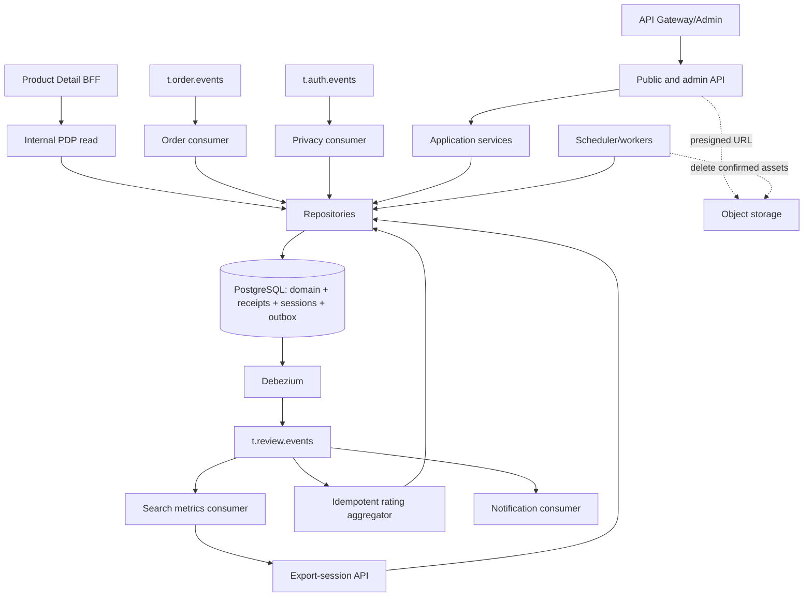

# Review Service — Architecture

## 1. Context and boundaries

Review owns entitlement, review content, media metadata, moderation, privacy erasure,
rating projection and the outbox. It reacts to `ORDER_COMPLETED` and `USER_DELETED`;
it never calls Order, Product, Auth or Search synchronously in a write transaction.

Product Detail BFF only calls internal PDP summary. Search only calls the internal
rating-export APIs and consumes metrics events. Neither may read Review PostgreSQL.

## 2. Components

| Component | Responsibility |
|---|---|
| API/application service | Validate request, authorize caller, take the caller's privacy subject lock and reject an active deletion guard; then generate author pseudonym, verify submitted media object metadata and keep domain mutation/counter/outbox in one PostgreSQL transaction |
| Order consumer | Take the event buyer's privacy subject lock; store receipt then suppress a guarded subject or insert entitlement from self-contained `ORDER_COMPLETED` snapshot |
| Privacy consumer | Take the subject lock; store receipt/request and durable HMAC deletion guard, anonymize author immediately; hard-purge worker removes direct IDs at deadline but retains the guard |
| Rating aggregator | Self-consume lifecycle facts, store receipt, apply aggregate delta, increment revision and write metric outbox atomically |
| Notification consumer | Consume only reply/removal notification requests and deduplicate by CloudEvents ID; no legal reason, admin identity or reply content is published |
| Export-session API | Capture Kafka end offsets, persist session/offsets, serve short keyset pages |
| Asset verifier/deleter | Verify object before attach; delete storage object after `DELETE_PENDING` commit |
| Scheduler | Expire entitlement/assets/sessions, purge privacy IDs, reconcile aggregate, maintain outbox partitions |

## 3. Transaction boundaries

Every domain command includes its domain change, dependent counter/state, receipt when
it is event-driven, and outbox rows in one transaction. No storage/Kafka/HTTP side
effect occurs before commit.

Every path that can introduce a direct customer ID takes the same transaction-scoped
privacy subject lock before it checks the deletion guard and writes. This covers the
Order consumer and customer upload/create/edit/report commands. The lock serializes
these writes with privacy anonymize/purge; it is not a global lock and releases on
commit or rollback.

Media is deliberately two-phase: client upload happens directly to storage, then the
create/edit command reads and verifies immutable object metadata before atomically
attaching it in PostgreSQL. Storage deletion happens after database detach. Review
does not expose a client verification/poll endpoint, refer to an expiring upload URL
in a review, or roll back an external object operation.

## 4. Consistency model

| Data | Consistency |
|---|---|
| Eligibility, review, asset state, report, reply, takedown, privacy request | Strong in PostgreSQL |
| Aggregate | Eventual, normally seconds; idempotent consumer removes duplicate-count drift |
| Search rating | Eventual; revision guard handles event retries and export overlap |
| Search export session | Fixed Kafka watermark for the session lifetime |
| Object bytes | External; verified before attachment and deletion-confirmed asynchronously |

Content-only edits and author anonymization do not alter aggregate or
`review_revision`. A content-only `REVIEW_UPDATED` is acknowledged without a delta;
author anonymization emits no Review event because every PII-owning service receives
`USER_DELETED` directly from Auth. The only notification events are the first-reply
and legal-removal requests defined by Review AsyncAPI.

## 5. Concurrency

- Create claims eligibility with one conditional `UPDATE`; unique review is the final
  safety net.
- Edit/report/reply/takedown lock the review row with `FOR UPDATE`.
- Attach asset verifies the caller-owned uploaded object, then locks its asset row and
  transitions it to `VERIFIED`/`ATTACHED`; unique `asset_id` prevents double attachment.
- Privacy, Order and customer write paths take the same per-subject transaction lock.
  If privacy wins, later input sees its guard; if a write wins, privacy processes that
  committed row before it releases the lock.
- Rating aggregator inserts event receipt first in its transaction. Duplicate receipt
  means no aggregate update. Deltas remain atomic SQL operations.
- Search does not hold a PostgreSQL transaction through all pages. It uses persisted
  Kafka watermark plus `review_revision` to converge correctly.

## 6. Architecture constraints

- No direct Kafka producer in business code; all outbound events use outbox/CDC.
- `t.review.events` is keyed by `product_id`; Notification must not assume ordering
  by recipient user ID and must deduplicate CloudEvents IDs itself.
- No direct database access by another service.
- No cache in Review read path.
- No synchronous cross-service call in a write path.
- Outbox is not a database queue with per-row `published_at`; health is observed via
  Debezium/Kafka Connect/replication slot telemetry.
- Review data is public only when `status='APPROVED'`; all public query indexes encode
  that predicate.
- A privacy hard purge removes direct customer identifiers, not review rating/content
  or aggregate history.
- `USER_DELETED` delivery is intentionally only the current Auth best-effort publish
  after commit with at most three retries. Review cannot create a guard for an event it never
  receives and has no synchronous Auth lookup; Auth operational reconciliation/redrive
  is required when that publish fails. This does not introduce an Auth outbox.
