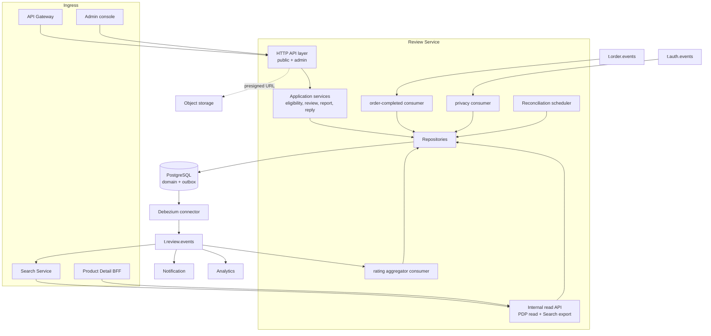

# Review Service — Architecture

> File này trả lời: "Service được chia thành những thành phần nào và chúng phối
> hợp ra sao?"

## 1. Architecture context

Review nằm ở cuối chuỗi mua hàng: nó chỉ bắt đầu làm việc sau khi Order tuyên bố
một đơn đã hoàn tất, và kết quả của nó chảy ngược lên các bề mặt hiển thị sản phẩm.

**Upstream gọi vào Review:**

- Client qua API Gateway: đọc danh sách đánh giá, đọc aggregate, tạo/sửa đánh giá,
  báo cáo vi phạm. Gateway đã xác thực JWT; Review nhận `user_id` canonical từ
  claim và không tự xác thực credential.
- Admin console: phản hồi đánh giá, xử lý báo cáo, gỡ nội dung theo yêu cầu pháp lý.
- Search Service qua HTTP nội bộ, dùng service identity: export rating aggregate
  snapshot. Endpoint này không đi qua API Gateway.
- Product Detail BFF qua HTTP nội bộ, dùng service identity: đọc rating aggregate
  và preview hữu hạn. Đây là query read-only, không chuyển ownership sang BFF.

**Upstream đẩy event vào Review:**

- Order Service: `ORDER_COMPLETED` trên `t.order.events`.
- Auth Service: `USER_DELETED` trên `t.auth.events`.

**Downstream phụ thuộc vào Review:**

- Search Service: chiếu rating vào document sản phẩm.
- Notification Service: thông báo cho tác giả đánh giá.
- Product Detail BFF: đọc aggregate/preview cho PDP và degrade độc lập khi Review lỗi.
- Analytics Service: báo cáo và phân tích chất lượng sản phẩm.

**Trust boundary.** API công khai chỉ tin `user_id` do Gateway cấp; mọi kiểm tra
quyền sở hữu tài nguyên đều thực hiện trong Review. Endpoint `/internal/v1/**` nằm
sau boundary nội bộ cluster, chỉ chấp nhận service identity, và phải bị chặn ở
ingress đối với traffic bên ngoài.

## 2. Component diagram

Đường `KOUT --> AGG` là self-consume: aggregator đọc lại chính topic mà Review phát
ra. Lý do ở [ADR-005](./decisions/ADR-005-async-rating-aggregation.md).

## 3. Trách nhiệm từng component

| Component | Làm gì | Không được làm gì | Dependency |
|---|---|---|---|
| HTTP API layer | Parse request, kiểm tra shape, gọi application service, map domain error sang HTTP status | Chứa business rule, gọi thẳng repository, gọi Kafka | Application services |
| Internal read API | Export aggregate cho Search; trả aggregate + preview cho BFF | Expose ra ngoài cluster; nhận command Review; để BFF đọc database | Repository; Kafka admin client chỉ cho export |
| Application services | Giữ business rule và invariant, mở/đóng transaction, ghi outbox | Gọi HTTP đồng bộ sang service khác trong đường ghi | Repositories |
| Repositories | Truy vấn và ghi PostgreSQL | Chứa business rule | PostgreSQL |
| order-completed consumer | Upsert eligibility theo từng item | Tạo review; suy diễn trạng thái đơn hàng | Repository |
| privacy consumer | Ẩn danh trường hiển thị tác giả, ghi audit | Xóa cứng review | Repository |
| rating aggregator consumer | Cập nhật bucket sao, derive aggregate, tăng `review_revision`, ghi outbox snapshot | Tính `average_rating` ngoài database rồi ghi đè | Repository |
| Reconciliation scheduler | Expire eligibility quá hạn, thu hồi eligibility kẹt, giám sát outbox backlog | Sửa nội dung đánh giá; drop partition khi safety gate chưa qua | Repository |
| Debezium connector | Đọc WAL, compose envelope, publish theo `partition_key` | Biến đổi business payload | PostgreSQL, Kafka |

## 4. Processing model

**Đồng bộ.** Toàn bộ đường đọc (danh sách đánh giá, aggregate, danh sách chờ đánh
giá) và mọi API ghi do người dùng khởi tạo đều xử lý đồng bộ trong một transaction
PostgreSQL duy nhất, rồi trả kết quả đã ghi cho caller. Nhờ đó tác giả luôn đọc
được thay đổi của chính mình mà không cần chờ pipeline bất đồng bộ.

**Bất đồng bộ.** Cấp eligibility, cập nhật aggregate, ẩn danh tác giả, và mọi tác
động sang service khác chạy bất đồng bộ qua Kafka.

**Transaction boundary.** Một transaction ghi luôn gồm: thay đổi domain, thay đổi
counter liên quan, và một hoặc nhiều dòng `review_outbox`. Transaction commit rồi
mới ACK message (với consumer) hoặc trả response (với API). Không có side effect
ngoài database nào được thực hiện trước commit.

**Publish.** Không có producer Kafka nào trong đường xử lý nghiệp vụ. Event rời
service qua WAL → Debezium → `t.review.events`. Điều này loại bỏ dual-write giữa
database và broker; xem [ADR-003](./decisions/ADR-003-outbox-cdc-publication.md).

**Media.** File không đi qua Review. Client xin presigned URL, upload thẳng lên
object storage, rồi gửi kèm object key khi tạo hoặc sửa đánh giá. Review chỉ ghi
metadata sau khi xác thực key thuộc namespace của chính user đó.

## 5. Consistency model

| Dữ liệu | Mô hình | Cửa sổ stale | Cách hội tụ |
|---|---|---|---|
| Eligibility, review, media, report, admin reply | Strong trong PostgreSQL | 0 | Transaction |
| `product_rating_aggregates` | Eventual | 1–5 giây trong điều kiện bình thường | Rating aggregator consume `t.review.events` |
| Rating trong Search index | Eventual | 2–10 giây | `REVIEW_METRICS_UPDATED` + guard `review_revision` |
| Rating/review preview ở PDP | Read-time từ Review; aggregate vẫn eventual | Aggregate thường trễ 1–5 giây; call có thể degrade | Internal PDP read qua BFF |
| Ẩn danh tác giả ở downstream | Eventual | ≤ 60 giây | `USER_DELETED` → cập nhật cục bộ → `REVIEW_UPDATED` |

**Điểm cần chú ý.** Ngay sau khi người dùng gửi đánh giá, API trả về review đã ghi,
nhưng aggregate trên cùng trang sản phẩm có thể vẫn là giá trị cũ trong vài giây.
Đây là hệ quả có chủ đích của [ADR-005](./decisions/ADR-005-async-rating-aggregation.md);
giao diện nên hiển thị đánh giá mới ngay và chấp nhận số tổng hợp trễ.

**Phát hiện lệch.** Reconciliation job so sánh aggregate với số đếm thực từ bảng
`reviews` theo lô, và phát metric `review_aggregate_drift_total`. Khi lệch, job
ghi lại giá trị đúng, tăng `review_revision` và phát snapshot mới để downstream
hội tụ — không được sửa aggregate mà không tăng revision.

## 6. Concurrency model

**Cấp quyền đánh giá.** Việc "giành quyền viết đánh giá" được thực hiện bằng một
câu `UPDATE ... WHERE status = 'PENDING' AND expires_at > now() RETURNING ...`
duy nhất. Câu lệnh này vừa là kiểm tra vừa là lock: hai request song song thì
đúng một request nhận được dòng trả về, request còn lại thấy 0 dòng và bị từ chối.
Không dùng `SELECT ... FOR UPDATE` rồi mới `UPDATE` cho luồng này.

**Sửa đánh giá, phản hồi, báo cáo.** Dùng `SELECT ... FOR UPDATE` trên dòng
`reviews` để tuần tự hóa các thao tác trên cùng một đánh giá. Đây là các thao tác
đọc-quyết định-ghi thật sự nên cần lock tường minh.

**Cập nhật aggregate.** Aggregator cập nhật bằng một câu lệnh cộng/trừ trực tiếp
trên bucket sao (`total_n_star = total_n_star + 1`), không đọc rồi ghi. Nhờ vậy hai
event trên cùng `product_id` không thể ghi đè lẫn nhau. `average_rating` và
`total_reviews` được derive từ bucket ngay trong cùng câu lệnh.

**Ordering.** Mọi event trên `t.review.events` dùng `partition_key = product_id`,
nên các thay đổi của cùng một sản phẩm luôn nằm trên một partition và được xử lý
theo thứ tự. Nhưng ordering của Kafka **không** đủ cho downstream: Search có thể
import snapshot export song song với replay event. Vì vậy `review_revision` là guard
bắt buộc, không phải tùy chọn; xem
[ADR-004](./decisions/ADR-004-review-revision-ordering-guard.md).

**Race condition đã biết:**

- Hai request tạo đánh giá cùng lúc cho một eligibility → chặn bằng UPDATE có điều
  kiện, cộng thêm `UNIQUE(eligibility_id)` trên `reviews` làm lưới an toàn cuối.
- Một người báo cáo hai lần → chặn bằng `UNIQUE(review_id, reporter_id)`.
- Report vượt ngưỡng đúng lúc admin đang bác báo cáo → cả hai đi qua `FOR UPDATE`
  trên `reviews`, nên tuần tự; kết quả cuối phụ thuộc thứ tự commit và cả hai
  trạng thái đều hợp lệ.
- Aggregator xử lý lại một event đã xử lý (at-least-once) → có thể gây over-count.
  Đây là trade-off đã chấp nhận, được bù bằng reconciliation; xem
  [ADR-005](./decisions/ADR-005-async-rating-aggregation.md).

## 7. Deployment topology

| Process | Số instance | Scale theo | Ghi chú |
|---|---|---|---|
| API server (public + admin + internal export) | ≥ 2 | RPS, CPU | Stateless |
| order-completed consumer | ≤ số partition `t.order.events` | Consumer lag | Stateless |
| privacy consumer | 1–2 | Consumer lag | Lưu lượng thấp |
| rating aggregator consumer | ≤ số partition `t.review.events` | Consumer lag | Không vượt số partition, nếu không sẽ có instance rảnh |
| Reconciliation scheduler | Đúng 1 hoạt động | Không scale | Cần leader election hoặc distributed lock |
| Debezium connector | 1 task cho publication này | Không scale ngang | Một replication slot duy nhất |

API và consumer có thể chạy chung một image nhưng phải là process/deployment riêng
để lỗi của consumer không kéo API xuống và ngược lại.

**Runtime dependency:** PostgreSQL (bắt buộc, có logical replication bật),
Kafka + Kafka Connect (bắt buộc), object storage (bắt buộc cho media).

## 8. Architecture constraints

- Không service nào truy vấn trực tiếp database của Review; mọi truy cập qua HTTP
  hoặc event.
- BFF chỉ được gọi internal PDP read; không được gửi Review command hoặc giữ full
  Review projection.
- Review không gọi đồng bộ sang Product, Order, Auth hay Search trong bất kỳ đường
  xử lý nào. Dữ liệu cần thiết phải đến từ event và được snapshot.
- Không phát event bằng producer trực tiếp; chỉ qua outbox.
- Không ACK Kafka message trước khi transaction commit.
- Business logic không đặt trong controller hoặc trong message adapter.
- Không cache đọc trong service; xem [ADR-002](./decisions/ADR-002-postgresql-only-read-path.md).
- Mọi thay đổi aggregate phải tăng `review_revision` cùng transaction với outbox.
- `/internal/v1/**` không được expose qua API Gateway.

## 9. Trade-offs và ADR liên quan

| Trade-off | ADR |
|---|---|
| Một lần đánh giá, một lần sửa: đơn giản và chống spam, nhưng người dùng không sửa lỗi chính tả lần thứ hai được | [ADR-001](./decisions/ADR-001-eligibility-and-single-edit.md) |
| Chỉ PostgreSQL, không cache: nhất quán và dễ vận hành, nhưng đường đọc phụ thuộc hoàn toàn vào index và read replica | [ADR-002](./decisions/ADR-002-postgresql-only-read-path.md) |
| Outbox + CDC: không mất event, nhưng thêm Debezium, replication slot và rủi ro WAL bloat | [ADR-003](./decisions/ADR-003-outbox-cdc-publication.md) |
| `review_revision` làm guard: downstream hội tụ được, nhưng mọi consumer phải cài guard mới đúng | [ADR-004](./decisions/ADR-004-review-revision-ordering-guard.md) |
| Aggregate bất đồng bộ: đường ghi nhanh và ít contention, nhưng aggregate stale và có thể drift | [ADR-005](./decisions/ADR-005-async-rating-aggregation.md) |
| Snapshot export cho Search: reindex không mất rating, nhưng Review trở thành dependency chặn cutover của Search | [ADR-006](./decisions/ADR-006-rating-snapshot-export.md) |
| Snapshot `user_name`: không phải consume profile event, nhưng tên hiển thị có thể lỗi thời | [ADR-007](./decisions/ADR-007-author-name-snapshot.md) |
| Auto-approve + ngưỡng báo cáo: đăng ngay, nhưng nội dung xấu hiển thị cho tới khi đủ báo cáo | [ADR-008](./decisions/ADR-008-auto-approve-with-report-threshold.md) |
| Review sở hữu luồng báo cáo: giảm số service, nhưng phải tách ra nếu sau này có Report Service | [ADR-009](./decisions/ADR-009-review-owns-report-flow.md) |
