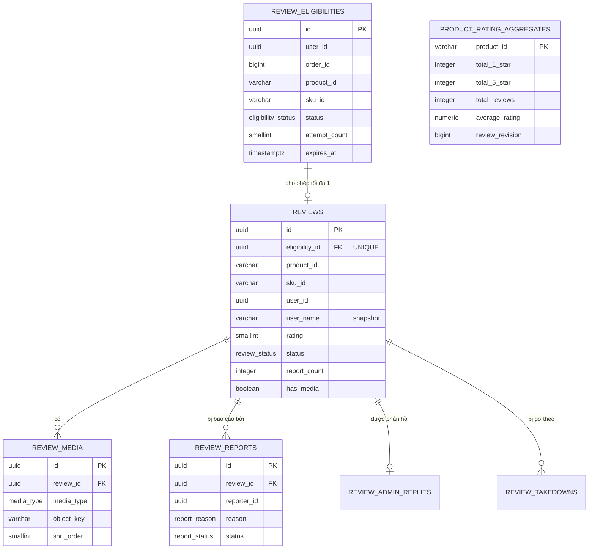

# Review Service — Thiết kế dữ liệu

> Nguồn chuẩn cho schema là
> [`0001_initial_review_schema.sql`](./schema/0001_initial_review_schema.sql).
> File này giải thích ownership, mục đích và các quy tắc của schema đó; không lặp
> lại định nghĩa cột.

## 1. Quyền sở hữu dữ liệu

Review sở hữu toàn bộ schema `review` trong PostgreSQL. Không service nào khác được
đọc hoặc ghi trực tiếp vào schema này.

| Kho lưu trữ | Dữ liệu | Nguồn chân lý |
|---|---|---|
| PostgreSQL `review` | Eligibility, review, media metadata, report, admin reply, takedown, aggregate, outbox | Review Service |
| Kafka `t.review.events` | Event nghiệp vụ và snapshot rating | Kênh truyền, không phải database |
| Object storage | File ảnh và video của đánh giá | Storage sở hữu file; Review sở hữu metadata trỏ tới file |

**Dữ liệu snapshot từ service khác.** Hai trường được sao chép vào Review tại thời
điểm ghi và cố tình không đồng bộ lại:

| Trường | Nguồn gốc | Vì sao không đồng bộ |
|---|---|---|
| `reviews.user_name`, `review_eligibilities` | Auth/User Service | Đánh giá phản ánh trạng thái tại thời điểm viết; xem [ADR-007](./decisions/ADR-007-author-name-snapshot.md) |
| `variant_name` | Product Service | Tên biến thể có thể đổi; người đọc cần biết người mua đã mua biến thể nào lúc đó |

`product_id`, `sku_id`, `order_id` và `user_id` là identifier ngoài. Review không
xác thực sự tồn tại của chúng bằng lời gọi đồng bộ; tính hợp lệ đến từ việc event
nguồn đã khẳng định điều đó.

**Dữ liệu Review cấp cho service khác:** `product_rating_aggregates` là nguồn chân
lý cho rating hiển thị ở Search và PDP. Search giữ projection riêng qua event/export;
Product Detail BFF đọc aggregate và preview theo request, không persist bản sao. Product
Service không consume Review. Xem [Search data design](../search/data.md#5-ordering-guard)
và [BFF ADR-002](../product-detail-bff/decisions/ADR-002-review-read-composition-without-domain-ownership.md).

## 2. Logical data model

`PRODUCT_RATING_AGGREGATES` cố tình **không** có quan hệ khóa ngoại tới `REVIEWS`.
Nó là aggregate root riêng, được cập nhật bất đồng bộ, và có thể tồn tại cho một
`product_id` mà tại thời điểm đó không có đánh giá nào đang hiển thị.

**Cardinality đáng chú ý:** một đơn hàng sinh nhiều eligibility (một cho mỗi SKU);
một eligibility sinh không hoặc một review; một review có không hoặc nhiều media,
không hoặc nhiều report, và không hoặc một admin reply.

## 3. Schema sources

- [`schema/0001_initial_review_schema.sql`](./schema/0001_initial_review_schema.sql)
  tạo toàn bộ schema từ đầu, gồm enum, bảng, constraint, index, partition khởi tạo
  và publication cho Debezium.
- Chưa có ORM entity hay migration tool nào được chọn — runtime của service chưa
  được quyết định. Khi chọn, migration đầu tiên phải sinh ra schema giống hệt file
  này, và file này trở thành tài liệu tham chiếu chứ không còn là nguồn thi hành.
- UUID do PostgreSQL sinh bằng `gen_random_uuid()`; timestamp dùng `TIMESTAMPTZ`
  theo UTC.
- `user_id` là `UUID` (kiểu native, không phải `VARCHAR`), khớp với định danh
  canonical do Auth cấp. Thiết kế cũ dùng `VARCHAR(64)` và phải validate định dạng
  UUID bằng tay ở từng consumer; kiểu native đẩy việc đó xuống database.

## 4. Constraints

**Constraint quan trọng và lý do tồn tại:**

| Constraint | Bảo vệ điều gì |
|---|---|
| `uq_eligibility_business_key` | `REVIEW-INV-001`; đồng thời là cơ chế idempotency khi `ORDER_COMPLETED` được gửi lại |
| `ck_eligibility_status_matches_attempts` | Chặn mọi cặp `(status, attempt_count)` vô nghĩa ở tầng database, thay vì tin vào application logic |
| `uq_review_eligibility` | `REVIEW-INV-002`; lưới an toàn cuối cùng cho race tạo đánh giá song song |
| `ck_review_rating_range` | `REVIEW-BR-005` |
| `uq_report_review_reporter` | `REVIEW-BR-011`; là cơ chế idempotency của luồng báo cáo |
| `ck_aggregate_total_matches_buckets` | `REVIEW-INV-005`; nếu aggregator tính sai, transaction bị từ chối ngay thay vì âm thầm ghi số sai |
| `ck_aggregate_media_within_total` | Chặn lỗi `total_with_media` chỉ tăng mà không giảm — một lỗi tồn tại trong thiết kế cũ |
| `ck_aggregate_revision_positive` | Khớp ràng buộc `minimum: 1` trong [contract export](../../contracts/http/review/internal/v1/openapi.yaml) |
| `ck_takedown_requires_two_people` | Người yêu cầu gỡ và người phê duyệt phải khác nhau |

**Khóa ngoại có chủ đích khác nhau:**

- `reviews.eligibility_id → review_eligibilities` dùng `ON DELETE RESTRICT`:
  eligibility không được xóa khi đã sinh đánh giá.
- `review_media`, `review_reports`, `review_admin_replies → reviews` dùng
  `ON DELETE CASCADE`: chúng vô nghĩa nếu không có đánh giá cha.
- `review_takedowns.review_id → reviews` dùng `ON DELETE RESTRICT`: dấu vết kiểm
  toán phải sống lâu hơn thao tác sinh ra nó.

**Business constraint không biểu diễn được bằng database:**

| Quy tắc | Nơi enforcement |
|---|---|
| `report_count` phải bằng số dòng `review_reports` chưa bị bác bỏ | Cùng transaction khi ghi report; reconciliation đối chiếu định kỳ |
| `has_media` phải khớp với sự tồn tại của `review_media` | Cùng transaction khi ghi media |
| `is_admin_replied` phải khớp với sự tồn tại của admin reply | Cùng transaction khi ghi reply |
| `object_key` phải thuộc namespace upload của chính người dùng | Application service, trước khi ghi |
| `review_revision` chỉ tăng | Chỉ có một câu lệnh được phép sửa cột này, dạng `review_revision + 1` |

Ba trường dẫn xuất đầu tiên là denormalization có chủ đích để đường đọc không phải
join hay đếm. Cái giá là chúng có thể lệch, nên reconciliation phải kiểm tra chúng.

## 5. Indexes và query patterns

| Index | Query pattern phục vụ | Trade-off |
|---|---|---|
| `ix_eligibility_user_status` | `GET /me/pending-reviews` — lấy các item chờ đánh giá của một người | Ghi thêm khi cấp và khi đổi trạng thái eligibility |
| `ix_eligibility_expiry_sweep` | Reconciliation quét eligibility quá hạn | Partial index nên nhỏ; chỉ chứa dòng `PENDING` |
| `ix_eligibility_stuck_reviewed` | Reconciliation phát hiện `REVIEWED` bất thường | Rất nhỏ trong thực tế |
| `ix_review_product_recent` | Danh sách đánh giá mặc định của trang sản phẩm, keyset theo `created_at DESC` | Index chính của đường đọc; partial theo `APPROVED` nên không chứa đánh giá bị ẩn |
| `ix_review_product_sku_recent` | Lọc "chỉ biến thể tôi quan tâm" | Chỉ dùng khi client truyền `sku_id` |
| `ix_review_product_rating_recent` | Lọc theo số sao | — |
| `ix_review_product_with_media` | Lọc "chỉ đánh giá có ảnh/video" | Partial index; nhỏ hơn nhiều so với index đầy đủ |
| `ix_review_user` | Ẩn danh hàng loạt khi nhận `USER_DELETED` | Ghi thêm ở mọi đánh giá |
| `ix_review_aggregate_recount` | Reconciliation đếm lại phân bố sao theo sản phẩm | Chỉ dùng bởi job nền |
| `ix_report_moderation_queue` | Hàng đợi kiểm duyệt của admin | Partial theo `PENDING`, thu nhỏ theo tiến độ xử lý |
| `ix_outbox_created_at` | Phát hiện backlog outbox chưa được publish | — |

**Vì sao các index đọc đều là partial theo `status = 'APPROVED'`.** Đánh giá bị ẩn
và bị gỡ không bao giờ xuất hiện trong đường đọc công khai. Loại chúng khỏi index
giúp index nhỏ hơn và loại bỏ nguy cơ rò rỉ nội dung đã bị ẩn qua một truy vấn quên
điều kiện lọc. Cái giá: khi một đánh giá đổi trạng thái, PostgreSQL phải thêm hoặc
bớt entry trong bốn index — chấp nhận được vì đổi trạng thái là thao tác hiếm so
với đọc.

**Pagination.** Đường đọc dùng keyset trên `(created_at, id)` chứ không dùng
`OFFSET`. Sản phẩm bán chạy có thể có hàng chục nghìn đánh giá; `OFFSET` sâu sẽ
buộc PostgreSQL quét và bỏ đi toàn bộ phần đầu.

## 6. Transaction boundaries

| Thao tác | Nằm trong một transaction | Isolation | Locking |
|---|---|---|---|
| Cấp eligibility | Upsert toàn bộ item của một đơn | `READ COMMITTED` | Không lock tường minh; dựa vào `ON CONFLICT` |
| Tạo đánh giá | `UPDATE` eligibility + `INSERT` review + `INSERT` media + `INSERT` outbox | `READ COMMITTED` | `UPDATE ... WHERE status='PENDING' RETURNING` vừa kiểm tra vừa lock |
| Sửa đánh giá | `UPDATE` eligibility + `UPDATE` review + thay media + `INSERT` outbox | `READ COMMITTED` | `SELECT ... FOR UPDATE` trên `reviews` |
| Báo cáo | `INSERT` report + `UPDATE` counter + có thể `UPDATE` status + `INSERT` outbox | `READ COMMITTED` | `SELECT ... FOR UPDATE` trên `reviews` |
| Admin reply | Upsert reply + `UPDATE` cờ + `INSERT` outbox (chỉ khi tạo mới) | `READ COMMITTED` | `SELECT ... FOR UPDATE` trên `reviews` |
| Cập nhật aggregate | `UPDATE` bucket + tăng revision + `INSERT` outbox | `READ COMMITTED` | Không lock tường minh; cập nhật cộng/trừ nguyên tử |
| Takedown | `UPDATE` review + `INSERT` takedown + `INSERT` outbox bù | `READ COMMITTED` | `SELECT ... FOR UPDATE` trên `reviews` |

`READ COMMITTED` là đủ vì không có thao tác nào đọc rồi ghi dựa trên tổng hợp nhiều
dòng mà không có lock. Trường hợp duy nhất có nguy cơ write skew — hai report cùng
đẩy `report_count` qua ngưỡng — đã được tuần tự hóa bằng `FOR UPDATE`.

**Side effect nằm ngoài transaction:** cấp presigned URL cho upload media (xảy ra
trước, ở một request riêng), và toàn bộ việc publish event (xảy ra sau, qua CDC).
Không có lời gọi HTTP nào tới service khác bên trong transaction.

## 7. Caching

**Review Service không có cache.** Đây là quyết định, không phải thiếu sót; xem
[ADR-002](./decisions/ADR-002-postgresql-only-read-path.md).

Không có Redis, không có in-process cache cho đường đọc, và không có cache HTTP nội
bộ. Đường đọc phục vụ trực tiếp từ PostgreSQL qua các partial index ở mục 5, với
read replica khi tải tăng.

Cái được: không có lớp invalidation nào để sai, không có cache stampede, không có
tình huống người dùng vừa gửi đánh giá xong lại không thấy nó, và không có sự cố
"cache còn giữ nội dung đã bị ẩn".

Cái mất: mọi lượt xem trang sản phẩm đều chạm database. Nếu điều này trở thành nút
thắt, thứ tự xử lý là: (1) read replica cho đường đọc, (2) cache ở CDN/Gateway với
TTL ngắn cho response công khai, (3) chỉ khi hai bước trên không đủ mới cân nhắc
cache trong service — và khi đó phải viết ADR mới thay thế ADR-002.

## 8. Outbox và idempotency

**Outbox.** `review_outbox` là đường duy nhất để event rời khỏi service
(`REVIEW-INV-007`). Mỗi dòng mang `event_type`, `aggregate_type`, `aggregate_id`,
`partition_key` và `payload` nghiệp vụ; phần envelope CloudEvents được Debezium dựng
từ các cột metadata này, không nằm trong `payload`.

`partition_key` **luôn** là `product_id`, kể cả với event có `aggregate_id` là
`review_id`. Nhờ vậy mọi thay đổi liên quan tới một sản phẩm nằm trên cùng một
partition và được xử lý theo thứ tự.

Bảng partition theo tháng trên `created_at`. Cleanup là `DROP TABLE` một partition,
không phải `DELETE` — `DELETE` trên bảng ghi nhiều sẽ sinh bloat và làm autovacuum
chạy đuổi theo mãi.

**Không có bảng inbox.** Review dựa hoàn toàn vào idempotency tự nhiên từ constraint
của database:

| Luồng | Cơ chế |
|---|---|
| `ORDER_COMPLETED` được gửi lại | `uq_eligibility_business_key` + `ON CONFLICT DO UPDATE` có điều kiện |
| Tạo đánh giá bị gửi hai lần | `UPDATE ... WHERE status='PENDING'` chỉ thành công một lần; `uq_review_eligibility` chặn phần còn lại |
| Báo cáo trùng | `uq_report_review_reporter` |
| Admin reply trùng | `uq_admin_reply_review` |
| `USER_DELETED` được gửi lại | Thao tác ẩn danh là idempotent theo bản chất (đặt giá trị cố định) |

**Ngoại lệ đã biết:** rating aggregator **không** idempotent. Nó cộng/trừ, nên xử lý
lại cùng một event sẽ đếm thừa. Đây là trade-off đã chấp nhận trong
[ADR-005](./decisions/ADR-005-async-rating-aggregation.md), được bù bằng
reconciliation ở mục 9 và metric `review_aggregate_drift_total`. Nếu độ chính xác
tức thời trở thành yêu cầu, cách xử lý là thêm bảng `processed_events` cho riêng
consumer này — không phải sửa constraint.

## 9. Data lifecycle

| Dữ liệu | Retention | Cách kết thúc |
|---|---|---|
| `review_eligibilities` | Giữ vô thời hạn | Không xóa; là bằng chứng cho việc đánh giá đã được xác thực mua hàng |
| `reviews` | Giữ vô thời hạn | Chỉ rời khỏi hiển thị qua `HIDDEN_BY_REPORT` hoặc `REMOVED` |
| `review_media` | Theo vòng đời của đánh giá | `CASCADE` khi đánh giá bị xóa cứng; file trên storage được dọn bởi job riêng |
| `review_reports` | 12 tháng sau khi resolved | Xóa theo lô |
| `review_takedowns` | Giữ vô thời hạn | Dấu vết kiểm toán |
| `review_outbox` | 30 ngày | `DROP PARTITION` sau khi qua safety gate |

**Xóa mềm và xóa cứng.** Đánh giá không có cột `deleted_at`. Việc rời khỏi hiển thị
được biểu diễn bằng `status`, vì "bị ẩn do báo cáo" và "bị gỡ theo pháp lý" là hai
tình huống nghiệp vụ khác nhau chứ không phải cùng một trạng thái xóa. Xóa cứng chỉ
xảy ra trong quy trình takedown và luôn để lại dòng trong `review_takedowns`.

**Media mồ côi.** File đã upload nhưng đánh giá không bao giờ được gửi sẽ nằm lại
trên storage. Một job dọn dẹp xóa các object trong namespace tạm quá 24 giờ mà không
có dòng `review_media` nào trỏ tới.

**Backfill và reconciliation.** Aggregate có thể dựng lại hoàn toàn từ bảng `reviews`
— nó là dữ liệu dẫn xuất, không phải nguồn chân lý. Quy trình dựng lại phải tăng
`review_revision` cho mọi sản phẩm bị chạm và phát snapshot mới, nếu không downstream
sẽ giữ giá trị cũ vĩnh viễn vì guard revision từ chối dữ liệu không mới hơn.

**Backup.** Backup ở mức database. Không có yêu cầu point-in-time đặc biệt ngoài
chuẩn chung, vì aggregate và outbox đều dựng lại được từ bảng nguồn.

## 10. Security và privacy

**PII trong Review:** `user_id`, `user_name` (snapshot), `reporter_id`, `admin_id`,
và bản thân nội dung đánh giá — người dùng có thể viết thông tin cá nhân vào đó.

**Đánh giá là dữ liệu công khai.** Danh sách đánh giá và aggregate đọc được mà không
cần đăng nhập. Ngược lại, `reporter_id` **không bao giờ** được trả ra API công khai:
việc biết ai đã báo cáo mình sẽ dẫn tới trả đũa.

| Yêu cầu | Cách xử lý |
|---|---|
| Encryption in transit | TLS cho mọi kết nối, kể cả tới PostgreSQL và Kafka |
| Encryption at rest | Mã hóa ở mức volume của database và object storage |
| Masking trong log | Không log `content`, `user_name` và `reporter_id`; log theo `review_id` và `user_id` |
| Audit trail | `review_takedowns` cho việc gỡ nội dung; log compliance cho mỗi lần ẩn danh |
| Access control | Quyền sở hữu ở cấp người dùng; role admin cho kiểm duyệt; service identity cho export |

**Xóa dữ liệu theo GDPR.** Khi nhận `USER_DELETED`, Review đặt
`user_name = 'Tài khoản đã bị xóa'` và `is_anonymized = true`, nhưng **giữ lại**
`user_id`, điểm và nội dung.

Đây là một quyết định cần được nêu rõ: giữ `user_id` nghĩa là dữ liệu vẫn liên kết
được tới một chủ thể nếu ai đó có bảng ánh xạ. Lý do giữ là để chống việc cùng một
tài khoản đánh giá lại sản phẩm sau khi xóa và tạo lại tài khoản, và để aggregate
không nhảy khi một người dùng rời đi. Trường `hard_delete_after` trong `USER_DELETED`
được ghi vào log compliance; pipeline thay `user_id` bằng một giá trị giả tại thời
điểm đó **chưa được thiết kế** và là một gap đã biết — xem
[README, mục 9](./README.md#9-known-gaps).
