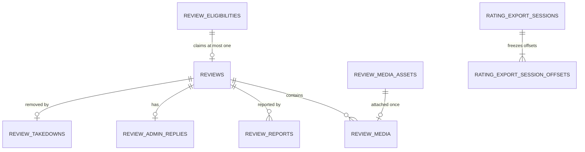

# Review Service — Thiết kế dữ liệu

> Nguồn chuẩn thực thi là
> [`0001_initial_review_schema.sql`](./schema/0001_initial_review_schema.sql).
> File này giải thích ownership, quan hệ và lý do thiết kế; không lặp lại DDL.

## 1. Ownership

Review sở hữu toàn bộ schema `review` trong PostgreSQL. Service khác không được đọc
hoặc ghi trực tiếp vào schema này.

| Kho lưu trữ | Dữ liệu | Nguồn chân lý |
|---|---|---|
| PostgreSQL `review` | entitlement, review, media asset metadata, moderation, privacy, aggregate, export session, outbox | Review Service |
| Kafka `t.review.events` | lifecycle facts, rating snapshot và notification request của Review | Kênh truyền, không phải database |
| Object storage | bytes ảnh/video | Storage sở hữu file; Review sở hữu metadata và lifecycle |

`order_id`, `product_id`, `sku_id` và các `*_user_id` là external identifier nên
không có foreign key sang service khác. `variant_name_snapshot` đến từ
`ORDER_COMPLETED`; Review không gọi đồng bộ sang Order hay Product để lấy nó.
`author_display_name` là pseudonym không chứa profile/email. Khi create, Review tạo
`Khách hàng #` cộng 12 ký tự Base32 viết hoa đầu của
`HMAC-SHA-256("review-author-alias:v1:" || canonical_lowercase_uuid(owner_user_id))`
bằng `REVIEW_AUTHOR_ALIAS_HMAC_SECRET`; cùng account giữ cùng pseudonym khi secret ổn
định. Alias chỉ để hiển thị, không cần unique và không được dùng cho authorization.
Review không gọi/consume User để lấy hay đồng bộ tên. Khi nhận `USER_DELETED`, Review
ghi đè giá trị bằng `Khách hàng ẩn danh`.

## 2. Logical data model



| Bảng | Vai trò | Quan hệ chính |
|---|---|---|
| `review_eligibilities` | Quyền tạo đúng một review cho SKU đã mua | Một entitlement sinh tối đa một review |
| `reviews` | Trạng thái public hiện tại của review | Giữ `product_id`/`sku_id` đã được FK xác minh để đọc nóng |
| `review_media_assets` | Lifecycle object upload, xác minh và xóa | Một asset gắn vào tối đa một `review_media` |
| `review_media` | Gắn asset và thứ tự hiển thị | Nhiều asset cho một review |
| `review_reports` | Report và quyết định moderation | Nhiều report cho một review |
| `review_admin_replies` | Một phản hồi chính thức đang hoạt động | Tối đa một cho một review |
| `review_takedowns` | Audit/legal record, không phải notification | Tối đa một cho một review |
| `product_rating_aggregates` | Projection rating bất đồng bộ theo product | Không FK, có thể rebuild |
| `review_event_receipts` | Biên nhận event đã xử lý của consumer | Idempotency cho consumer |
| `privacy_erasure_requests` | Vòng đời xóa/anonymize ở cấp subject | Điều phối hard delete và audit |
| `rating_export_sessions` + `rating_export_session_offsets` | Watermark Kafka cố định cho một export của Search | Một session có một offset cho mỗi partition |
| `review_outbox` | Event append-only cho Debezium | Không có publish status theo từng row |

## 3. Entitlement và review

`review_eligibilities` có business key `(order_id, product_id, sku_id)`. `order_id`
là globally unique và xác định buyer, nên không cần giữ `user_id` trong unique key.
Điều này cho phép null hóa owner ID khi privacy purge mà không phá idempotency.

`order_id` là opaque string do Order sở hữu, lưu `VARCHAR(64)`. Review chỉ so sánh
bằng, không parse, không sắp xếp và không suy ra gì từ nó, nên Order đổi định dạng nội
bộ không phá Review. Nó không phải số: JSON number là IEEE-754 double ở JavaScript nên
mọi giá trị trên 2^53-1 bị làm tròn im lặng.

`completed_at` là fact bất biến từ `ORDER_COMPLETED`; `expires_at` được tính từ nó.
`created_at` chỉ là lúc Review ghi nhận event và có thể muộn hơn `expires_at`, nên
không tham gia validation hoặc tính hạn. Khi eligibility là `EXPIRED`, `expires_at`
vẫn là thời điểm cửa sổ review thực sự đóng; `updated_at` phản ánh lần Review ghi
nhận thay đổi state gần nhất.

Eligibility chỉ có ba state:

| State | Ý nghĩa |
|---|---|
| `PENDING` | Owner còn tạo được review |
| `CLAIMED` | Review đã được tạo trong cùng transaction |
| `EXPIRED` | Cửa sổ review kết thúc trước khi tạo |

Quota sửa thuộc `reviews.edit_count` (`0..1`), không nằm trong eligibility. Một
review chỉ tồn tại khi `eligibility.status = CLAIMED`; thao tác tạo review là
`UPDATE ... WHERE status='PENDING' AND expires_at > now() RETURNING` rồi insert review
trong cùng transaction.

`reviews` cố ý copy `product_id` và `sku_id` cho public read. Composite foreign key
`(eligibility_id, product_id, sku_id)` bảo đảm copy này luôn trùng entitlement. Review
không copy `owner_user_id`; authorization sửa review join qua eligibility. Khi hard
delete, owner ID chỉ phải xóa ở một nơi, còn tên public được thay bằng display name
ẩn danh trên review.

## 4. Media asset lifecycle

Client xin signed upload instruction bằng `asset_id`, upload thẳng tới object storage,
rồi gửi `asset_id` khi tạo/sửa review. Client không gọi một bước verify/poll riêng và
không gửi object key hay URL tùy ý. Review đọc metadata của object immutable trong
command create/edit, xác minh MIME, kích thước và checksum khi được khai báo, rồi mới
chuyển asset sang `VERIFIED` và attach trong transaction PostgreSQL.

```text
ISSUED -- attachment deadline --> DELETE_PENDING -- storage confirmation --> DELETED
   |
   +--> VERIFIED -- attachment deadline --> DELETE_PENDING
                    |
                    +--> ATTACHED -- replacement/takedown --> DELETE_PENDING
```

- `object_key` là opaque, không chứa `user_id` và không xuất hiện trong public API.
- Signed upload phải single-write/no-overwrite. Review xác minh object tồn tại, loại
  và metadata trước khi state thành `VERIFIED`; object đã kiểm tra không được thay
  byte trước khi attach.
- `review_media.asset_id UNIQUE` ngăn tái dùng một upload cho nhiều review.
- Thứ tự asset trong create hoặc media replacement là `review_media.sort_order`.
  PATCH v1 giữ attachment khi field media vắng mặt và không hỗ trợ chỉ reorder asset
  đang attach.
- URL download/presigned URL được tạo lúc đọc; không lưu `media_url` hay
  `thumbnail_url` vì chúng hết hạn.
- `expires_at` là deadline để asset chưa attach được dùng; ở v1 nó trùng expiry của
  signed upload instruction. Scheduler chuyển asset `ISSUED`/`VERIFIED` quá deadline
  sang `DELETE_PENDING` với `deletion_reason=UNATTACHED_EXPIRED`, kể cả khi client
  chưa upload object.
- Takedown hoặc thay media chỉ detach database trong transaction và chuyển asset sang
  `DELETE_PENDING` với reason lần lượt `TAKEDOWN` hoặc `REPLACED`; storage worker xóa
  byte sau commit.
- Mọi `DELETE_PENDING` có `deletion_reason` và `delete_requested_at`. Worker chỉ ghi
  `DELETED` sau khi Storage xác nhận xóa; `object not found` cũng là xác nhận thành
  công để asset hết hạn nhưng chưa từng upload không bị retry vô hạn. `ISSUED` asset
  có thể đi thẳng tới `DELETE_PENDING` nên `verified_at` được phép null ở hai state
  cleanup (`DELETE_PENDING`, `DELETED`).
- Attach và expiry sweep cùng khóa asset row: attach thắng thì asset đã `ATTACHED` và
  không còn thuộc sweep; sweep thắng thì asset đã `DELETE_PENDING` và attach bị từ
  chối. Storage worker luôn chạy sau commit, không có storage call trong transaction.

`has_media` được giữ lại vì phục vụ filter/index public. `is_admin_replied` bị loại
bỏ vì public read đã phải batch-load nội dung reply; boolean đó chỉ thêm drift.

Asset được cấp URL nhưng không attach chỉ còn `ISSUED` hoặc `VERIFIED` đến deadline;
sau đó nó đi qua cleanup pipeline nêu trên, không ở lại một state `EXPIRED`. Ngoài giới
hạn 9 asset/review, API/Gateway phải áp quota số asset chưa attach và tổng byte upload
theo user để object storage không trở thành nơi upload vô hạn. Giới hạn byte theo
`IMAGE`/`VIDEO` được enforce cả trong signed upload policy lẫn lúc Review đọc metadata;
client-side validation không phải security control.

## 5. Moderation và takedown

`active_report_count` là denormalization của các report chưa `DISMISSED`. Nó được
cập nhật cùng transaction với report mới hoặc dismiss. Một reviewer có tối đa một
active report cho một review khi còn identity; unique partial index loại trừ report
`DISMISSED`, nên report mới sau một lần dismiss có thể tích lũy lại từ đầu.

`ACTIONED` là quyết định tự động khi chạm ngưỡng: có `resolved_at` nhưng không có
admin. `DISMISSED` luôn cần `resolved_by_admin_id` và `resolved_at`.

Moderation queue của admin là một danh sách duy nhất, đơn vị là review chứ không phải
report, vì `report-dismissals` thao tác theo review. Nó cần hai cột trên `reviews`:
`first_reported_at` mở chu kỳ khi `active_report_count` rời khỏi 0 và là khóa sắp xếp,
`hidden_at` ghi lần gần nhất threshold ẩn review và chỉ để hiển thị.

Phải khóa theo review state chứ không theo report state: hide chuyển mọi report
`PENDING` thành `ACTIONED`, nên một queue lọc theo report status sẽ mất case đúng lúc
nó cần admin phân xử. Cả hai `ck_review_hidden_at_present` và
`ck_review_first_reported_at_present` là implication một chiều, nên dismiss khôi phục
review mà vẫn giữ lịch sử; report mới ghi đè `first_reported_at` để mở chu kỳ mới.

`review_takedowns` là audit/legal record: `legal_case_id`, admin thực hiện
(`taken_down_by_admin_id`) và lý do nội bộ. Nó không phải nội dung notification.
Admin identity được lấy từ trusted Gateway identity, không có trường actor trong body.
Notification đi qua
`REVIEW_REMOVAL_NOTIFICATION_REQUESTED` trong cùng transaction với takedown;
notification request không chứa legal case, lý do hay định danh admin. Khi author
identity đã bị purge, Review không tạo request này.

## 6. Aggregate, revision và idempotency

`product_rating_aggregates` chỉ tính review `APPROVED`. Bucket, total và average
được derive trong một câu lệnh PostgreSQL. Các counter dùng `BIGINT`.

`review_revision` chỉ tăng khi aggregate thật sự thay đổi: rating, media-presence
hoặc visibility thay đổi; không tăng khi chỉ sửa content hoặc anonymize tác giả.
Search dùng revision để bỏ snapshot/event cũ hoặc trùng.

Rating aggregator, order consumer và privacy consumer ghi receipt vào
`review_event_receipts` trong cùng transaction với hiệu ứng của event. Primary key
`(consumer_name, event_id)` biến delivery at-least-once thành no-op khi event tới lại.
Receipt được giữ ít nhất bằng Kafka retention cộng recovery margin; cleanup chỉ được
chạy sau khi khoảng replay tương ứng đã đóng.

## 7. Export session cho Search

Tạo session bằng `POST /internal/v1/reviews/rating-aggregate-exports`. Review chụp
end offset của mọi partition `t.review.events`, ghi một dòng session và một dòng
offset cho từng partition. `replay_from_offset` là offset Search phải seek lại theo
nghĩa inclusive.

Search lấy trang qua `GET .../rating-aggregate-exports/{session_id}`. Mọi trang trả
chính tập offsets của session, dù aggregate scan theo keyset có thể thấy mutation mới
hơn watermark. Sau import, Search replay offsets rồi dùng `review_revision` guard;
vì vậy không cần giữ database transaction lâu qua toàn bộ HTTP pages.

Session ngắn hạn. Hết hạn hoặc lỗi ở giữa run trả `410`/`503`; Search tạo session
mới và chạy lại toàn bộ export. Offset rows xóa theo `ON DELETE CASCADE` khi session
được dọn.

## 8. Privacy lifecycle

`USER_DELETED` tạo `privacy_erasure_requests` với source event, thời điểm xóa,
`hard_delete_after`, state và `subject_match_key`. Key này là 32-byte HMAC-SHA-256 của
`"review-privacy-guard:v1:" || canonical_lowercase_uuid(user_id)`, dùng key
`REVIEW_PRIVACY_GUARD_HMAC_SECRET` và `subject_key_version = 1`. Nó chỉ dùng để so
khớp deletion guard, không được dùng authorization, public output, log hay metric
label. Nó khác
`author_anonymized_at`: bảng request theo dõi toàn bộ subject; cột trên review chỉ nói
review đó đã đổi display name chưa.

1. Consumer lấy transaction-scoped subject lock từ HMAC key, nhận event idempotently
   và ghi request `RECEIVED`. `subject_match_key UNIQUE` làm cho deletion lặp với ID
   event mới cũng không tạo lifecycle thứ hai.
2. Đổi `author_display_name` thành `Khách hàng ẩn danh`, đặt `author_anonymized_at`,
   đánh dấu request `ANONYMIZED` **kèm** `anonymized_at`; aggregate không đổi và không
   phát Review event. Mọi service giữ PII phải xử lý trực tiếp `USER_DELETED` từ Auth.
3. Ngay khi guard được commit — bình thường cùng state `ANONYMIZED`, hoặc request
   `FAILED` đang được retry — Order consumer cùng lấy subject lock, ghi receipt rồi
   suppress `ORDER_COMPLETED`; upload/create/edit/report của subject bị từ chối trước
   khi ghi direct user ID. Caller chưa có guard vẫn ghi và kiểm tra ownership như cũ.
4. Tại `hard_delete_after`, worker cùng lấy subject lock và trong cùng transaction ghi
   đủ **cả cặp cột** của từng bảng: `owner_user_id`/`owner_erased_at` trên eligibility
   và media asset, `reporter_user_id`/`reporter_erased_at` trên report, rồi
   `subject_user_id`/`purged_at` cùng `status='PURGED'` trên chính request.

Mỗi bảng erasable ghép identifier với một mốc erasure dưới một CHECK đòi có cả hai
hoặc không cột nào (`ck_eligibility_owner_erasure_consistent`,
`ck_media_asset_owner_erasure_consistent`, `ck_reporter_erasure_consistent`,
`ck_privacy_purge_identity_consistent`, `ck_privacy_status_timestamps_consistent`).
Null hóa mỗi identifier sẽ bị từ chối và rollback toàn bộ purge. Lỗi đó deterministic
chứ không phải transient, nên retry mức critical sẽ lặp lại y hệt và deadline pháp lý
trôi qua trong khi dữ liệu vẫn còn.

Tra cứu theo subject đi qua ba partial index trên `<identifier> IS NOT NULL`:
`ix_eligibility_owner_erasure`, `ix_media_asset_owner_erasure` và
`ix_report_reporter_erasure`. `ix_eligibility_owner_pending` không thay thế được vì nó
partial theo `status='PENDING'`, trong khi review chỉ tồn tại khi eligibility đã
`CLAIMED` — tức đúng phần nằm ngoài index đó. Row đã purge rơi khỏi index thay vì làm
nó phình ra.

`subject_user_id` chỉ được giữ tới khi purge để Review có thể tìm toàn bộ dữ liệu cần
xử lý. `subject_match_key` được giữ cùng privacy request sau purge để tránh late
delivery, retry, DLQ redrive hoặc backfill ghi UUID trở lại; đây là dữ liệu
pseudonymous nên thời hạn dọn request/guard phải được Privacy chốt sau khi mọi horizon
replay được phép đã đóng. Admin/legal identifiers có retention riêng theo chính sách
audit và không bị quy trình customer erasure này xóa ngầm.

Auth hiện publish `USER_DELETED` trực tiếp sau commit và retry tối đa ba lần. Nếu event
đó mất trước khi Review nhận được, Review không có guard và không có synchronous Auth
lookup để phát hiện chủ động. Đây là giới hạn contract hiện tại: Auth phải alert rồi
reconcile/redrive event bị mất; Review không thêm Auth outbox.

## 9. Outbox và retention

`review_outbox` là append-only CDC source, partition theo tháng. Bootstrap tạo tháng
UTC hiện tại và tháng kế; scheduler phải luôn duy trì cửa sổ đó. Thiếu partition vẫn
là lỗi critical của write path.

Không có `published_at`: Debezium không ack từng row theo cách cho phép Review cập
nhật publish status an toàn. Vì vậy không được suy diễn outbox backlog bằng số row
cũ. Giám sát publication qua Kafka Connect state, replication slot/WAL lag và độ
trễ từ `created_at` tới message observed downstream.

Cleanup chỉ drop partition khi connector/slot đã vượt toàn bộ vùng dữ liệu cần xóa.
UUID event ID là CloudEvents id; PostgreSQL 14 partitioning không enforce global
unique UUID tại parent, nên producer phải luôn sinh UUID ngẫu nhiên và không tái sử
dụng event ID.

`payload` là CloudEvents envelope hoàn chỉnh, không phải `data` trần: Debezium
`EventRouter` chỉ chọn topic/key/header chứ không dựng envelope, nên row outbox chính
là message sẽ lên wire. Các cột `event_id`, `event_type`, `partition_key` và
`correlation_id` là projection của envelope, được `ck_outbox_columns_mirror_payload`
giữ không lệch; `ck_outbox_payload_is_cloudevent` từ chối row không phải envelope hợp
lệ và `ck_outbox_payload_within_channel_limit` ép giới hạn 16 KiB của channel ngay tại
write path. Chi tiết ánh xạ nằm ở
[ADR-003](./decisions/ADR-003-outbox-cdc-publication.md).

`aggregate_type` không dùng để route và chỉ có hai giá trị: `REVIEW` với
`aggregate_id = review_id` cho năm lifecycle fact và cả hai notification request, và
`REVIEW_METRIC` với `aggregate_id = product_id` cho rating snapshot.

Mọi row outbox được Debezium publish lên cùng `t.review.events` với Kafka key
`partition_key = product_id`, gồm cả hai notification request. Connector phải đặt
`route.topic.replacement` tĩnh: để `EventRouter` route mặc định theo `aggregate_type`
sẽ tách Review thành nhiều topic và phá ordering theo `product_id`. Hai payload đó chỉ có
`recipient_user_id`, `review_id` và `product_id`; chúng không có content, display
name, object key, report detail hay legal reason. Consumer không chịu trách nhiệm cho
một type phải ACK nó mà không persist/log payload.

## 10. Query/index policy

Public review list dùng keyset `(created_at, id)` và các partial index
`status='APPROVED'`. Mọi index phục vụ sort đều kết thúc bằng
`created_at DESC, id DESC`; không dùng `OFFSET`.

Admin moderation list dùng keyset `(first_reported_at, id)` tăng dần cho cả hai
status, trên `ix_review_moderation_reported` và `ix_review_moderation_hidden`. Dùng
chung một khóa sắp xếp để phân trang giữ nguyên ý nghĩa khi review chuyển từ
`REPORTED` sang `HIDDEN_BY_REPORT`. Mọi index review khác đều partial theo
`status='APPROVED'` và không có predicate report, nên thiếu hai index này thì list
seq-scan toàn bảng.

`review_reports` không có index theo `created_at` toàn cục: queue khóa theo review nên
report chỉ được batch-load theo `review_id` qua `ix_report_review_status`.

Các query secondary tải media/reply theo batch cho page review, không N+1; admin
moderation list cũng batch-load media và report chưa `DISMISSED` theo cùng cách.
Aggregate đọc theo primary key. Search export keyset theo `product_id`. Mọi `updated_at` trên
bảng mutable được trigger database cập nhật, không phụ thuộc việc application code
nhớ set cột.
