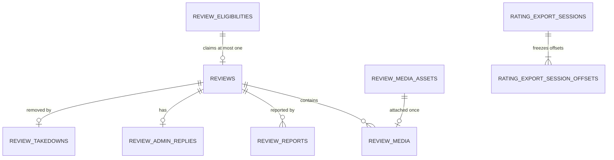

# Review Service — Thiết kế dữ liệu

> Nguồn chuẩn thực thi là
> [`0001_initial_review_schema.sql`](./schema/0001_initial_review_schema.sql).
> File này giải thích ownership, quan hệ và lý do thiết kế; không lặp lại DDL.

## 1. Ownership

Review sở hữu toàn bộ schema `review` trong PostgreSQL. Service khác không được đọc
hoặc ghi trực tiếp vào schema này.

| Kho lưu trữ | Dữ liệu | Nguồn chân lý |
|---|---|---|
| PostgreSQL `review` | entitlement, review, media asset metadata, moderation, privacy, aggregate, export session, outbox | Review Service |
| Kafka `t.review.events` | lifecycle facts, rating snapshot và notification request của Review | Kênh truyền, không phải database |
| Object storage | bytes ảnh/video | Storage sở hữu file; Review sở hữu metadata và lifecycle |

`order_id`, `product_id`, `sku_id` và các `*_user_id` là external identifier nên
không có foreign key sang service khác. `variant_name_snapshot` đến từ
`ORDER_COMPLETED`; Review không gọi đồng bộ sang Order hay Product để lấy nó.
`author_display_name` là pseudonym không chứa profile/email. Khi create, Review tạo
`Khách hàng #` cộng 12 ký tự Base32 viết hoa đầu của
`HMAC-SHA-256("review-author-alias:v1:" || canonical_lowercase_uuid(owner_user_id))`
bằng `REVIEW_AUTHOR_ALIAS_HMAC_SECRET`; cùng account giữ cùng pseudonym khi secret ổn
định. Alias chỉ để hiển thị, không cần unique và không được dùng cho authorization.
Review không gọi/consume User để lấy hay đồng bộ tên. Khi nhận `USER_DELETED`, Review
ghi đè giá trị bằng `Khách hàng ẩn danh`.

## 2. Logical data model



| Bảng | Vai trò | Quan hệ chính |
|---|---|---|
| `review_eligibilities` | Quyền tạo đúng một review cho SKU đã mua | Một entitlement sinh tối đa một review |
| `reviews` | Trạng thái public hiện tại của review | Giữ `product_id`/`sku_id` đã được FK xác minh để đọc nóng |
| `review_media_assets` | Lifecycle object upload, xác minh và xóa | Một asset gắn vào tối đa một `review_media` |
| `review_media` | Gắn asset và thứ tự hiển thị | Nhiều asset cho một review |
| `review_reports` | Report và quyết định moderation | Nhiều report cho một review |
| `review_admin_replies` | Một phản hồi chính thức đang hoạt động | Tối đa một cho một review |
| `review_takedowns` | Audit/legal record, không phải notification | Tối đa một cho một review |
| `product_rating_aggregates` | Projection rating bất đồng bộ theo product | Không FK, có thể rebuild |
| `review_event_receipts` | Biên nhận event đã xử lý của consumer | Idempotency cho consumer |
| `privacy_erasure_requests` | Vòng đời xóa/anonymize ở cấp subject | Điều phối hard delete và audit |
| `rating_export_sessions` + `rating_export_session_offsets` | Watermark Kafka cố định cho một export của Search | Một session có một offset cho mỗi partition |
| `review_outbox` | Event append-only cho Debezium | Không có publish status theo từng row |

## 3. Entitlement và review

`review_eligibilities` có business key `(order_id, product_id, sku_id)`. `order_id`
là globally unique và xác định buyer, nên không cần giữ `user_id` trong unique key.
Điều này cho phép null hóa owner ID khi privacy purge mà không phá idempotency.

Eligibility chỉ có ba state:

| State | Ý nghĩa |
|---|---|
| `PENDING` | Owner còn tạo được review |
| `CLAIMED` | Review đã được tạo trong cùng transaction |
| `EXPIRED` | Cửa sổ review kết thúc trước khi tạo |

Quota sửa thuộc `reviews.edit_count` (`0..1`), không nằm trong eligibility. Một
review chỉ tồn tại khi `eligibility.status = CLAIMED`; thao tác tạo review là
`UPDATE ... WHERE status='PENDING' AND expires_at > now() RETURNING` rồi insert review
trong cùng transaction.

`reviews` cố ý copy `product_id` và `sku_id` cho public read. Composite foreign key
`(eligibility_id, product_id, sku_id)` bảo đảm copy này luôn trùng entitlement. Review
không copy `owner_user_id`; authorization sửa review join qua eligibility. Khi hard
delete, owner ID chỉ phải xóa ở một nơi, còn tên public được thay bằng display name
ẩn danh trên review.

## 4. Media asset lifecycle

Client xin signed upload instruction bằng `asset_id`, upload thẳng tới object storage,
rồi gửi `asset_id` khi tạo/sửa review. Client không gọi một bước verify/poll riêng và
không gửi object key hay URL tùy ý. Review đọc metadata của object immutable trong
command create/edit, xác minh MIME, kích thước và checksum khi được khai báo, rồi mới
chuyển asset sang `VERIFIED` và attach trong transaction PostgreSQL.

```text
ISSUED -> VERIFIED -> ATTACHED -> DELETE_PENDING -> DELETED
   |          |
   +--------> EXPIRED
```

- `object_key` là opaque, không chứa `user_id` và không xuất hiện trong public API.
- Signed upload phải single-write/no-overwrite. Review xác minh object tồn tại, loại
  và metadata trước khi state thành `VERIFIED`; object đã kiểm tra không được thay
  byte trước khi attach.
- `review_media.asset_id UNIQUE` ngăn tái dùng một upload cho nhiều review.
- Thứ tự asset trong create hoặc media replacement là `review_media.sort_order`.
  PATCH v1 giữ attachment khi field media vắng mặt và không hỗ trợ chỉ reorder asset
  đang attach.
- URL download/presigned URL được tạo lúc đọc; không lưu `media_url` hay
  `thumbnail_url` vì chúng hết hạn.
- Takedown hoặc thay media chỉ detach database trong transaction và chuyển asset sang
  `DELETE_PENDING`; storage worker xóa byte sau commit.

`has_media` được giữ lại vì phục vụ filter/index public. `is_admin_replied` bị loại
bỏ vì public read đã phải batch-load nội dung reply; boolean đó chỉ thêm drift.

Asset được cấp URL nhưng không attach vẫn có `ISSUED` hoặc `VERIFIED` và hết hạn theo
TTL. Ngoài giới hạn 9 asset/review, API/Gateway phải áp quota số asset chưa attach và
tổng byte upload theo user để object storage không trở thành nơi upload vô hạn. Giới
hạn byte theo `IMAGE`/`VIDEO` được enforce cả trong signed upload policy lẫn lúc Review
đọc metadata; client-side validation không phải security control.

## 5. Moderation và takedown

`active_report_count` là denormalization của các report chưa `DISMISSED`. Nó được
cập nhật cùng transaction với report mới hoặc dismiss. Một reviewer có tối đa một
active report cho một review khi còn identity; unique partial index loại trừ report
`DISMISSED`, nên report mới sau một lần dismiss có thể tích lũy lại từ đầu.

`ACTIONED` là quyết định tự động khi chạm ngưỡng: có `resolved_at` nhưng không có
admin. `DISMISSED` luôn cần `resolved_by_admin_id` và `resolved_at`.

`review_takedowns` là audit/legal record: `legal_case_id`, admin thực hiện
(`taken_down_by_admin_id`) và lý do nội bộ. Nó không phải nội dung notification.
Admin identity được lấy từ trusted Gateway identity, không có trường actor trong body.
Notification đi qua
`REVIEW_REMOVAL_NOTIFICATION_REQUESTED` trong cùng transaction với takedown;
notification request không chứa legal case, lý do hay định danh admin. Khi author
identity đã bị purge, Review không tạo request này.

## 6. Aggregate, revision và idempotency

`product_rating_aggregates` chỉ tính review `APPROVED`. Bucket, total và average
được derive trong một câu lệnh PostgreSQL. Các counter dùng `BIGINT`.

`review_revision` chỉ tăng khi aggregate thật sự thay đổi: rating, media-presence
hoặc visibility thay đổi; không tăng khi chỉ sửa content hoặc anonymize tác giả.
Search dùng revision để bỏ snapshot/event cũ hoặc trùng.

Rating aggregator, order consumer và privacy consumer ghi receipt vào
`review_event_receipts` trong cùng transaction với hiệu ứng của event. Primary key
`(consumer_name, event_id)` biến delivery at-least-once thành no-op khi event tới lại.
Receipt được giữ ít nhất bằng Kafka retention cộng recovery margin; cleanup chỉ được
chạy sau khi khoảng replay tương ứng đã đóng.

## 7. Export session cho Search

Tạo session bằng `POST /internal/v1/reviews/rating-aggregate-exports`. Review chụp
end offset của mọi partition `t.review.events`, ghi một dòng session và một dòng
offset cho từng partition. `replay_from_offset` là offset Search phải seek lại theo
nghĩa inclusive.

Search lấy trang qua `GET .../rating-aggregate-exports/{session_id}`. Mọi trang trả
chính tập offsets của session, dù aggregate scan theo keyset có thể thấy mutation mới
hơn watermark. Sau import, Search replay offsets rồi dùng `review_revision` guard;
vì vậy không cần giữ database transaction lâu qua toàn bộ HTTP pages.

Session ngắn hạn. Hết hạn hoặc lỗi ở giữa run trả `410`/`503`; Search tạo session
mới và chạy lại toàn bộ export. Offset rows xóa theo `ON DELETE CASCADE` khi session
được dọn.

## 8. Privacy lifecycle

`USER_DELETED` tạo `privacy_erasure_requests` với source event, thời điểm xóa,
`hard_delete_after` và state. Nó khác `author_anonymized_at`: bảng request theo dõi
toàn bộ subject; cột trên review chỉ nói review đó đã đổi display name chưa.

1. Consumer nhận event idempotently, ghi request `RECEIVED`.
2. Đổi `author_display_name` thành `Khách hàng ẩn danh`, đặt `author_anonymized_at`, đánh dấu request
   `ANONYMIZED`; aggregate không đổi và không phát Review event. Mọi service giữ
   PII phải xử lý trực tiếp `USER_DELETED` từ Auth.
3. Tại `hard_delete_after`, worker null hóa `owner_user_id`, `reporter_user_id` và
   owner của media asset liên quan trong cùng transaction; sau đó null hóa
   `privacy_erasure_requests.subject_user_id` và đánh dấu `PURGED`.

`subject_user_id` chỉ được giữ tới khi purge để Review có thể tìm toàn bộ dữ liệu cần
xử lý. Admin/legal identifiers có retention riêng theo chính sách audit và không bị
quy trình customer erasure này xóa ngầm.

## 9. Outbox và retention

`review_outbox` là append-only CDC source, partition theo tháng. Bootstrap tạo tháng
UTC hiện tại và tháng kế; scheduler phải luôn duy trì cửa sổ đó. Thiếu partition vẫn
là lỗi critical của write path.

Không có `published_at`: Debezium không ack từng row theo cách cho phép Review cập
nhật publish status an toàn. Vì vậy không được suy diễn outbox backlog bằng số row
cũ. Giám sát publication qua Kafka Connect state, replication slot/WAL lag và độ
trễ từ `created_at` tới message observed downstream.

Cleanup chỉ drop partition khi connector/slot đã vượt toàn bộ vùng dữ liệu cần xóa.
UUID event ID là CloudEvents id; PostgreSQL 14 partitioning không enforce global
unique UUID tại parent, nên producer phải luôn sinh UUID ngẫu nhiên và không tái sử
dụng event ID.

Mọi row outbox được Debezium publish lên cùng `t.review.events` với Kafka key
`partition_key = product_id`, gồm cả hai notification request. Hai payload đó chỉ có
`recipient_user_id`, `review_id` và `product_id`; chúng không có content, display
name, object key, report detail hay legal reason. Consumer không chịu trách nhiệm cho
một type phải ACK nó mà không persist/log payload.

## 10. Query/index policy

Public review list dùng keyset `(created_at, id)` và các partial index
`status='APPROVED'`. Mọi index phục vụ sort đều kết thúc bằng
`created_at DESC, id DESC`; không dùng `OFFSET`.

Các query secondary tải media/reply theo batch cho page review, không N+1. Aggregate
đọc theo primary key. Search export keyset theo `product_id`. Mọi `updated_at` trên
bảng mutable được trigger database cập nhật, không phụ thuộc việc application code
nhớ set cột.
