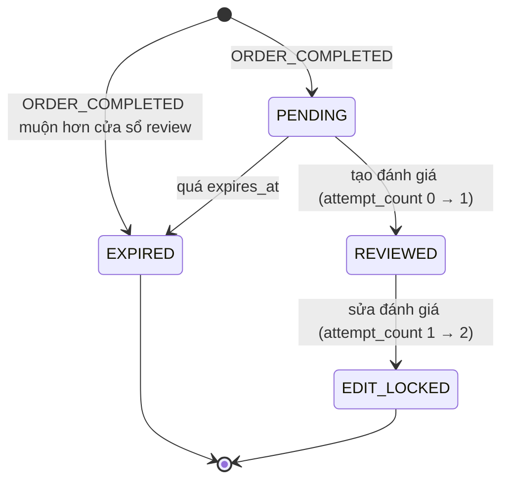
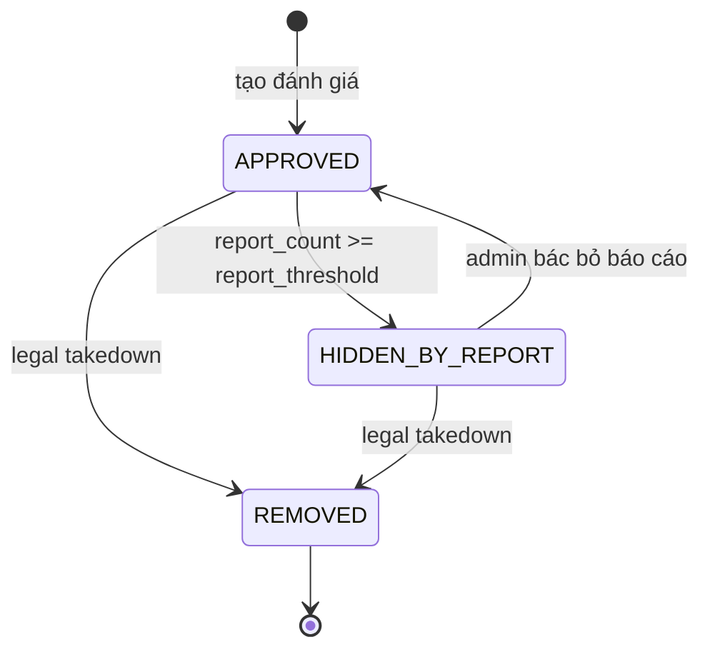
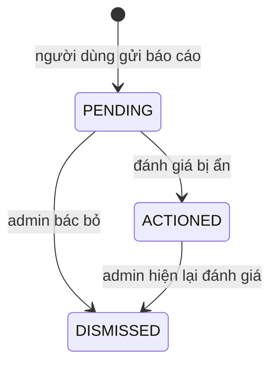

# Review Service — Domain Model

> File này trả lời: "Service đang bảo vệ những quy tắc nghiệp vụ nào?"

## 1. Ubiquitous language

| Term | Định nghĩa | Không được nhầm với |
|---|---|---|
| Eligibility | Quyền viết đánh giá cho đúng một SKU trong đúng một đơn hàng của đúng một người mua | Review — eligibility tồn tại trước và có thể không bao giờ sinh review |
| Attempt | Một lần người dùng gửi nội dung đánh giá, gồm cả lần tạo và lần sửa | Số lần gọi API — request thất bại không tính là attempt |
| Review | Nội dung đánh giá đã được ghi nhận và mặc định hiển thị công khai | Rating — rating chỉ là một trường của review |
| Rating aggregate | Số liệu tổng hợp theo `product_id`, gồm trung bình, tổng và phân bố sao | Rating của một review đơn lẻ |
| `review_revision` | Số nguyên tăng đơn điệu trong phạm vi một `product_id`, đánh dấu phiên bản của aggregate | Timestamp — `observed_at` không dùng để so sánh thứ tự |
| Report | Một lần người dùng báo cáo đánh giá vi phạm | Việc ẩn đánh giá — ẩn là hệ quả khi đủ ngưỡng |
| Admin reply | Phản hồi chính thức của quản trị viên gắn với một đánh giá | Bình luận của người dùng khác — hệ thống không có tính năng này |
| Anonymization | Xóa thông tin nhận dạng tác giả nhưng giữ nội dung và điểm | Takedown — takedown gỡ cả nội dung |
| Takedown | Gỡ đánh giá theo yêu cầu pháp lý, có phê duyệt và dấu vết kiểm toán | Hidden — hidden có thể hoàn tác, takedown thì không |

## 2. Domain objects

**Aggregate root: `ReviewEligibility`**
Định danh bằng `id` (UUID); khóa nghiệp vụ là `(order_id, product_id, sku_id, user_id)`.
Sở hữu `status`, `attempt_count` và `expires_at`. Vòng đời bắt đầu khi Order phát
`ORDER_COMPLETED` và kết thúc khi hết hạn hoặc dùng hết lượt.

**Aggregate root: `Review`**
Định danh bằng `id` (UUID). Tham chiếu đúng một eligibility. Chứa entity con
`ReviewMedia` (danh sách có thứ tự) và `ReviewReport` (tập hợp), cùng `AdminReply`
(tối đa một). `report_count`, `has_media`, `is_admin_replied` là giá trị dẫn xuất
được duy trì trong cùng transaction với thay đổi sinh ra chúng.

**Aggregate root: `ProductRatingAggregate`**
Định danh bằng `product_id`. Là aggregate riêng, cập nhật bất đồng bộ và **không**
nằm trong transaction ghi review. Đây là ranh giới quan trọng nhất của mô hình:
`Review` không được sửa aggregate trực tiếp.

**Value object:** `Rating` (1–5), `ReportReason` (`SPAM`, `OFFENSIVE`, `FAKE`,
`OTHER`), `MediaRef` (`media_type`, `media_url`, `thumbnail_url`, `sort_order`).

**Object thuộc service khác, chỉ tham chiếu:** `product_id`, `sku_id`, `order_id`
là identifier ngoài; `variant_name` và `user_name` là snapshot chỉ đọc, không được
đồng bộ lại. Review không có bản sao của Product hay User.

## 3. Commands và queries

| Loại | Tên | Actor | Aggregate xử lý |
|---|---|---|---|
| Command | Cấp eligibility từ đơn hoàn tất | Order Service (event) | `ReviewEligibility` |
| Command | Tạo đánh giá | Người mua sở hữu eligibility | `ReviewEligibility` → `Review` |
| Command | Sửa đánh giá | Tác giả đánh giá | `ReviewEligibility` + `Review` |
| Command | Báo cáo đánh giá | Người dùng đã đăng nhập, khác tác giả | `Review` |
| Command | Bác bỏ báo cáo và hiện lại đánh giá | Admin | `Review` |
| Command | Phản hồi đánh giá | Admin | `Review` |
| Command | Gỡ đánh giá theo yêu cầu pháp lý | Admin có phê duyệt | `Review` |
| Command | Ẩn danh tác giả | Auth Service (event) | `Review` |
| Command | Cập nhật aggregate | Rating aggregator (event) | `ProductRatingAggregate` |
| Query | Danh sách item chờ đánh giá của tôi | Chủ tài khoản | `ReviewEligibility` |
| Query | Danh sách đánh giá của một sản phẩm | Bất kỳ ai | `Review` |
| Query | Số liệu tổng hợp của một sản phẩm | Bất kỳ ai | `ProductRatingAggregate` |
| Query | Aggregate và review preview cho PDP | Product Detail BFF | `ProductRatingAggregate` + `Review` |
| Query | Export aggregate snapshot | Search Service | `ProductRatingAggregate` |

## 4. Business rules

| ID | Điều kiện áp dụng | Quy tắc | Domain error khi vi phạm |
|---|---|---|---|
| `REVIEW-BR-001` | Nhận `ORDER_COMPLETED` | Mỗi item trong đơn sinh đúng một eligibility; gửi lại cùng đơn không tạo thêm | — (idempotent) |
| `REVIEW-BR-002` | Cấp eligibility | `expires_at = completed_at + review_window_days`; nếu đã quá hạn ngay lúc xử lý thì cấp ở trạng thái `EXPIRED` | — |
| `REVIEW-BR-003` | Tạo đánh giá | Chỉ chủ sở hữu eligibility được tạo | `NOT_ELIGIBILITY_OWNER` |
| `REVIEW-BR-004` | Tạo đánh giá | Eligibility phải ở `PENDING` và chưa quá hạn | `ELIGIBILITY_EXPIRED`, `ALREADY_REVIEWED` |
| `REVIEW-BR-005` | Tạo và sửa | `rating` nằm trong 1–5 | `INVALID_RATING` |
| `REVIEW-BR-006` | Tạo và sửa | `content` không vượt quá giới hạn độ dài cấu hình; có thể để trống nếu có điểm | `CONTENT_TOO_LONG` |
| `REVIEW-BR-007` | Tạo và sửa | Số media không vượt `max_media_per_review`; object key phải thuộc namespace upload của chính người dùng | `TOO_MANY_MEDIA`, `INVALID_MEDIA_REFERENCE` |
| `REVIEW-BR-008` | Sửa đánh giá | Chỉ tác giả được sửa | `NOT_REVIEW_AUTHOR` |
| `REVIEW-BR-009` | Sửa đánh giá | Eligibility phải ở `REVIEWED` với `attempt_count = 1`; sau khi sửa chuyển sang `EDIT_LOCKED` với `attempt_count = 2` | `EDIT_QUOTA_EXHAUSTED` |
| `REVIEW-BR-010` | Sửa đánh giá | Chỉ sửa được đánh giá đang ở `APPROVED` | `REVIEW_NOT_EDITABLE` |
| `REVIEW-BR-011` | Báo cáo | Một người báo cáo một đánh giá tối đa một lần | `ALREADY_REPORTED` |
| `REVIEW-BR-012` | Báo cáo | Tác giả không được tự báo cáo đánh giá của mình | `CANNOT_REPORT_OWN_REVIEW` |
| `REVIEW-BR-013` | Báo cáo | Khi `report_count` đạt `report_threshold`, đánh giá chuyển `HIDDEN_BY_REPORT` | — |
| `REVIEW-BR-014` | Admin bác báo cáo | Đánh giá quay lại `APPROVED`, các report liên quan chuyển `DISMISSED`, và không bị ẩn lại bởi chính những report đó | — |
| `REVIEW-BR-015` | Admin reply | Chỉ phản hồi được đánh giá `APPROVED`; mỗi đánh giá tối đa một phản hồi đang hoạt động | `REVIEW_NOT_REPLYABLE` |
| `REVIEW-BR-016` | Admin reply | Sửa nội dung phản hồi đã tồn tại không phát event thông báo mới | — |
| `REVIEW-BR-017` | Aggregate | Chỉ đánh giá ở `APPROVED` được tính vào aggregate | — |
| `REVIEW-BR-018` | Aggregate | `average_rating` và `total_reviews` được derive từ bucket sao trong cùng câu lệnh cập nhật | — |
| `REVIEW-BR-019` | Ẩn danh | `USER_DELETED` chỉ xóa thông tin nhận dạng tác giả; điểm và nội dung được giữ để không làm sai lệch aggregate | — |
| `REVIEW-BR-020` | Takedown | Gỡ nội dung phải có `legal_case_id` và người phê duyệt; nếu đánh giá đang được tính thì phải phát event bù | `TAKEDOWN_NOT_APPROVED` |

## 5. Invariants

| ID | Nội dung | Nơi enforcement |
|---|---|---|
| `REVIEW-INV-001` | Một `(order_id, product_id, sku_id, user_id)` có tối đa một eligibility | `UNIQUE` constraint trong [schema](./schema/0001_initial_review_schema.sql) |
| `REVIEW-INV-002` | Một eligibility sinh tối đa một review | `UNIQUE(eligibility_id)` trên `reviews` |
| `REVIEW-INV-003` | `attempt_count ∈ [0, 2]` và chỉ tăng | `CHECK` constraint + `UPDATE` có điều kiện; không có câu lệnh nào giảm giá trị này |
| `REVIEW-INV-004` | Review chỉ tồn tại khi eligibility đã rời `PENDING` | Cùng transaction: `UPDATE` eligibility trả về dòng rồi mới `INSERT` review |
| `REVIEW-INV-005` | `total_reviews = Σ total_n_star`, `average_rating` derive từ bucket | Câu lệnh cập nhật aggregate + reconciliation job kiểm tra định kỳ |
| `REVIEW-INV-006` | Mọi thay đổi aggregate tăng `review_revision` cùng transaction với outbox event | Cùng một `UPDATE ... RETURNING` rồi `INSERT` outbox trong một transaction |
| `REVIEW-INV-007` | Mọi event đi qua outbox | Không có Kafka producer trong code nghiệp vụ; kiểm tra bằng architecture test |
| `REVIEW-INV-008` | `review_revision` đơn điệu tăng trong phạm vi một `product_id` | Chỉ được cập nhật bằng `review_revision + 1` |

## 6. State machines

### 6.1 Eligibility

| State | Ý nghĩa | `attempt_count` |
|---|---|---|
| `PENDING` | Còn quyền viết đánh giá | 0 |
| `REVIEWED` | Đã viết đánh giá, còn đúng một lượt sửa | 1 |
| `EDIT_LOCKED` | Đã dùng hết lượt sửa | 2 |
| `EXPIRED` | Hết hạn trước khi viết đánh giá | 0 |

`EXPIRED` chỉ áp dụng cho eligibility chưa từng được dùng. Khi đánh giá đã tồn tại,
việc hết hạn không làm gì cả: đánh giá vẫn hiển thị bình thường.

**Chuyển trạng thái không hợp lệ:** `EDIT_LOCKED → REVIEWED`, `EXPIRED → PENDING`,
và mọi đường quay ngược về `PENDING`. Trạng thái chỉ tiến, không lùi.

> **Không có luồng "thu hồi eligibility kẹt".** Thiết kế cũ có một câu lệnh
> reconciliation đưa `REVIEWED` trở lại `PENDING` và đặt `attempt_count = 0`. Nó vừa
> vi phạm `REVIEW-INV-003`, vừa không thể kích hoạt: điều kiện của nó là
> `status = 'REVIEWED' AND attempt_count = 0`, trong khi hai giá trị này luôn được
> đặt cùng lúc thành `REVIEWED`/`1`. Trong thiết kế này, việc chuyển eligibility và
> việc tạo review nằm trong **cùng một transaction**, nên trạng thái "REVIEWED nhưng
> không có review" không thể xuất hiện do lỗi runtime. Nếu nó vẫn xuất hiện — do sửa
> dữ liệu thủ công hoặc do bug — reconciliation **phát hiện và cảnh báo**, không tự
> sửa; xem `WF-REVIEW-010`.

> **Đổi tên so với thiết kế cũ.** Tài liệu trước dùng
> `REJECTED_RETRY_PENDING`/`REJECTED_FINAL` để biểu thị việc đã dùng hết lượt sửa.
> Hai tên này mô tả sai bản chất (không có gì bị "từ chối") và được dùng lẫn lộn cho
> hai tình huống khác nhau. Mapping: `REJECTED_FINAL` → `EDIT_LOCKED`;
> `REJECTED_RETRY_PENDING` bị loại bỏ vì không có luồng nào tạo ra nó. Xem
> [ADR-001](./decisions/ADR-001-eligibility-and-single-edit.md).

### 6.2 Review

| State | Hiển thị công khai | Tính vào aggregate | Sửa được |
|---|---|---|---|
| `APPROVED` | Có | Có | Có, nếu còn lượt |
| `HIDDEN_BY_REPORT` | Không | Không | Không |
| `REMOVED` | Không | Không | Không |

`REMOVED` là terminal state và không thể hoàn tác.

### 6.3 Report

## 7. Authorization rules

| Hành động | Ai được phép | Kiểm tra |
|---|---|---|
| Xem danh sách đánh giá, xem aggregate | Bất kỳ ai, kể cả chưa đăng nhập | Không |
| Xem danh sách chờ đánh giá | Chủ tài khoản | `user_id` trong token khớp `user_id` truy vấn |
| Tạo đánh giá | Chủ sở hữu eligibility | `eligibility.user_id = token.user_id` |
| Sửa đánh giá | Tác giả | `review.user_id = token.user_id` |
| Báo cáo đánh giá | Người dùng đã đăng nhập, không phải tác giả | `review.user_id <> token.user_id` |
| Phản hồi, bác báo cáo | Role admin | Role claim |
| Gỡ theo yêu cầu pháp lý | Role admin kèm phê duyệt được ghi nhận | Role claim + `legal_case_id` bắt buộc |
| Export aggregate snapshot | Service identity của Search | Bearer service identity, chặn ở ingress |

Đánh giá là dữ liệu công khai nên không có isolation theo shop hay tenant. Sự cô
lập duy nhất là quyền sở hữu ở cấp người dùng.

## 8. Domain errors

| Error code | Điều kiện phát sinh | Retryable | HTTP |
|---|---|---|---|
| `ELIGIBILITY_NOT_FOUND` | Không có eligibility khớp | No | 404 |
| `NOT_ELIGIBILITY_OWNER` | Eligibility thuộc người khác | No | 403 |
| `ELIGIBILITY_EXPIRED` | `expires_at <= now()` | No | 410 |
| `ALREADY_REVIEWED` | Eligibility đã ở `REVIEWED` hoặc `EDIT_LOCKED` | No | 409 |
| `REVIEW_NOT_FOUND` | Không có đánh giá, hoặc đã `REMOVED` | No | 404 |
| `NOT_REVIEW_AUTHOR` | Người gọi không phải tác giả | No | 403 |
| `EDIT_QUOTA_EXHAUSTED` | Eligibility đã ở `EDIT_LOCKED` | No | 409 |
| `REVIEW_NOT_EDITABLE` | Đánh giá đang bị ẩn hoặc đã gỡ | No | 409 |
| `INVALID_RATING` | `rating` ngoài 1–5 | No | 400 |
| `CONTENT_TOO_LONG` | Vượt giới hạn độ dài | No | 400 |
| `TOO_MANY_MEDIA` | Vượt `max_media_per_review` | No | 400 |
| `INVALID_MEDIA_REFERENCE` | Object key không thuộc namespace của người dùng | No | 400 |
| `ALREADY_REPORTED` | Đã báo cáo đánh giá này rồi | No | 409 |
| `CANNOT_REPORT_OWN_REVIEW` | Tự báo cáo | No | 403 |
| `REVIEW_NOT_REPLYABLE` | Đánh giá không ở `APPROVED` | No | 409 |
| `TAKEDOWN_NOT_APPROVED` | Thiếu `legal_case_id` hoặc phê duyệt | No | 422 |
| `EXPORT_SESSION_UNAVAILABLE` | Không chụp được offset hoặc không mở được scan nhất quán | **Yes** | 503 |

Toàn bộ domain error đều không retryable trừ `EXPORT_SESSION_UNAVAILABLE`. Lỗi hạ
tầng (timeout PostgreSQL, Kafka không sẵn sàng, connection pool cạn) không nằm trong
bảng này; chúng trả 503 và được xử lý ở [Operations](./operations.md).

## 9. Business examples

**Đánh giá hợp lệ.** Đơn `10001` của người dùng `U1` hoàn tất ngày 01/09 với hai
item. Review tạo hai eligibility `PENDING`, hạn 01/10. Ngày 03/09 `U1` gửi đánh giá
5 sao cho SKU đầu tiên: eligibility chuyển `REVIEWED` với `attempt_count = 1`, một
đánh giá `APPROVED` được tạo, và trong vài giây aggregate của sản phẩm tăng thêm một
đánh giá 5 sao với `review_revision` mới.

**Sửa rồi sửa tiếp.** Ngày 04/09 `U1` sửa từ 5 sao xuống 3 sao. Eligibility chuyển
`EDIT_LOCKED` với `attempt_count = 2`; aggregate trừ một ở bucket 5 sao và cộng một
ở bucket 3 sao. Ngày 05/09 `U1` sửa lần nữa: bị từ chối với `EDIT_QUOTA_EXHAUSTED`
(409). Đây là điểm bản thiết kế cũ bỏ sót — nếu aggregator không xử lý `REVIEW_UPDATED`
thì aggregate vẫn giữ 5 sao và hiển thị sai vĩnh viễn.

**Hết hạn.** Item thứ hai của đơn `10001` không được đánh giá. Ngày 01/10
reconciliation chuyển eligibility sang `EXPIRED`. Ngày 02/10 `U1` thử gửi đánh giá:
nhận `ELIGIBILITY_EXPIRED` (410).

**Ẩn rồi hiện lại.** Một đánh giá nhận đủ 10 báo cáo và chuyển `HIDDEN_BY_REPORT`;
aggregate trừ đánh giá này ra. Admin xem lại, thấy báo cáo là sai, bác bỏ toàn bộ:
đánh giá quay lại `APPROVED`, aggregate cộng lại, và các report đó chuyển `DISMISSED`
nên không thể đẩy đánh giá vào trạng thái ẩn một lần nữa.

**Xóa tài khoản.** `U1` xóa tài khoản. Auth phát `USER_DELETED`. Review đổi tên hiển
thị thành "Tài khoản đã bị xóa" trên mọi đánh giá của `U1`, giữ nguyên điểm và nội
dung, và phát `REVIEW_UPDATED` cho consumer content/analytics. Search không lưu tên
tác giả và chỉ xử lý metrics snapshot. Aggregate không đổi — nếu xóa
đánh giá thì điểm sản phẩm sẽ nhảy và người bán bị ảnh hưởng bởi một hành động
không liên quan đến chất lượng sản phẩm.
