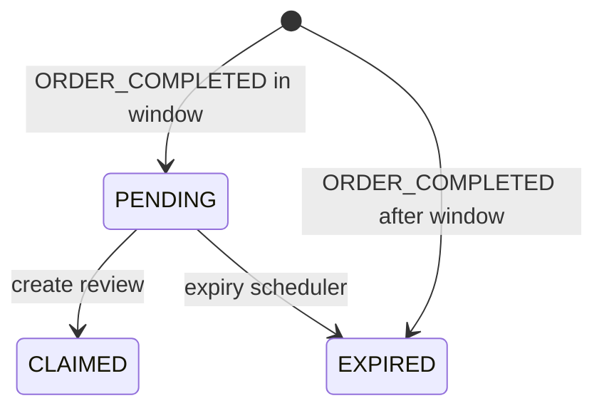
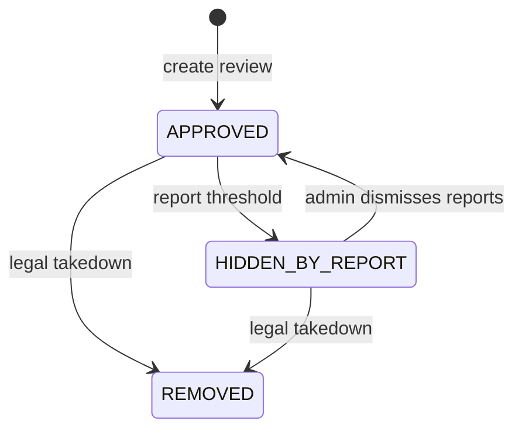
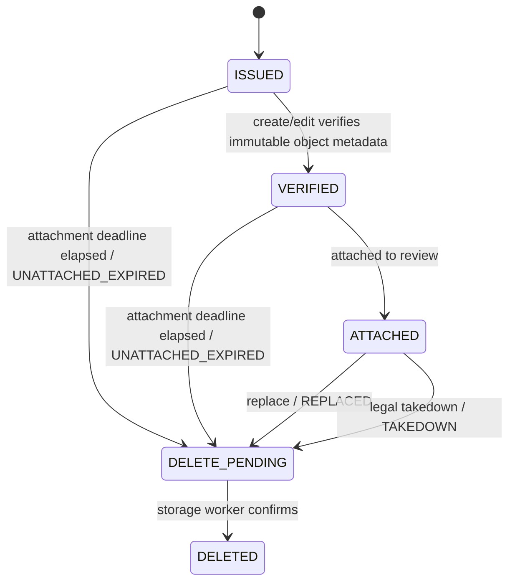

# Review Service — Domain Model

## 1. Ubiquitous language

| Term | Định nghĩa |
|---|---|
| Eligibility | Quyền tạo đúng một review cho một SKU đã mua trong một order |
| Claimed eligibility | Eligibility đã sinh review; không còn quyền tạo review thứ hai |
| Edit quota | Một lần sửa tối đa, giữ bằng `reviews.edit_count` |
| Review | Nội dung public hiện tại, có rating, content và media attachment |
| Media asset | Object upload có lifecycle riêng; chưa chắc đã được gắn review |
| Active report | Report chưa bị `DISMISSED`; được dùng để đếm ngưỡng ẩn |
| Takedown | Gỡ vĩnh viễn theo yêu cầu pháp lý bởi một admin có thẩm quyền, có audit record; không phải notification |
| Review revision | Version đơn điệu của rating aggregate theo product, không phải version content |
| Export session | Watermark Kafka cố định cho một lần Search scan aggregate |
| Privacy erasure request | Vòng đời anonymize rồi purge external identity của một subject |

## 2. Aggregate roots

**ReviewEligibility** quản lý quyền tạo review: external purchase snapshot, gồm cả
`completed_at`, `owner_user_id`, trạng thái và expiry. Một order globally unique nên
business key là `(order_id, product_id, sku_id)`.

**Review** quản lý public review hiện tại, edit quota, visibility, report counter,
media attachment, report, reply và takedown. `product_id`/`sku_id` trên Review là
denormalization đã được composite FK xác minh với Eligibility.

**ProductRatingAggregate** là projection riêng theo `product_id`, cập nhật bởi event
consumer idempotent; không nằm trong transaction create/edit Review.

**PrivacyErasureRequest** quản lý việc một `USER_DELETED` được nhận, anonymize và
hard purge đúng hạn. Nó không phải dữ liệu hiển thị public.

## 3. Business rules

| ID | Quy tắc |
|---|---|
| `REVIEW-BR-001` | Mỗi `(order_id, product_id, sku_id)` của subject chưa có deletion guard sinh tối đa một eligibility; replay `ORDER_COMPLETED` là idempotent. Event của subject đã có guard chỉ ghi receipt rồi bị suppress. |
| `REVIEW-BR-002` | `completed_at` là thời điểm nghiệp vụ từ `ORDER_COMPLETED`; `expires_at = completed_at + review_window_days`, không tính từ lúc Review nhận event. Event tới muộn tạo `EXPIRED`; `expires_at` vẫn là mốc cửa sổ review đóng. |
| `REVIEW-BR-003` | Chỉ `owner_user_id` của eligibility còn `PENDING` được tạo review. |
| `REVIEW-BR-004` | Tạo review atomically chuyển `PENDING → CLAIMED`; một eligibility sinh tối đa một review. |
| `REVIEW-BR-005` | Rating nằm trong 1–5; content là null hoặc non-blank, không quá maximum cố định. |
| `REVIEW-BR-006` | Review chỉ sửa khi `status=APPROVED` và `edit_count=0`; commit sửa tăng nó thành 1. |
| `REVIEW-BR-007` | Caller chỉ gửi `asset_id` của asset do mình sở hữu. Khi create/edit, Review xác minh object đã upload, rồi atomically chuyển asset hợp lệ sang `VERIFIED`/`ATTACHED`; asset phải chưa attach và không vượt số lượng tối đa. |
| `REVIEW-BR-008` | Một account có tối đa một active report cho một review khi identity còn tồn tại; tác giả không tự report. Sau khi admin dismiss, caller có thể report lại. |
| `REVIEW-BR-009` | Report đầu tiên của một chu kỳ ghi `first_reported_at`. Khi active report đạt threshold, review thành `HIDDEN_BY_REPORT` và ghi `hidden_at`; dismiss toàn bộ report chỉ đưa review `HIDDEN_BY_REPORT` về `APPROVED`. `REMOVED` luôn terminal và không được resurrect bởi dismiss. Vì hide chuyển mọi report `PENDING` thành `ACTIONED`, một queue lọc theo report status sẽ mất case đúng lúc cần phân xử; moderation queue vì thế khóa theo review state, và đó là đường duy nhất lấy được `review_id` cho dismiss. |
| `REVIEW-BR-010` | Reply chỉ cho review `APPROVED`, tối đa một reply; lần tạo đầu tiên chỉ phát `REVIEW_REPLY_NOTIFICATION_REQUESTED` khi eligibility owner không có deletion guard. Guard không chặn reply, chỉ chặn notification request; sửa reply không phát event mới. |
| `REVIEW-BR-011` | Takedown cần `legal_case_id`, lý do nội bộ non-blank và một admin có thẩm quyền; `REMOVED` là terminal. Actor được lấy từ trusted Gateway identity, không nhận từ request body. |
| `REVIEW-BR-012` | Chỉ review `APPROVED` thuộc aggregate. |
| `REVIEW-BR-013` | Aggregate chỉ tăng `review_revision` khi metric đổi, không phải khi content/name đổi. |
| `REVIEW-BR-014` | Một event consumer xử lý tối đa một lần theo `(consumer_name, event_id)`. |
| `REVIEW-BR-015` | `USER_DELETED` tạo deletion guard bằng HMAC subject key và anonymize ngay. Tới `hard_delete_after` thì purge direct customer identifiers nhưng giữ guard; Order input bị suppress, customer-originated write của subject đã có guard bị chặn, và admin reply/takedown vẫn thực hiện nhưng không được ghi notification request chứa recipient ID của subject. |
| `REVIEW-BR-016` | Create review tạo pseudonym `Khách hàng #…` bằng HMAC-SHA-256 của trusted `X-User-Id`, không nhận tên/email và không gọi/consume User. Alias chỉ để hiển thị, không dùng authorization; `USER_DELETED` thay nó bằng `Khách hàng ẩn danh`. |

## 4. Invariants

| ID | Nội dung | Enforcement |
|---|---|---|
| `REVIEW-INV-001` | Một SKU trong một order có tối đa một eligibility | `UNIQUE(order_id, product_id, sku_id)` |
| `REVIEW-INV-002` | Một eligibility sinh tối đa một review | `UNIQUE(eligibility_id)` |
| `REVIEW-INV-003` | Product/SKU của review luôn khớp entitlement | Composite FK |
| `REVIEW-INV-004` | Không thể sửa quá một lần | `edit_count` range + conditional update |
| `REVIEW-INV-005` | Aggregate total/average khớp bucket | SQL derive + CHECK constraints |
| `REVIEW-INV-006` | Mỗi aggregate mutation tăng revision và ghi metric outbox cùng transaction | Application transaction + test |
| `REVIEW-INV-007` | Event business ra ngoài chỉ qua outbox | Architecture test |
| `REVIEW-INV-008` | Consumer effect idempotent | `review_event_receipts` trong cùng transaction |
| `REVIEW-INV-009` | Một export session giữ cùng offset cho mọi page | session-offset primary key + API session ID |
| `REVIEW-INV-010` | Direct user identifiers biến mất khi privacy request được purge | privacy worker ghi identifier và `*_erased_at`/`purged_at` cùng một UPDATE; các CHECK cặp-cột từ chối việc chỉ null hóa identifier |
| `REVIEW-INV-011` | Hạn eligibility luôn sau thời điểm hoàn tất đơn hàng, kể cả event tới muộn | `completed_at`, `CHECK (expires_at > completed_at)` + integration test |
| `REVIEW-INV-012` | Sau khi deletion guard commit, không write mới nào được lưu direct ID của subject, gồm cả `recipient_user_id` trong notification outbox | HMAC guard lookup + cùng transaction-scoped subject lock + integration test |

## 5. State machines

### 5.1 Eligibility

`CLAIMED` chỉ ghi nhận review đã tồn tại. Nó không biểu diễn edit quota và không được
đưa về `PENDING`. `expires_at` là mốc nghiệp vụ cửa sổ review đóng; `updated_at` ghi
nhận lần thay đổi state gần nhất, bao gồm transition sang `EXPIRED` của scheduler.

### 5.2 Review

| State | Public | Aggregate | Editable |
|---|---|---|---|
| `APPROVED` | Có | Có | Có nếu `edit_count=0` |
| `HIDDEN_BY_REPORT` | Không | Không | Không |
| `REMOVED` | Không | Không | Không |

`first_reported_at` mở chu kỳ kiểm duyệt khi active report rời khỏi 0 và là khóa sắp
xếp của moderation queue; `hidden_at` ghi lần gần nhất threshold ẩn review. Cả hai
không bị xóa khi dismiss khôi phục review, nên một review bị brigade nhiều lần vẫn giữ
lịch sử; mọi index trên chúng đều partial nên giá trị cũ vô hại. Cạnh
`HIDDEN_BY_REPORT → APPROVED` chỉ đi được qua moderation queue, vì review bị ẩn không
còn xuất hiện ở bất kỳ surface nào khác.

### 5.3 Media asset

`EXPIRED` không phải state của media asset (chỉ là state của eligibility/export
session). `expires_at` là deadline để asset chưa attach được dùng; ở v1 nó bằng thời
điểm hết hạn của signed upload instruction. Scheduler chỉ sweep `ISSUED`/`VERIFIED`
đã quá deadline và chuyển chúng sang `DELETE_PENDING` với
`deletion_reason=UNATTACHED_EXPIRED`. Vì asset `ISSUED` có thể chưa từng upload object,
`verified_at` được phép null ở `DELETE_PENDING`/`DELETED`.

Attach và expiry scheduler cùng khóa row asset. Nếu attach ghi `ATTACHED` trước,
scheduler không còn thấy asset sweep được; nếu scheduler ghi `DELETE_PENDING` trước,
attach bị từ chối như asset không còn usable. Worker xóa `object_key` sau commit, coi
storage trả “object not found” là xóa thành công, rồi mới ghi `DELETED`. Mọi route vào
`DELETE_PENDING` phải lưu `deletion_reason` (`UNATTACHED_EXPIRED`, `REPLACED` hoặc
`TAKEDOWN`) và `delete_requested_at`; không có storage call trong transaction Review.

## 6. Authorization

| Action | Rule |
|---|---|
| Create review | Token `user_id` phải khớp `eligibility.owner_user_id`; create bị chặn nếu caller đã có deletion guard |
| Pending list | Token `user_id` phải khớp `eligibility.owner_user_id`; Gateway normally rejects a deleted account before this read |
| Edit | Token `user_id` phải khớp owner qua review eligibility và caller không có deletion guard |
| Upload/attach asset | Asset owner phải là caller và caller không có deletion guard; client chỉ upload rồi gửi `asset_id`, Review tự xác minh object khi create/edit trước khi attach |
| Report | Caller đăng nhập, có identity, không là author và không có deletion guard |
| Reply/dismiss/takedown | Role admin; takedown được audit bằng trusted identity của admin thực hiện |
| Moderation queue | Role admin; không trả reporter identity. Chỉ surface admin được cấp signed URL cho media của review không `APPROVED`, với TTL ngắn hơn public |
| Export session/page | Service identity của Search |

## 7. Error model

| Error | HTTP | Ý nghĩa |
|---|---:|---|
| `ELIGIBILITY_NOT_FOUND` | 404 | Không có entitlement |
| `NOT_ELIGIBILITY_OWNER` | 403 | Entitlement thuộc caller khác hoặc đã purge identity |
| `ELIGIBILITY_EXPIRED` | 410 | PENDING entitlement đã hết hạn |
| `ALREADY_REVIEWED` | 409 | Eligibility đã `CLAIMED` |
| `REVIEW_NOT_FOUND` | 404 | Review không tồn tại hoặc không visible ở endpoint đang gọi |
| `NOT_REVIEW_OWNER` | 403 | Review không thuộc buyer đang gọi |
| `EDIT_QUOTA_EXHAUSTED` | 409 | `edit_count=1` |
| `REVIEW_NOT_EDITABLE` | 409 | Review hidden/removed |
| `MEDIA_NOT_VERIFIED` | 409 | Asset là của caller nhưng chưa dùng được: object chưa upload, metadata không khớp, expired hoặc đã attach |
| `INVALID_MEDIA_REFERENCE` | 409 | `asset_id` không giải được thành asset khả dụng của caller. Không tồn tại và thuộc người khác trả cùng một code, cố ý không phân biệt để không thành existence oracle |
| `MEDIA_QUOTA_EXCEEDED` | 429 | Đã chạm quota asset chưa attach hoặc byte upload của caller |
| `ALREADY_REPORTED` | 409 | Partial unique guard từ chối report active trùng |
| `REVIEW_REPORT_FORBIDDEN` | 403 | Caller là author hoặc không còn report identity |
| `REVIEW_NOT_REPORTABLE` | 409 | Review không còn nhận report; response không nêu moderation progress. **Không phát sinh ở v1**: review không `APPROVED` thì không tồn tại trên surface public, nên report nó trả `REVIEW_NOT_FOUND`. Một code riêng cho "đã bị ẩn" sẽ nói đúng điều mà response 202 trung tính cố ý không nói (ADR-008) |
| `REVIEW_NOT_REPLYABLE` | 409 | Review không ở state `APPROVED` |
| `TAKEDOWN_ALREADY_EXISTS` | 409 | Review đã có legal takedown; takedown không thể lặp hay đảo ngược |
| `EXPORT_SESSION_NOT_FOUND` | 404 | Không có export session |
| `EXPORT_SESSION_EXPIRED` | 410 | Search phải tạo session mới |
| `EXPORT_SESSION_UNAVAILABLE` | 503 | Không chụp Kafka offset hoặc không persist session được |

## 8. Key examples

**Tạo rồi sửa.** Eligibility `PENDING` được claim trong transaction tạo review.
Review mới có `edit_count=0`; một lần sửa thành `1`. Request sửa lặp trả 409 dù
response trước đó bị mất.

**Ẩn danh.** `USER_DELETED` từ Auth đổi author display name, không đổi rating và
không phát Review event hay metric snapshot. Tới hard-delete deadline, worker null hóa
direct user IDs nhưng giữ review, rating và opaque media object key.

**Aggregate replay.** `REVIEW_CREATED(event_id=A)` được aggregator xử lý, receipt A
và aggregate update commit cùng lúc. Kafka giao lại A thì insert receipt conflict và
không có delta thứ hai.

**Search export.** Session S chụp replay offsets trước scan. Search import nhiều
pages của S, sau đó replay inclusive offsets. Revision guard làm snapshot/event overlap
trở thành no-op thay vì ghi đè dữ liệu mới.
