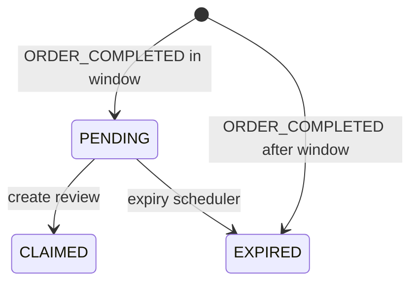
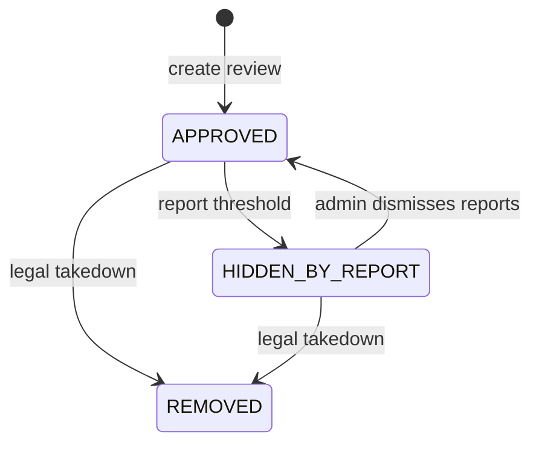
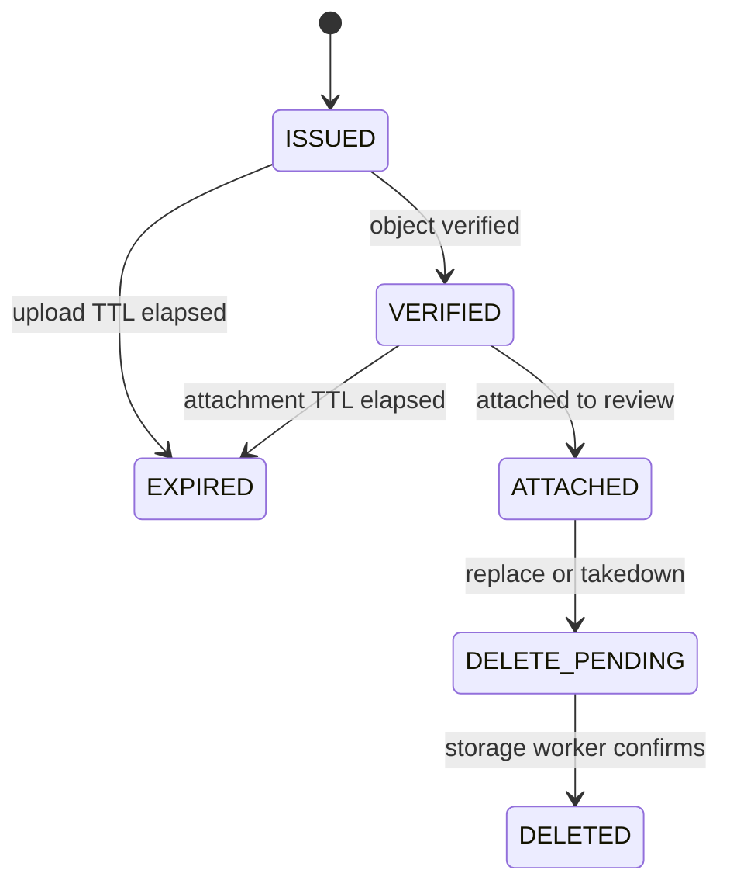

# Review Service — Domain Model

## 1. Ubiquitous language

| Term | Định nghĩa |
|---|---|
| Eligibility | Quyền tạo đúng một review cho một SKU đã mua trong một order |
| Claimed eligibility | Eligibility đã sinh review; không còn quyền tạo review thứ hai |
| Edit quota | Một lần sửa tối đa, giữ bằng `reviews.edit_count` |
| Review | Nội dung public hiện tại, có rating, content và media attachment |
| Media asset | Object upload có lifecycle riêng; chưa chắc đã được gắn review |
| Active report | Report chưa bị `DISMISSED`; được dùng để đếm ngưỡng ẩn |
| Takedown | Gỡ vĩnh viễn theo yêu cầu pháp lý, có audit record; không phải notification |
| Review revision | Version đơn điệu của rating aggregate theo product, không phải version content |
| Export session | Watermark Kafka cố định cho một lần Search scan aggregate |
| Privacy erasure request | Vòng đời anonymize rồi purge external identity của một subject |

## 2. Aggregate roots

**ReviewEligibility** quản lý quyền tạo review: external purchase snapshot,
`owner_user_id`, trạng thái và expiry. Một order globally unique nên business key là
`(order_id, product_id, sku_id)`.

**Review** quản lý public review hiện tại, edit quota, visibility, report counter,
media attachment, report, reply và takedown. `product_id`/`sku_id` trên Review là
denormalization đã được composite FK xác minh với Eligibility.

**ProductRatingAggregate** là projection riêng theo `product_id`, cập nhật bởi event
consumer idempotent; không nằm trong transaction create/edit Review.

**PrivacyErasureRequest** quản lý việc một `USER_DELETED` được nhận, anonymize và
hard purge đúng hạn. Nó không phải dữ liệu hiển thị public.

## 3. Business rules

| ID | Quy tắc |
|---|---|
| `REVIEW-BR-001` | Mỗi `(order_id, product_id, sku_id)` sinh tối đa một eligibility; replay `ORDER_COMPLETED` là idempotent. |
| `REVIEW-BR-002` | `expires_at = completed_at + review_window_days`; event tới muộn tạo `EXPIRED`. |
| `REVIEW-BR-003` | Chỉ `owner_user_id` của eligibility còn `PENDING` được tạo review. |
| `REVIEW-BR-004` | Tạo review atomically chuyển `PENDING → CLAIMED`; một eligibility sinh tối đa một review. |
| `REVIEW-BR-005` | Rating nằm trong 1–5; content là null hoặc non-blank, không quá maximum cố định. |
| `REVIEW-BR-006` | Review chỉ sửa khi `status=APPROVED` và `edit_count=0`; commit sửa tăng nó thành 1. |
| `REVIEW-BR-007` | Media phải là asset `VERIFIED`, thuộc caller, chưa attach và không vượt số lượng tối đa. |
| `REVIEW-BR-008` | Một account report một review tối đa một lần khi identity còn tồn tại; tác giả không tự report. |
| `REVIEW-BR-009` | Khi active report đạt threshold, review thành `HIDDEN_BY_REPORT`; dismiss toàn bộ report đưa review về `APPROVED`. |
| `REVIEW-BR-010` | Reply chỉ cho review `APPROVED`, tối đa một reply; lần tạo đầu tiên phát `REVIEW_REPLY_NOTIFICATION_REQUESTED` khi author identity còn tồn tại, sửa reply không phát event mới. |
| `REVIEW-BR-011` | Takedown cần `legal_case_id` và hai admin khác nhau; `REMOVED` là terminal. |
| `REVIEW-BR-012` | Chỉ review `APPROVED` thuộc aggregate. |
| `REVIEW-BR-013` | Aggregate chỉ tăng `review_revision` khi metric đổi, không phải khi content/name đổi. |
| `REVIEW-BR-014` | Một event consumer xử lý tối đa một lần theo `(consumer_name, event_id)`. |
| `REVIEW-BR-015` | `USER_DELETED` anonymize ngay; tới `hard_delete_after` thì purge direct customer identifiers. |

## 4. Invariants

| ID | Nội dung | Enforcement |
|---|---|---|
| `REVIEW-INV-001` | Một SKU trong một order có tối đa một eligibility | `UNIQUE(order_id, product_id, sku_id)` |
| `REVIEW-INV-002` | Một eligibility sinh tối đa một review | `UNIQUE(eligibility_id)` |
| `REVIEW-INV-003` | Product/SKU của review luôn khớp entitlement | Composite FK |
| `REVIEW-INV-004` | Không thể sửa quá một lần | `edit_count` range + conditional update |
| `REVIEW-INV-005` | Aggregate total/average khớp bucket | SQL derive + CHECK constraints |
| `REVIEW-INV-006` | Mỗi aggregate mutation tăng revision và ghi metric outbox cùng transaction | Application transaction + test |
| `REVIEW-INV-007` | Event business ra ngoài chỉ qua outbox | Architecture test |
| `REVIEW-INV-008` | Consumer effect idempotent | `review_event_receipts` trong cùng transaction |
| `REVIEW-INV-009` | Một export session giữ cùng offset cho mọi page | session-offset primary key + API session ID |
| `REVIEW-INV-010` | Direct user identifiers biến mất khi privacy request được purge | privacy worker transaction + schema checks |

## 5. State machines

### 5.1 Eligibility

`CLAIMED` chỉ ghi nhận review đã tồn tại. Nó không biểu diễn edit quota và không được
đưa về `PENDING`.

### 5.2 Review

| State | Public | Aggregate | Editable |
|---|---|---|---|
| `APPROVED` | Có | Có | Có nếu `edit_count=0` |
| `HIDDEN_BY_REPORT` | Không | Không | Không |
| `REMOVED` | Không | Không | Không |

### 5.3 Media asset

## 6. Authorization

| Action | Rule |
|---|---|
| Create/pending list | Token `user_id` phải khớp `eligibility.owner_user_id` |
| Edit | Token `user_id` phải khớp owner qua review eligibility |
| Upload/attach asset | Asset owner phải là caller, state là `VERIFIED` |
| Report | Caller đăng nhập, có identity và không là author |
| Reply/dismiss/takedown | Role admin; takedown cần approver khác requester |
| Export session/page | Service identity của Search |

## 7. Error model

| Error | HTTP | Ý nghĩa |
|---|---:|---|
| `ELIGIBILITY_NOT_FOUND` | 404 | Không có entitlement |
| `NOT_ELIGIBILITY_OWNER` | 403 | Entitlement thuộc caller khác hoặc đã purge identity |
| `ELIGIBILITY_EXPIRED` | 410 | PENDING entitlement đã hết hạn |
| `ALREADY_REVIEWED` | 409 | Eligibility đã `CLAIMED` |
| `EDIT_QUOTA_EXHAUSTED` | 409 | `edit_count=1` |
| `REVIEW_NOT_EDITABLE` | 409 | Review hidden/removed |
| `MEDIA_NOT_VERIFIED` | 409 | Asset chưa xác minh, expired hoặc đã attach |
| `INVALID_MEDIA_REFERENCE` | 400 | Asset không thuộc caller |
| `ALREADY_REPORTED` | 409 | Partial unique report guard từ chối |
| `TAKEDOWN_NOT_APPROVED` | 422 | Thiếu legal case/approval hợp lệ |
| `EXPORT_SESSION_NOT_FOUND` | 404 | Không có export session |
| `EXPORT_SESSION_EXPIRED` | 410 | Search phải tạo session mới |
| `EXPORT_SESSION_UNAVAILABLE` | 503 | Không chụp Kafka offset hoặc không persist session được |

## 8. Key examples

**Tạo rồi sửa.** Eligibility `PENDING` được claim trong transaction tạo review.
Review mới có `edit_count=0`; một lần sửa thành `1`. Request sửa lặp trả 409 dù
response trước đó bị mất.

**Ẩn danh.** `USER_DELETED` từ Auth đổi author display name, không đổi rating và
không phát Review event hay metric snapshot. Tới hard-delete deadline, worker null hóa
direct user IDs nhưng giữ review, rating và opaque media object key.

**Aggregate replay.** `REVIEW_CREATED(event_id=A)` được aggregator xử lý, receipt A
và aggregate update commit cùng lúc. Kafka giao lại A thì insert receipt conflict và
không có delta thứ hai.

**Search export.** Session S chụp replay offsets trước scan. Search import nhiều
pages của S, sau đó replay inclusive offsets. Revision guard làm snapshot/event overlap
trở thành no-op thay vì ghi đè dữ liệu mới.
