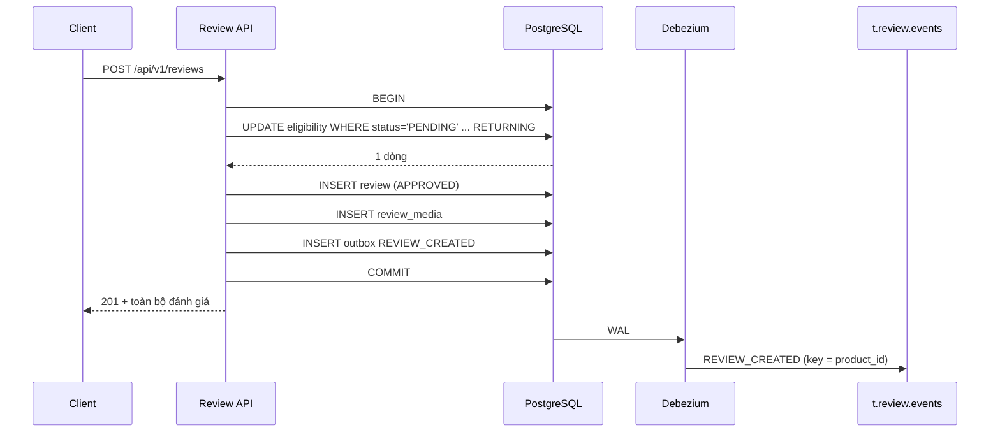

# Review Service — Workflows

> File này mô tả các luồng end-to-end. Mỗi workflow phải cho developer biết chính
> xác điều gì xảy ra khi một bước timeout hoặc cùng request được gửi hai lần.

## Workflow index

| ID | Workflow | Trigger | Actor | Status |
|---|---|---|---|---|
| [`WF-REVIEW-001`](#wf-review-001--cấp-eligibility-từ-đơn-hàng-hoàn-tất) | Cấp eligibility từ đơn hàng hoàn tất | Event | Order Service | proposed |
| [`WF-REVIEW-002`](#wf-review-002--tạo-đánh-giá) | Tạo đánh giá | API | Người mua | proposed |
| [`WF-REVIEW-003`](#wf-review-003--sửa-đánh-giá) | Sửa đánh giá | API | Tác giả | proposed |
| [`WF-REVIEW-004`](#wf-review-004--đọc-đánh-giá-và-số-liệu-tổng-hợp) | Đọc đánh giá và số liệu tổng hợp | API | Bất kỳ ai | proposed |
| [`WF-REVIEW-005`](#wf-review-005--phản-hồi-của-quản-trị-viên) | Phản hồi của quản trị viên | API | Admin | proposed |
| [`WF-REVIEW-006`](#wf-review-006--báo-cáo-vi-phạm-và-tự-động-ẩn) | Báo cáo vi phạm và tự động ẩn | API | Người dùng | proposed |
| [`WF-REVIEW-007`](#wf-review-007--cập-nhật-aggregate-và-phát-snapshot) | Cập nhật aggregate và phát snapshot | Event | Rating aggregator | proposed |
| [`WF-REVIEW-008`](#wf-review-008--export-snapshot-cho-full-reindex-của-search) | Export snapshot cho full reindex của Search | API nội bộ | Search Service | proposed |
| [`WF-REVIEW-009`](#wf-review-009--ẩn-danh-tác-giả-khi-tài-khoản-bị-xóa) | Ẩn danh tác giả khi tài khoản bị xóa | Event | Auth Service | proposed |
| [`WF-REVIEW-010`](#wf-review-010--reconciliation-định-kỳ) | Reconciliation định kỳ | Schedule | Scheduler | proposed |
| [`WF-REVIEW-011`](#wf-review-011--gỡ-nội-dung-theo-yêu-cầu-pháp-lý) | Gỡ nội dung theo yêu cầu pháp lý | API | Admin có phê duyệt | proposed |
| [`WF-REVIEW-012`](#wf-review-012--pdp-summary-và-preview-cho-bff) | PDP summary và preview | API nội bộ | Product Detail BFF | proposed |

---

## WF-REVIEW-001 — Cấp eligibility từ đơn hàng hoàn tất

### Mục tiêu

Mỗi SKU mà một người thực sự đã mua và nhận được sẽ có đúng một quyền viết đánh giá,
có thời hạn.

### Actor và participants

Order Service phát event. Review là consumer duy nhất tham gia; không có lời gọi
liên-service nào.

### Trigger

`ORDER_COMPLETED` trên `t.order.events`, consumer group `review-order-sync`.

### Preconditions

Event mang `order_id`, `user_id`, `status = COMPLETED`, `completed_at` và danh sách
item có `product_id` và `sku_id`.

### Input

Xem [Interfaces, mục 6.1](./interfaces.md#61-order_completed).

### Happy path

1. Consumer nhận message, validate các trường bắt buộc.
2. Mở transaction.
3. Với mỗi item, upsert một dòng `review_eligibilities` với
   `expires_at = completed_at + review_window_days`.
4. Nếu `expires_at <= now()` ngay tại thời điểm xử lý — trường hợp event bị đọng
   trong hàng đợi lâu hơn cửa sổ đánh giá — cấp thẳng ở trạng thái `EXPIRED` thay vì
   `PENDING`, để không sinh ra rác trong danh sách chờ đánh giá của người dùng.
5. Commit.
6. ACK message.

### State/data changes

Thêm hoặc cập nhật các dòng `review_eligibilities`. Không có event nào được phát ra
— việc có quyền đánh giá không phải thông tin mà service khác cần.

### Events emitted

Không có.

### Output

Không có response đồng bộ. Người dùng thấy kết quả ở `GET /api/v1/reviews/me/pending`.

### Failure paths

| Điểm hỏng | Hành vi | State còn lại |
|---|---|---|
| Thiếu `product_id` hoặc `sku_id` | Không xử lý, đưa message vào dead letter, cảnh báo | Không có eligibility nào cho item đó |
| Thiếu `variant_name` | Vẫn xử lý, ghi log cảnh báo | Eligibility có `variant_name` null |
| `user_id` sai định dạng | Database từ chối (kiểu `UUID`), message vào dead letter | Không thay đổi |
| PostgreSQL không sẵn sàng | Transaction thất bại, không ACK, retry | Không thay đổi |
| Crash giữa commit và ACK | Message được gửi lại, upsert không tạo bản sao | Đúng như sau commit |

### Timeout và retry

Retry thuộc về consumer: tối đa 10 lần, backoff 1s → 5m. Lỗi contract (thiếu trường
bắt buộc) không được retry — retry sẽ không bao giờ thành công.

### Idempotency

Khóa là `(order_id, product_id, sku_id, user_id)` qua
`uq_eligibility_business_key`. Mệnh đề `ON CONFLICT DO UPDATE` chỉ chạm các dòng còn
ở `PENDING`, nên nhận lại event cũ không thể đưa một eligibility đã dùng về trạng
thái ban đầu.

### Concurrency/race conditions

Hai instance consumer xử lý cùng một đơn (khi rebalance) → unique constraint bảo đảm
kết quả giống nhau. Đơn hoàn tất trong lúc người dùng đang xem danh sách chờ đánh giá
→ không có xung đột; đây là hai thao tác trên các dòng khác nhau.

### Compensation hoặc recovery

Không cần compensation. Nếu event bị mất hoàn toàn — Kafka retention hết trước khi
Review kịp xử lý — người dùng sẽ không có quyền đánh giá cho đơn đó. Phục hồi bằng
cách Order replay event; Review không tự suy diễn được đơn nào đã hoàn tất.

### Metrics và traces

`review_eligibility_granted_total{result}`, `review_order_consumer_lag`,
`review_eligibility_granted_already_expired_total`. Trace span nhận `correlation_id`
từ event và truyền tiếp vào outbox của các workflow sau.

### Implementation evidence

Chưa có.

### Test scenarios

Đơn một item; đơn nhiều item; gửi lại cùng một đơn; gửi lại đơn mà một item đã được
đánh giá (không được đưa về `PENDING`); `completed_at` cũ hơn cửa sổ đánh giá; thiếu
`variant_name`; thiếu `sku_id`; `user_id` không phải UUID; crash giữa commit và ACK.

---

## WF-REVIEW-002 — Tạo đánh giá

### Mục tiêu

Người mua để lại đánh giá cho một SKU đã mua, và nhìn thấy nó ngay lập tức.

### Actor và participants

Người mua qua API Gateway. Object storage đã nhận file media từ trước. Debezium và
các consumer downstream tham gia sau khi transaction commit.

### Trigger

`POST /api/v1/reviews`.

### Preconditions

Người gọi đã đăng nhập; eligibility thuộc về họ, đang `PENDING`, chưa hết hạn; media
(nếu có) đã được upload lên namespace của chính họ qua `WF-REVIEW-002a` bên dưới.

### Input

`eligibility_id`, `rating`, `content` tùy chọn, danh sách object key của media.

### Happy path

1. Validate shape: `rating` trong 1–5, độ dài `content`, số lượng media.
2. Kiểm tra mọi object key thuộc namespace upload của `user_id` trong token.
3. Mở transaction.
4. Chạy `UPDATE review_eligibilities SET status='REVIEWED', attempt_count=1 WHERE
   id = :id AND user_id = :user_id AND status='PENDING' AND expires_at > now()
   RETURNING product_id, sku_id, variant_name`. Câu lệnh này **vừa là kiểm tra
   quyền vừa là lock**.
5. Nếu không có dòng trả về, phân loại lỗi bằng một truy vấn đọc và trả về
   (xem Failure paths).
6. `INSERT` vào `reviews` với `status = 'APPROVED'`, `user_name` là snapshot tên
   hiển thị lấy từ token.
7. `INSERT` các dòng `review_media` theo thứ tự client gửi; đặt `has_media`.
8. `INSERT` một dòng outbox `REVIEW_CREATED` với `partition_key = product_id`.
9. Commit.
10. Trả `201` kèm toàn bộ đánh giá vừa tạo.

### State/data changes

Trong một transaction duy nhất: eligibility `PENDING → REVIEWED`; một dòng `reviews`
mới; các dòng `review_media`; một dòng outbox. Aggregate **không** được chạm ở đây;
nó được cập nhật bất đồng bộ bởi `WF-REVIEW-007`.

### Events emitted

`REVIEW_CREATED` sau commit, qua CDC. Xem
[Interfaces, mục 5](./interfaces.md#5-event-phát-ra).

### Output

`201` với đánh giá đầy đủ. Đây là cơ chế duy nhất bảo đảm tác giả đọc được thay đổi
của chính mình — không có cơ chế read-your-own-writes nào khác trong hệ thống.

### Failure paths

| Điểm hỏng | HTTP | State còn lại |
|---|---|---|
| Eligibility không tồn tại | `404 ELIGIBILITY_NOT_FOUND` | Không đổi |
| Eligibility của người khác | `403 NOT_ELIGIBILITY_OWNER` | Không đổi |
| `expires_at <= now()` | `410 ELIGIBILITY_EXPIRED` | Không đổi |
| Đã ở `REVIEWED` hoặc `EDIT_LOCKED` | `409 ALREADY_REVIEWED` | Không đổi |
| Object key không thuộc người gọi | `400 INVALID_MEDIA_REFERENCE` | Không đổi |
| `rating` ngoài 1–5 | `400 INVALID_RATING` | Không đổi |
| Vi phạm `uq_review_eligibility` (race) | `409 ALREADY_REVIEWED` | Không đổi |
| PostgreSQL lỗi giữa transaction | `503` | Rollback toàn bộ; không có đánh giá, không có outbox |
| Debezium dừng sau commit | `201` đã trả | Đánh giá tồn tại và hiển thị được; event nằm chờ trong outbox, downstream trễ cho tới khi connector chạy lại |

Hàng cuối là tính chất quan trọng nhất của thiết kế: **lỗi ở đường publish không bao
giờ làm mất đánh giá của người dùng**, chỉ làm downstream trễ.

### Timeout và retry

Không có retry phía server. Client có thể gửi lại; lần thứ hai sẽ nhận
`409 ALREADY_REVIEWED` chứ không tạo bản sao.

### Idempotency

Không dùng `Idempotency-Key`. Việc chuyển trạng thái eligibility chính là khóa
idempotency, và `uq_review_eligibility` là lưới an toàn cuối. Thiết kế cũ nhắc tới
header này nhưng không mô tả nơi lưu kết quả hay thời gian giữ — nó không cần thiết
khi bản thân miền nghiệp vụ đã chỉ cho phép một lần.

### Concurrency/race conditions

Hai request song song cho cùng eligibility: `UPDATE ... WHERE status='PENDING'` chỉ
trả về dòng cho đúng một request; request kia thấy 0 dòng. Nếu bằng cách nào đó cả
hai vượt qua (ví dụ do sửa code sai), `uq_review_eligibility` vẫn chặn.

Eligibility hết hạn đúng lúc request đang chạy: điều kiện `expires_at > now()` được
đánh giá trong cùng câu lệnh, nên kết quả xác định.

### Compensation hoặc recovery

Không cần. Transaction là đơn vị nguyên tử duy nhất; không có bước nào đã thực hiện
ở hệ thống ngoài cần hoàn tác. Media đã upload nhưng đánh giá thất bại sẽ được dọn
bởi job media mồ côi.

### Metrics và traces

`review_created_total{result}`, `review_create_duration_seconds`,
`review_media_attached_count`. Span bao trọn transaction; `correlation_id` được ghi
vào outbox để truy vết qua tới Search.

### Implementation evidence

Chưa có.

### Test scenarios

Tạo đánh giá không media; có media; gửi lại cùng request; hai request song song;
eligibility của người khác; eligibility đã hết hạn; eligibility đã dùng; `rating`
bằng 0 và bằng 6; `content` vượt giới hạn; số media vượt giới hạn; object key của
người khác; PostgreSQL lỗi giữa transaction (không được để lại dòng nào); outbox có
đúng một dòng với `partition_key = product_id`.

### WF-REVIEW-002a — Upload media (bước phụ)

1. Client gọi `POST /api/v1/reviews/media/upload-urls` với số lượng và loại file.
2. Review sinh object key dạng `tmp/{user_id}/{uuid}` và trả presigned URL có hạn ngắn.
3. Client `PUT` file thẳng lên object storage. File không đi qua Review.
4. Client gửi object key kèm request tạo hoặc sửa đánh giá.
5. Review kiểm tra key khớp `tmp/{user_id}/` của chính người gọi trước khi ghi metadata.

File đã upload nhưng không bao giờ được gắn vào đánh giá bị dọn sau 24 giờ. Không có
bước xác minh file thực sự tồn tại trên storage tại thời điểm ghi metadata: nếu client
gửi key hợp lệ nhưng chưa upload, đánh giá sẽ có media hỏng. Đây là gap đã biết; cách
xử lý là kiểm tra `HEAD` object trước khi ghi, đánh đổi bằng độ trễ của đường ghi.

---

## WF-REVIEW-003 — Sửa đánh giá

### Mục tiêu

Tác giả sửa lại đánh giá đúng một lần, và số liệu tổng hợp phản ánh đúng thay đổi đó.

### Actor và participants

Tác giả đánh giá. Rating aggregator xử lý hệ quả bất đồng bộ.

### Trigger

`PATCH /api/v1/reviews/{review_id}`.

### Preconditions

Người gọi là tác giả; đánh giá ở `APPROVED`; eligibility ở `REVIEWED` với
`attempt_count = 1`.

### Input

`rating`, `content`, danh sách media mới — mỗi trường tùy chọn, nhưng phải có ít nhất
một trường thay đổi.

### Happy path

1. Mở transaction.
2. `SELECT r.*, e.status, e.attempt_count FROM reviews r JOIN review_eligibilities e
   ON e.id = r.eligibility_id WHERE r.id = :id FOR UPDATE OF r`.
3. Kiểm tra quyền tác giả, `r.status = 'APPROVED'`, `e.status = 'REVIEWED'`.
4. Ghi nhớ `old_rating` và `old_has_media` **trước khi** sửa.
5. `UPDATE review_eligibilities SET status='EDIT_LOCKED', attempt_count=2`.
6. `UPDATE reviews` với các giá trị mới.
7. Xóa toàn bộ `review_media` cũ và chèn danh sách mới; cập nhật `has_media`.
8. `INSERT` outbox `REVIEW_UPDATED` mang **cả** `old_rating`, `new_rating`,
   `old_has_media`, `new_has_media`.
9. Commit; trả `200` với đánh giá sau khi sửa.

### State/data changes

Eligibility `REVIEWED → EDIT_LOCKED`; nội dung đánh giá thay đổi; danh sách media
được thay thế toàn bộ; một dòng outbox.

### Events emitted

`REVIEW_UPDATED`. Việc event này mang giá trị cũ là điều kiện để `WF-REVIEW-007`
tính đúng; xem [Interfaces, mục 5.1](./interfaces.md#51-review_updated-phải-mang-giá-trị-cũ).

### Output

`200` với đánh giá sau khi sửa.

### Failure paths

| Điểm hỏng | HTTP |
|---|---|
| Không phải tác giả | `403 NOT_REVIEW_AUTHOR` |
| Eligibility đã `EDIT_LOCKED` | `409 EDIT_QUOTA_EXHAUSTED` |
| Đánh giá đang bị ẩn hoặc đã gỡ | `409 REVIEW_NOT_EDITABLE` |
| Đánh giá không tồn tại | `404 REVIEW_NOT_FOUND` |
| Validate nội dung/media thất bại | `400` |
| PostgreSQL lỗi | `503`, rollback toàn bộ |

### Timeout và retry

Không retry phía server. Gửi lại sau khi thành công trả `409 EDIT_QUOTA_EXHAUSTED`.

### Idempotency

Không có khóa idempotency riêng. Hạn mức một lần sửa vừa là quy tắc nghiệp vụ vừa là
cơ chế chống gửi trùng. Hệ quả cần chấp nhận: nếu response `200` bị mất trên đường
về, client không phân biệt được "sửa thành công nhưng mất response" với "đã dùng hết
lượt" — cả hai đều dẫn tới `409` khi thử lại. Client nên `GET` lại đánh giá để xác
định.

### Concurrency/race conditions

Hai request sửa song song: `FOR UPDATE` tuần tự hóa; request thứ hai thấy
`EDIT_LOCKED` và bị từ chối.

Sửa đánh giá đúng lúc report thứ 10 tới: cả hai đều lấy `FOR UPDATE` trên cùng dòng
`reviews`, nên tuần tự. Nếu ẩn thắng, lần sửa sau đó thất bại với
`REVIEW_NOT_EDITABLE`. Nếu sửa thắng, việc ẩn vẫn diễn ra bình thường.

### Compensation hoặc recovery

Không cần. Nếu aggregator xử lý sai `REVIEW_UPDATED`, reconciliation sẽ dựng lại
aggregate từ bảng `reviews`.

### Metrics và traces

`review_updated_total{result}`, `review_edit_quota_rejected_total`.

### Implementation evidence

Chưa có.

### Test scenarios

Sửa chỉ nội dung; sửa điểm từ 5 xuống 1 và kiểm tra aggregate hội tụ về giá trị
đúng; sửa lần thứ hai bị từ chối; sửa bởi người khác; sửa đánh giá đang bị ẩn; sửa
đồng thời hai request; thay toàn bộ media; xóa hết media (`has_media` phải về false
và aggregate `total_with_media` phải giảm); outbox chứa đủ `old_rating` và
`new_rating`.

---

## WF-REVIEW-004 — Đọc đánh giá và số liệu tổng hợp

### Mục tiêu

Trang sản phẩm hiển thị danh sách đánh giá và số liệu tổng hợp, ổn định khi dữ liệu
lớn.

### Actor và participants

Bất kỳ ai, kể cả người chưa đăng nhập. Chỉ Review và PostgreSQL tham gia.

### Trigger

`GET /api/v1/reviews/products/{product_id}` và
`GET /api/v1/reviews/products/{product_id}/aggregate`.

### Preconditions

Không có.

### Input

`product_id`; tùy chọn `sku_id`, `rating`, `has_media`, `cursor`, `limit`.

### Happy path

1. Giải mã `cursor` thành `(created_at, id)`; cursor rỗng nghĩa là trang đầu.
2. Truy vấn `reviews` với `status = 'APPROVED'` và các bộ lọc, dùng partial index
   tương ứng; lấy `limit + 1` dòng để biết còn trang sau hay không.
3. Nạp media và admin reply của các đánh giá trong trang bằng truy vấn theo lô, không
   truy vấn từng dòng.
4. Với endpoint aggregate: đọc một dòng `product_rating_aggregates` theo khóa chính.
5. Trả kết quả kèm cursor cho trang kế tiếp.

### State/data changes

Không có.

### Events emitted

Không có.

### Output

Danh sách đánh giá đã lọc và phân trang, hoặc số liệu tổng hợp. Không bao giờ chứa
`reporter_id`, `report_count` hay đánh giá không ở `APPROVED`.

### Failure paths

| Điểm hỏng | Hành vi |
|---|---|
| Cursor không hợp lệ hoặc bị sửa | `400`, không rơi về trang đầu một cách âm thầm |
| Sản phẩm chưa có đánh giá | `200` với danh sách rỗng và aggregate toàn số 0 |
| Chưa có dòng aggregate cho sản phẩm | `200` với giá trị 0; không tạo dòng khi đọc |
| PostgreSQL không sẵn sàng | `503`; không có fallback vì không có cache |
| Read replica trễ | Có thể trả dữ liệu cũ vài trăm mili-giây; đường đọc của **chính tác giả** ngay sau khi ghi phải đi vào primary |

Hàng cuối là hệ quả trực tiếp của việc không có cache: bù lại độ trễ bằng read
replica thì phải xử lý riêng trường hợp read-your-own-writes.

### Timeout và retry

Client retry an toàn vì đây là thao tác chỉ đọc.

### Idempotency

Thao tác đọc, không áp dụng.

### Concurrency/race conditions

Đánh giá mới được chèn trong lúc người dùng đang lật trang: keyset pagination giữ
kết quả ổn định — mục mới có `created_at` lớn hơn nên nằm ở trang trước, không đẩy
lệch các trang sau. Đây là lý do không dùng `OFFSET`.

Đánh giá bị ẩn giữa hai lần lật trang: nó biến mất khỏi kết quả. Chấp nhận được.

### Compensation hoặc recovery

Không áp dụng.

### Metrics và traces

`review_list_duration_seconds{filter}`, `review_aggregate_read_total`,
`review_list_page_size`.

### Implementation evidence

Chưa có.

### Test scenarios

Trang đầu và lật hết nhiều trang; mỗi bộ lọc dùng đúng index dự kiến (kiểm bằng
`EXPLAIN`); cursor bị sửa; sản phẩm không có đánh giá; sản phẩm có 50.000 đánh giá
(độ trễ trang cuối phải tương đương trang đầu); đánh giá bị ẩn không xuất hiện;
`reporter_id` không rò rỉ trong bất kỳ response nào.

---

## WF-REVIEW-005 — Phản hồi của quản trị viên

### Mục tiêu

Quản trị viên trả lời công khai một đánh giá, và tác giả được thông báo — đúng một lần.

### Actor và participants

Admin qua admin console. Notification Service nhận event.

### Trigger

`POST /api/v1/admin/reviews/{review_id}/replies`.

### Preconditions

Role admin; đánh giá ở `APPROVED`.

### Input

`content`.

### Happy path

1. Mở transaction.
2. `SELECT ... FROM reviews WHERE id = :id FOR UPDATE`; kiểm tra `status='APPROVED'`.
3. Upsert `review_admin_replies` theo `uq_admin_reply_review`.
4. Đặt `reviews.is_admin_replied = true`.
5. **Chỉ khi là lần tạo mới**, `INSERT` outbox `ADMIN_REPLY_CREATED`.
6. Commit; trả `200`.

### State/data changes

Một dòng `review_admin_replies` được tạo hoặc cập nhật; cờ trên `reviews`; có thể
một dòng outbox.

### Events emitted

`ADMIN_REPLY_CREATED`, **chỉ ở lần tạo đầu tiên**. Sửa nội dung phản hồi không phát
event: mỗi lần sửa lỗi chính tả mà gửi lại thông báo cho tác giả là hành vi gây
phiền, và Notification không có cách nào tự phân biệt.

### Output

`200` với nội dung phản hồi.

### Failure paths

| Điểm hỏng | HTTP |
|---|---|
| Đánh giá không ở `APPROVED` | `409 REVIEW_NOT_REPLYABLE` |
| Đánh giá không tồn tại | `404 REVIEW_NOT_FOUND` |
| `content` rỗng | `400` (chặn bởi `ck_admin_reply_content_not_blank`) |
| Không có role admin | `403` |

### Timeout và retry

Không retry phía server. Gửi lại cùng nội dung là an toàn: upsert cho kết quả giống
nhau và không phát event thứ hai.

### Idempotency

`uq_admin_reply_review`. Việc phát event bị điều kiện hóa theo "có phải insert mới
hay không", xác định bằng kết quả của `ON CONFLICT`.

### Concurrency/race conditions

Hai admin trả lời cùng lúc: `FOR UPDATE` tuần tự hóa; người thứ hai ghi đè nội dung
của người thứ nhất và **không** phát event thứ hai. Hệ thống không có khái niệm
nhiều phản hồi cho một đánh giá.

### Compensation hoặc recovery

Không cần.

### Metrics và traces

`review_admin_reply_total{operation}` với `operation` là `created` hoặc `updated`.

### Implementation evidence

Chưa có.

### Test scenarios

Tạo phản hồi đầu tiên (phải có outbox); sửa phản hồi (không được có outbox); trả lời
đánh giá đang bị ẩn; hai admin đồng thời; nội dung chỉ có khoảng trắng.

---

## WF-REVIEW-006 — Báo cáo vi phạm và tự động ẩn

### Mục tiêu

Nội dung bị nhiều người báo cáo sẽ tự động biến mất khỏi trang sản phẩm mà không cần
chờ người kiểm duyệt.

### Actor và participants

Người dùng đã đăng nhập. Admin tham gia ở luồng ngược lại (bác bỏ báo cáo).

### Trigger

`POST /api/v1/reviews/{review_id}/reports`.

### Preconditions

Người gọi đã đăng nhập, không phải tác giả, và chưa từng báo cáo đánh giá này.

### Input

`reason`, `detail` tùy chọn.

### Happy path

1. Mở transaction.
2. `SELECT ... FROM reviews WHERE id = :id FOR UPDATE`.
3. Kiểm tra đánh giá tồn tại, ở `APPROVED`, và `user_id` khác người gọi.
4. `INSERT` vào `review_reports` với `status = 'PENDING'`.
5. `UPDATE reviews SET report_count = report_count + 1`.
6. Nếu `report_count >= report_threshold`:
   - `UPDATE reviews SET status = 'HIDDEN_BY_REPORT'`.
   - `UPDATE review_reports SET status = 'ACTIONED'` cho các report `PENDING` của
     đánh giá này.
   - `INSERT` outbox `REVIEW_HIDDEN` với `hidden_reason = 'REPORT_THRESHOLD_EXCEEDED'`.
7. Commit; trả `202` với thông báo trung tính.

### State/data changes

Một dòng report; counter tăng; có thể đổi `reviews.status` và trạng thái các report;
có thể một dòng outbox.

### Events emitted

`REVIEW_HIDDEN`, chỉ khi vượt ngưỡng. Rating aggregator trừ đánh giá này ra khỏi số
liệu; Notification báo cho tác giả.

### Output

`202` với nội dung trung tính. **Không** tiết lộ `report_count` hay việc đánh giá đã
bị ẩn — nếu tiết lộ, một nhóm có thể dò ra ngưỡng chính xác rồi phối hợp ẩn các đánh
giá thật.

### Failure paths

| Điểm hỏng | HTTP |
|---|---|
| Đã báo cáo rồi | `409 ALREADY_REPORTED` |
| Tự báo cáo | `403 CANNOT_REPORT_OWN_REVIEW` |
| Đánh giá đã bị ẩn hoặc gỡ | `409` — không nhận thêm báo cáo cho nội dung đã khuất |
| `reason` không hợp lệ | `400` |

### Timeout và retry

Không retry phía server.

### Idempotency

`uq_report_review_reporter`. Đây cũng là lý do `report_count` không thể bị thổi
phồng bởi một người bấm nhiều lần.

### Concurrency/race conditions

Nhiều người báo cáo đồng thời quanh ngưỡng: `FOR UPDATE` tuần tự hóa toàn bộ, nên
đúng một transaction nhìn thấy `report_count` chạm ngưỡng và phát đúng một
`REVIEW_HIDDEN`. Đây là lý do phải dùng lock tường minh thay vì `UPDATE ... RETURNING`.

Báo cáo tới đúng lúc admin đang bác bỏ: cùng lock, nên tuần tự. Report mới sau khi
admin đã bác bỏ sẽ đếm lại từ các report `PENDING` mới, vì report `DISMISSED` không
được tính vào counter.

### Compensation hoặc recovery

Luồng ngược là `POST /api/v1/admin/reviews/{review_id}/dismiss-reports`: đánh giá về
`APPROVED`, report về `DISMISSED`, `report_count` được tính lại từ số report còn
`PENDING`, và outbox nhận `REVIEW_APPROVED` để aggregator cộng lại.

Nếu không tính lại counter, đánh giá sẽ bị ẩn lại ngay bởi chính những report vừa bị
bác bỏ.

### Metrics và traces

`review_reported_total{reason}`, `review_hidden_total`,
`review_reports_dismissed_total`, `review_moderation_queue_depth`.

### Implementation evidence

Chưa có.

### Test scenarios

Báo cáo dưới ngưỡng; báo cáo thứ N chạm ngưỡng (đúng một `REVIEW_HIDDEN` trong
outbox); mười người báo cáo đồng thời; báo cáo trùng; tự báo cáo; báo cáo đánh giá đã
ẩn; admin bác bỏ rồi đánh giá không bị ẩn lại; sau khi bác bỏ, các report mới lại tích
lũy từ đầu.

---

## WF-REVIEW-007 — Cập nhật aggregate và phát snapshot

### Mục tiêu

`product_rating_aggregates` phản ánh đúng tập đánh giá đang hiển thị, và mọi thay đổi
được công bố cho downstream kèm revision.

### Actor và participants

Rating aggregator consumer, self-consume `t.review.events`.

### Trigger

`REVIEW_CREATED`, `REVIEW_UPDATED`, `REVIEW_APPROVED`, `REVIEW_HIDDEN`,
`REVIEW_REMOVED`. Consumer group `review-rating-aggregator`.

### Preconditions

Event mang `product_id` và các trường cần cho phép tính tương ứng.

### Input

Xem [Interfaces, mục 6.3](./interfaces.md#63-treviewevents-self-consume).

### Happy path

1. Gom event thành micro-batch 100–500 message để giảm số transaction.
2. Mở transaction.
3. Với mỗi event, xác định delta lên các bucket:

   | Event | Delta |
   |---|---|
   | `REVIEW_CREATED` | `+1` ở bucket `rating`; `+1` `total_with_media` nếu có media |
   | `REVIEW_UPDATED` | `-1` ở bucket `old_rating`, `+1` ở bucket `new_rating`; điều chỉnh `total_with_media` theo `old_has_media` và `new_has_media` |
   | `REVIEW_APPROVED` | `+1` ở bucket `rating` (cộng lại sau khi hiện lại) |
   | `REVIEW_HIDDEN` | `-1` ở bucket `rating` |
   | `REVIEW_REMOVED` | `-1` ở bucket `rating` nếu đánh giá đang được tính |

4. `INSERT ... ON CONFLICT (product_id) DO UPDATE` với các delta cộng dồn, đồng thời
   trong **cùng câu lệnh**: derive `total_reviews` bằng tổng năm bucket, derive
   `average_rating` từ bucket, và đặt `review_revision = review_revision + 1`.
5. `INSERT` outbox `REVIEW_METRICS_UPDATED` mang toàn bộ aggregate mới và
   `review_revision` vừa tăng, `partition_key = product_id`.
6. Commit; ACK.

**Vì sao derive thay vì truyền vào.** Thiết kế cũ nhận `:new_avg` do consumer tính
sẵn — tức là đọc, tính ngoài database, rồi ghi đè. Hai event của cùng một sản phẩm
xử lý gần nhau sẽ ghi đè kết quả của nhau. Derive trong cùng câu lệnh loại bỏ hoàn
toàn lớp lỗi này, và `ck_aggregate_total_matches_buckets` biến mọi sai lệch còn lại
thành lỗi transaction thay vì số liệu sai âm thầm.

### State/data changes

Một dòng `product_rating_aggregates` cho mỗi sản phẩm bị chạm; một dòng outbox cho
mỗi sản phẩm bị chạm. Gộp nhiều event của cùng một sản phẩm trong một batch thành
**một** dòng outbox — snapshot mang trạng thái cuối nên không mất thông tin.

### Events emitted

`REVIEW_METRICS_UPDATED`, contract
[`com.ecommerce.review.metrics-updated.v1`](../../contracts/events/review/v1/asyncapi.yaml).

### Output

Không có response đồng bộ. Kết quả hiển thị qua API aggregate và qua Search.

### Failure paths

| Điểm hỏng | Hành vi | State còn lại |
|---|---|---|
| `REVIEW_UPDATED` thiếu `old_rating` | Không xử lý, dead letter, cảnh báo | Aggregate giữ giá trị cũ; sẽ được reconciliation sửa |
| Vi phạm `ck_aggregate_total_matches_buckets` | Transaction thất bại, không ACK, cảnh báo | Aggregate không đổi — thà trễ còn hơn sai |
| Bucket bị âm | Vi phạm `ck_aggregate_buckets_non_negative`, transaction thất bại | Dấu hiệu event bị xử lý lặp hoặc thiếu event; cần điều tra |
| PostgreSQL lỗi | Không ACK, retry | Không đổi |
| Crash sau commit trước ACK | Batch được xử lý lại → **đếm thừa** | Lệch, được phát hiện bởi `WF-REVIEW-010` |

Hàng cuối là hạn chế đã biết và được chấp nhận có ý thức; xem
[ADR-005](./decisions/ADR-005-async-rating-aggregation.md).

### Timeout và retry

10 lần, backoff 1s → 5m. Lỗi contract không retry.

### Idempotency

**Không có.** Consumer này cộng/trừ nên xử lý lại sẽ đếm sai. Bù bằng reconciliation
và metric `review_aggregate_drift_total`.

### Concurrency/race conditions

Nhiều instance cùng consumer group xử lý các partition khác nhau; vì key là
`product_id`, hai instance không bao giờ chạm cùng một sản phẩm. Cập nhật dạng
cộng/trừ nên ngay cả khi có, chúng cũng không ghi đè nhau — chỉ thứ tự revision là
không xác định, và guard ở downstream xử lý được điều đó.

Aggregator **không được** xử lý `REVIEW_METRICS_UPDATED`; nếu xử lý, nó tự kích hoạt
chính mình thành vòng lặp vô hạn. Đây phải là một test.

### Compensation hoặc recovery

Aggregate là dữ liệu dẫn xuất và dựng lại được hoàn toàn từ bảng `reviews`. Quy trình
dựng lại phải tăng `review_revision` và phát snapshot mới, nếu không downstream sẽ từ
chối dữ liệu vì guard revision.

### Metrics và traces

`review_aggregate_updated_total{event_type}`,
`review_aggregate_convergence_seconds` (từ lúc đánh giá được ghi tới lúc aggregate
đổi), `review_aggregate_drift_total`, `review_rating_aggregator_lag`.

### Implementation evidence

Chưa có.

### Test scenarios

Mỗi loại event một lần; `REVIEW_UPDATED` đổi điểm; `REVIEW_UPDATED` chỉ đổi nội dung
(`review_revision` vẫn phải tăng vì Search cần biết); xử lý lại cùng một event (phải
phát hiện được lệch); batch chứa nhiều event của một sản phẩm chỉ sinh một dòng
outbox; `REVIEW_METRICS_UPDATED` bị bỏ qua chứ không tạo vòng lặp; bucket không bao
giờ âm; `average_rating` khớp với công thức trên mọi phân bố.

---

## WF-REVIEW-008 — Export snapshot cho full reindex của Search

### Mục tiêu

Search dựng lại index từ đầu mà không mất rating của các sản phẩm không phát event
trong cửa sổ replay.

### Actor và participants

Search Service gọi; Review phục vụ. Kafka tham gia ở bước chụp offset.

### Trigger

`GET /internal/v1/reviews/rating-aggregates`, service identity của Search.

### Preconditions

Caller có service identity hợp lệ; Review kết nối được Kafka để đọc offset cuối của
mọi partition `t.review.events`.

### Input

`after_product_id` tùy chọn, `limit` mặc định 500.

### Happy path

1. **Trang đầu tiên:** Review chụp offset hiện tại của mọi partition
   `t.review.events` và mở một export session mang tập offset đó.
2. Keyset scan `product_rating_aggregates` theo `product_id`.
3. Mỗi mục trả `product_id`, `average_rating`, `total_reviews`, `total_with_media`,
   `review_revision`, `observed_at`.
4. Mọi trang của cùng session trả **cùng một** `replay_from_offsets`.
5. Search import xong toàn bộ trang, rồi seek inclusive vào các offset đó và replay
   `REVIEW_METRICS_UPDATED`.

**Vì sao thứ tự này đúng.** Offset được chụp **trước** khi scan, nên mọi mutation xảy
ra trong lúc export đều nằm sau watermark và sẽ được replay. Mutation trước watermark
đã nằm trong snapshot. Phần chồng lấn — một sản phẩm vừa có trong snapshot vừa có
trong replay — được xử lý bởi guard `review_revision`: event có revision không lớn
hơn giá trị đã materialize là no-op.

### State/data changes

Không có. Đây là thao tác chỉ đọc.

### Events emitted

Không có.

### Output

Trang snapshot kèm `next_after_product_id` và `replay_from_offsets`. Xem
[contract](../../contracts/http/review/internal/v1/openapi.yaml).

### Failure paths

| Điểm hỏng | HTTP | Hệ quả với Search |
|---|---|---|
| Không chụp được offset Kafka | `503 EXPORT_SESSION_UNAVAILABLE` | **Không được cutover**; hủy hoặc chạy lại run |
| Không mở được scan nhất quán | `503` | Như trên |
| Service identity thiếu hoặc sai | `401` / `403` | Reindex thất bại |
| Review quá tải giữa chừng | `503` ở một trang | Search chạy lại toàn bộ session, không nối tiếp session cũ |
| Aggregate đang lệch tại thời điểm export | `200` với dữ liệu lệch | Search materialize dữ liệu lệch cho tới lần reconciliation kế tiếp |

Hàng cuối đáng chú ý: export không kiểm tra tính đúng đắn của aggregate. Nếu
reconciliation đang phát hiện drift, việc chạy full reindex nên chờ.

### Timeout và retry

Search retry ở mức run, không ở mức trang. Trang lỗi giữa session làm hỏng tính nhất
quán của `replay_from_offsets` nên phải bắt đầu lại từ trang đầu.

### Idempotency

Thao tác đọc. Chạy lại tạo session mới với watermark mới — đúng và an toàn.

### Concurrency/race conditions

Mutation xảy ra giữa lúc export: xử lý bởi watermark và guard như trên.

Hai export session song song: mỗi session có watermark riêng, không ảnh hưởng nhau.

### Compensation hoặc recovery

Không cần phía Review. Phía Search, run thất bại được hủy và alias cũ giữ nguyên;
xem [Search WF-SEARCH-009](../search/workflows.md).

### Metrics và traces

`review_snapshot_export_total{status}`, `review_snapshot_export_duration_seconds`,
`review_snapshot_export_pages`, `review_snapshot_session_active`.

### Implementation evidence

Contract đã có; implementation chưa có.

### Test scenarios

Export toàn bộ nhiều trang; `replay_from_offsets` giống nhau ở mọi trang; mutation
xảy ra giữa export và được replay đúng; replay event cũ hơn revision là no-op; sản
phẩm chưa có đánh giá; Kafka không sẵn sàng khi chụp offset trả `503`; caller không
có service identity; snapshot và event cho cùng trạng thái mang cùng `review_revision`
(contract test bắt buộc, xem
[Search ADR-016](../search/decisions/ADR-016-review-rating-snapshot-reindex.md)).

---

## WF-REVIEW-009 — Ẩn danh tác giả khi tài khoản bị xóa

### Mục tiêu

Đánh giá của một tài khoản đã bị xóa không còn hiển thị thông tin nhận dạng, nhưng
điểm số của sản phẩm không bị ảnh hưởng.

### Actor và participants

Auth Service phát event. Review cập nhật source-of-truth; Analytics hoặc consumer
content được phép cập nhật snapshot riêng. Search không lưu tên tác giả.

### Trigger

`USER_DELETED` trên `t.auth.events`, consumer group `review-privacy-sync`.

### Preconditions

Event mang `user_id`, `deleted_at`, `reason`, `hard_delete_after`.

### Input

Xem [Interfaces, mục 6.2](./interfaces.md#62-user_deleted).

### Happy path

1. Mở transaction.
2. `UPDATE reviews SET user_name = 'Tài khoản đã bị xóa', is_anonymized = true
   WHERE user_id = :user_id AND is_anonymized = false RETURNING id, product_id`.
3. Với mỗi đánh giá bị chạm, `INSERT` outbox `REVIEW_UPDATED` với
   `old_rating = new_rating` — nội dung và điểm không đổi, chỉ tên hiển thị đổi.
4. Ghi log compliance gồm `user_id`, `deleted_at`, `reason`, `hard_delete_after` và
   số đánh giá bị chạm.
5. Commit; ACK.

### State/data changes

`user_name` và `is_anonymized` trên mọi đánh giá của người đó. **Không** đụng vào
`rating`, `content`, `review_media` hay `product_rating_aggregates`.

**Vì sao không xóa đánh giá.** Xóa sẽ làm điểm trung bình của sản phẩm nhảy vì một
hành động không liên quan đến chất lượng sản phẩm, và người bán bị ảnh hưởng bởi
quyết định cá nhân của một người mua. Đánh giá phản ánh một giao dịch có thật; việc
tác giả rời đi không làm giao dịch đó biến mất.

### Events emitted

`REVIEW_UPDATED` cho từng đánh giá bị chạm. Aggregator sẽ tính delta bằng 0 và không
đổi bucket, nhưng vẫn có thể tăng `review_revision` và phát aggregate snapshot mới;
Search chỉ xử lý snapshot metrics, không xử lý tên tác giả.

### Output

Không có response đồng bộ.

### Failure paths

| Điểm hỏng | Hành vi |
|---|---|
| `user_id` không có đánh giá nào | Không có dòng nào bị chạm; ACK bình thường, vẫn ghi log compliance |
| Event gửi lại | Điều kiện `is_anonymized = false` làm lần thứ hai không chạm dòng nào và không phát event thừa |
| PostgreSQL lỗi | Không ACK, retry |
| Người dùng có rất nhiều đánh giá | Transaction dài; xử lý theo lô theo `id` nếu vượt ngưỡng cấu hình |

### Timeout và retry

10 lần, backoff 1s → 5m. Đây là luồng tuân thủ pháp lý nên thất bại kéo dài phải
cảnh báo ở mức cao chứ không im lặng vào dead letter.

### Idempotency

Điều kiện `is_anonymized = false` làm thao tác idempotent và đồng thời tránh phát
event trùng cho downstream.

### Concurrency/race conditions

Người dùng gửi đánh giá đúng lúc tài khoản bị xóa: đánh giá mới có thể được tạo sau
khi ẩn danh chạy xong và mang tên thật. Cửa sổ này rất hẹp nhưng có thật. Xử lý:
kiểm tra `is_anonymized` của các đánh giá cùng `user_id` khi tạo đánh giá mới, hoặc
chạy lại luồng ẩn danh định kỳ cho các `user_id` đã có trong log compliance. Hiện
tại đây là gap đã biết.

### Compensation hoặc recovery

Không thể hoàn tác, và không nên. Nếu bỏ lỡ event, chạy lại từ log compliance của Auth.

### Metrics và traces

`review_anonymized_users_total`, `review_anonymized_reviews_total`,
`review_privacy_consumer_lag`.

### Implementation evidence

Chưa có.

### Test scenarios

Người dùng có nhiều đánh giá; người dùng không có đánh giá nào; gửi lại event (không
được phát event trùng); aggregate không đổi sau khi ẩn danh; `review_revision` vẫn
tăng; log compliance có đủ trường; người dùng có hàng nghìn đánh giá.

---

## WF-REVIEW-010 — Reconciliation định kỳ

### Mục tiêu

Phát hiện và sửa các sai lệch mà đường xử lý bình thường không tự khắc phục được.

### Actor và participants

Scheduler, chạy đơn nhất (leader election hoặc distributed lock).

### Trigger

Lịch: các bước nhẹ mỗi 5 phút, các bước nặng mỗi ngày ngoài giờ cao điểm.

### Preconditions

Chỉ một instance được chạy tại một thời điểm.

### Happy path

**Bước 1 — Hết hạn eligibility (mỗi 5 phút).**
`UPDATE review_eligibilities SET status='EXPIRED' WHERE status='PENDING' AND
expires_at <= now()`. Dùng `ix_eligibility_expiry_sweep`.

**Bước 2 — Phát hiện eligibility bất thường (mỗi 5 phút).**
Đếm các dòng `REVIEWED` không có `reviews` tương ứng. Trong thiết kế này, số đó phải
**luôn bằng 0**: việc chuyển trạng thái và việc tạo đánh giá nằm trong cùng một
transaction. Khác 0 nghĩa là có người sửa dữ liệu thủ công hoặc có bug — phát metric
và cảnh báo, **không tự sửa**.

> Thiết kế cũ tự động đưa các dòng này về `PENDING` với `attempt_count = 0`. Việc đó
> vừa vi phạm `REVIEW-INV-003`, vừa có nguy cơ mở lại quyền đánh giá cho một
> eligibility đã sinh đánh giá nếu điều kiện lọc sai. Xem
> [Domain, mục 6.1](./domain.md#61-eligibility).

**Bước 3 — Giám sát backlog outbox (mỗi 5 phút).**
Đếm dòng `review_outbox` cũ hơn 15 phút. Vượt ngưỡng nghĩa là Debezium đang tụt lại
hoặc đã dừng → cảnh báo và **khóa bước 5**.

**Bước 4 — Đối chiếu aggregate (mỗi ngày).**
Với từng lô sản phẩm, đếm lại phân bố sao từ `reviews` với `status='APPROVED'` và so
với `product_rating_aggregates`. Với mỗi sản phẩm lệch:
ghi lại giá trị đúng, **tăng `review_revision`**, và `INSERT` outbox
`REVIEW_METRICS_UPDATED`. Bỏ bước tăng revision thì downstream sẽ từ chối bản sửa vì
guard, và lệch sẽ tồn tại vĩnh viễn.

Đồng thời đối chiếu ba trường dẫn xuất: `report_count`, `has_media`,
`is_admin_replied`.

**Bước 5 — Dọn partition outbox (mỗi ngày).**
Chỉ `DROP` partition sau khi qua đủ safety gate:
1. Độ trễ connector dưới 120 giây.
2. Không có alert connector `FAILED` hoặc `PAUSED`.
3. Partition sắp xóa không chứa dòng mới hơn mốc retention.

Thiếu bất kỳ điều kiện nào thì bỏ qua và cảnh báo. Xóa một partition còn event chưa
publish là mất dữ liệu không phục hồi được.

**Bước 6 — Dọn media mồ côi (mỗi ngày).**
Xóa object trong namespace tạm quá 24 giờ mà không có `review_media` trỏ tới.

**Bước 7 — Tạo partition tương lai (mỗi ngày).**
Bảo đảm luôn có sẵn partition cho tháng sau. Thiếu partition sẽ làm **mọi** thao tác
ghi thất bại vì không chèn được outbox.

### State/data changes

Đổi trạng thái eligibility hết hạn; sửa aggregate lệch kèm revision mới; xóa partition
cũ; xóa object mồ côi; tạo partition mới.

### Events emitted

`REVIEW_METRICS_UPDATED` cho các sản phẩm được sửa ở bước 4.

### Failure paths

| Điểm hỏng | Hành vi |
|---|---|
| Hai instance chạy đồng thời | Ngăn bằng lock; nếu vẫn xảy ra, các bước đều idempotent trừ bước 5 |
| Bước 4 chạy quá lâu | Chia lô theo `product_id`, dừng khi hết cửa sổ thời gian, tiếp tục ở lần sau |
| Safety gate của bước 5 không qua | Bỏ qua, cảnh báo, thử lại ngày hôm sau |
| Bước 7 thất bại | Cảnh báo mức cao — hết partition sẽ làm ngừng toàn bộ đường ghi |

### Timeout và retry

Mỗi bước có giới hạn thời gian riêng. Thất bại một bước không chặn các bước còn lại.

### Idempotency

Mọi bước idempotent. Bước 5 là thao tác phá hủy nên có safety gate thay cho idempotency.

### Concurrency/race conditions

Bước 4 chạy trong lúc aggregator đang xử lý: có thể đọc trạng thái đang chuyển tiếp
và "sửa" một giá trị vốn đúng. Hệ quả là một `review_revision` thừa và một event thừa
— vô hại nhờ guard ở downstream. Chọn ngưỡng lệch tối thiểu để giảm nhiễu.

### Compensation hoặc recovery

Không cần.

### Metrics và traces

`review_reconciliation_run_total{step,result}`,
`review_eligibility_expired_total`, `review_aggregate_drift_total`,
`review_outbox_backlog_count`, `review_outbox_partition_drop_skipped_total`,
`review_orphan_media_deleted_total`.

### Implementation evidence

Chưa có.

### Test scenarios

Hết hạn đúng các dòng cần hết hạn; không chạm dòng đã có đánh giá; phát hiện lệch
aggregate và sửa kèm revision tăng; safety gate chặn việc xóa partition khi connector
tụt lại; tạo partition tương lai; hai instance chạy đồng thời; bước 4 dừng giữa chừng
và tiếp tục đúng chỗ.

---

## WF-REVIEW-011 — Gỡ nội dung theo yêu cầu pháp lý

### Mục tiêu

Gỡ vĩnh viễn một đánh giá theo yêu cầu pháp lý, có dấu vết kiểm toán, và giữ cho số
liệu tổng hợp cùng downstream không bị lệch.

### Actor và participants

Admin yêu cầu; một người khác phê duyệt. Search và Analytics nhận event để gỡ khỏi
projection của mình.

### Trigger

`POST /api/v1/admin/reviews/{review_id}/takedown`.

### Preconditions

Role admin; có `legal_case_id`; người phê duyệt khác người yêu cầu.

### Input

`legal_case_id`, `reason`, `approved_by`.

### Happy path

1. Mở transaction.
2. `SELECT ... FROM reviews WHERE id = :id FOR UPDATE`; ghi nhớ `status` và `rating`.
3. `INSERT` vào `review_takedowns` — `ck_takedown_requires_two_people` chặn việc một
   người vừa yêu cầu vừa phê duyệt.
4. `UPDATE reviews SET status = 'REMOVED'`, xóa `content`, xóa các dòng
   `review_media`.
5. `INSERT` outbox `REVIEW_REMOVED`.
6. Nếu đánh giá **đang được tính** vào aggregate (tức trước đó ở `APPROVED`), event
   này là tín hiệu để aggregator trừ ra. Nếu trước đó đã `HIDDEN_BY_REPORT` thì nó
   đã bị trừ rồi; event mang cờ `was_counted` để aggregator không trừ hai lần.
7. Commit; trả `200`.

### State/data changes

`reviews.status = 'REMOVED'`, nội dung và media bị xóa; một dòng `review_takedowns`;
một dòng outbox. Dòng `reviews` **không** bị xóa — `review_takedowns` tham chiếu tới
nó bằng `ON DELETE RESTRICT`, và dấu vết kiểm toán cần biết cái gì đã bị gỡ.

### Events emitted

`REVIEW_REMOVED` với `was_counted`. Đây là "event bù" mà thiết kế cũ có nhắc tới
nhưng không định nghĩa; không có nó, aggregate và Search sẽ giữ đánh giá đã bị gỡ.

### Output

`200` xác nhận, kèm `takedown_id`.

### Failure paths

| Điểm hỏng | HTTP |
|---|---|
| Thiếu `legal_case_id` hoặc phê duyệt | `422 TAKEDOWN_NOT_APPROVED` |
| Người yêu cầu và người phê duyệt trùng nhau | `422` (chặn bởi constraint) |
| Đánh giá đã `REMOVED` | `409` — thao tác không lặp lại được |
| Đánh giá không tồn tại | `404` |

### Timeout và retry

Không retry tự động. Đây là thao tác phá hủy do người thực hiện.

### Idempotency

Không idempotent theo thiết kế: `REMOVED` là terminal state nên lần gọi thứ hai bị
từ chối. Mỗi lần gỡ là một sự kiện pháp lý riêng và phải được ghi nhận riêng.

### Concurrency/race conditions

Takedown chạy đồng thời với sửa đánh giá hoặc với báo cáo: `FOR UPDATE` tuần tự hóa.
Nếu takedown thắng, các thao tác sau thất bại với `REVIEW_NOT_EDITABLE` hoặc `409`.

### Compensation hoặc recovery

**Không có.** Nội dung đã bị xóa không khôi phục được từ dữ liệu đang hoạt động. Nếu
cần khôi phục, phải lấy từ backup và đó là một quy trình thủ công có phê duyệt riêng.

### Metrics và traces

`review_takedown_total{reason}`. Mỗi lần gỡ phải sinh log ở mức cảnh báo kèm
`legal_case_id`, người yêu cầu và người phê duyệt.

### Implementation evidence

Chưa có.

### Test scenarios

Gỡ đánh giá đang hiển thị (aggregate phải giảm); gỡ đánh giá đã bị ẩn (aggregate
**không** được giảm lần nữa); một người vừa yêu cầu vừa phê duyệt bị chặn; thiếu
`legal_case_id`; gỡ lần thứ hai bị từ chối; dòng `review_takedowns` tồn tại sau khi
gỡ; media bị xóa khỏi cả database và storage.

---

## WF-REVIEW-012 — PDP summary và preview cho BFF

### Mục tiêu

Cấp rating aggregate và một preview hữu hạn cho initial render của Product Detail mà
không chuyển ownership Review sang BFF.

### Actor, trigger và preconditions

Product Detail BFF gọi
`GET /internal/v1/reviews/products/{product_id}/pdp-summary` bằng service identity.
Endpoint bị chặn ở external ingress; `preview_limit` có giới hạn nhỏ theo contract.

### Happy path

1. Xác thực service identity của BFF và validate `product_id`, `preview_limit`.
2. Đọc `product_rating_aggregates` theo primary key; nếu chưa có row thì dùng aggregate 0.
3. Đọc tối đa `preview_limit` review `APPROVED` mới nhất bằng partial index
   `ix_review_product_recent`.
4. Map các field preview hữu hạn từ review row; không nạp full media/admin reply hoặc
   phát sinh N+1 query.
5. Trả `200` với `product_id`, aggregate và preview. Không ghi state hay phát event.

### Failure paths và degradation

| Điểm hỏng | Review trả | BFF phải làm |
|---|---|---|
| Product chưa có review | `200`, aggregate 0, preview rỗng | `review_section.status = AVAILABLE` |
| Service identity thiếu/sai | `401`/`403` | Ghi dependency/auth error; không retry vô hạn |
| PostgreSQL timeout/không sẵn sàng | `503` | Trả PDP với `review_section.status = UNAVAILABLE` |
| `preview_limit` ngoài range | `400` | Contract/configuration error, không giả aggregate 0 |

### Consistency, idempotency và concurrency

Đây là query read-only và retry-safe. Danh sách review có thể mới hơn aggregate 1–5
giây do aggregator bất đồng bộ; BFF không tự hiệu chỉnh hoặc tính lại average. Review
ẩn/takedown biến mất ngay khỏi preview vì query chỉ dùng partial index `APPROVED`.

### Metrics và test scenarios

Theo dõi `review_pdp_read_total{result}` và `review_pdp_read_duration_seconds`; không
dùng `product_id` làm metric label. Test bắt buộc: chưa có review; có review/media/admin
reply; review hidden/removed không lộ; aggregate stale hợp lệ; service identity sai;
database timeout trả 503; query không N+1 và preview không vượt giới hạn.
