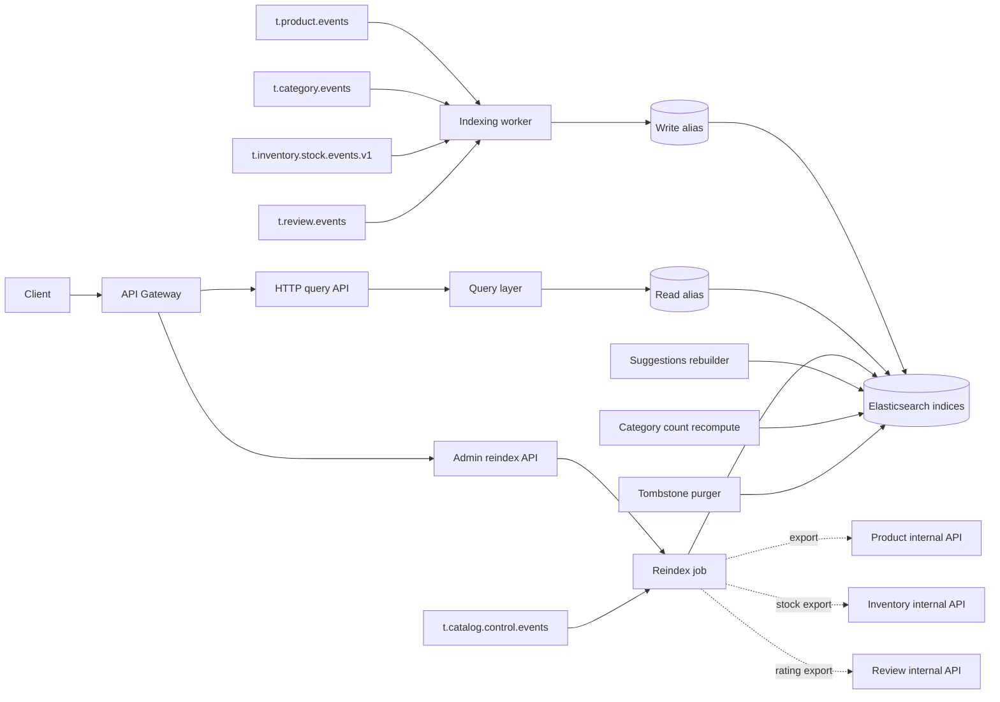

# Search Service — Architecture

> File này trả lời: “Search Service gồm những thành phần nào và chúng phối hợp ra sao?”

## 1. Architecture context

Search là read side của kiến trúc CQRS ở phạm vi catalog. Write side nằm ở
Product (catalog và giá), Inventory (tồn kho) và Review (rating). Search chỉ nhận
dữ liệu qua Kafka, không gọi ngược sang các service đó trong hot path; full reindex
mới gọi internal export API của Product, Inventory và Review.

Trust boundary: client không bao giờ chạm trực tiếp Search. API Gateway xác thực
JWT rồi forward request kèm claim đã verify. Elasticsearch nằm trong mạng nội bộ
và chỉ Search được ghi.

## 2. Components and responsibilities

| Component | Trách nhiệm | Không được làm | Dependencies | Evidence |
|---|---|---|---|---|
| HTTP query adapter | Validate và chuẩn hóa tham số, map lỗi, encode/decode cursor | Chứa logic ranking hoặc gọi Kafka | Query layer | `controller/api` |
| Admin reindex adapter | Nhận trigger reindex qua Gateway, kiểm tra ADMIN, trả trạng thái run | Chạy reindex đồng bộ trong request thread | Reindex job | `controller/api` |
| Query layer | Build Elasticsearch DSL, transform SKU hit thành response, encode/decode cursor | Ghi vào index hoặc gom Product bằng field collapse | Elasticsearch read alias | `service`, `repository` |
| Indexing worker | Consume snapshot catalog/category/stock/review, transform event thành lệnh ghi, apply guard | Bỏ qua guard hoặc tự gọi ngược Product trong hot path | Kafka, write alias | `worker` |
| Reindex job | Build index mới, import catalog/stock/rating snapshot kèm replay offsets, catch-up, cutover alias | Ghi qua write alias trong pha catch-up hoặc tự chụp catalog watermark | Elasticsearch, Kafka, Product/Inventory/Review export API | `worker` |
| Suggestions rebuilder | Build lại index suggestion và swap alias | Cập nhật incremental theo event | Elasticsearch | `worker` |
| Category count recompute | Tính lại `product_count` bằng aggregation | Cộng trừ số đếm theo từng event hoặc tự dựng lại category tree | Elasticsearch | `worker` |
| Tombstone purger | Xóa document đã tombstone quá cửa sổ bảo vệ | Xóa document còn trong cửa sổ bảo vệ | Elasticsearch | `worker` |

## 3. Processing model

Đường đọc là synchronous và không có side effect: request → validate → một
Elasticsearch query → transform → response. Không có cache tầng ứng dụng; Search
dựa vào filter cache và request cache của Elasticsearch
([ADR-001](./decisions/ADR-001-elasticsearch-only-store.md)).

Đường ghi là asynchronous và chỉ do event dẫn dắt. Không có transaction phân tán
và không có outbox vì Search không phát event. Một lệnh ghi có thể là:

- `_update` theo `_id = sku_id` cho event tác động một SKU.
- `_bulk` gom nhiều `_update` trong cùng một batch Kafka.
- `_update_by_query` chỉ cho projection rating theo product, bắt buộc
  `conflicts=proceed` và throttle. Category-tree change đi qua control-driven
  reindex, không update diện rộng theo path.
- Các job build/rebuild ghi `_bulk` phải chunk theo giới hạn action và byte, đồng
  thời áp dụng rate limiter phía client cùng giới hạn số request in-flight. Khi ES
  trả 429/503 hoặc timeout, job back off và hạ tốc độ trước khi dispatch chunk mới;
  không dùng `requests_per_second` như thể đó là tham số của Bulk API.

Offset chỉ được commit sau khi toàn bộ record trong batch đã apply xong hoặc đã
được phân loại là lỗi không tự hồi phục.

## 4. Consistency model

| Dữ liệu | Mức nhất quán | Độ trễ chấp nhận |
|---|---|---|
| Catalog, giá công bố, trạng thái | Eventual | Vài giây kể từ commit ở Product |
| `available_quantity`, `is_in_stock` | Eventual | Vài giây; chỉ dùng để hiển thị/lọc |
| Rating | Eventual | Vài giây tới vài phút |
| `categories.product_count` | Eventual, self-healing | Bằng chu kỳ job recompute |
| Suggestion | Eventual | Tới một ngày (rebuild hàng ngày) |

Không có luồng nào của Search yêu cầu strong consistency. Nếu một luồng nghiệp vụ
cần dữ liệu chính xác tại thời điểm quyết định, luồng đó phải gọi service sở hữu
dữ liệu chứ không đọc Search ([`SEARCH-INV-001`](./README.md#7-critical-invariants)).

Phát hiện lệch dữ liệu dựa vào metric enrichment miss, `document_missing`, consumer
lag và job recompute. Phục hồi bằng full reindex.

## 5. Concurrency model

Search không có lock nghiệp vụ. Tính đúng đắn dựa trên bốn cơ chế:

- **Guard theo từng nguồn.** Mỗi nguồn dữ liệu có một field revision riêng trên
  document: `catalog_revision`, `category_revision`, `stock_revision` và
  `review_revision`. Product, Inventory và Review phải cấp revision đơn điệu trong
  đúng scope aggregate; timestamp chỉ là observability, không là ordering guard
  ([ADR-015](./decisions/ADR-015-upstream-revision-guards.md)).
- **Kafka partition ordering.** Product event dùng key `product_id`, Inventory
  dùng `sku_id`, Review dùng `product_id`. Ordering chỉ được cam kết trong cùng
  key, và guard là thứ bảo vệ khi ordering không đủ.
- **Snapshot semantics.** Event catalog, stock và rating đều mang snapshot đầy đủ
  của field thuộc nguồn đó. Mọi export Product/Inventory/Review chụp replay offsets
  trước scan; vì vậy import snapshot rồi replay event từ offsets đó không bỏ lỡ
  mutation giữa lúc build. Search không tự tạo catalog boundary.
- **`conflicts=proceed` cho `_update_by_query`.** Version conflict do ghi đồng thời
  được bỏ qua có kiểm soát; guard đảm bảo không có lost update về mặt nghiệp vụ.

Race condition quan trọng: event tồn kho hoặc rating tới trước khi document SKU
tồn tại. Xử lý bắt buộc là bỏ qua, ghi metric và để event catalog sau đó tạo
document — không tự upsert, vì upsert từ nguồn không sở hữu catalog sẽ tạo
document rỗng ([`SEARCH-INV-005`](./README.md#7-critical-invariants)).

## 6. Deployment topology

Một artifact chạy được ở hai vai trò cấu hình được: API instance và worker
instance. Mặc định deploy chung process, tách khi cần scale độc lập.

- API stateless, scale ngang theo RPS và latency.
- Consumer scale tối đa tới tổng số partition của năm topic.
- Reindex job, suggestions rebuilder, category count recompute và tombstone purger
  phải chạy singleton; cần distributed lock hoặc leader election khi có nhiều
  replica.
- Runtime dependency: Elasticsearch cluster và Kafka. Không có database hay cache
  nào khác.

## 7. Architecture constraints

- Không truy cập database của service khác; catalog chỉ vào qua Kafka hoặc export
  API của Product.
- Không gọi đồng bộ sang Product/Inventory/Review trong đường xử lý event.
- Không đặt business logic trong controller hoặc Kafka listener; transform và rule
  nằm ở application layer.
- Mọi ghi qua write alias; pha catch-up của reindex là ngoại lệ duy nhất và ghi
  trực tiếp vào index đích.
- Không đổi mapping tại chỗ trên index đang phục vụ; đổi mapping phải qua reindex.
- Không có Redis, Caffeine hay cache tầng ứng dụng nào khác.

## 8. Trade-offs và ADR liên quan

Các đánh đổi lớn được ghi ở [Decision index](./decisions/README.md): dùng
Elasticsearch làm store duy nhất, chiến lược SKU-first, guard theo từng nguồn,
không DLQ, reindex ba pha, cursor pagination, cách duy trì `product_count`, nguồn
của tồn kho, cây danh mục dẫn xuất và cửa sổ tombstone.
