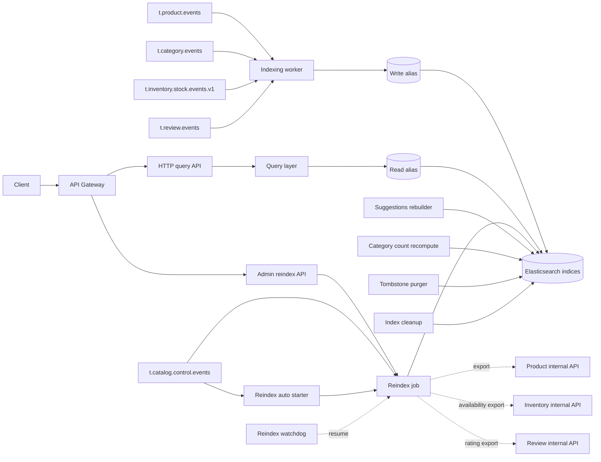

# Search Service — Architecture

> File này trả lời: “Search Service gồm những thành phần nào và chúng phối hợp ra sao?”

## 1. Architecture context

Search là read side của kiến trúc CQRS ở phạm vi catalog. Write side nằm ở
Product (catalog và giá), Inventory (tồn kho) và Review (rating). Search nhận projection
data qua Kafka; sau catalog write nó gọi idempotent Inventory readiness để mở publication
gate. Query hot path không gọi upstream; full reindex gọi export API của Product,
Inventory và Review.

Trust boundary: client không bao giờ chạm trực tiếp Search. API Gateway xác thực
JWT rồi forward request kèm claim đã verify. Elasticsearch nằm trong mạng nội bộ
và chỉ Search được ghi.

## 2. Components and responsibilities

| Component | Trách nhiệm | Không được làm | Dependencies | Evidence |
|---|---|---|---|---|
| HTTP query adapter | Validate và chuẩn hóa tham số, map lỗi, encode/decode cursor | Chứa logic ranking hoặc gọi Kafka | Query layer | `controller/api` |
| Admin reindex adapter | Nhận trigger reindex qua Gateway, kiểm tra ADMIN, trả trạng thái run | Chạy reindex đồng bộ trong request thread | Reindex job | `controller/api` |
| Query layer | Build SKU filters, PIT composite grouping, chọn cheapest eligible SKU, sort/page Product, ký cursor | Ghi catalog/index hoặc suy luận stock | Elasticsearch read alias | `service`, `repository` |
| Indexing worker | Consume snapshot catalog/category/availability/review, transform event thành lệnh ghi, apply guard; đăng ký readiness sau catalog create; lưu bền control event; `nack` batch không áp dụng được | Bỏ qua guard hoặc upsert document từ Availability; coi "không ACK" là đủ để retry | Kafka, write alias, Inventory readiness API, `search_jobs` | `worker` |
| Reindex job | Build index mới theo stage có checkpoint, import catalog/per-SKU availability/rating snapshot, catch-up, kiểm tra, cutover bốn alias trong một lệnh, tail replay | Tạo index availability riêng hoặc tự chụp catalog watermark; ghi state khi đã mất lease | Elasticsearch, Kafka, Product/Inventory/Review export API, lease `full-reindex` | `worker/job` |
| Reindex verifier | Kiểm tra index mới trước cutover: số document, sample diff, smoke query | Sửa bất kỳ index nào | Elasticsearch | `worker/job` |
| Reindex watchdog | Tìm run chưa kết thúc mà lease đã hết hạn; resume hoặc đánh dấu `RUN_ABANDONED` | Chạy song song với owner còn sống | `search_jobs`, Reindex job | `worker/job` |
| Reindex auto starter | Biến request `catalog-reindex-requested` đã gộp thành một run sau debounce | Chạy khi đã có run đang chạy | `search_jobs`, Reindex job | `worker` |
| Index cleanup | Xóa index versioned không còn alias phục vụ sau thời gian giữ | Xóa index đang phục vụ, của run chưa kết thúc, hoặc rollback version của suggestion | Elasticsearch, `search_jobs` | `worker/job` |
| Suggestions rebuilder | Build lại index suggestion và swap alias | Cập nhật incremental theo event | Elasticsearch | `worker` |
| Category count recompute | Tính lại `product_count` bằng aggregation | Cộng trừ số đếm theo từng event hoặc tự dựng lại category tree; ghi số từ câu trả lời `timed_out` | Elasticsearch | `worker` |
| Tombstone purger | Xóa document đã tombstone quá cửa sổ bảo vệ | Xóa document còn trong cửa sổ bảo vệ | Elasticsearch | `worker` |

## 3. Processing model

Đường đọc synchronous: request → validate → PIT → composite scan Product + top_hits cheapest eligible SKU → sort/page → response. [ADR-020](./decisions/ADR-020-product-cards-with-cheapest-eligible-sku.md). Không ghi projection; chỉ mở/gia hạn/đóng PIT. Không có cache tầng ứng dụng; Search
dựa vào filter cache và request cache của Elasticsearch
([ADR-001](./decisions/ADR-001-elasticsearch-only-store.md)). Một câu trả lời của Elasticsearch
có `timed_out` hoặc shard lỗi không bao giờ được trả cho buyer hay ghi vào `product_count`: nó là
`SEARCH_TIMEOUT` (job giữ số cũ).

Đường ghi là asynchronous và chỉ do event dẫn dắt. Không có transaction phân tán
và không có outbox vì Search không phát event. Một lệnh ghi có thể là:

- `_update` theo `_id = sku_id` cho event tác động một SKU.
- `_bulk` gom nhiều `_update` trong cùng một batch Kafka.
- `_update_by_query` chỉ cho projection rating theo product, bắt buộc
  `conflicts=proceed` và throttle. Category-tree change đi qua control-driven
  reindex, không update diện rộng theo path.
- Các job build/rebuild ghi `_bulk` phải chunk theo giới hạn action và byte, đồng
  thời áp dụng rate limiter phía client cùng giới hạn số request in-flight. Khi ES
  trả 429/503 hoặc timeout, job back off và hạ tốc độ trước khi dispatch chunk mới;
  không dùng `requests_per_second` như thể đó là tham số của Bulk API.

Offset chỉ được commit sau khi toàn bộ record trong batch đã apply xong hoặc đã
được phân loại là lỗi không tự hồi phục. Một batch không áp dụng được (lỗi tạm thời của
Elasticsearch, `429`/`503`, readiness lỗi, `document_missing` của availability) được trả lại
cho Kafka bằng `Acknowledgment.nack(index, pause)`: offset trước `index` được commit, consumer
seek về record đầu tiên chưa xử lý và nhận lại sau `search.consumer.retry-backoff` (5s). Chỉ
"không ACK" là chưa đủ — với manual ack container vẫn poll các record tiếp theo và batch sau
thành công sẽ commit vượt qua batch lỗi ([ADR-022](./decisions/ADR-022-post-implementation-audit-corrections.md)).
Mọi ghi có guard revision nên áp dụng lại là no-op.

## 4. Consistency model

| Dữ liệu | Mức nhất quán | Độ trễ chấp nhận |
|---|---|---|
| Catalog, giá công bố, trạng thái | Eventual | Vài giây kể từ commit ở Product |
| `is_in_stock` | Eventual | Vài giây; Inventory sở hữu phép tính, Search chỉ dùng để hiển thị/lọc |
| Rating | Eventual | Vài giây tới vài phút |
| `categories.product_count` | Eventual, self-healing | Bằng chu kỳ job recompute |
| Suggestion | Eventual | Tới một ngày (rebuild hàng ngày) |

Không có luồng nào của Search yêu cầu strong consistency. Nếu một luồng nghiệp vụ
cần dữ liệu chính xác tại thời điểm quyết định, luồng đó phải gọi service sở hữu
dữ liệu chứ không đọc Search ([`SEARCH-INV-001`](./README.md#7-critical-invariants)).

Phát hiện lệch dữ liệu dựa vào metric enrichment miss, `document_missing`, consumer
lag và job recompute. Phục hồi bằng full reindex.

## 5. Concurrency model

Search không có lock nghiệp vụ. Các job singleton dùng lease trong `search_jobs` (tạo atomic, fencing
token đơn điệu, gia hạn bằng heartbeat): `full-reindex`, `suggestion-rebuild`, `category-product-count`,
`tombstone-purge`, `index-cleanup`. Tính đúng đắn của dữ liệu dựa trên bốn cơ chế:

- **Guard theo từng nguồn.** Mỗi nguồn dữ liệu có một field revision riêng trên
  document: `catalog_revision`, `category_revision`, `availability_revision` và
  `review_revision`. Product, Inventory và Review phải cấp revision đơn điệu trong
  đúng scope aggregate; timestamp chỉ là observability, không là ordering guard
  ([ADR-015](./decisions/ADR-015-upstream-revision-guards.md)).
- **Kafka partition ordering.** Product event dùng key `product_id`, Inventory
  dùng `sku_id`, Review dùng `product_id`. Ordering chỉ được cam kết trong cùng
  key, và guard là thứ bảo vệ khi ordering không đủ.
- **Snapshot semantics.** Event catalog, availability và rating đều mang snapshot đầy đủ
  của field thuộc nguồn đó. Product/Review export dùng replay offsets; Inventory dùng
  fixed export watermark và ordered change feed. Search không tự tạo boundary.
- **`conflicts=proceed` cho `_update_by_query`.** Version conflict do ghi đồng thời
  được bỏ qua có kiểm soát; guard đảm bảo không có lost update về mặt nghiệp vụ.

Inventory availability không được phép tới trước document SKU: sau khi Product catalog
upsert thành công, Search đăng ký readiness với Inventory; chỉ sau đó Inventory mới được
publish/export snapshot hiện hành của SKU. `document_missing` khi apply availability là
vi phạm contract, Search ghi metric và không commit offset để retry, tuyệt đối không
upsert. Rating không có handshake nên missing rating vẫn là no-op. Quy tắc này cho phép
giữ availability ngay trong `products`, không cần thêm index reverse lookup
([`SEARCH-INV-005`](./README.md#7-critical-invariants)).

## 6. Deployment topology

Một artifact chạy được ở hai vai trò cấu hình được: API instance và worker
instance. Mặc định deploy chung process, tách khi cần scale độc lập.

- API stateless, scale ngang theo RPS và latency.
- Consumer scale tối đa tới tổng số partition của năm topic.
- Reindex job, suggestions rebuilder, category count recompute, tombstone purger và index cleanup
  chạy singleton qua lease Elasticsearch nên an toàn khi có nhiều replica. Watchdog và auto starter
  của reindex chạy trên mọi replica; lease quyết định replica nào hành động.
- Runtime dependency: Elasticsearch cluster và Kafka. Không có database hay cache
  nào khác; state của job singleton nằm trong index nội bộ `search_jobs` của chính
  Search, không phải một store thứ hai.

## 7. Architecture constraints

- Không truy cập database của service khác; catalog chỉ vào qua Kafka hoặc export
  API của Product.
- Không gọi đồng bộ sang Product/Review trong đường xử lý event. Ngoại lệ duy nhất là
  readiness PUT/DELETE idempotent sang Inventory sau catalog write/tombstone; không có
  sync call trong đường apply availability.
- Không làm shared availability store cho Product Detail BFF; PDP dùng Inventory
  Availability Read API riêng, còn Product vẫn là catalog authority.
- Không đặt business logic trong controller hoặc Kafka listener; transform và rule
  nằm ở application layer.
- Mọi ghi qua write alias; pha catch-up của reindex là ngoại lệ duy nhất và ghi
  trực tiếp vào index đích.
- Không đổi mapping tại chỗ trên index đang phục vụ; đổi mapping phải qua reindex.
- Không có Redis, Caffeine hay cache tầng ứng dụng nào khác.

## 8. Trade-offs và ADR liên quan

Các đánh đổi lớn được ghi ở [Decision index](./decisions/README.md): dùng
Elasticsearch làm store duy nhất, chiến lược SKU-first, guard theo từng nguồn,
không DLQ, reindex ba pha, cursor pagination, cách duy trì `product_count`, nguồn
của tồn kho, cây danh mục dẫn xuất, cửa sổ tombstone và vòng đời reindex
([ADR-022](./decisions/ADR-022-post-implementation-audit-corrections.md)).
