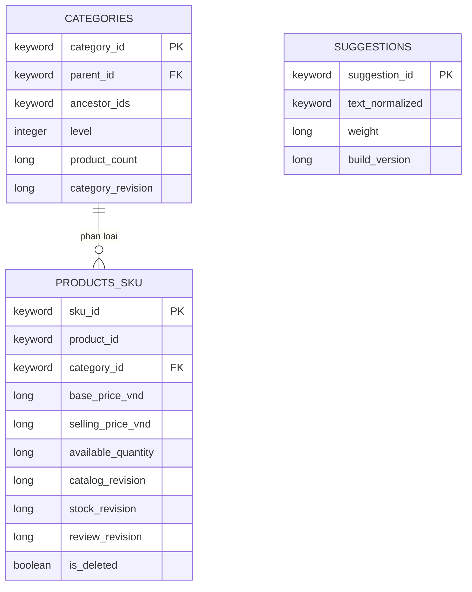

# Search Service — Thiết kế dữ liệu

> Nguồn chuẩn cho mapping đích là ba file trong [`schema/`](./schema). Các
> Painless script hiện có là artifact legacy, không phải đặc tả cho service viết
> lại. File này giải thích ownership, ý nghĩa field và các quy tắc không thể hiện
> được trong JSON.

## 1. Data ownership

Search không sở hữu dữ liệu nghiệp vụ. Toàn bộ index là projection và có thể được
xây dựng lại từ đầu bằng full reindex mà không mất thông tin có thẩm quyền.

| Store | Dữ liệu | Nguồn chân lý |
|---|---|---|
| ES index `products` | SKU document denormalize | Product (catalog, giá), Inventory (tồn kho), Review (rating) |
| ES index `categories` | Node danh mục và số đếm hiển thị | Product (danh mục); số đếm do Search tính |
| ES index `search_suggestions` | Gợi ý autocomplete | Search tự sinh từ hai index trên |

Search sở hữu mapping, alias, analyzer, token filter, `is_in_stock`,
`has_promotion`, `product_count`, `weight` và metadata projection/indexing. Product
sở hữu snapshot cấu trúc category; Search chỉ materialize `ancestor_ids`, slug path,
`level` và `is_leaf` từ snapshot đó. Không service nào khác được ghi vào Elasticsearch này.

## 2. Logical data model

Quan hệ chỉ là quan hệ logic bằng identifier: Elasticsearch không có join và
thiết kế cố tình tránh `nested`/`join` field
([ADR-012](./decisions/ADR-012-sku-results-with-search-after.md)). Mỗi hit của API search
là một SKU; `product_id` chỉ giữ liên kết logic, dùng cho count DISTINCT và ngữ
cảnh hiển thị, không dùng để field collapse ([ADR-012](./decisions/ADR-012-sku-results-with-search-after.md)).

## 3. Schema sources

| Artifact | Vai trò |
|---|---|
| [`schema/products.index.json`](./schema/products.index.json) | Settings và mapping của `products_v{N}` |
| [`schema/categories.index.json`](./schema/categories.index.json) | Settings và mapping của `categories_v{N}` |
| [`schema/search_suggestions.index.json`](./schema/search_suggestions.index.json) | Settings và mapping của `search_suggestions_v{N}` |
| [`schema/scripts/*.painless`](./schema/scripts) | Artifact legacy; thay cùng write path khi implementation mới bắt đầu |

Index vật lý luôn có hậu tố version (`products_v1`); ứng dụng chỉ được cấu hình
tên alias. Mapping để `dynamic: strict` để một field lạ trong payload gây lỗi rõ
ràng thay vì âm thầm sinh field mới.

## 4. Field semantics

Bảng dưới chỉ giải thích các field có ngữ nghĩa không tự hiển nhiên; kiểu dữ liệu
xem trong file mapping.

| Field | Nguồn | Ý nghĩa |
|---|---|---|
| `sku_id` | Product | `_id` của document |
| `product_id`, `product_slug` | Product | Liên kết Product cho response/detail và pivot cho mọi phép đếm DISTINCT |
| `product_attribute_tokens` | Search materialize từ Product | Token chuẩn hóa của thuộc tính Product-level |
| `variant_attribute_tokens` | Search materialize từ Product | Token chuẩn hóa của thuộc tính biến thể SKU |
| `filter_tokens` | Search dẫn xuất | Union hai tập token trên; nguồn duy nhất cho filter/facet attribute |
| `base_price_vnd` | Product | Giá niêm yết admin đặt |
| `selling_price_vnd` | Product | Giá công bố sau markdown; dùng cho sort và range filter |
| `has_promotion` | Search dẫn xuất | `selling_price_vnd < base_price_vnd` |
| `available_quantity` | Inventory | Tổng khả dụng per-SKU tại thời điểm snapshot, dùng `long` vì tổng nhiều kho có thể vượt `integer` |
| `is_in_stock` | Search dẫn xuất | `available_quantity > 0`; không phải cam kết tồn kho |
| `product_status` | Product | `DRAFT`, `ACTIVE`, `HIDDEN` |
| `sku_status` | Product | `ACTIVE`, `INACTIVE` |
| `category_ancestor_ids` | Product snapshot | ID của category hiện tại và tổ tiên; lọc theo nhánh bằng ID, không bằng slug |
| `category_slug_path` | Product snapshot | Path để hiển thị; không dùng làm filter vì slug có thể đổi |
| `facet_definitions` | Product category snapshot | Descriptor `{code,label,type}` của attribute có thể lọc trong category. Giữ `enabled: false`: Search đọc metadata này để render API facet, còn count/value luôn query từ `products.filter_tokens`. Product phải đưa cùng snapshot này vào category event và category export. |
| `thumbnail_storage_key` | Product `sku-upserted` | Thumbnail hiệu lực: SKU IMAGE ưu tiên Product IMAGE; `null` khi không có ảnh. Response adapter dựng URL CDN hoặc placeholder. |
| `is_deleted`, `deleted_at` | Search | Tombstone chặn zombie update trước khi purge |
| `catalog_revision` | Product | Guard cho mọi event catalog của Product aggregate |
| `stock_revision` | Inventory target contract | Revision đơn điệu per-SKU; timestamp chỉ dùng đo freshness |
| `review_revision` | Review | Revision đơn điệu per product rating aggregate; guard chung cho snapshot export và event |
| `category_revision` | Product | Guard `long` cho category snapshot |
| `*_indexed_at` | Search | Mốc projection riêng từng source, không bị nguồn khác ghi đè |
| `last_*_event_id` | Search | Truy vết event cuối đã apply theo từng nguồn |

Giá VND là số nguyên nên dùng `long`, không dùng `scaled_float`.

## 5. Ordering guard

Search nhận dữ liệu từ ba nguồn độc lập, mỗi nguồn có scope revision riêng,
nên **không tồn tại một version chung** cho document. Mỗi nguồn có guard riêng và
chỉ được ghi các field thuộc nguồn đó
([ADR-015](./decisions/ADR-015-upstream-revision-guards.md)).

| Nguồn | Guard field | Điều kiện apply | Kafka key |
|---|---|---|---|
| Product catalog | `catalog_revision` (long) | `event.catalog_revision > doc.catalog_revision` | `product_id` |
| Product category | `category_revision` (long) | `event.sequence > doc.category_revision` | `category_id` |
| Inventory | `stock_revision` (long) | `event.stock_revision > doc.stock_revision` | `sku_id` |
| Review | `review_revision` (long) | `event.review_revision > doc.review_revision` | `product_id` |

Guard dùng so sánh `>` chặt. Product đã cấp `catalog_revision` và
`category_revision`; Inventory v1 định nghĩa `stock_revision` cùng stock snapshot
export. Các contract vẫn `proposed`, nên Search chỉ dùng chúng sau rollout producer
và contract test. Review v1 định nghĩa `review_revision` cho cả event và aggregate
snapshot export. Không dùng publish timestamp làm guard vì hai mutation có thể cùng
timestamp mà mang state khác nhau.

Event catalog của Product mang snapshot đầy đủ nên apply lại cùng revision là
no-op. Khi cây category đổi, Product phát control event; Search coalesce rồi
full reindex từ category export trước Product export thay vì `_update_by_query`
theo path ([ADR-013](./decisions/ADR-013-product-category-snapshots.md)).

## 6. Constraints

Elasticsearch không có khóa ngoại hay unique constraint, nên các ràng buộc dưới
đây do application enforce và phải có test:

| Constraint | Enforcement |
|---|---|
| `_id = sku_id` cho index `products` | Worker luôn chỉ định `_id`, không dùng auto-id |
| `_id = category_id` cho index `categories` | Như trên |
| Document tồn tại trước khi apply stock/review | Không dùng `scripted_upsert` cho hai nguồn này |
| Document tombstone không nhận update | Guard `is_deleted` đứng đầu mọi script |
| Field lạ không được index | `dynamic: strict` |
| Không có hai index cùng nhận một write alias | Cutover bằng đúng một lệnh `_aliases` atomic |

## 7. Indexes và query patterns

Search chỉ có ba index; “index” theo nghĩa quan hệ được thay bằng mapping type và
alias. Các quyết định mapping bám theo query pattern thực tế:

| Field / cấu hình | Query pattern phục vụ | Trade-off |
|---|---|---|
| `name` + `name.autocomplete` + `name.keyword` | Full-text, prefix fallback, sort/exact | Tăng disk và thời gian index |
| `filter_tokens` | Filter/facet attribute bằng term filter | Encoding bắt buộc phân biệt string/number/boolean; UI OR các value cùng code, AND giữa các code |
| `selling_price_vnd` | Range filter và sort giá | Phải reprice document khi markdown đổi |
| `product_id` | Ngữ cảnh Product trên SKU hit và `cardinality` count | `cardinality` là xấp xỉ; cần `precision_threshold` đủ lớn |
| `is_in_stock`, `has_promotion`, `is_deleted` | Term filter được cache bitset | Phải recompute khi nguồn đổi |
| `refresh_interval` 1s cho `products` | Buyer thấy thay đổi gần realtime | Giảm throughput indexing; có thể nới tạm khi ingest spike |
| `refresh_interval` 5s cho hai index còn lại | Dữ liệu đổi chậm | — |
| 3 shard cho `products` | Catalog cỡ triệu SKU | Mỗi shard nên giữ 10–50GB |

`track_total_hits` bật cho API search để trả tổng chính xác; đây là chi phí có
chủ ý và cần theo dõi khi catalog lớn lên.

## 8. Transaction boundaries

Search không có transaction. Đơn vị nguyên tử là một lệnh Elasticsearch trên một
document. Hệ quả phải chấp nhận:

- Một event catalog chạm nhiều SKU được thực hiện bằng nhiều lệnh trong một
  `_bulk`; có thể thành công một phần. Guard làm cho lần xử lý lại an toàn.
- `_update_by_query` không nguyên tử trên toàn bộ tập kết quả; chạy với
  `conflicts=proceed` và có thể quan sát thấy trạng thái ở giữa.
- Không có rollback. Cơ chế phục hồi là apply lại event hoặc reindex.

## 9. Caching

Search cố tình **không có cache tầng ứng dụng**
([ADR-001](./decisions/ADR-001-elasticsearch-only-store.md)):

- Filter context của Elasticsearch tự cache bitset cho các term filter lặp lại.
- Node query cache và shard request cache là cơ chế cache duy nhất được dựa vào.
- `categories.product_count` là dạng vật chất hóa số đếm, được job recompute làm
  mới ([ADR-008](./decisions/ADR-008-category-product-count-recompute.md)); nó
  không phải cache và không có TTL.
- Suggestion index là kết quả pre-compute hàng ngày, cũng không phải cache.

Khi Elasticsearch không sẵn sàng, Search không có lớp nào để phục vụ tiếp; hành vi
degrade nằm ở [Operations](./operations.md).

## 10. Idempotency storage

Không có bảng inbox hay bộ nhớ dedupe theo `event_id`. Idempotency đến từ guard
theo nguồn cộng với snapshot semantics. `last_*_event_id` chỉ để truy vết vận
hành, không dùng để quyết định apply hay bỏ qua.

Trạng thái của một lần reindex (`run_id`, pha, tiến độ, watermark offset) được lưu
trong một index nội bộ nhỏ của Search hoặc trong bộ nhớ của instance giữ lock;
lựa chọn cụ thể phải được ghi lại khi implementation được xác minh.

## 10.1 Attribute token encoding

Product phát attribute object có value `string`, `number` hoặc `boolean`. Search
chuẩn hóa mỗi entry thành đúng một token `code:type:value`, trong đó `type` là
`s`, `n` hoặc `b`; string được Unicode-normalize, case-fold và escape `:`/`\\`.
`filter_tokens` là union của token Product-level và token variant của chính SKU.
Nhờ đó cùng một SKU không nhầm `"1"`, `1` và `true`, và facet/filter dùng cùng
một field. Đây là encoding contract nội bộ của Search, không phải format Product
phải lưu.

## 11. Data lifecycle

- **Tombstone.** `PRODUCT_DELETED`/`SKU_DELETED` đặt `is_deleted = true` và
  `deleted_at`. Document biến mất khỏi mọi kết quả ngay lập tức.
- **Purge.** Tombstone purger xóa vật lý document sau cửa sổ bảo vệ; cửa sổ này
  phải dài hơn retention của các topic mà Search tiêu thụ
  ([ADR-011](./decisions/ADR-011-tombstone-and-purge-window.md)).
- **Index cũ.** Sau cutover, index version cũ được giữ tối thiểu 24 giờ để rollback
  rồi mới xóa.
- **Suggestion.** Mỗi build tạo index mới; giữ lại một version trước để rollback.
- **Backup.** Catalog/category tái tạo từ Product export cộng catch-up Kafka. Stock
  tái tạo từ Inventory snapshot export rồi replay `t.inventory.stock.events.v1` từ
  offsets export trả về; chỉ được tuyên bố khôi phục hoàn toàn sau producer rollout.
- **Reconciliation.** Job recompute `product_count` là reconciliation liên tục cho
  số đếm; full reindex là reconciliation toàn phần cho phần còn lại.

## 12. Security và privacy

Index của Search không chứa PII: chỉ có dữ liệu catalog công khai, số tồn kho tổng
hợp và rating tổng hợp. Không lưu `user_id`, lịch sử tìm kiếm hay hành vi người
dùng trong ba index này.

Kết nối tới Elasticsearch và Kafka dùng TLS và credential lấy từ secret manager.
Log request chỉ chứa `request_id`, tham số truy vấn đã chuẩn hóa và `user_id` khi
chính sách privacy cho phép; không log payload event đầy đủ ở mức INFO.
