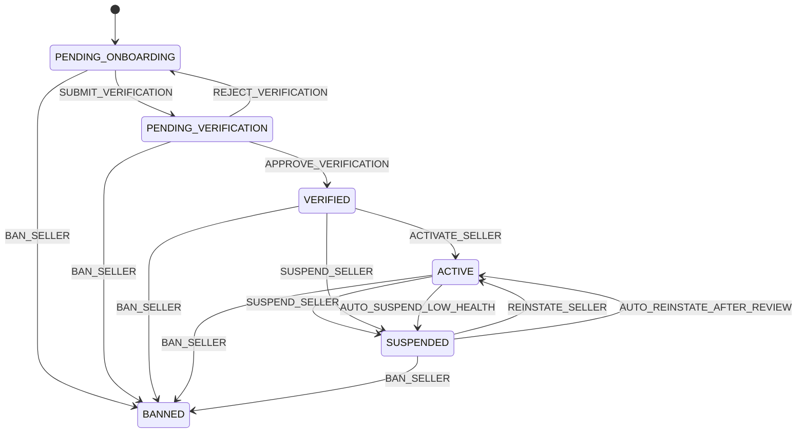
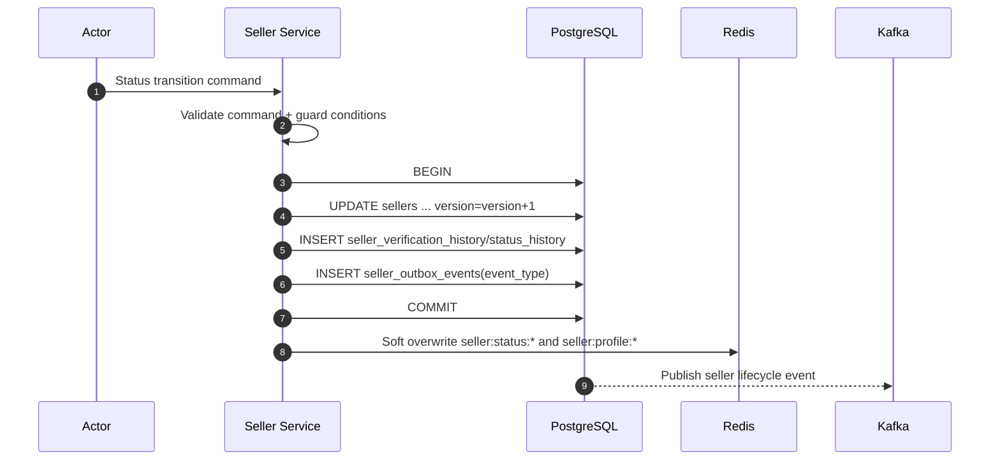

# Seller Service - State Machine and Lifecycle

**Liên kết nhanh (Related Documents):**
* [Workflows (API & Data Flow)](seller_workflow.md)
* [Background Workers & Jobs](seller_workers.md)
* [Caching Schema (Redis + L1)](seller_caching_schema.md)
* [Database Schema (Write Store)](seller_db_design.md)
* [State Machine & Lifecycle](seller_state_machine.md)
* [Events Structure & Kafka Topics](seller_events.md)
* [Architecture Recommendations](seller_architecture_recommendations.md)

---

Tài liệu này mô tả lifecycle trạng thái của Seller Service, bao gồm transitions do user/admin và do hệ thống tự động kích hoạt.

## 1. Danh sách trạng thái

1. `PENDING_ONBOARDING`: Seller mới tạo, chưa nộp đủ hồ sơ.
2. `PENDING_VERIFICATION`: Seller đã nộp hồ sơ, chờ review.
3. `VERIFIED`: Hồ sơ đã được duyệt.
4. `ACTIVE`: Seller được phép hoạt động bán hàng.
5. `SUSPENDED`: Seller bị tạm dừng theo policy.
6. `BANNED`: Seller bị khoá nghiêm trọng.

## 2. Bảng transitions

| Transition | Từ trạng thái | Sang trạng thái | Actor | Ghi chú |
|---|---|---|---|---|
| `SUBMIT_VERIFICATION` | PENDING_ONBOARDING | PENDING_VERIFICATION | SELLER | Nộp hồ sơ xác minh |
| `APPROVE_VERIFICATION` | PENDING_VERIFICATION | VERIFIED | ADMIN/SYSTEM | Duyệt hồ sơ |
| `REJECT_VERIFICATION` | PENDING_VERIFICATION | PENDING_ONBOARDING | ADMIN/SYSTEM | Từ chối hồ sơ và yêu cầu bổ sung |
| `ACTIVATE_SELLER` | VERIFIED | ACTIVE | ADMIN/SYSTEM | Kích hoạt seller |
| `SUSPEND_SELLER` | ACTIVE, VERIFIED | SUSPENDED | ADMIN/SYSTEM | Tạm dừng seller |
| `REINSTATE_SELLER` | SUSPENDED | ACTIVE | ADMIN | Mở lại seller |
| `BAN_SELLER` | Bất kỳ | BANNED | ADMIN/SYSTEM | Khoá nặng theo compliance |
| `AUTO_SUSPEND_LOW_HEALTH` | ACTIVE | SUSPENDED | SYSTEM | Tự động theo health score |
| `AUTO_REINSTATE_AFTER_REVIEW` | SUSPENDED | ACTIVE | SYSTEM/ADMIN | Mở lại sau khi pass kiểm tra |

## 3. Guard conditions

1. `APPROVE_VERIFICATION` chỉ hợp lệ khi hồ sơ đầy đủ và user chủ sở hữu đáp ứng điều kiện KYC liên quan.
2. `ACTIVATE_SELLER` yêu cầu có payout account hợp lệ.
3. `REINSTATE_SELLER` yêu cầu đã xử lý xong violations.
4. `BAN_SELLER` là terminal business state; muốn quay lại phải đi qua privileged override process.
5. Mọi transition thành công phải tăng `sellers.version`.

## 4. Post-actions bắt buộc

1. Ghi history (`seller_verification_history` hoặc status history chuẩn hoá).
2. Ghi outbox event tương ứng.
3. Overwrite cache status/profile.
4. Trigger side effects downstream:
   - Product hide/show listings.
   - Search cập nhật searchable flags.

## 5. UML state diagram

## 6. Sequence diagram: Transition chuẩn

