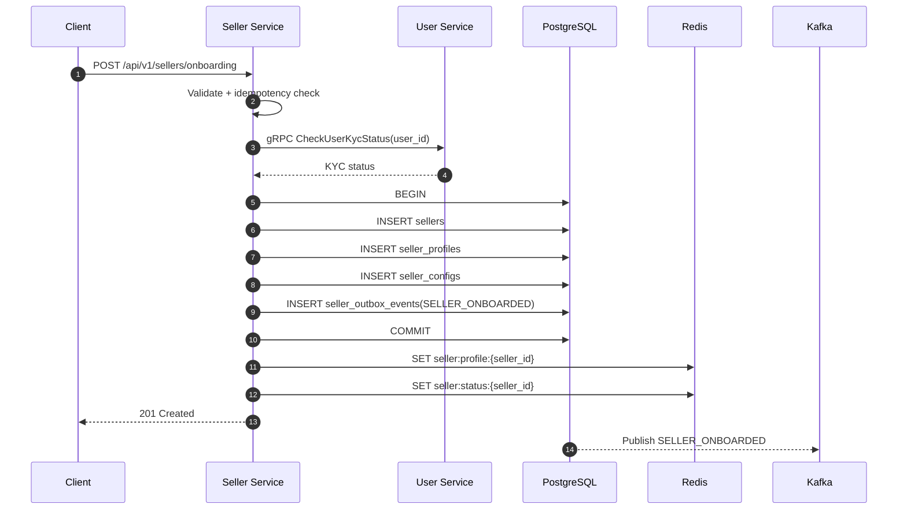
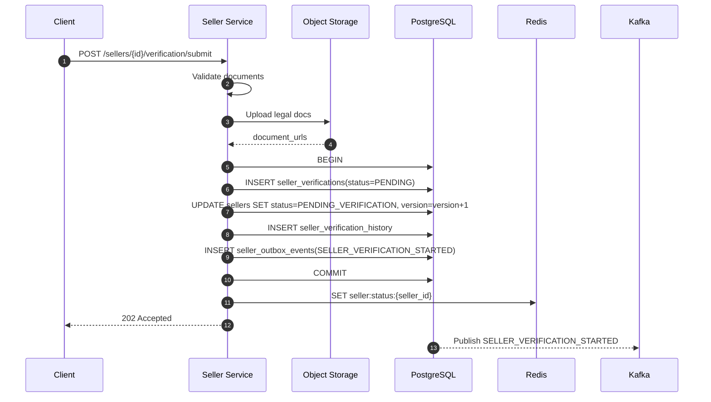
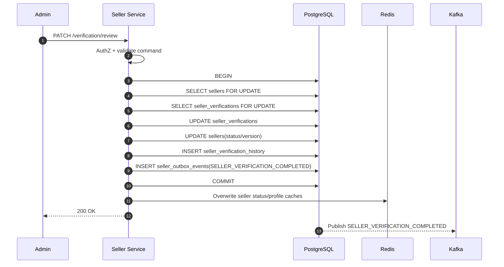
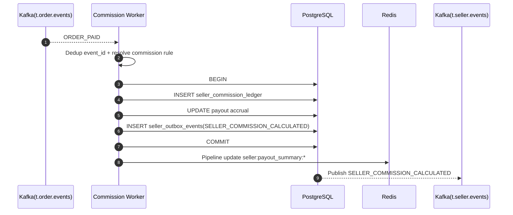
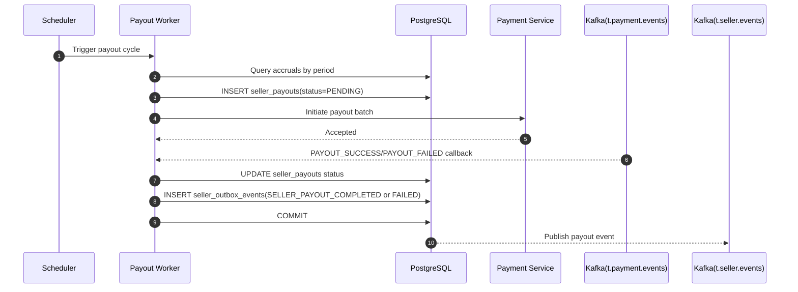

# Seller Service - Workflows (API and Data Flow)

**Liên kết nhanh (Related Documents):**
* [Workflows (API & Data Flow)](seller_workflow.md)
* [Background Workers & Jobs](seller_workers.md)
* [Caching Schema (Redis + L1)](seller_caching_schema.md)
* [Database Schema (Write Store)](seller_db_design.md)
* [State Machine & Lifecycle](seller_state_machine.md)
* [Events Structure & Kafka Topics](seller_events.md)
* [Architecture Recommendations](seller_architecture_recommendations.md)

---

Tài liệu này mô tả trình tự nghiệp vụ chi tiết của Seller Service, bao gồm cả luồng đồng bộ sang cache và Kafka.

## 1. Gợi ý base path

`/api/v1/sellers/...`

## 2. Workflow quan trọng: Onboarding (`POST /api/v1/sellers/onboarding`)

### Các bước xử lý

1. Validate payload + idempotency key.
2. Gọi User Service để kiểm tra điều kiện khởi tạo (KYC/account status).
3. Mở transaction:
   - insert `sellers`.
   - insert `seller_profiles` mặc định.
   - insert `seller_configs` mặc định.
   - insert outbox `SELLER_ONBOARDED`.
4. Commit.
5. Ghi cache `seller:profile:{seller_id}` và `seller:status:{seller_id}`.
6. Trả `201 Created`.

### Sequence diagram



## 3. Workflow quan trọng: Submit verification (`POST /api/v1/sellers/{id}/verification/submit`)

### Các bước xử lý

1. Validate hồ sơ và metadata.
2. Upload hồ sơ lên object storage.
3. Mở transaction:
   - insert `seller_verifications` status `PENDING`.
   - update `sellers.status = PENDING_VERIFICATION`, `version = version + 1`.
   - insert `seller_verification_history`.
   - insert outbox `SELLER_VERIFICATION_STARTED`.
4. Commit.
5. Overwrite cache status.
6. Trả `202 Accepted`.

### Sequence diagram



## 4. Workflow quan trọng: Review verification (`PATCH /api/v1/sellers/{id}/verification/review`)

### Các bước xử lý

1. Kiểm tra quyền reviewer.
2. Lock `sellers` và `seller_verifications` rows theo thứ tự chuẩn.
3. Cập nhật kết quả review.
4. Áp dụng state transition theo FSM.
5. Ghi history và outbox `SELLER_VERIFICATION_COMPLETED`.
6. Commit, refresh cache, trả `200`.

### Sequence diagram



## 5. Workflow quan trọng: Change seller status (`PATCH /api/v1/sellers/{id}/status`)

### Các bước xử lý

1. Validate command theo state machine.
2. Update trạng thái bằng optimistic lock (`version`).
3. Insert `seller_verification_history` (hoặc status history thống nhất).
4. Insert outbox `SELLER_STATUS_CHANGED`.
5. Commit.
6. Soft refresh cache status/profile.
7. Downstream xử lý visibility qua Kafka.

## 6. Workflow quan trọng: Commission calculation (async)

**Trigger:** `ORDER_PAID` từ `t.order.events`.

### Các bước xử lý

1. Worker nhận event, dedup theo `event_id`.
2. Resolve commission rule theo seller/category.
3. Transaction:
   - insert `seller_commission_ledger`.
   - update payout accrual summary.
   - insert outbox `SELLER_COMMISSION_CALCULATED`.
4. Commit.
5. Update cache payout summary theo batch pipeline.

### Sequence diagram



## 7. Workflow quan trọng: Payout settlement (async)

### Các bước xử lý

1. Scheduler chạy theo kỳ quyết toán.
2. Tạo payout records `PENDING` cho từng seller.
3. Trigger payment transfer (bounded concurrency).
4. Nhận callback success/fail từ Payment Service.
5. Cập nhật `seller_payouts.status`, ghi outbox payout event.
6. Commit và refresh payout caches.

### Sequence diagram



## 8. Workflow quan trọng: Performance scoring (async)

1. Worker tổng hợp tín hiệu từ order/review/inventory.
2. Tính score theo trọng số chuẩn hoá.
3. Update `seller_performance_metrics` + tăng `performance_version`.
4. Insert outbox `SELLER_PERFORMANCE_SCORE_UPDATED`.

## 9. Internal gRPC workflows

1. `GetSellerProfile`: L1 -> L2 -> DB fallback.
2. `ValidateSellerStatus`: ưu tiên consistency, stale guard theo `status_version`.
3. `GetCommissionRate`: đọc commission rule cache, miss thì DB.
4. `GetPrimaryWarehouse`: lookup warehouse cache/DB.

## 10. Error handling và resilience rules

1. Optimistic lock conflict trả `409`, caller có retry policy.
2. Redis down: fallback DB có rate limit/circuit breaker.
3. Callback payout duplicate: idempotent theo `payout_id` + `provider_reference`.
4. Consumer lỗi tạm thời: retry; lỗi payload/schema: DLQ.

## 11. REST contract schema mẫu

### 11.1 Onboarding - Request

```json
{
    "user_id": "u-10001",
    "company_name": "ABC Trading Co.",
    "tax_id": "0312345678",
    "store_name": "ABC Official Store"
}
```

### 11.2 Onboarding - Response

```json
{
    "seller_id": "s-9001",
    "user_id": "u-10001",
    "status": "PENDING_ONBOARDING",
    "verification_status": "PENDING",
    "state_version": 1,
    "created_at": "2026-03-31T10:00:00Z"
}
```

### 11.3 Review verification - Request

```json
{
    "decision": "APPROVE",
    "reason": "Hồ sơ hợp lệ",
    "expected_version": 2
}
```

## 12. gRPC contract schema mẫu

```proto
syntax = "proto3";

service SellerService {
    rpc GetSellerProfile(GetSellerProfileRequest) returns (GetSellerProfileResponse);
    rpc ValidateSellerStatus(ValidateSellerStatusRequest) returns (ValidateSellerStatusResponse);
    rpc GetCommissionRate(GetCommissionRateRequest) returns (GetCommissionRateResponse);
    rpc GetPrimaryWarehouse(GetPrimaryWarehouseRequest) returns (GetPrimaryWarehouseResponse);
}

message GetSellerProfileRequest {
    string seller_id = 1;
}

message GetSellerProfileResponse {
    string seller_id = 1;
    string store_name = 2;
    string status = 3;
    int64 profile_version = 4;
    string updated_at = 5;
}

message ValidateSellerStatusRequest {
    string seller_id = 1;
}

message ValidateSellerStatusResponse {
    string seller_id = 1;
    string status = 2;
    int64 status_version = 3;
    bool can_sell = 4;
}

message GetCommissionRateRequest {
    string seller_id = 1;
    string category_id = 2;
}

message GetCommissionRateResponse {
    string seller_id = 1;
    string category_id = 2;
    double commission_rate = 3;
    string policy_version = 4;
}

message GetPrimaryWarehouseRequest {
    string seller_id = 1;
}

message GetPrimaryWarehouseResponse {
    string seller_id = 1;
    string warehouse_id = 2;
    string warehouse_name = 3;
    string warehouse_status = 4;
}
```
