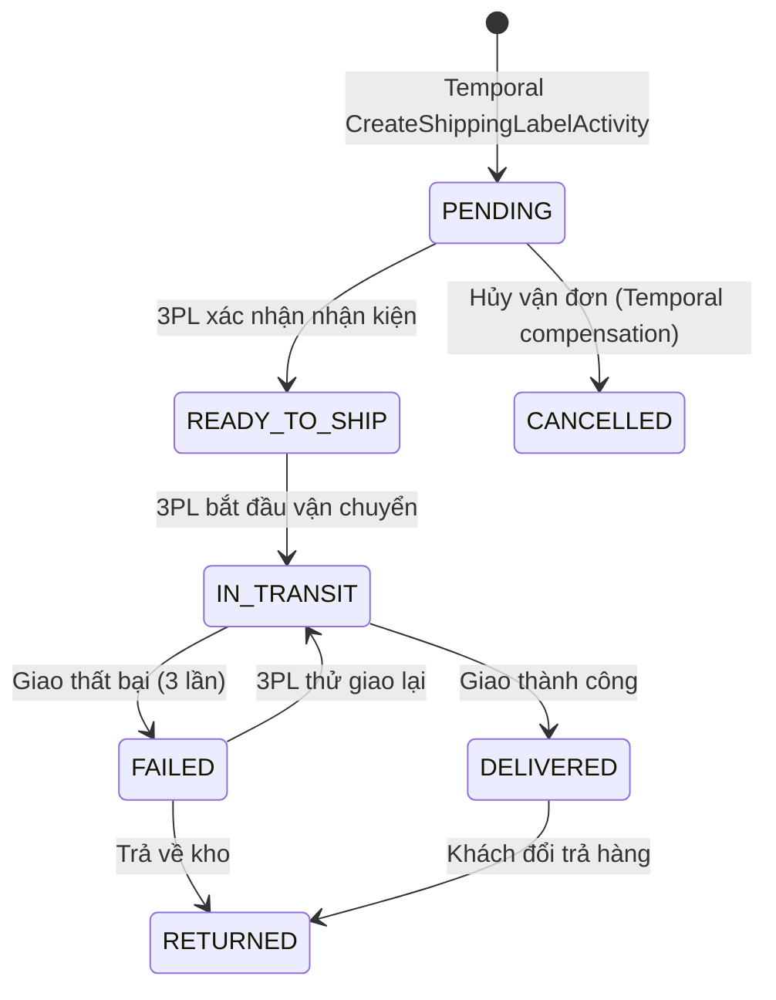

# Shipping Service - Quản Lý Trạng Thái Vận Đơn (State Machine)

**Liên kết nhanh (Related Documents):**
*   [Database Schema](shipping_db_design.md)
*   [Workflows (API & Data Flow)](shipping_workflow.md)
*   [Background Workers & Jobs](shipping_workers.md)
*   [Events Structure & Kafka Topics](shipping_events.md)

**Cross-Service References:**
*   [Order Item Shipping FSM](../order/order_state_machine.md#2-order-item-shipping-fsm-bảng-order_items) — Mapping `shipments.standardized_status` ↔ `order_items.status`
*   [Inventory Smart Routing](../inventory/smart_routing_engine.md) — Shipping rate calculation

---

Tài liệu này mô tả **Finite State Machine (FSM)** cho Shipping Service. Điểm đặc biệt: Shipping Service nhận trạng thái gốc từ hàng chục 3PL (GHN, NinjaVan, J&T, GHTK...) — mỗi nhà vận chuyển có hệ thống mã trạng thái riêng. FSM chuẩn hóa tất cả về **1 bộ trạng thái thống nhất (`standardized_status`)**.

---

## 1. Shipment FSM (Bảng `shipments`)

### 1.1. Sơ đồ Trạng thái (Chuẩn hóa)



### 1.2. Bảng Chi tiết Transitions

| # | Trạng thái Hiện tại | Sự kiện (Webhook) | Trạng thái Mới | Actor | Guard |
|:--|:---|:---|:---|:---|:---|
| S1 | `PENDING` | `LABEL_CONFIRMED` | `READY_TO_SHIP` | 3PL Webhook | 3PL xác nhận đã tạo vận đơn, chờ lấy hàng |
| S2 | `READY_TO_SHIP` | `PICKED_UP` | `IN_TRANSIT` | 3PL Webhook | Shipper đã lấy kiện từ kho |
| S3 | `IN_TRANSIT` | `DELIVERED` | `DELIVERED` | 3PL Webhook | Giao hàng thành công, người nhận ký xác nhận |
| S4 | `IN_TRANSIT` | `DELIVERY_FAILED` | `FAILED` | 3PL Webhook | Không giao được (sai địa chỉ, không liên lạc) |
| S5 | `FAILED` | `RETRY_DELIVERY` | `IN_TRANSIT` | 3PL Webhook | 3PL thử giao lại (max 3 lần) |
| S6 | `FAILED` | `RETURN_INITIATED` | `RETURNED` | 3PL Webhook | Trả kiện về kho admin |
| S7 | `DELIVERED` | `RETURN_PICKUP` | `RETURNED` | 3PL Webhook | Khách yêu cầu trả hàng, 3PL lấy kiện về |
| S8 | `PENDING` | `CANCEL_SHIPMENT` | `CANCELLED` | Temporal Compensation | Order bị hủy trước khi kiện được 3PL nhận |

### 1.3. Ràng buộc Transition

- **Forward-only (trừ FAILED → IN_TRANSIT retry):** Không cho phép transition ngược (VD: IN_TRANSIT → READY_TO_SHIP).
- **Terminal states:** `RETURNED`, `CANCELLED` — không có transition nào ra khỏi. `DELIVERED` là trạng thái gần cuối, nhưng vẫn có thể chuyển sang `RETURNED` khi phát sinh đổi trả.
- **Retry limit:** `FAILED` → `IN_TRANSIT` tối đa 3 lần. Sau đó bắt buộc `RETURNED`.

---

## 2. Provider Status Mapping Table (Bảng `provider_status_mappings`)

Đây là bảng "Rosetta Stone" dịch mã trạng thái riêng của từng 3PL sang `standardized_status`.

### 2.1. GHN (Giao Hàng Nhanh)

| GHN Status Code | GHN Description | `standardized_status` |
|:---|:---|:---|
| `ready_to_pick` | Chờ lấy hàng | `READY_TO_SHIP` |
| `picking` | Đang lấy hàng | `READY_TO_SHIP` |
| `picked` | Đã lấy hàng | `IN_TRANSIT` |
| `delivering` | Đang giao hàng | `IN_TRANSIT` |
| `delivered` | Giao thành công | `DELIVERED` |
| `delivery_fail` | Giao thất bại | `FAILED` |
| `return` | Đang trả hàng | `RETURNED` |
| `returned` | Đã trả hàng | `RETURNED` |
| `cancel` | Đã hủy | `CANCELLED` |

### 2.2. NinjaVan

| NinjaVan Status | `standardized_status` |
|:---|:---|
| `Pending Pickup` | `READY_TO_SHIP` |
| `En-route to Sorting Hub` | `IN_TRANSIT` |
| `On Vehicle for Delivery` | `IN_TRANSIT` |
| `Completed` | `DELIVERED` |
| `Pending Reschedule` | `FAILED` |
| `Returned to Sender` | `RETURNED` |
| `Cancelled` | `CANCELLED` |

### 2.3. J&T Express

| J&T Status | `standardized_status` |
|:---|:---|
| `Picked Up` | `IN_TRANSIT` |
| `In Transit` | `IN_TRANSIT` |
| `Out for Delivery` | `IN_TRANSIT` |
| `Delivered` | `DELIVERED` |
| `Undelivered` | `FAILED` |
| `Returned` | `RETURNED` |

> [!NOTE]
> Bảng mappings này được lưu trong DB (`provider_status_mappings`) và cache vào Redis/Caffeine. Khi thêm 3PL mới, chỉ cần INSERT thêm mappings — không cần thay đổi code.

---

## 3. Liên kết với Order Item Shipping FSM

| Shipping `standardized_status` | Order `item_status` | Ghi chú |
|:---|:---|:---|
| `PENDING` | `PREPARING` | Vận đơn mới tạo |
| `READY_TO_SHIP` | `HANDED_OVER` | 3PL đã xác nhận nhận kiện |
| `IN_TRANSIT` | `IN_TRANSIT` | Đang vận chuyển |
| `DELIVERED` | `DELIVERED` | Giao thành công |
| `FAILED` | `DELIVERY_FAILED` | Giao thất bại |
| `RETURNED` | `RETURNED` | Trả về kho |
| `CANCELLED` | *(Order item shipment unit bị hủy)* | Vận đơn hủy |

> Order Service consumer nhận `SHIPMENT_STATUS_UPDATED` event → Map theo bảng trên → Update `order_items.status`. Xem [Order Workers - Shipping Consumer](../order/order_workers.md#5-shipping-status-consumer-kafka-consumer).
>
> Với buyer-facing search/list của Order Service, các item shipment statuses `HANDED_OVER`, `IN_TRANSIT`, `DELIVERY_FAILED` được gom vào tab `TO_RECEIVE` theo [Buyer Tab Precedence](../order/order_state_machine.md#24-buyer-tab-precedence-platformee-style).

---

## 4. Bảo Vệ FSM

### 4.1. Webhook Idempotency
Mỗi webhook được check trùng theo `provider_event_fingerprint` (ưu tiên `provider_webhook_id`, fallback hash payload canonical):
```sql
INSERT INTO shipping_event_idempotency (event_id, shipment_id, action_type, action_scope_key, processed_at)
VALUES (:webhook_event_id, :shipment_id, 'UPDATE_SHIPMENT_STATUS', :provider_event_fingerprint, NOW())
ON CONFLICT DO NOTHING;
-- Nếu affected_rows = 0 → Duplicate webhook, skip
```

### 4.2. Optimistic Locking
```sql
UPDATE shipments SET standardized_status = :new_status, version = version + 1
WHERE id = :shipment_id AND version = :expected_version;
```

### 4.3. Event History (ScyllaDB)
Mỗi transition ghi vào `shipment_events` (ScyllaDB) — append-only, high write throughput:
```
PK: shipment_id
CK: event_timestamp DESC
Columns: provider_status, standardized_status, raw_payload, location
```
