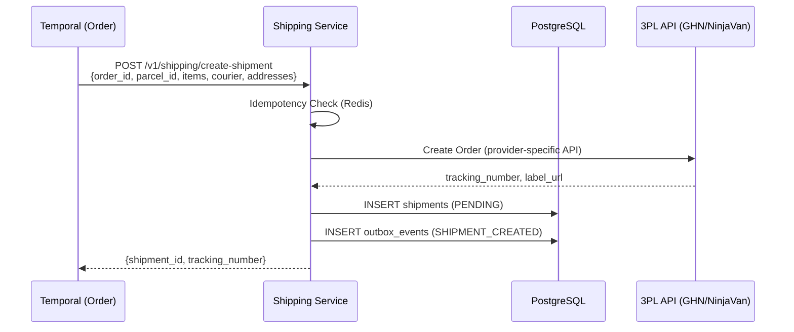

# Shipping Service - Quy Trình Hoạt Động (Workflows & API Data Flow)

**Liên kết nhanh (Related Documents):**
*   [Database Schema](shipping_db_design.md)
*   [State Machine & Provider Mapping](shipping_state_machine.md)
*   [Background Workers & Jobs](shipping_workers.md)
*   [Events Structure & Kafka Topics](shipping_events.md)

**Cross-Service References:**
*   [Order Workflow - Post-Payment Saga](../order/order_workflow.md#4-workflow-nhận-checkout-submit-full-saga-flow) — Temporal Activity `CreateShippingLabelsActivity`
*   [Inventory Smart Routing](../inventory/smart_routing_engine.md) — Gọi `POST /v1/shipping/calculate-batch` tính phí ship
*   [Checkout Workflow](../checkout/checkout_workflow.md) — Preview flow: lấy phí ship hiển thị cho user

---

Tài liệu này mô tả các Workflows của Shipping Service: tính phí vận chuyển, tạo/hủy vận đơn, xử lý webhook, và truy vấn tracking. Mỗi flow ghi rõ: `[PostgreSQL]`, `[Redis]`, `[ScyllaDB]`, `[3PL API]`, `[FSM]`, `[Kafka]`.

---

## 1. API: Calculate Shipping Fee (`POST /v1/shipping/calculate-batch`)

**Ngữ cảnh:** Inventory Smart Routing Engine và Checkout Service gọi API này để lấy báo giá phí ship. Được gọi TRƯỚC khi user chốt đơn (Checkout Preview). Xem [Inventory Smart Routing Bước 2](../inventory/smart_routing_engine.md#bước-2-scoring-algorithm-chấm-điểm-phân-bổ).

1. **[Backend]** Nhận request:
   ```json
   {
     "quotes": [
       {
         "from_warehouse_id": 5,
         "to_province": "HCM", "to_district": "Q1",
         "weight_grams": 500,
         "dimensions": {"length": 20, "width": 15, "height": 10},
         "cod_amount": 0,
         "items_count": 2
       },
       {
         "from_warehouse_id": 8,
         "to_province": "HCM", "to_district": "Q7",
         "weight_grams": 1200,
         "dimensions": {"length": 30, "width": 20, "height": 15},
         "cod_amount": 500000,
         "items_count": 1
       }
     ]
   }
   ```
2. **[Redis Cache]** Check cache rate cards:
   - Key: `shipping:rates:{provider_code}:{from_province}:{to_province}:{service_type}`
   - Hit → Tính từ cache (< 1ms).
  - Miss → Query DB → Cache (TTL 20 phút, đồng bộ với Checkout session window).
3. **[Calculation Engine]** Cho mỗi quote, tính phí từ **tất cả** providers active:
   ```
   Cho mỗi provider (GHN, NinjaVan, J&T):
     base_fee = rate_card[from→to][weight_range]
     surcharge = dimension_surcharge + cod_fee + remote_area_fee
     total = base_fee + surcharge
   ```
4. **[Response]** Trả về bảng giá đa provider cho mỗi quote:
   ```json
   {
    "rate_card_version": "2026-03-14T09:00:00Z",
     "quotes": [
       {
         "quote_index": 0,
         "options": [
           {"provider": "GHN", "service": "STANDARD", "fee": 25000, "delivery_days": 2},
           {"provider": "GHN", "service": "EXPRESS", "fee": 40000, "delivery_days": 1},
           {"provider": "NINJAVAN", "service": "STANDARD", "fee": 28000, "delivery_days": 3}
         ]
       },
       {"quote_index": 1, "options": [...]}
     ]
   }
   ```

> **Performance:** API target < 20ms. Response trả kèm `rate_card_version` để Checkout lưu vào session và revalidate tại submit.

---

## 2. API: Create Shipment (Temporal Activity `CreateShippingLabelActivity`)

**Ngữ cảnh:** Order Service Post-Payment Saga gọi API này SAU khi thanh toán thành công. Tạo vận đơn thật với 3PL. Xem [Order Workflow Bước 4.4](../order/order_workflow.md#44-post-payment-saga-sau-khi-nhận-payment-success).



### Bước Chi tiết:
1. **[Backend]** Nhận request:
   ```json
   {
     "order_id": 10001,
     "parcel_id": 2001,
     "courier_code": "GHN",
     "service_type": "STANDARD",
     "sender": {"warehouse_id": 5, "name": "Kho Tân Bình", "phone": "028-xxx"},
     "receiver": {"name": "Nguyen Van A", "phone": "0901234567", "address": "123 Nguyen Hue, Q1, HCM"},
     "items": [
       {"name": "Áo thun nam", "quantity": 2, "weight_grams": 250}
     ],
     "cod_amount": 0,
     "total_weight_grams": 500,
     "note": "Giao giờ hành chính"
   }
   ```
2. **[Redis]** Idempotency: `SETNX shipping:create:{parcel_id}` TTL 24h.
3. **[Provider Adapter]** Gọi 3PL API:
   - GHN: `POST /shiip/public-api/v2/shipping-order/create`
   - NinjaVan: `POST /v1/orders`
4. **[PostgreSQL - Transaction]**
   ```sql
   BEGIN;
   INSERT INTO shipments (order_id, parcel_id, tracking_number, courier_code, 
     standardized_status, shipping_fee, ...)
   VALUES (:order_id, :parcel_id, :tracking, 'GHN', 'PENDING', :fee, ...);
   INSERT INTO outbox_events (...'SHIPMENT_CREATED'...);
   COMMIT;
   ```
5. **[Response]** `{shipment_id, tracking_number, label_url, estimated_delivery_date}`.

---

## 3. API: Cancel Shipment (Temporal Compensation `CancelShippingActivity`)

**Ngữ cảnh:** Order bị hủy → Temporal Compensation → Hủy vận đơn đã tạo.

1. **[Backend]** Nhận: `{shipment_id, reason: "ORDER_CANCELLED"}`.
2. **[FSM Check]** `status` phải là `PENDING`. Nếu đã `READY_TO_SHIP` trở đi → Trả lỗi (3PL đã nhận kiện, cần xử lý manual).
3. **[Provider Adapter]** Gọi 3PL cancel API.
4. **[PostgreSQL]** Update FSM: `PENDING` → `CANCELLED`. Insert outbox `SHIPMENT_CANCELLED`.

---

## 4. API: Get Tracking Events (`GET /v1/shipping/{trackingNumber}/events`)

**Ngữ cảnh:** User/Frontend xem lịch sử tracking chi tiết.

1. **[Backend → ScyllaDB]** Query event history (đọc nhanh, high throughput):
   ```cql
   SELECT * FROM shipment_events 
   WHERE shipment_id = :shipment_id 
   ORDER BY event_timestamp DESC;
   ```
2. **[Response]** Timeline tracking:
   ```json
   {
     "tracking_number": "GHN12345",
     "courier_code": "GHN",
     "current_status": "IN_TRANSIT",
     "events": [
       {"status": "IN_TRANSIT", "location": "Hub Tân Bình", "timestamp": "2026-03-01T08:00:00Z"},
       {"status": "READY_TO_SHIP", "location": "Kho Tân Bình", "timestamp": "2026-02-28T16:00:00Z"},
       {"status": "PENDING", "location": null, "timestamp": "2026-02-28T10:10:00Z"}
     ]
   }
   ```

---

## 5. Workflow: Webhook Processing (3PL → Kafka → Worker → FSM)

**Ngữ cảnh:** 3PL gọi webhook khi trạng thái vận đơn thay đổi.

1. **[API Endpoint]** `POST /v1/shipping/webhook/{provider}` nhận raw body.
2. **[Trả 200 OK ngay]** Không xử lý inline — dump vào Kafka.
3. **[Kafka]** `producer.send("t.shipping.webhooks.raw", key, rawBody)`.
4. **[Webhook Ingest Worker]** Consume → Parse → Verify → Map Status → Update FSM → Write ScyllaDB → Outbox. Xem [Workers #2](shipping_workers.md#2-webhook-ingest-worker-kafka-consumer--internal).
5. **[Downstream]** Outbox Worker pickup → Produce `SHIPMENT_STATUS_UPDATED` lên `t.shipping.events` → Order Service consume.

> **Adapter Pattern:** Mỗi 3PL có webhook format khác nhau. Factory `WebhookAdapterFactory.getAdapter(provider)` trả về adapter phù hợp implement interface `ShippingWebhookAdapter`. Thêm 3PL mới = thêm 1 adapter class + INSERT mapping table.

---

## TỔNG KẾT

Shipping Service tuân thủ 3 nguyên tắc:
1. **Provider Abstraction:** Adapter/Factory pattern cho mỗi 3PL. Core logic không biết GHN hay NinjaVan.
2. **Status Standardization:** Mọi webhook đều được map qua Mapping Table trước khi FSM process.
3. **Dual Write (PostgreSQL + ScyllaDB):** PostgreSQL cho state machine (consistency), ScyllaDB cho event history (high write throughput, time-series queries).

---

## 6. 3PL API Resilience Pattern

Khi Temporal Activity `CreateShippingLabelActivity` gọi 3PL API đồng bộ, nếu 3PL chậm/down → Activity timeout → Saga compensation. Để giảm thiểu cascade failure và tối ưu latency, áp dụng Circuit Breaker + Connection Pooling cho mọi external 3PL calls.

### 6.1. Circuit Breaker Per-Provider

Mỗi 3PL provider có Circuit Breaker **riêng biệt** (GHN, NinjaVan, J&T) — tránh 1 provider down kéo theo tất cả:

| State | Điều kiện chuyển | Hành vi |
|:---|:---|:---|
| **CLOSED** (bình thường) | Error rate < 50% trong 10 requests | Gọi 3PL bình thường |
| **OPEN** (ngắt mạch) | Error rate ≥ 50% trong window 60s | Fail-fast không gọi 3PL, trả lỗi ngay cho Temporal Activity |
| **HALF-OPEN** | Sau 30s kể từ OPEN | Cho 1 request thử → thành công → CLOSED, thất bại → OPEN |

**Config:**
- Window: 60 giây sliding
- Failure threshold: 50% (5/10 requests fail)
- Reset timeout: 30 giây
- Library: `resilience4j` (Java) hoặc `gobreaker` (Go)

### 6.2. HTTP Connection Pool

```yaml
# Per-provider connection pool
pool:
  max_connections_per_host: 50    # Tối đa 50 concurrent connections tới 1 3PL
  max_idle_connections: 10
  idle_timeout: 90s
  connect_timeout: 3s
  read_timeout: 10s               # 3PL API thường chậm (5-8s)
  write_timeout: 5s
```

> **Tại sao cần connection pool?** Mỗi lần gọi 3PL API mà tạo connection mới → TLS handshake overhead ~100-200ms. Connection pool reuse connections → giảm latency đáng kể khi volume cao (Flash Sale).

### 6.3. Phối hợp Circuit Breaker + Temporal Activity Retry

Temporal Activity đã có retry built-in:
```go
RetryPolicy: &temporal.RetryPolicy{
    InitialInterval:    5 * time.Second,
    BackoffCoefficient: 2.0,
    MaximumAttempts:    3,
    MaximumInterval:    30 * time.Second,
    NonRetryableErrors: []string{"INVALID_ADDRESS", "PROVIDER_REJECTED"},
}
```

**Chuỗi xử lý khi 3PL down:**
1. Circuit **OPEN** → Activity fail immediately (không chờ timeout 10s) → Temporal retry sau 5s.
2. Circuit vẫn **OPEN** → fail again → Temporal retry sau 10s.
3. Circuit chuyển **HALF-OPEN** (sau 30s) → thử 1 request.
   - Thành công → Circuit **CLOSED**, Activity pass.
   - Thất bại → Circuit **OPEN**, Activity fail → Temporal đã hết 3 attempts → **Compensation** (Order Saga rollback).

> **Lợi ích fail-fast:** Không có Circuit Breaker, mỗi Activity retry phải chờ `read_timeout` 10s mới biết fail. Với Circuit Breaker OPEN, fail ngay < 1ms → Saga quyết định nhanh hơn (rollback hoặc chờ recover).
