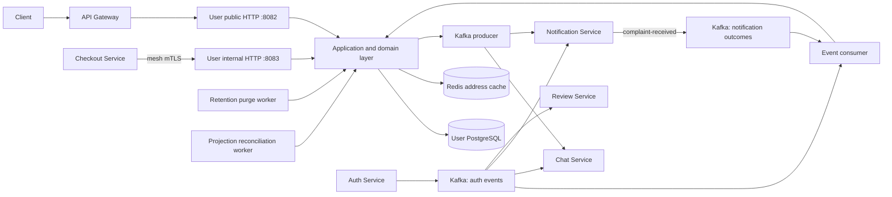

# User Service — Kiến trúc

> Cấu trúc dưới đây khớp `go/services/user-service` (một binary, bốn thành phần bật/tắt
> riêng bằng config). Phụ thuộc đi `api → domain ← infrastructure`.

## 1. Bối cảnh kiến trúc

User nằm sau API Gateway đối với request đồng bộ. Auth là upstream bất đồng bộ
cho bootstrap và xóa account; Notification là upstream bất đồng bộ cho tín hiệu
complaint. PostgreSQL là system of record; Redis chỉ tăng tốc
đọc danh sách address. Chat và Notification nhận event User để tự duy trì
projection; User, Chat, Notification và Review nhận tín hiệu xóa trực tiếp từ
Auth. Checkout gọi internal HTTP trên listener riêng (`:8083`) để
resolve address snapshot sau khi user chọn address, thay vì đọc database User; mTLS
và việc cho phép principal `checkout-service` do service mesh thực thi.

## 2. Thành phần và trách nhiệm

| Thành phần | Trách nhiệm | Không được làm | Phụ thuộc |
|---|---|---|---|
| HTTP adapter | Nhận public request qua Gateway (`:8082`) và Checkout internal request (`:8083`, allowlist `X-Service-Identity` sau mesh), ánh xạ error | Chứa rule nghiệp vụ, tin `user_id` từ client, hoặc tự kết thúc TLS | Application layer |
| Application/domain layer | Validate rule, ownership, transaction và điều phối side effect | Phụ thuộc HTTP/Kafka framework | Repository, cache, publisher |
| Profile/address/preferences repository | Persist data User sở hữu | Đọc/ghi database service khác | PostgreSQL |
| Address cache adapter | Đọc cache-aside và invalidation sau commit | Là nguồn chân lý cho address | Redis |
| Event consumer | Một consumer group `user-service` đọc `t.auth.events` (verification/deletion) và `t.notification.outcomes.v1` (chỉ complaint-received), gọi command idempotent; lỗi vào DLQ của topic nguồn | Thay đổi state ngoài application layer, redrive DLQ tự động | Kafka, application layer |
| User-event producer | Phát profile/preferences event theo contract | Tự thay đổi transaction data hoặc republish account deletion | Kafka |
| Retention purge worker | Tìm retention record đến hạn, hard delete an toàn | Hard delete trước deadline hoặc bỏ qua observability | PostgreSQL, application layer |
| Projection reconciliation worker | Quét current state active và phát corrective snapshot cho projection | Phát `USER_DELETED`, đọc log PII hoặc tạo outbox/checkpoint mới | PostgreSQL, Kafka publisher |

## 3. Mô hình xử lý

Profile, address và preferences được xử lý synchronous, mỗi command ghi trong
một PostgreSQL transaction. Address cache bị invalidated sau commit; cache lỗi
không được rollback transaction. Read address dùng cache-aside và fallback DB.

Consumer xử lý `USER_VERIFIED_SUCCESS`, `USER_DELETED` và `complaint-received` bất đồng
bộ, phải idempotent theo business key (`user_id`). Retention purge chạy mỗi giờ theo
UTC; projection reconciliation chạy hằng ngày ngoài giờ và chỉ phát current
snapshot của profile/preferences active. Thiết kế phát User event trực tiếp sau
commit, không outbox; reconciliation là cơ chế hội tụ cho cửa sổ mất event khi
Kafka publish thất bại — xem [ADR-004](./decisions/ADR-004-direct-event-publication.md)
và [ADR-007](./decisions/ADR-007-projection-reconciliation-without-outbox.md).

## 4. Tính nhất quán và đồng thời

Profile, preferences, ownership và default address cần strong consistency trong
PostgreSQL. Partial unique constraint cho default address là safety net; mọi mutation
address (và anonymization) serialize các address của cùng user bằng advisory lock theo
user, chi tiết ở [Data §5](./data.md). Hai mutation cache liên tiếp có thể chỉ tạo nhiều
`DEL`, điều này an toàn; một fill đọc trước mutation bị epoch từ chối ([ADR-011](./decisions/ADR-011-address-cache-invalidation-epoch.md)).

Projection downstream, cache refresh và Kafka delivery là eventual consistency.
Address cache được phép stale từ lúc commit đến invalidation; khi
Redis unavailable, đọc trực tiếp DB và mutation vẫn hoàn tất. Consumer trùng
phải không tạo duplicate profile/retention record hay phát side effect vô hạn.
Consumer profile/preference bỏ qua snapshot `updated_at` cũ hơn; consumer
deletion xem `USER_DELETED` là terminal.

## 5. Mô hình triển khai

Một binary gồm public API, internal API, Kafka consumer, retention purge worker và
projection reconciliation worker; mỗi thành phần bật/tắt bằng config
(`app.api_enabled`, `internal.enabled`, `kafka.consumer_enabled`, `workers.*.enabled`)
nên cùng image nhưng scale độc lập về vận hành. API scale theo RPS/DB pool; consumer theo partition và lag, đồng thời giữ
ordering theo `user_id`; purge worker claim row để không hard-delete cùng record
hai lần; reconciliation chỉ có một run active để tránh full sweep trùng.
PostgreSQL, Redis và Kafka là runtime dependency.

## 6. Ràng buộc kiến trúc

- Không truy cập trực tiếp database của Auth, Order, Chat, Notification hay Review.
- Không đặt PII không cần thiết trong Kafka event hoặc log.
- Không publish event trước khi transaction data commit.
- Cache không thay thế PostgreSQL và cache failure không làm mất address mutation đã commit.
- Consumer/worker phải idempotent, có retry/DLQ và observable trước khi production.
- Adapter không chứa business rule; domain/application layer không phụ thuộc transport.

## 7. Đánh đổi và quyết định

Các đánh đổi được quản lý tại [Decision index](./decisions/README.md): bootstrap
bằng Auth event, cache-aside cho address và epoch chống refill muộn, invariant default
address, GDPR retention và việc account đã xóa vô hình với owner, reliability của direct
event publishing/reconciliation, xác thực cổng internal qua mesh, và marketing opt-in cùng
complaint opt-out. ADR-001 đến ADR-012 đều `accepted` và đã có code.
