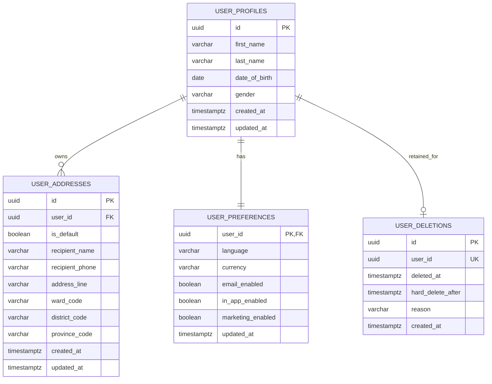

# User Service — Thiết kế dữ liệu

> Đây là logical data design cho PostgreSQL schema `"user"`. Chưa tạo
> migration/schema machine-readable; chỉ tạo sau khi thiết kế này được chốt.

## 1. Quyền sở hữu dữ liệu

| Kho lưu trữ | Dữ liệu | Nguồn chân lý |
|---|---|---|
| PostgreSQL schema `"user"` | `user_profiles`, `user_addresses`, `user_preferences`, `user_deletions` | User Service |
| Redis | Danh sách address serialized theo user với TTL | PostgreSQL |
| Kafka `t.auth.events` | Identity input | Auth Service, không phải bản sao User |
| Kafka `t.user.events` | Integration event | Không phải database nguồn |

Email, password, role, account state và phone liên hệ chung không thuộc schema
User. User không giữ address của đơn hàng sau checkout; Order sở hữu snapshot
province/district/ward riêng.

## 2. Mô hình dữ liệu logic

`user_deletions` là retention/event-store record không cần `status` hoặc foreign
key tới profile: một row tồn tại nghĩa là profile đã anonymize và đang chờ purge.
Consumer idempotently kiểm tra/tạo row theo unique `user_id`; worker chỉ xử lý row
đến hạn rồi xóa profile và record một cách tường minh.

## 3. Nguồn schema và quy tắc field

Schema hiện chỉ được mô tả trong tài liệu; cần tạo migration trước khi đánh dấu
`implemented`. SQL phải tạo và luôn quote schema `"user"`. UUID do application
sinh cho mọi record; riêng `user_profiles.id` là UUID từ Auth event, không có DB
default. Timestamp dùng UTC `TIMESTAMPTZ`.

`gender` được giới hạn `MALE`, `FEMALE`, `OTHER`, `UNKNOWN`; `date_of_birth`, nếu
có, không được ở tương lai. `language` chỉ là `vi`, `currency` chỉ là `VND`; ba
notification flag mặc định `true`. `recipient_phone` là bắt buộc và được chuẩn hóa
E.164; profile không có phone number. Address chỉ phục vụ Việt Nam nên không lưu
`country_code`.

### `"user".user_profiles`

| Field | Kiểu/ràng buộc | Quy tắc |
|---|---|---|
| `id` | `UUID` PK, không default | Chính là `user_id` từ Auth; application truyền vào khi bootstrap. |
| `first_name`, `last_name` | `VARCHAR(100)`, nullable | Cho phép profile rỗng lúc bootstrap; `sender_name` cho Chat được suy ra khi phát event. |
| `date_of_birth` | `DATE`, nullable | Application từ chối ngày ở tương lai. |
| `gender` | `VARCHAR(10)` not null, default `UNKNOWN` | Check: `MALE`, `FEMALE`, `OTHER`, `UNKNOWN`. |
| `created_at`, `updated_at` | `TIMESTAMPTZ` not null, default `NOW()` | Trigger chỉ cập nhật `updated_at`. |

### `"user".user_addresses`

| Field | Kiểu/ràng buộc | Quy tắc |
|---|---|---|
| `id` | `UUID` PK, không default | Application sinh UUID. |
| `user_id` | `UUID` not null, FK → `user_profiles(id)` | `ON DELETE CASCADE` là safety net khi purge profile. |
| `is_default` | `BOOLEAN` not null, default `false` | Partial unique index bảo đảm tối đa một address default. |
| `recipient_name` | `VARCHAR(200)` not null | Người nhận của riêng address này. |
| `recipient_phone` | `VARCHAR(16)` not null | E.164, check `^\+[1-9][0-9]{7,14}$`. |
| `address_line` | `VARCHAR(500)` not null | Số nhà, đường, tòa nhà và chi tiết giao hàng. |
| `province_code`, `district_code`, `ward_code` | `VARCHAR(20)` not null | Mã địa giới Việt Nam dùng chung với Checkout, Order và Inventory. |
| `created_at`, `updated_at` | `TIMESTAMPTZ` not null, default `NOW()` | Trigger chỉ cập nhật `updated_at`. |

### `"user".user_preferences`

| Field | Kiểu/ràng buộc | Quy tắc |
|---|---|---|
| `user_id` | `UUID` PK, FK → `user_profiles(id)` | Quan hệ đúng một preferences/profile; `ON DELETE CASCADE`. |
| `language` | `VARCHAR(10)` not null, default `vi` | Check chỉ nhận `vi`. |
| `currency` | `VARCHAR(3)` not null, default `VND` | Check chỉ nhận `VND`. |
| `email_enabled`, `in_app_enabled`, `marketing_enabled` | `BOOLEAN` not null, default `true` | Ba field duy nhất được Notification replicate. |
| `updated_at` | `TIMESTAMPTZ` not null, default `NOW()` | Trigger chỉ cập nhật khi preference thay đổi. |

### `"user".user_deletions`

| Field | Kiểu/ràng buộc | Quy tắc |
|---|---|---|
| `id` | `UUID` PK, không default | Application sinh UUID. |
| `user_id` | `UUID` not null, unique, không FK | Business-key idempotency; record vẫn độc lập trong lúc profile bị purge. |
| `deleted_at`, `hard_delete_after` | `TIMESTAMPTZ` not null | Giá trị nhận từ Auth; check `hard_delete_after > deleted_at`, không tự tính lại deadline. |
| `reason` | `VARCHAR(50)` not null | Check: `GDPR_REQUEST`, `ADMIN_DELETION`, đồng nhất Auth. |
| `created_at` | `TIMESTAMPTZ` not null, default `NOW()` | Thời điểm User ghi nhận deletion. |

## 4. Ràng buộc và chỉ mục

| Constraint/index | Mục đích |
|---|---|
| `user_profiles.id` PK | Ánh xạ 1:1 với `Auth account_id`/`user_id` |
| `user_addresses.user_id` FK/index | Ownership và liệt kê address theo user; `ON DELETE CASCADE` là safety net |
| Partial unique `(user_id) WHERE is_default` | Tối đa một default address |
| Index address `(user_id, is_default DESC, created_at DESC)` | Đọc address book theo thứ tự checkout |
| `user_preferences.user_id` PK/FK | Chính xác một preferences cho profile |
| Unique/index `user_deletions.user_id` | Deduplicate deletion input |
| Index `user_deletions.hard_delete_after` | Worker lấy batch profile đã đến hạn purge; B-tree thường, không dùng predicate `NOW()` |

Check constraint cho enum/format và trigger `updated_at` phải được tạo trong
migration. Rule “không xóa address đang là default” cần application authorization/
validation; partial unique index chỉ bảo vệ invariant tối đa một default.

## 5. Ranh giới transaction và xử lý đồng thời

Tạo address đầu tiên và set default phải update các address liên quan trong cùng
transaction. Address đang default bị từ chối xóa; owner phải set default khác
trước. Profile update và event source state commit trước khi publish event.
Anonymization transaction tạo deletion record, scrub profile và xóa
address/preferences cùng lúc.

Migration phải chọn isolation/row locking hoặc optimistic concurrency đủ để hai
request set-default đồng thời không vi phạm invariant. Compliance worker phải
claim/lock row khi xử lý batch. Chi tiết mechanism chưa được xác minh.

## 6. Bộ đệm

| Item | Thiết kế |
|---|---|
| Key | `user:caches:addresses:{user_id}` |
| Value | JSON list address theo thứ tự default trước, mới hơn sau |
| Nguồn chân lý | PostgreSQL `user_addresses` |
| Normal TTL | 12 giờ (`43200` giây) |
| Empty-list TTL | 15–30 phút; chọn một giá trị cụ thể khi implement |
| Đọc | Cache-aside: GET, miss thì query DB, SET TTL |
| Write | Commit DB trước; sau đó `DEL` key cho create/update/delete/set-default |
| Stampede | Chưa có single-flight/lock được chốt; cần bổ sung nếu miss đồng thời là rủi ro thực tế |
| Redis unavailable | Bypass cache khi read; không rollback DB mutation |

Profile và preferences không cache theo thiết kế mục tiêu. Cache có thể stale cho
đến khi invalidation hoàn tất hoặc TTL hết hạn; nó không được dùng cho quyết định
ghi/authorization.

## 7. Kho lưu inbox/outbox và idempotency

Thiết kế không dùng outbox, inbox hay bảng deduplication theo event ID. Bootstrap
dùng unique PK/FK và deletion dùng unique `user_deletions.user_id` làm business-key
idempotency tối thiểu; duplicate event cùng user trở thành no-op. Direct publisher
sau commit không bảo đảm atomic DB+Kafka; xem ADR-004.

## 8. Vòng đời dữ liệu, bảo mật và quyền riêng tư

Address hard-delete ngay khi owner xóa; Order đã có snapshot đầy đủ. `USER_DELETED`
anonymize PII ngay, xóa address/preferences và lưu nguyên `hard_delete_after` do
Auth phát; worker hard-delete profile cùng deletion record khi đến hạn. Backup/
restore, reconciliation, masking log, access control và encryption at rest/in
transit là yêu cầu vận hành phải được cụ thể hóa trước production.

Profile name, date of birth, gender, recipient phone và address là PII. Không log
raw address/phone hay đưa chúng vào event nếu downstream không cần; DB access phải
tuân thủ least privilege.
