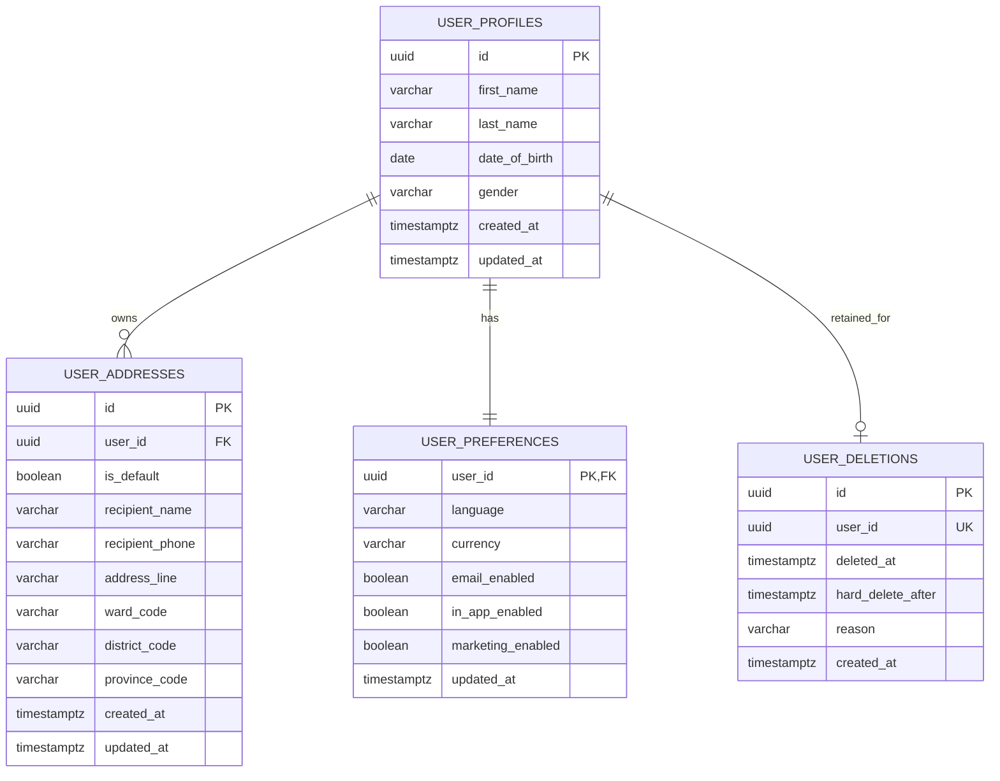

# User Service — Thiết kế dữ liệu

> Data design cho PostgreSQL schema `"user"`. Nguồn chuẩn của DDL là
> `go/services/user-service/migrations` (`0001` tạo schema, `0002` đổi mặc định
> marketing); tài liệu này giải thích ý nghĩa và phải khớp với migration.

## 1. Quyền sở hữu dữ liệu

| Kho lưu trữ | Dữ liệu | Nguồn chân lý |
|---|---|---|
| PostgreSQL schema `"user"` | `user_profiles`, `user_addresses`, `user_preferences`, `user_deletions` | User Service |
| Redis | Danh sách address serialized theo user với TTL, và bộ đếm epoch của nó | PostgreSQL |
| Kafka `t.auth.events` | Identity input | Auth Service, không phải bản sao User |
| Kafka `t.notification.outcomes.v1` | Tín hiệu `complaint-received` | Notification Service, không phải bản sao User |
| Kafka `t.user.events` | Integration event | Không phải database nguồn |

Email, password, role, account state và phone liên hệ chung không thuộc schema
User. User không giữ address của đơn hàng sau checkout; Order sở hữu snapshot
province/district/ward riêng.

## 2. Mô hình dữ liệu logic

`user_deletions` là retention/event-store record không cần `status` hoặc foreign
key tới profile: một row tồn tại nghĩa là profile đã anonymize và đang chờ purge.
Consumer idempotently kiểm tra/tạo row theo unique `user_id`; worker chỉ xử lý row
đến hạn rồi xóa profile và record một cách tường minh.

## 3. Nguồn schema và quy tắc field

Schema do migration `go/services/user-service/migrations` tạo; SQL luôn quote schema
`"user"` vì đó là từ khóa dành riêng. UUID do application sinh cho mọi record; riêng
`user_profiles.id` là UUID từ Auth event, không có DB default. Timestamp dùng UTC
`TIMESTAMPTZ`.

`gender` được giới hạn `MALE`, `FEMALE`, `OTHER`, `UNKNOWN`; `date_of_birth`, nếu
có, không được ở tương lai (application kiểm tra, vì `CURRENT_DATE` không dùng được
trong `CHECK`). `language` chỉ là `vi`, `currency` chỉ là `VND`. Ba notification flag:
`email_enabled` và `in_app_enabled` mặc định `true`, `marketing_enabled` mặc định
**`false`** (opt-in, [ADR-009](./decisions/ADR-009-marketing-opt-in-and-complaint-opt-out.md));
application luôn ghi giá trị tường minh lúc bootstrap. `recipient_phone` là bắt buộc và
được chuẩn hóa E.164; profile không có phone number. Address chỉ phục vụ Việt Nam nên
không lưu `country_code`. Mỗi profile giữ tối đa 50 address: ràng buộc này do
application kiểm tra (`constants.AddressBookLimit`), không có trong DDL.

### `"user".user_profiles`

| Field | Kiểu/ràng buộc | Quy tắc |
|---|---|---|
| `id` | `UUID` PK, không default | Chính là `user_id` từ Auth; application truyền vào khi bootstrap. |
| `first_name`, `last_name` | `VARCHAR(100)`, nullable | Cho phép profile rỗng lúc bootstrap; check `btrim(...) <> ''` nên tên rỗng được lưu là `NULL`; `sender_name` cho Chat được suy ra khi phát event. |
| `date_of_birth` | `DATE`, nullable | Application từ chối ngày ở tương lai. |
| `gender` | `VARCHAR(10)` not null, default `UNKNOWN` | Check: `MALE`, `FEMALE`, `OTHER`, `UNKNOWN`. |
| `created_at`, `updated_at` | `TIMESTAMPTZ` not null, default `NOW()` | Trigger chỉ cập nhật `updated_at`. |

### `"user".user_addresses`

| Field | Kiểu/ràng buộc | Quy tắc |
|---|---|---|
| `id` | `UUID` PK, không default | Application sinh UUID. |
| `user_id` | `UUID` not null, FK → `user_profiles(id)` | `ON DELETE CASCADE` là safety net khi purge profile. |
| `is_default` | `BOOLEAN` not null, default `false` | Partial unique index bảo đảm tối đa một address default. |
| `recipient_name` | `VARCHAR(200)` not null | Người nhận của riêng address này. |
| `recipient_phone` | `VARCHAR(16)` not null | E.164, check `^\+[1-9][0-9]{7,14}$`. |
| `address_line` | `VARCHAR(500)` not null | Số nhà, đường, tòa nhà và chi tiết giao hàng. |
| `province_code`, `district_code`, `ward_code` | `VARCHAR(20)` not null | Mã địa giới Việt Nam dùng chung với Checkout, Order và Inventory. |
| `created_at`, `updated_at` | `TIMESTAMPTZ` not null, default `NOW()` | Trigger chỉ cập nhật `updated_at`. |

### `"user".user_preferences`

| Field | Kiểu/ràng buộc | Quy tắc |
|---|---|---|
| `user_id` | `UUID` PK, FK → `user_profiles(id)` | Quan hệ đúng một preferences/profile; `ON DELETE CASCADE`. |
| `language` | `VARCHAR(10)` not null, default `vi` | Check chỉ nhận `vi`. |
| `currency` | `VARCHAR(3)` not null, default `VND` | Check chỉ nhận `VND`. |
| `email_enabled`, `in_app_enabled` | `BOOLEAN` not null, default `true` | Mặc định bật: chặn email xác nhận đơn của user mới là lỗi rõ ràng hơn gửi nhầm (cùng quyết định với [Notification 08](../notification/08-decide.md) §5). |
| `marketing_enabled` | `BOOLEAN` not null, default `false` | Opt-in. Trùng mặc định của Notification khi chưa có row. Migration `0002` đổi default từ `true` và backfill các row owner chưa từng chạm (`updated_at = user_profiles.created_at`). |
| `updated_at` | `TIMESTAMPTZ` not null, default `NOW()` | Trigger chỉ cập nhật khi một trong ba cờ thay đổi, nên PUT cùng body không làm consumer tưởng có snapshot mới. |

Ba cờ là các field duy nhất Notification replicate.

### `"user".user_deletions`

| Field | Kiểu/ràng buộc | Quy tắc |
|---|---|---|
| `id` | `UUID` PK, không default | Application sinh UUID. |
| `user_id` | `UUID` not null, unique, không FK | Business-key idempotency; record vẫn độc lập trong lúc profile bị purge. |
| `deleted_at`, `hard_delete_after` | `TIMESTAMPTZ` not null | Giá trị nhận từ Auth; check `hard_delete_after > deleted_at`, không tự tính lại deadline. |
| `reason` | `VARCHAR(50)` not null | Check: `GDPR_REQUEST`, `ADMIN_DELETION`, đồng nhất Auth. |
| `created_at` | `TIMESTAMPTZ` not null, default `NOW()` | Thời điểm User ghi nhận deletion. |

## 4. Ràng buộc và chỉ mục

| Constraint/index | Mục đích |
|---|---|
| `user_profiles.id` PK | Ánh xạ 1:1 với `Auth account_id`/`user_id` |
| `user_addresses.user_id` FK/index | Ownership và liệt kê address theo user; `ON DELETE CASCADE` là safety net |
| Partial unique `uq_user_addresses_one_default (user_id) WHERE is_default` | Tối đa một default address |
| Index `idx_user_addresses_book (user_id, is_default DESC, created_at DESC)` | Đọc address book theo thứ tự checkout |
| `user_preferences.user_id` PK/FK | Chính xác một preferences cho profile |
| `uq_user_deletions_user_id` | Deduplicate deletion input; cũng là chỉ mục cho `NOT EXISTS` của `GetActive` |
| Index `idx_user_deletions_hard_delete_after` | Worker lấy batch profile đã đến hạn purge; B-tree thường, không dùng predicate `NOW()` |

Check constraint cho enum/format (`chk_user_profiles_*`, `chk_user_addresses_*`,
`chk_user_preferences_*`, `chk_user_deletions_*`) và trigger `updated_at` nằm trong
migration `0001`. Rule “không xóa address đang là default khi còn address khác” và giới
hạn 50 address do application kiểm tra; partial unique index chỉ bảo vệ invariant tối
đa một default.

## 5. Ranh giới transaction và xử lý đồng thời

Tạo address đầu tiên và set default update các address liên quan trong cùng
transaction. Address đang default bị từ chối xóa khi còn address khác; owner phải set
default khác trước (address duy nhất còn lại xóa được). Profile update và event source
state commit trước khi publish event. Anonymization transaction tạo deletion record,
scrub profile và xóa address/preferences cùng lúc.

Cơ chế (isolation mặc định `READ COMMITTED`):

- Mọi mutation address, và cả anonymization, mở đầu bằng `pg_advisory_xact_lock` theo
  user (`LockUser`). Row lock không đủ vì hai request tạo address đầu tiên cùng thấy
  address book rỗng và không có row nào để khoá; advisory lock bao cả trường hợp rỗng.
  Số address (giới hạn 50, quyết định xóa default) được đếm dưới khoá này.
- `PATCH /profile` khoá row profile bằng `FOR UPDATE` rồi kiểm retention record bằng
  câu lệnh riêng, nên tuần tự hóa với anonymization ([ADR-010](./decisions/ADR-010-deleted-account-invisible-to-owner.md)).
- `PUT /preferences` đọc rồi ghi cả ba cờ, không khoá: hai PUT đồng thời là last-writer-wins
  trên toàn bộ body. Tắt marketing do complaint là một `UPDATE ... WHERE marketing_enabled`
  nguyên tử nên không ghi đè cờ email/in-app.
- Compliance worker claim từng row bằng `FOR UPDATE SKIP LOCKED`, mỗi row một transaction.

## 6. Bộ đệm

| Item | Thiết kế |
|---|---|
| Key | `user:caches:addresses:{user_id}` |
| Value | JSON `{"version":1,"addresses":[...]}` theo thứ tự default trước, mới hơn sau; version khác bị coi là miss |
| Epoch key | `user:caches:addresses-epoch:{user_id}`: bộ đếm tăng sau mỗi invalidation, TTL bằng TTL của list ([ADR-011](./decisions/ADR-011-address-cache-invalidation-epoch.md)) |
| Nguồn chân lý | PostgreSQL `user_addresses` |
| Normal TTL | 12 giờ (`cache.address_ttl`) |
| Empty-list TTL | 15 phút (`cache.address_empty_ttl`), không bao giờ dài hơn TTL thường |
| Đọc | Cache-aside: GET; miss thì đọc epoch, query DB, rồi fill có điều kiện (Lua) chỉ khi epoch chưa đổi. List rỗng chỉ được cache khi profile còn active |
| Write | Commit DB trước; sau đó script Lua `INCR` epoch và `DEL` key cho create/update/delete/set-default và sau anonymization |
| Stampede | Chưa có single-flight/lock; epoch chỉ chặn fill muộn, không chặn nhiều request cùng miss |
| Redis unavailable | Bypass cache khi read (không đọc được epoch thì không fill); không rollback DB mutation |

Profile và preferences không cache. Cache có thể stale giữa commit và lúc invalidation
chạy, hoặc tới hết TTL nếu invalidation thất bại; nó không còn giữ danh sách cũ sau một
invalidation thành công. Nó không được dùng cho quyết định ghi/authorization: snapshot
nội bộ cho Checkout luôn đọc PostgreSQL.

## 7. Kho lưu inbox/outbox và idempotency

Thiết kế không dùng outbox, inbox hay bảng deduplication theo event ID. Bootstrap
dùng unique PK/FK và deletion dùng unique `user_deletions.user_id` làm business-key
idempotency tối thiểu; duplicate event cùng user trở thành no-op. `complaint-received`
idempotent nhờ điều kiện `WHERE marketing_enabled` của câu UPDATE. Direct publisher
sau commit không bảo đảm atomic DB+Kafka; xem ADR-004.

## 8. Vòng đời dữ liệu, bảo mật và quyền riêng tư

Address hard-delete ngay khi owner xóa; Order đã có snapshot đầy đủ. `USER_DELETED`
anonymize PII ngay, xóa address/preferences và lưu nguyên `hard_delete_after` do
Auth phát; worker hard-delete profile cùng deletion record khi đến hạn. Backup/
restore, reconciliation, masking log, access control và encryption at rest/in
transit là yêu cầu vận hành phải được cụ thể hóa trước production.

Profile name, date of birth, gender, recipient phone và address là PII. Không log
raw address/phone hay đưa chúng vào event nếu downstream không cần; DB access phải
tuân thủ least privilege.
