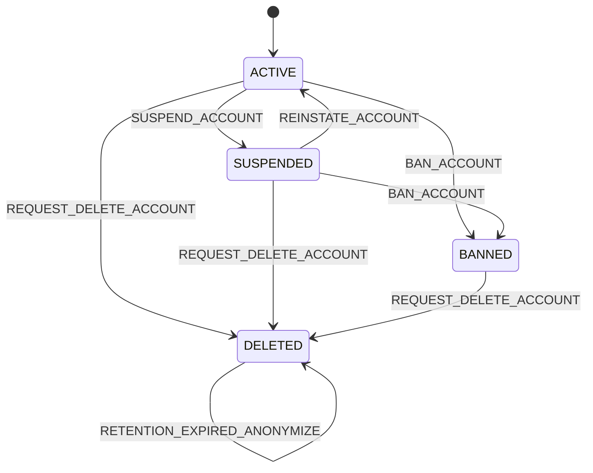
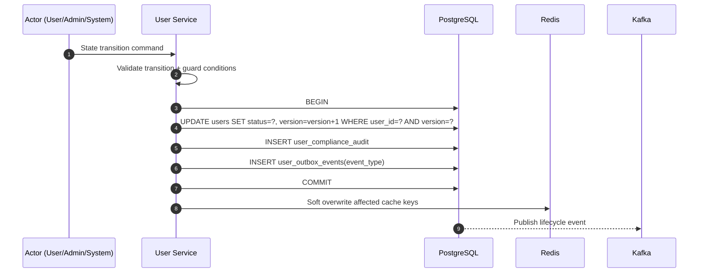

# User Service - State Machine and Lifecycle

**Liên kết nhanh (Related Documents):**
* [Workflows (API & Data Flow)](user_workflow.md)
* [Background Workers & Jobs](user_workers.md)
* [Caching Schema (Redis)](user_caching_schema.md)
* [Database Schema (Write Store)](user_db_design.md)
* [State Machine & Lifecycle](user_state_machine.md)
* [Events Structure & Kafka Topics](user_events.md)
* [Architecture Recommendations](user_architecture_recommendations.md)

---

Tài liệu này quy định vòng đời trạng thái account của User Service, cùng các guard conditions và post-actions bắt buộc.

## 1. Danh sách trạng thái

1. `ACTIVE`: Trạng thái hoạt động bình thường.
2. `SUSPENDED`: Tạm khóa theo moderation/compliance.
3. `BANNED`: Khoá mức nghiêm trọng.
4. `DELETED`: Tài khoản đã yêu cầu xoá (đang hoặc đã qua retention).

## 2. Bảng transitions

| Transition | Từ trạng thái | Sang trạng thái | Actor | Ghi chú |
|---|---|---|---|---|
| `SUSPEND_ACCOUNT` | ACTIVE | SUSPENDED | ADMIN/SYSTEM | Tạm khóa account |
| `REINSTATE_ACCOUNT` | SUSPENDED | ACTIVE | ADMIN | Mở khoá lại account |
| `BAN_ACCOUNT` | ACTIVE, SUSPENDED | BANNED | ADMIN/SYSTEM | Khoá nặng theo policy |
| `REQUEST_DELETE_ACCOUNT` | ACTIVE, SUSPENDED, BANNED | DELETED | USER/ADMIN/LEGAL | Bắt đầu retention lifecycle |
| `RETENTION_EXPIRED_ANONYMIZE` | DELETED | DELETED | SYSTEM | Không đổi state, đổi legal marker |

## 3. Guard conditions

1. Chỉ role hợp lệ mới được suspend/reinstate/ban.
2. Delete request phải kiểm tra legal hold trước khi cho phép.
3. Account đã BANNED không được quay lại ACTIVE nếu không qua privileged override process.
4. Mọi transition hợp lệ phải tăng `users.version`.

## 4. Post-actions bắt buộc

1. Ghi `user_compliance_audit` trong cùng transaction.
2. Ghi outbox event tương ứng (`ACCOUNT_BANNED`, `ACCOUNT_DELETED`, ...).
3. Overwrite cache keys liên quan (`user:profile:*`, `user:deletion_status:*`).
4. Trigger side effects ở downstream:
   - Auth revoke sessions.
   - Review anonymize author metadata.
   - Notification dừng luồng không phù hợp compliance.

## 5. UML state diagram

## 6. Sequence diagram: State transition chuẩn

