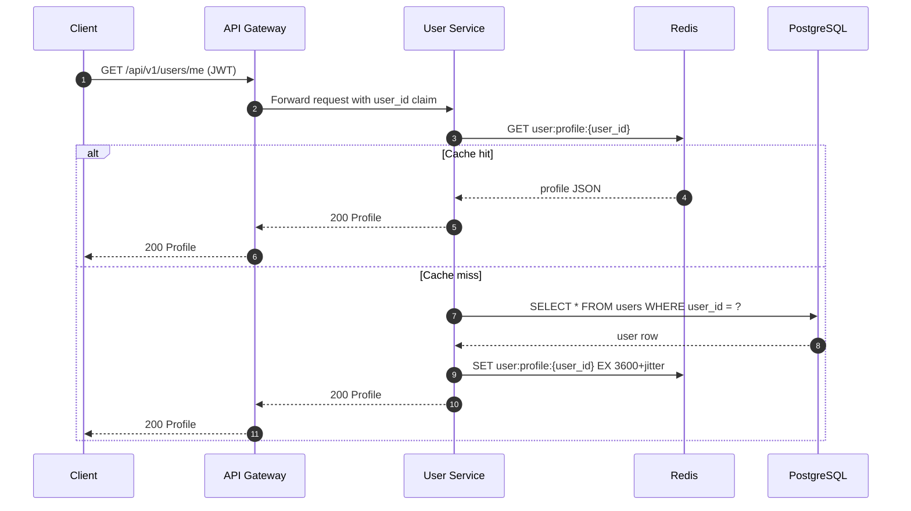
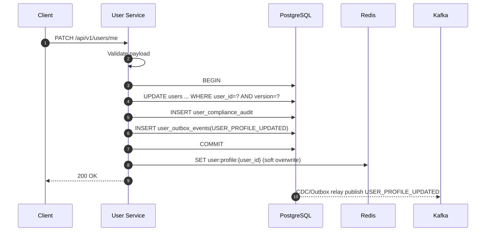
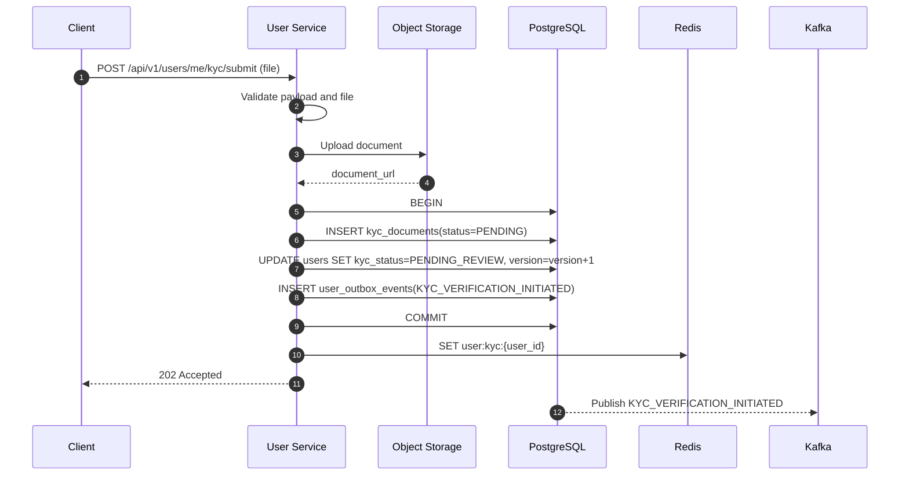
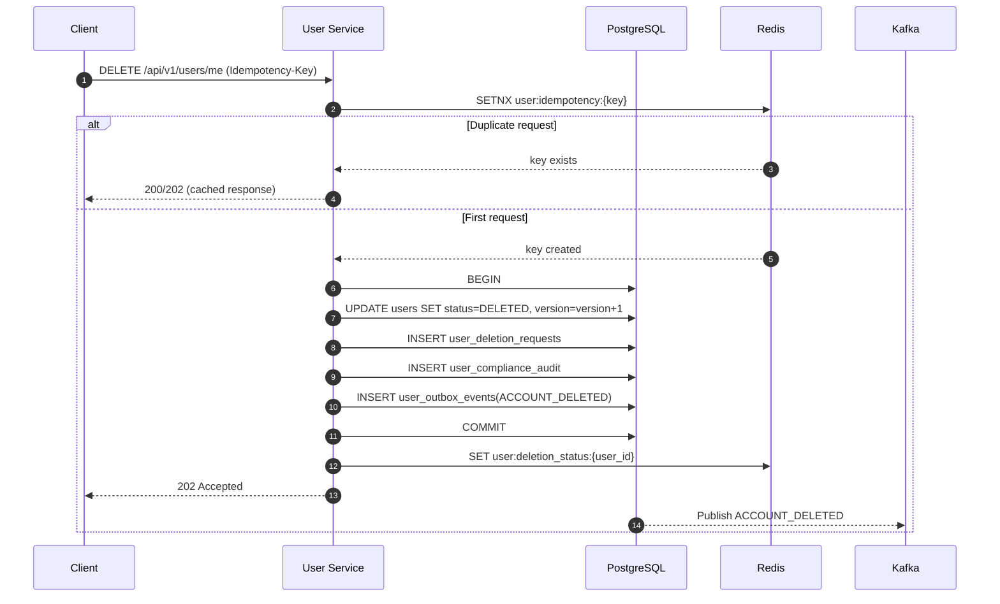
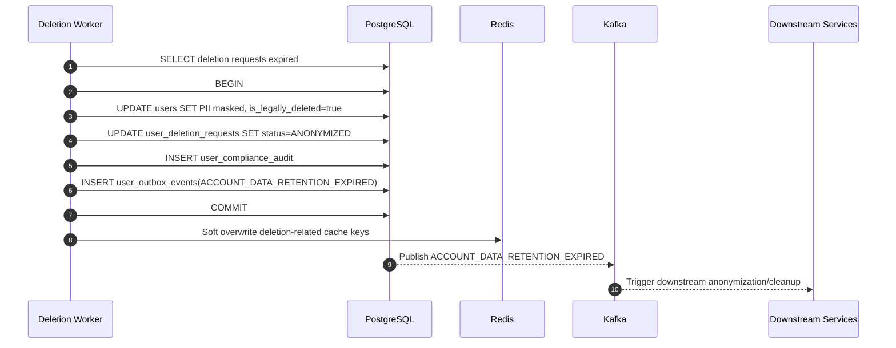

# User Service - Workflows (API and Data Flow)

**Liên kết nhanh (Related Documents):**
* [Workflows (API & Data Flow)](user_workflow.md)
* [Background Workers & Jobs](user_workers.md)
* [Caching Schema (Redis)](user_caching_schema.md)
* [Database Schema (Write Store)](user_db_design.md)
* [State Machine & Lifecycle](user_state_machine.md)
* [Events Structure & Kafka Topics](user_events.md)
* [Architecture Recommendations](user_architecture_recommendations.md)

---

Tài liệu này mô tả trình tự nghiệp vụ chi tiết cho các API chính của User Service, bao gồm cả luồng đồng bộ cache, database và Kafka events.

## 1. Gợi ý base path

`/api/v1/users/...`

## 2. Workflow quan trọng: GET profile (`GET /api/v1/users/me`)

### Các bước xử lý

1. API Gateway xác thực JWT và chuyển `user_id` vào request context.
2. User Service kiểm tra key cache `user:profile:{user_id}`.
3. Nếu cache hit, trả response ngay.
4. Nếu cache miss, service dùng singleflight để chỉ một luồng được phép truy vấn DB.
5. Service truy vấn bảng `users`, build payload, ghi lại cache, và trả response.

### Sequence diagram



## 3. Workflow quan trọng: PATCH profile (`PATCH /api/v1/users/me`)

### Các bước xử lý

1. Validate payload.
2. Mở transaction.
3. Cập nhật bảng `users` bằng optimistic lock (`version`).
4. Ghi `user_compliance_audit`.
5. Ghi `user_outbox_events` event `USER_PROFILE_UPDATED`.
6. Commit transaction.
7. Soft overwrite cache profile.
8. CDC/relay phát event ra Kafka.

### Sequence diagram



## 4. Workflow quan trọng: Submit KYC (`POST /api/v1/users/me/kyc/submit`)

### Các bước xử lý

1. Validate file và metadata.
2. Upload file vào object storage.
3. Mở transaction:
   - Insert `kyc_documents` status `PENDING`.
   - Update `users.kyc_status = PENDING_REVIEW`, tăng `version`.
   - Insert outbox `KYC_VERIFICATION_INITIATED`.
4. Commit.
5. Overwrite cache `user:kyc:{user_id}`.
6. Trả `202 Accepted`.

### Sequence diagram



## 5. Workflow quan trọng: Delete account (`DELETE /api/v1/users/me`)

### Các bước xử lý

1. Kiểm tra idempotency key (chống double submit).
2. Mở transaction:
   - Update `users.status = DELETED`, tăng `version`.
   - Insert `user_deletion_requests` với `retention_window_expires_at`.
   - Insert `user_compliance_audit`.
   - Insert outbox `ACCOUNT_DELETED`.
3. Commit.
4. Cập nhật `user:deletion_status:{user_id}`.
5. Trả `202 Accepted`.

### Sequence diagram



## 6. Workflow quan trọng: Retention expired anonymization (async)

### Các bước xử lý

1. Deletion retention worker quét `user_deletion_requests` đã hết hạn.
2. Mở transaction:
   - Anonymize các trường PII trong `users`.
   - Set `is_legally_deleted = true`.
   - Update trạng thái deletion request = `ANONYMIZED`.
   - Ghi audit.
   - Insert outbox `ACCOUNT_DATA_RETENTION_EXPIRED`.
3. Commit.
4. Worker self-heal cache.
5. Publish event để downstream hoàn tất cleanup.

### Sequence diagram



## 7. Internal gRPC workflow: `GetUsersByIds`

1. Validate danh sách IDs (size limit, dedup đầu vào).
2. MGET hàng loạt từ Redis.
3. Chỉ query DB cho nhóm cache miss.
4. Pipeline set cache cho các miss.
5. Trả kết quả theo đúng thứ tự input.

## 8. Error handling và resilience rules

1. Optimistic lock conflict trả `409 Conflict`, client có thể retry.
2. Redis lỗi tạm thời: fallback DB có rate limit/circuit breaker.
3. Event publish bị trễ không được block write path; giám sát qua outbox lag.
4. Duplicate request phải trả response idempotent, không tạo side effects lần hai.

## 9. REST contract schema mẫu

### 9.1 PATCH profile - Request

```json
{
    "display_name": "nguyen_van_a",
    "first_name": "Nguyen",
    "last_name": "Van A",
    "avatar_url": "https://cdn.example.com/u10001.jpg",
    "expected_version": 16
}
```

### 9.2 PATCH profile - Response

```json
{
    "user_id": "u-10001",
    "display_name": "nguyen_van_a",
    "status": "ACTIVE",
    "kyc_status": "APPROVED",
    "state_version": 17,
    "updated_at": "2026-03-31T09:00:00Z"
}
```

### 9.3 DELETE account - Response

```json
{
    "user_id": "u-10001",
    "status": "DELETED",
    "retention_window_expires_at": "2026-06-29T11:00:00Z",
    "deletion_request_id": "del-10001"
}
```

## 10. gRPC contract schema mẫu

```proto
syntax = "proto3";

service UserService {
    rpc GetUserProfile(GetUserProfileRequest) returns (GetUserProfileResponse);
    rpc GetUsersByIds(GetUsersByIdsRequest) returns (GetUsersByIdsResponse);
    rpc CheckUserKycStatus(CheckUserKycStatusRequest) returns (CheckUserKycStatusResponse);
}

message GetUserProfileRequest {
    string user_id = 1;
}

message GetUserProfileResponse {
    string user_id = 1;
    string display_name = 2;
    string status = 3;
    string kyc_status = 4;
    int64 state_version = 5;
    string updated_at = 6;
}

message GetUsersByIdsRequest {
    repeated string user_ids = 1;
}

message GetUsersByIdsResponse {
    repeated GetUserProfileResponse users = 1;
}

message CheckUserKycStatusRequest {
    string user_id = 1;
}

message CheckUserKycStatusResponse {
    string user_id = 1;
    string kyc_status = 2;
    string reviewed_at = 3;
}
```
