# User Service - Trình Tự Nghiệp Vụ (Workflows)

**Liên kết nhanh:**
*   [Workflows (API & Data Flow)](user_workflows.md)
*   [Caching Schema (Redis)](user_caching_schema.md)
*   [Database Schema](user_db_design.md)
*   [Events Structure & Kafka Topics](user_events.md)

---
Tài liệu này mô tả 9 luồng công việc (workflows) cốt lõi của User Service nhằm xử lý hồ sơ nhân khẩu học, khởi tạo dữ liệu sau đăng ký, quản lý sổ địa chỉ (với cache cho checkout), cài đặt cá nhân và cung cấp dữ liệu cho các hệ sinh thái khác (Order, Chat, Notification).

---

## 1. Luồng Khởi Tạo Hồ Sơ (Event-Driven Profile Creation)

Như đã phân tích, hệ thống tách biệt Auth Service và User Service. Khi Auth xử lý thành công bước đăng ký, Auth đẩy thông điệp sang Kafka và User Service sẽ dùng Worker để tạo vỏ hồ sơ.

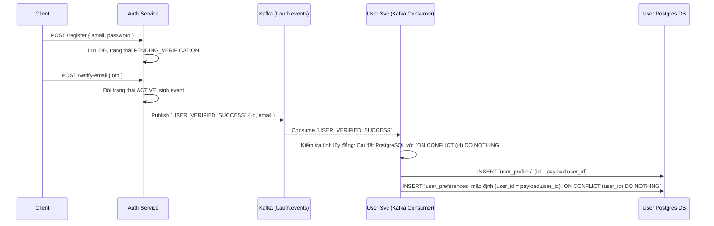

**Nguyên tắc xử lý:**
* Luồng này đảm bảo độ phản hồi API `/verify-email` phía Auth cực nhanh vì không phải đợi User Service Insert.
* Nếu User Service bị down (sập), thư Kafka `USER_VERIFIED_SUCCESS` vẫn nằm chờ. Khi User Service hồi sinh (restart), nó đọc tiếp thông điệp và bổ khuyết Data.
* Tính lũy đẳng (Idempotency) được đảm bảo qua `ON CONFLICT DO NOTHING` - đảm bảo worker chạy lại nhiều lần vẫn không tạo duplicate.

---

## 2. Luồng Quản Lý Sổ Địa Chỉ - CRUD Operations (Address Management)

Order Service yêu cầu dữ liệu Snapshot, nên User Service áp dụng **Hard Delete** (xóa thẳng từ CSDL) nhằm nhẹ gánh cho Database. Danh sách địa chỉ được cache với Redis để tối ưu hiệu năng cho luồng Checkout.

### 2.1. Luồng Thêm Địa Chỉ Mới (Create Address)

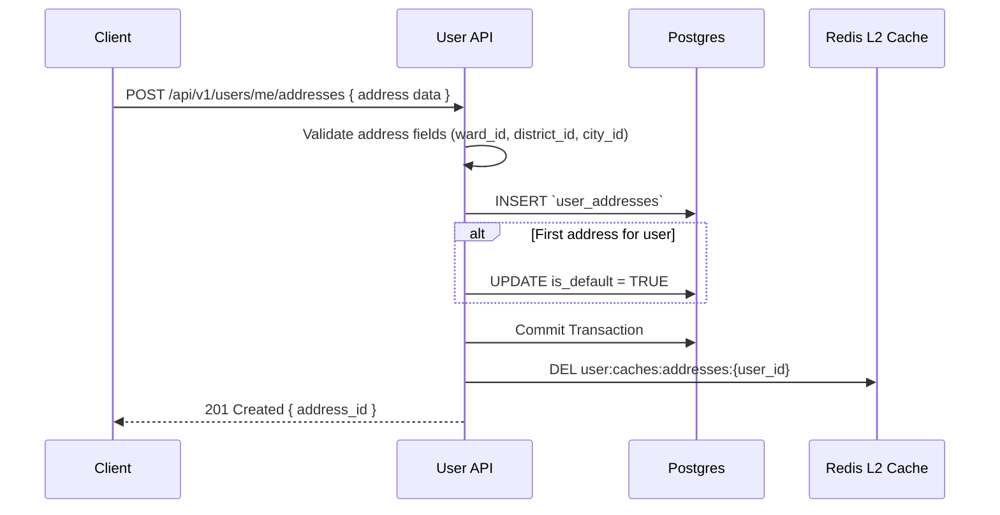

**Nguyên tắc xử lý:**
* Nếu đây là địa chỉ đầu tiên của user, tự động set `is_default = TRUE`.
* Sau khi insert thành công, xóa cache Redis để đảm bảo consistency.

### 2.2. Luồng Cập Nhật Địa Chỉ (Update Address)

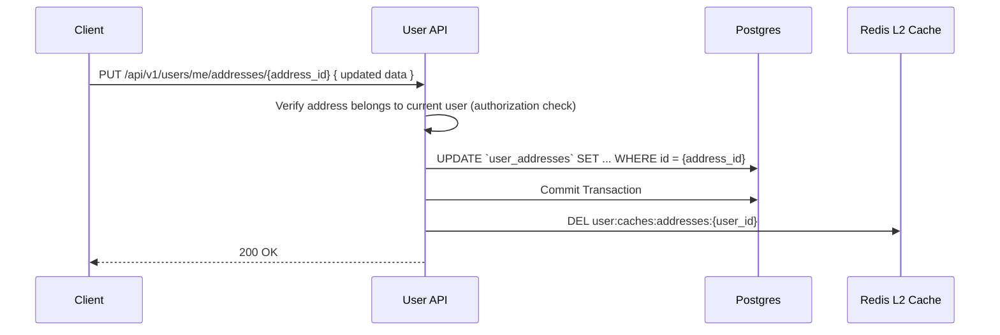

**Lưu ý bảo mật:**
* Kiểm tra `user_id` sở hữu address trước khi update để tránh hack sang address người khác.

### 2.3. Luồng Set Default (Address Rotation)

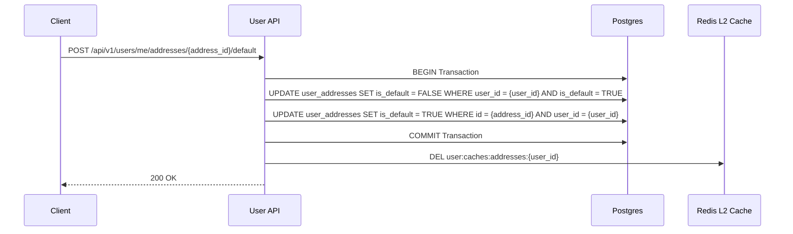

**Nguyên tắc xử lý:**
* Sử dụng Database Transaction để đảm bảo atomicity - không thể có 2 địa chỉ default cùng lúc.
* Partial Unique Index `idx_unique_default_address` trên `user_addresses` đảm bảo ràng buộc ở cấp database.

### 2.4. Luồng Xóa Địa Chỉ - Hard Delete

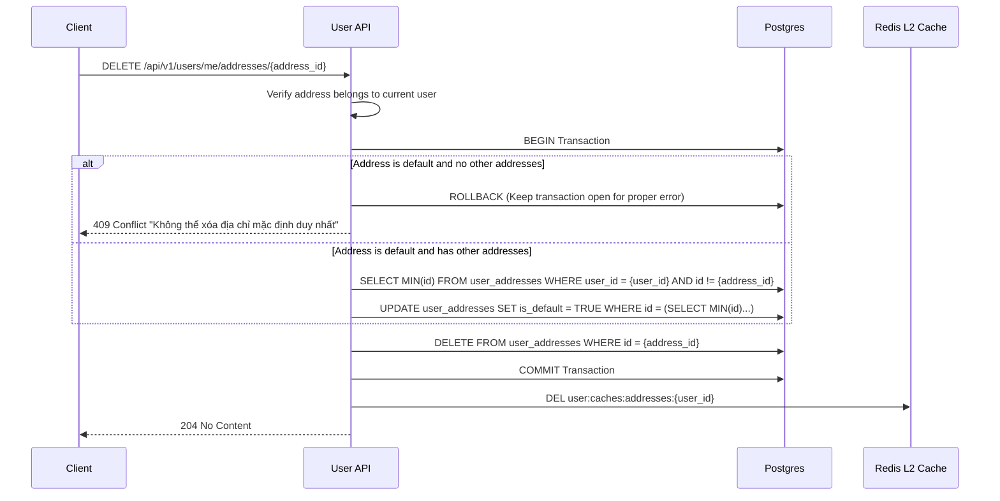

**Quy tắc nghiệp vụ:**
* Không cho phép xóa địa chỉ mặc định duy nhất.
* Nếu xóa địa chỉ default và còn địa chỉ khác, tự động promote địa chỉ khác thành default.
* Áp dụng Hard Delete để nhẹ gánh Database (Order Service đã snapshot vào bảng `orders`).

### 2.5. Luồng Đọc Danh Sách Địa Chỉ với L2 Cache (Read Addresses for Checkout)

Danh sách địa chỉ là dữ liệu được truy cập thường xuyên (Checkout page), nên được cache với chiến lược Cache-Aside.

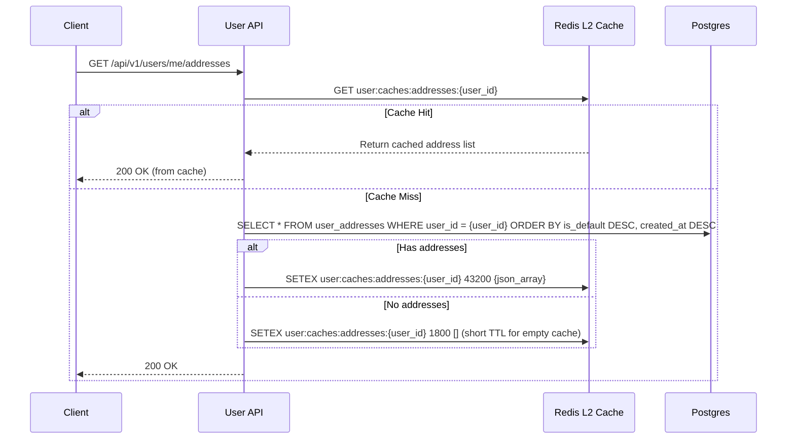

**Cache Key Pattern:**
* `user:caches:addresses:{user_id}` với TTL 12 giờ (43200 seconds)

**Cache Invalidation Events:**
* Tạo mới address -> `DEL user:caches:addresses:{user_id}`
* Cập nhật address -> `DEL user:caches:addresses:{user_id}`
* Xóa address -> `DEL user:caches:addresses:{user_id}`
* Set default -> `DEL user:caches:addresses:{user_id}`

**Empty Cache Policy:**
* Nếu user chưa có địa chỉ, cache empty array `[]` với TTL ngắn (30 phút) để tránh cache penetration.

---

## 3. Luồng Cập Nhật Hồ Sơ Của User (Update Profile)

Chức năng then chốt của Hệ thống để đồng bộ hiển thị và giải quyết triệt để việc cập nhật dữ liệu hồ sơ người dùng.

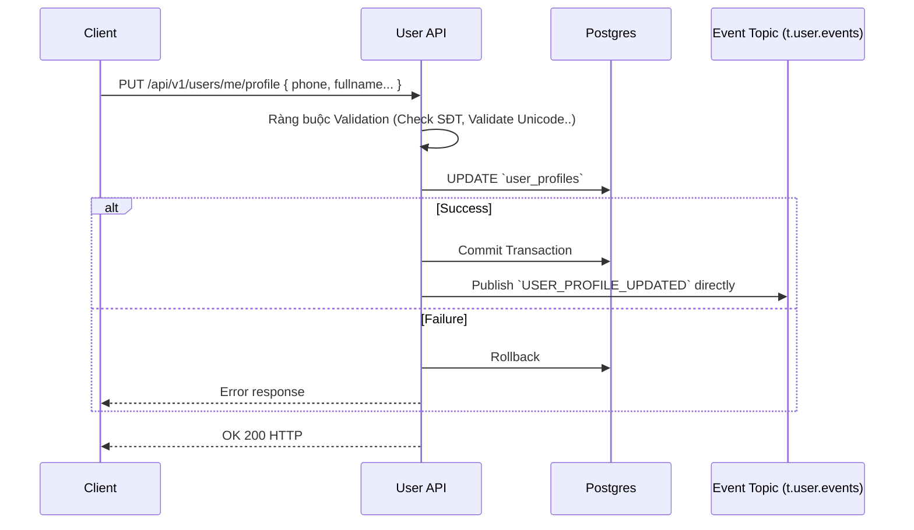

**Lưu ý xử lý nghiệp vụ:**
* Nếu `phone_number` trùng với user khác (vi phạm unique), API trả lỗi 409 Conflict với thông điệp nghiệp vụ rõ ràng.
* Sử dụng direct Kafka publishing: sau khi DB UPDATE thành công, UserEventProducer publish trực tiếp lên Kafka topic `t.user.events`.
* Nếu publish thất bại, DB không rollback (eventual consistency qua retry/circuit breaker).

---

## 4. Luồng Quản Lý Preferences (Update Preferences)

User Service quản lý các thiết lập ứng dụng của người dùng. Dữ liệu này được đồng bộ sang Notification Service qua Kafka events.

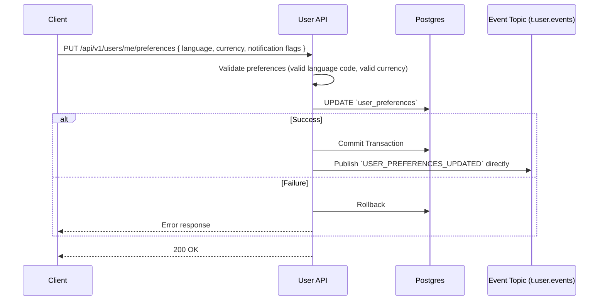

**Các trường Preferences:**
| Field | Giá trị mặc định | Mô tả |
|:------|:-----------------|:-------|
| `language` | `'vi'` | Ngôn ngữ hiển thị |
| `currency` | `'VND'` | Tiền tệ ưu tiên |
| `email_enabled` | `TRUE` | Bật thông báo qua Email |
| `in_app_enabled` | `TRUE` | Bật thông báo In-App |
| `marketing_enabled` | `TRUE` | Bật tin quảng cáo/khuyến mãi |

**Lưu ý:**
* Preferences được tạo mặc định khi User Service nhận `USER_VERIFIED_SUCCESS` (Workflow 1).
* Notification Service tiêu thụ `USER_PREFERENCES_UPDATED` để sync preferences cho việc gửi thông báo.

---

## 5. Luồng Cung Cấp Dữ Liệu Cho Chat Service (Event-Driven Projection)

Chat Service duy trì bản sao thông tin user (Name) trong DB nội bộ thông qua Event-Driven Projection.

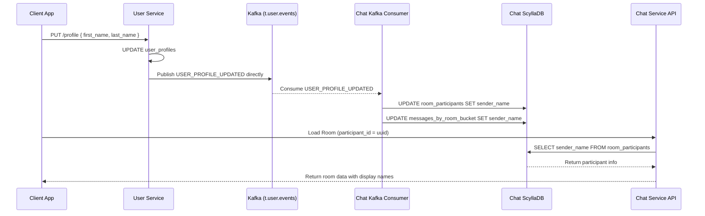

**Lưu ý kiến trúc:**
- Chat Service **KHÔNG** gọi trực tiếp User Database.
- Tất cả dữ liệu user được đồng bộ qua Kafka events.
- Nếu Chat Worker chưa xử lý kịp, Chat Service có thể fallback gọi User Service qua gRPC để lấy thông tin (tùy chọn).

---

## 6. Luồng Xóa Tài Khoản (GDPR 2-Giai Đoạn)

Khi Auth Service phát sự kiện `USER_DELETED`, User Service thực hiện xóa theo 2 giai đoạn để tuân thủ GDPR:

| Giai đoạn | Thời điểm | Mô tả |
|:----------|:-----------|:-------|
| **Giai đoạn 1: Anonymize** | Ngay khi nhận event | Anonymize PII, publish `ACCOUNT_DELETED` cho downstream |
| **Giai đoạn 2: Hard Delete** | Sau 90 ngày (`retention_window_expires_at`) | Compliance Worker xóa vĩnh viễn dữ liệu |

> **Tại sao cần 2 giai đoạn?**
> Kafka không phải permanent storage (mặc định retention 7 ngày). Bảng `user_deletions` đóng vai trò Event Store để Compliance Worker có thể truy vấn và xóa vĩnh viễn sau 90 ngày.

### 6.1. Giai đoạn 1: Anonymize (Ngay lập tức)

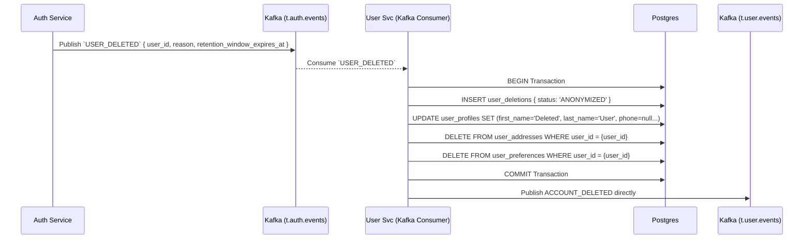

**Thứ tự xử lý:**
1. INSERT vào `user_deletions` với `status = 'ANONYMIZED'`
2. UPDATE `user_profiles`: anonymize PII (tên → "Deleted User", SĐT → null)
3. DELETE `user_addresses` (Order Service đã snapshot vào bảng `orders`)
4. DELETE `user_preferences`
5. COMMIT transaction
6. Publish `ACCOUNT_DELETED` trực tiếp lên Kafka qua UserEventProducer

### 6.2. Giai đoạn 2: Hard Delete (Sau 90 ngày)

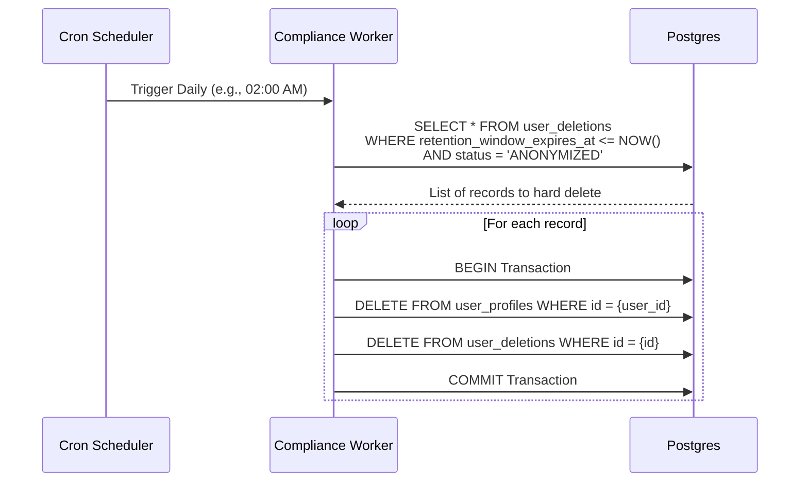

**Hành động của Compliance Worker:**
1. Chạy định kỳ (recommend: daily lúc 02:00 AM)
2. Query các bản ghi có `retention_window_expires_at <= NOW()`
3. HARD DELETE `user_profiles` (bảng cha, sau khi đã anonymize thì không còn PII)
4. DELETE bản ghi trong `user_deletions`

**Lưu ý:**
- `user_addresses` và `user_preferences` đã bị DELETE ở Giai đoạn 1 (không cần xóa lại)
- Hard Delete chỉ cần xóa `user_profiles` vì FK relations đã được cascade

---

---

## 7. Luồng Đọc Hồ Sơ Trực Tiếp (Read Profile - No Cache)

Hồ sơ user được đọc trực tiếp từ Database mà không qua cache vì:
* Dữ liệu profile ít thay đổi nhưng tần suất đọc không cao như address (checkout)
* Việc cache profile không mang lại lợi ích đáng kể về hiệu năng

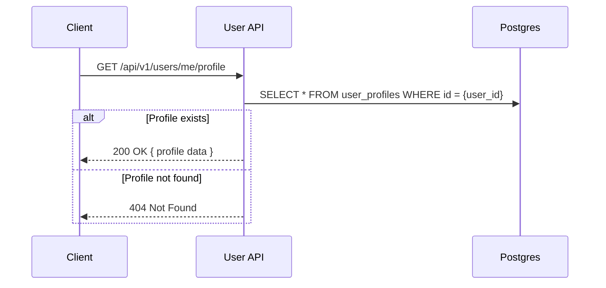

---

## 8. Tổng Kết Luồng Sự Kiện (Events Summary)

### Event Flow Diagram

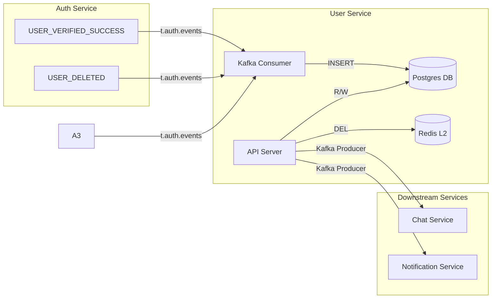

### Bảng Mapping Events và Workflows

| Event | Source | Target | Workflow |
|:------|:-------|:-------|:---------|
| `USER_VERIFIED_SUCCESS` | Auth Service | User Service | #1 Profile Creation |
| `USER_DELETED` | Auth Service | User Service | #6.1 Account Deletion (Anonymize) |
| `USER_PROFILE_UPDATED` | User Service (Kafka Producer) | Chat Service | #3 Profile Update |
| `USER_PREFERENCES_UPDATED` | User Service (Kafka Producer) | Notification Service | #4 Preferences Update |
| `ACCOUNT_DELETED` | User Service (Kafka Producer) | Review Service, Notification Service | #6.1 Account Deletion (Notify Downstream) |

### Workers Summary

| Worker | Trigger | Frequency | Mục đích |
|:-------|:--------|:-----------|:---------|
| **GDPR Deletion Consumer** | Kafka (`t.auth.events`) | On-demand | Consume `USER_DELETED`, anonymize PII, publish `ACCOUNT_DELETED` |
| **Compliance Worker** | Cron Scheduler | Daily (02:00 AM) | Hard delete records where `retention_window_expires_at` passed |

### Cache Strategy Summary

| Data | Cached? | Key Pattern | TTL | Purpose |
|:-----|:--------|:------------|:----|:--------|
| **Addresses** | ✅ Yes | `user:caches:addresses:{user_id}` | 12h | Checkout optimization |
| **Profile** | ❌ No | - | - | Direct DB read |
| **Preferences** | ❌ No | - | - | Direct DB read |
