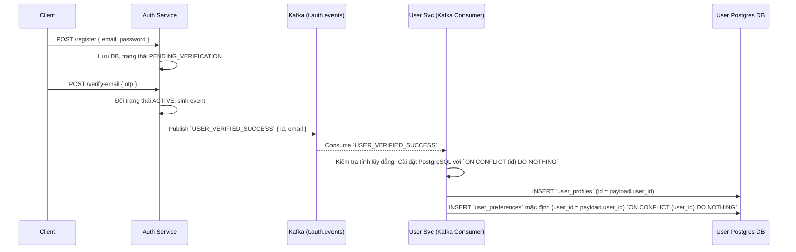
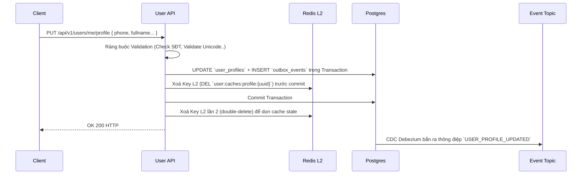
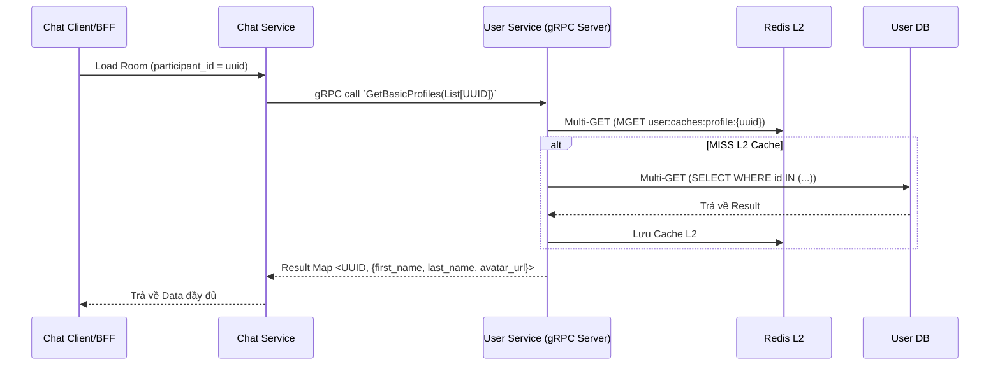

# User Service - Trình Tự Nghiệp Vụ (Workflows)

**Liên kết nhanh:**
*   [Workflows (API & Data Flow)](user_workflows.md)
*   [Caching Schema (Redis)](user_caching_schema.md)
*   [Database Schema](user_db_design.md)
*   [Events Structure & Kafka Topics](user_events.md)

---
Tài liệu này mô tả 3 luồng công việc (workflows) cốt lõi của User Service nhằm xử lý hồ sơ nhân khẩu học, khởi tạo dữ liệu sau đăng ký và cung cấp dữ liệu cho các hệ sinh thái khác (Order, Chat, Notification).

## 1. Luồng Khởi Tạo Hồ Sơ (Event-Driven Profile Creation)

Như đã phân tích, hệ thống tách biệt Auth Service và User Service. Khi Auth xử lý thành công bước đăng ký, Auth đẩy thông điệp sang Kafka và User Service sẽ dùng Worker để tạo vỏ hồ sơ.

**Nguyên tắc xử lý:**
* Luồng này đảm bảo độ phản hồi API `/verify-email` phía Auth cực nhanh vì không phải đợi User Service Insert.
* Nếu User Service bị down (sập), thư Kafka `USER_VERIFIED_SUCCESS` vẫn nằm chờ. Khi User Service hồi sinh (restart), nó đọc tiếp thông điệp và bổ khuyết Data.

## 2. Luồng Quản Lý Sổ Địa Chỉ (Address Management - Hard Delete & Set Default)

Order Service yêu cầu dữ liệu Snapshot, nên User Service áp dụng **Hard Delete** (xóa thẳng từ CSDL) nhằm nhẹ gánh cho Database.

### Quy trình Set Default (Address Rotation)
Khi User chọn "Đặt làm địa chỉ mặc định":

1.  Client POST `/api/v1/users/me/addresses/{address_id}/default`.
2.  Server mở Database **Transaction**.
3.  Lệnh 1: Update tước cờ default cũ (nếu có). 
    `UPDATE user_addresses SET is_default = FALSE WHERE user_id = {user_id} AND is_default = TRUE;`
4.  Lệnh 2: Bật cờ cho Address ID được chọn.
    `UPDATE user_addresses SET is_default = TRUE WHERE id = {address_id} AND user_id = {user_id};`
5.  Lệnh 3 (Nội bộ): Ghi log sự kiện thông qua Outbox Database (Debezium CDC pattern).
6.  Commit Transaction gốc thành công. Sinh event `USER_ADDRESS_UPDATED`.
7.  Hủy lệnh ở Redis: `DEL user:caches:addresses:{user_id}`.

### Quy trình Xóa Sổ Giao Hàng (Hard Delete)
1.  Client DELETE `/api/v1/users/me/addresses/{address_id}`.
2.  Server kiểm tra ID này có thuộc về `user_id` hiện tại không (Tránh Hack chỉ xóa ID nhà người khác).
3.  Server kiểm tra số lượng địa chỉ còn lại của user.
    * Nếu địa chỉ đang xóa là **default** và **không còn địa chỉ nào khác** -> trả lỗi 409 "Không thể xóa địa chỉ mặc định duy nhất".
    * Nếu địa chỉ đang xóa là **default** và **còn địa chỉ khác** -> tự động chọn 1 địa chỉ khác làm default trong cùng transaction.
4.  Lưu sự kiện ra Outbox Table DB để chuẩn bị xuất bản (Event `USER_ADDRESS_DELETED`).
5.  Tiến hành **DELETE XÓA CỨNG** bản ghi khỏi Postgres. Commit Database.
6.  Debezium sẽ quăng message Kafka cho Audit, Shipping, Logistics v.v..
7.  Clear Cache Toàn Mạng Bị Lỗi Stale bằng cách: xóa Redis L2 (`DEL user:caches:addresses:{user_id}`) (áp dụng double-delete nếu cần).

## 3. Luồng Cập Nhật Hồ Sơ Của User (Update Profile)

Chức năng then chốt của Hệ thống để đồng bộ hiển thị và giải quyết triệt để Cache Invalidation diện rộng. 

Tất cả các thành phần Analytics, Audit hoặc hệ thống Data Lake có thể đọc được cấu trúc cập nhật qua `t.user.events`.

**Lưu ý xử lý nghiệp vụ:**
* Nếu `phone_number` trùng với user khác (vi phạm unique), API trả lỗi 409 Conflict với thông điệp nghiệp vụ rõ ràng.

## 4. Luồng Cung Cấp Dữ Liệu Cho Chat Service / API Gateway (gRPC Profile Pulling)

Chat Service giữ `uuid` khách hàng nhưng không có tên/ảnh. Để Chat render UI nhanh nhất, cần luồng cấp dữ liệu tối ưu qua Cache. Không áp dụng Masking để tiết kiệm cycle CPU.

    ## 5. Luồng Xóa Tài Khoản (GDPR / USER_DELETED)

    Khi Auth Service phát sự kiện `USER_DELETED` (hoặc Admin xóa vĩnh viễn), User Service phải dọn sạch PII.

    1.  Kafka Consumer nhận `USER_DELETED`.
    2.  Mở Transaction và xóa theo thứ tự: `user_addresses` -> `user_preferences` -> `user_profiles`.
    3.  Commit thành công.
    4.  Xóa cache L2 tương ứng (`user:caches:profile:{id}`, `user:caches:addresses:{id}`, `user:caches:preferences:{id}`).
